# Brood v Brood, coached (brood-v-brood-coach)

The owner (2026-11-11 22:35): every matchup COACHED and FILMED "with the same level of scrutiny and attention" as the Crown v
Brood job. This is the Brood mirror: both sides are the Hard Brood computer (scripts/ai_brood_new.gd), OPTIMAL against
OPTIMAL. Coaching as a human coach does it: film real games, watch them, name each mistake with its time and a picture,
find the decision behind it in the code, fix that decision, replay the same seed and check the mistake is gone.

No unit, building or economy number was changed. Every fix is the computer's play and is GATED to the mirror (the enemy
is the Brood) unless said otherwise.

## The tool

`tools/shot_brood_mirror.gd` (new): two Brood computers on any map and seed, filmed and logged.

    xvfb-run -a godot --rendering-driver opengl3 --fixed-fps 30 --script res://tools/shot_brood_mirror.gd -- \
        map:greenhold seed:1 out:/abs/dir [end:900] [sa:optimal] [sb:optimal] [shots:1] [every:30]

It writes `lines.txt` (every 30 s per side: food, spoils, income earned, supply, grubs, eggs, army by kind and value, the
Mother's stage, health and rooting, its rooted creatures, value killed and lost, the computer's plan, wave, defence squad,
attack_at and the enemy army it has seen), `story.txt` (both computers' own lines), `log.txt`, `result.txt`, and
pictures: the whole map and each Mother every minute, every fight of 4+ creatures a side (at most every 20 s), a Mother
under 70% health. A 15:00 game takes about 5 minutes with pictures on this machine (two at a time).

Maps: Greenhold (crossroads), Highmoor (highlands), Hollowfen and Kestrel Rise (hand-made), Twin Fords (rivers) for the
measuring batch. (Dune Sea was dropped after round 2: it is Greenhold's crossroads layout in the desert biome, the same
geography, and its games were the same as Greenhold's minute by minute.)

## Round 1: 0.33.16 as it is (Greenhold, Dune Sea, Hollowfen, Kestrel Rise; seed 1)

| map | result | P1 picks | P2 picks | income at 8:00 (P1 / P2) | grubs at 8:00 |
|---|---|---|---|---|---|
| Greenhold | draw at 15:00 (P2's Mother dying) | 1:40 Rush, 3:06 Balanced | 1:50 Rush, 3:06 Balanced | 2,803 / 2,788 | 16 / 12 |
| Dune Sea | P2 wins 14:56 | 1:40 Rush, 3:02 Balanced | 1:41 Rush, 3:02 Balanced | 3,471 / 2,547 | 25 / 20 |
| Hollowfen | P2 wins 11:43 | 1:48 Rush, 3:36 Balanced | (no read, Balanced) | 3,703 / 7,928 | 10 / 54 |
| Kestrel Rise | P1 wins 13:25 | (no read, Balanced) | (no read, Balanced) | 9,684 / 9,574 | 53 / 53 |

For scale: the QA study's Brood earned 5,842 by 8:00 on average against every opponent.

### Coach's notes

Greenhold (the clearest game; Dune Sea played the same):
- 0:00 both root a Mound Turtle 22 tiles out (their standard opening), 0:40 a grub to the enemy's main.
- 1:40 / 1:50 both read the other GREEDY, "no army and no production at its base", and pick the Rush. Neither was
  greedy: this is the Brood's normal opening (no production building exists; the Tyrant Sire comes at 2:00-3:00).
- 2:49 / 2:50 both Raptor rushes (10) leave at the same second and cross. 3:06 both read AGGRESSIVE "a Horse Breeder or
  riders early" and switch to Balanced: the enemy's RAPTORS were taken for Horsemen.
- 3:06 to 15:00: 34 lines of "riders in its land", "guards its grubs with N against M riders, no chase", "a Rootmaw
  under attack uproots to back off": the anti-Horseman lockdown (grubs run to the warriors, warriors guard and never
  chase, Raptors laid until the "riders" are matched, waves wait while it is "short of warriors against the riders").
  Picture: the Mother's clutch full (Eggs 10/10) at 4:37 while the food is spent on Raptors that stand guard.
- Economy flat for five minutes: 8 grubs at 5:00, 16 at 8:00, 2,800 earned by 8:00. Stage 2 only at 9:33 / 10:34.
- 10:09 P2's first real wave is 43 Raptors and nothing else; 11:16 P1's 24.

Hollowfen: P1 read GREEDY and rushed, then sat in the rider lockdown (stage 2 at 9:42); P2 never got a read, played
Balanced, earned twice as much (7,928 at 8:00, 54 grubs), had stage 3 by 7:24, and its Spitters and Raptors killed P1's
Mother at 11:43. Kestrel Rise: neither read anything early, both played Balanced and both economies were healthy (9,700 at
8:00); there the problems were the attacks (round 2).

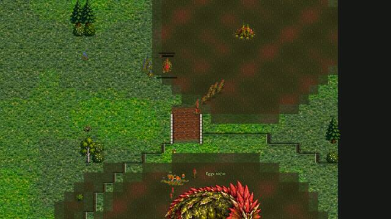
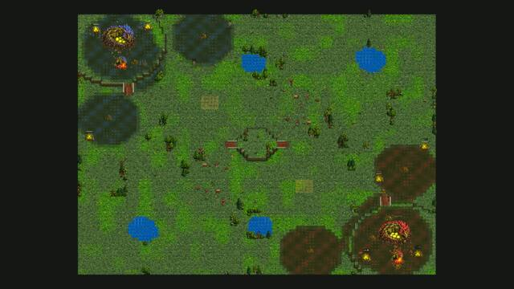

### The biggest mistakes (both sides: it is the same computer)

1. **1:40, the read of the Brood's normal opening as GREEDY** (AIBroodNew._nb_read): "no army and no production at its
   base" and "a second base and little army" are true of every Brood opening (no production building; a turtle on new
   ground at 0:00). OPTIMAL then punishes "greed" with a Rush into an opponent who is not greedy, and the Rush makes the
   Rush's own economy (9 grubs).
2. **3:06, the enemy's Raptors read as riders** (AIBroodNew.is_rider: speed 95 or more, melee, not one of the Brood's
   OWN rooting kinds; a Raptor runs at 96). Every Raptor wave set off the brood-anti-riders answer to a Horseman rush for
   the rest of the game: grubs off work, warriors on guard, no chase, Raptor eggs instead of grubs, waves held back. This
   is the single biggest mistake: the economy at 8:00 was a third of the healthy games'.
3. Stage 2 at 9:30-10:30 instead of 4:20-5:00, and the first real wave at 10:00 (both follow from 2).

## Round 2: fixes 1 and 2 (same seeds)

Fix 1 (first try): against another Brood, greed is a third base early or no Sire seen by 3:30.
Fix 2: `is_rider` is false for every Brood unit (a Raptor is a warrior, met by the swarm defence).

| map | result | P1 | P2 | income at 8:00 | grubs at 8:00 |
|---|---|---|---|---|---|
| Greenhold | P1 wins 13:17 | 3:30 GREEDY, Timing | 4:05 GREEDY, Timing | 9,693 / 9,203 | 43 / 45 |
| Dune Sea | draw | (as Greenhold) | | 9,705 / 9,302 | 43 / 45 |
| Hollowfen | draw | 3:30 GREEDY Timing, 6:03 Economy | Balanced | 7,630 / 9,374 | 48 / 54 |
| Kestrel Rise | draw | Balanced | Balanced | 9,735 / 9,745 | 54 / 53 |

The lockdown is gone (0 rider lines in all four games) and the economies are three times bigger at 8:00 (9,200-9,700,
43-54 grubs; stage 2 at 4:21-6:01).

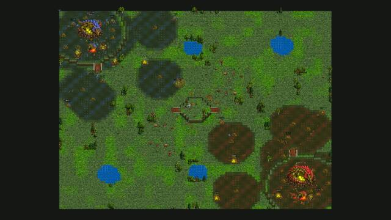

### Coach's notes, round 2

- The "no Sire seen by 3:30" half of fix 1 still read GREEDY on three maps: the Sires root beside the Mother out of the
  watching grub's sight. Greenhold P1 then played the Timing attack: 5:56, 23 Raptors into an army of 600; it lost 425
  and killed 150 (thrown away).
- **THE BASE TRADE** (Kestrel Rise, both sides): both waves leave at the same second, 6:30 (30 supply) and 8:35 (81
  supply), and walk past each other. Each wave razes the other's Rootmaws and turtles while the other's eats its grubs
  at home; at 9:11 P1 pulls back with 495 of 2,155 and P2 at 7:10 with 270 of 1,230. Neither army ever fought the
  other. A human sees the enemy army leave (the watching grub sees it: the ALARM line fires the moment its own wave is
  home) and meets it, at home if need be, where the swamp, the Sires and the fresh eggs help.

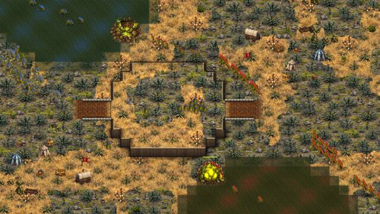
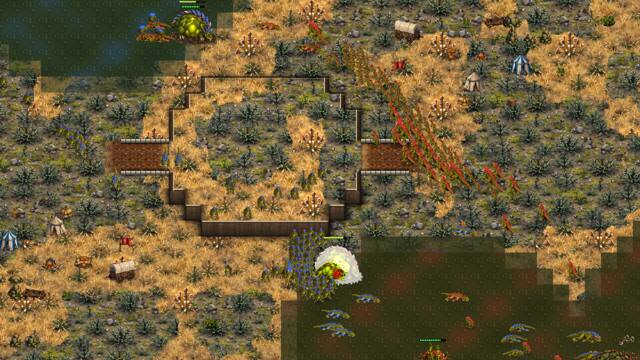

Fixes for round 3:
- Fix 1 (final): only a third base early with little army seen is greed against another Brood (_nb_brood_greedy).
- Fix 3, the meeting (AIBroodNew._nb_meet_army, called from _nb_wave_tick): against another Brood, while its wave is
  still on the road (more than 18 tiles from its goal), an enemy army worth 40% of the wave or more, seen nearer its
  Mother than the wave is (and not beside the wave), becomes the wave's target: it turns and meets it.

## Round 3: fixes 1 (final), 2 and 3 (Greenhold, Highmoor, Hollowfen, Kestrel Rise; seed 1)

| map | result | income at 8:00 (P1 / P2) | waves P1 | waves P2 | meetings |
|---|---|---|---|---|---|
| Greenhold | P1 wins 13:39 | 9,825 / 9,683 | 6:30 23, 9:19 119 | 6:30 23, 7:38 44, 9:15 71 | 9:42 (P2) |
| Highmoor | P1 wins 12:57 | 9,772 / 9,461 | 6:30 25, 9:54 134, 11:40 124 | 6:30 25, 9:47 119 | 6:48 (both), 10:06 (P1) |
| Hollowfen | P1 wins 13:44 | 9,033 / 9,144 | 6:44 23, 11:46 109 | 8:47 84 | - |
| Kestrel Rise | draw (P2 far ahead) | 9,598 / 9,743 | 6:30 30, 8:10 38 | 6:30 30, 8:22 72, 12:59 46 | 6:53 (P1), 7:01 (P2), 8:40 (P1) |

No GREEDY read in any game now (all NORMAL: both play Balanced), no rider line. Three of four games decided. The
meeting fires: on Highmoor at 6:48 both waves turned onto each other and fought in the middle; on Kestrel Rise at 6:53
and 7:01.

### Coach's notes, round 3

- **THE QUEEN NOT FINISHED** (Greenhold): P1's 119-supply wave (109 Raptors) broke P2 at 9:54 (P2 called its own wave
  home, "an attack at the Mother (2,300)"). P2's Mother then stood UP at 534 (11:00), 333 (12:00), 463 (13:00) of 2,400
  health with 60 to 120 of P1's Raptors in her base, and lived until 13:39. The pictures show why: the Raptors on
  attack-move bite whatever is nearest, her fresh eggs and hatchlings (her clutch was full, 20 of 20, she laid all the
  time), her grubs and her Sires, while she heals. Five Raptors on her would take 100 health a second. A human player
  kills the Mother: it is the game.
- **THE SIRES ALL GET UP AND NOTHING IS LAID** (Highmoor, P2, also Greenhold and Kestrel Rise): from 11:00 P2's three
  Sires stood up to defend her ("defends with 3 (1 tyrannosaur, 1 dilophosaurus, 1 pterodactyl)"). A warrior egg needs
  its Sire rooted beside her, so no egg was laid for two minutes while the food went from 722 to 1,597 and her clutch sat
  full (15 of 15). The Sires died one by one and grubs were turned into new lures (12:24 "a grub goes to grow the Tyrant
  Lure"). The Mother fell at 12:57 with 1,597 food in the bank. Thirty Raptors from that bank, hatched in 11 seconds,
  would have done more than three Sires' bites.
- On Kestrel Rise P1 lost its army in the 8:10 and 8:22 waves and never rebuilt it: from 11:00 to 15:00 its army was its
  three Sires, its income grew by 400 a minute (its Rootmaws razed one by one) and P2, far ahead (23,100 earned against
  14,900), did not finish it (the same Queen problem: P2's waves bit eggs and Sires and went home at 25%).

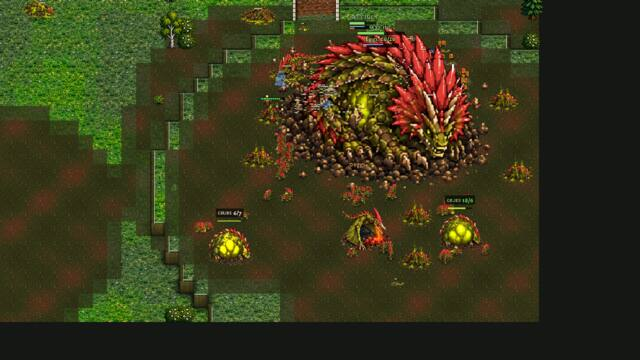
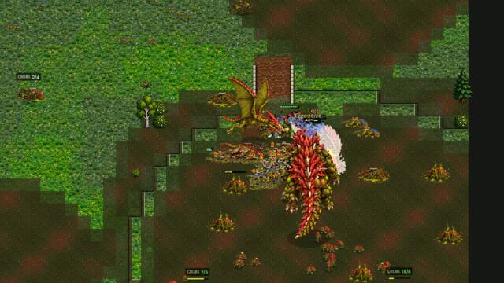
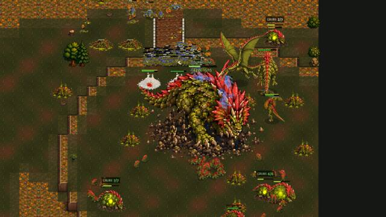

Fixes for round 4:
- Fix 4, the Queen hunt (AIBroodNew._nb_queen_hunt, called from _nb_wave_tick): against another Brood, a wave within 14
  tiles of the enemy Mother that it sees, with the upper hand there (the enemy warriors within 8 tiles of her worth under
  70% of the wave, or her health under half), sends every creature that is not biting an enemy warrior beside it at her
  (every 2 s).
- Fix 5, the laying Sire stays (AIBroodNew._nb_sire_stays, used by _nb_one_father and _nb_defend): against another Brood,
  while her clutch holds 3 eggs or more and the food for 3 of his warriors is there, the Sire of the quickest line (the
  Tyrant Sire, else the Venom Sire) keeps his nest when an attack comes to her; the other Sires may still get up. And no
  food is kept back for her next stage while an enemy army is at her (_nb_growth_keep, mirror only).

## Round 4: fixes 1 to 5 (same seeds)

| map | result | income at 8:00 | notes |
|---|---|---|---|
| Highmoor | P1 wins 12:03 (round 3: 12:57) | 9,902 / 9,464 | P2 spends its food now (45, 36, 5 at 10:30-11:30, against 722-1,597 banked in round 3) |
| Greenhold | draw, even (both 200/200, armies 3,735 / 3,645) | 9,830 / 9,723 | four even trades; the game diverged from round 3 at 7:00 |
| Hollowfen | P2 wins 11:12 (round 3: P1 13:44) | 8,996 / 9,152 | P1's 82 met P2's 94 in the field at 9:10 and lost |
| Kestrel Rise | draw (P1 ahead, 25,400 earned to 19,300) | 9,598 / 9,744 | meetings at 6:53, 7:01, 10:18, 10:23 |

The Queen hunt did not fire once: the wave's middle (averaged over a hundred creatures and their stragglers) was rarely
within 14 tiles of the enemy Mother. Changed: the creatures of the wave that are near her count, and they are the ones
sent.

### Coach's notes, round 4

- **THE COLUMN** (Hollowfen 9:04, P1): P1's wave of 82 walked into P2's army of 94 as a column a screen long, single file
  along the path; its head fought alone while the tail was still crossing the marsh. It pulled back at 9:14 with 895 of
  2,090 (killed 1,390) and the game was lost from there. A human closes the army up before the fight.

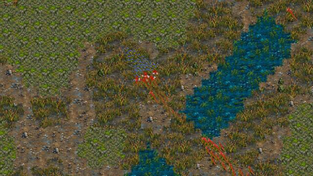

Fix 6, the wave closes up (AIBroodNew._nb_wave_gather): against another Brood, a wave on the road that sees an enemy army
worth 40% of it or more within 15 tiles of its head (but not yet within 5: no backing off mid-fight), with under 60% of
its supply within 7 tiles of its head, gathers on its middle (the head waits, the tail comes up) until 80% is together,
for at most 10 s or until it is attacked, then goes at that army on attack-move. Once per 40 s.

## Round 5: fixes 1 to 6 (Greenhold 1, Kestrel Rise 1; Highmoor 2, Hollowfen 2)

(The first pair ran before fix 6 was in.)

| map | result | notes |
|---|---|---|
| Kestrel Rise 1 | P2 wins 12:32 (rounds 3 and 4: draws at 15:00) | the Queen hunt: 9:26 "goes for the enemy Mother with 16", her health 2,190 (9:58), 923 (10:37), 471 (11:08), 146 (12:23) |
| Greenhold 1 | draw | even game |
| Highmoor 2 | draw, P1 far ahead | see below |
| Hollowfen 2 | P2 (Economy) wins 9:33 | the Queen hunt with 70 at 9:16: the Mother died in 17 s |

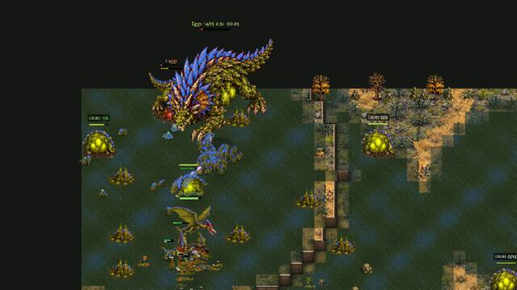

### Coach's notes, round 5

- **THE ENDLESS TRICKLE** (Highmoor seed 2, P1): a wave of 23 supply left at 6:30 and was still "attacking" at 15:00,
  70 to 90 Raptors fed in by groups of 6 supply into P2's ramp, where a rooted Mound Turtle closed the way, the Mother
  stood up at the top and the Sires bit. P2 killed 13,750 and lost little; P1 sat on 1,000 to 2,900 food, its waves
  never home to gather. The reason in the code: _nb_wave_tick reckons a wave's losses against the value that LEFT
  (`_wave_v0`, 575), and the reinforcements (_nb_join_fresh) kept "what is left" above it, so no retreat rule could
  ever fire. At 13:51 P2's Mother sat untouched with her clutch full while P1's army was stuck at the ramp.
- The other side of it: waves that were winning went home at a quarter of their size even with nothing left ahead
  (Kestrel Rise round 3, 12:36: 575 of 2,340 left, 6,205 killed, 0 ahead), and the beaten side lived to 15:00.

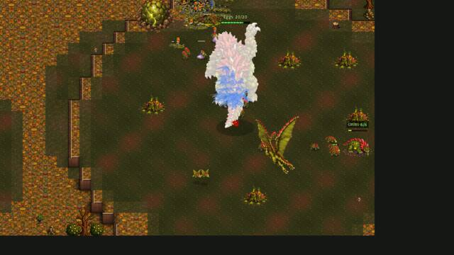
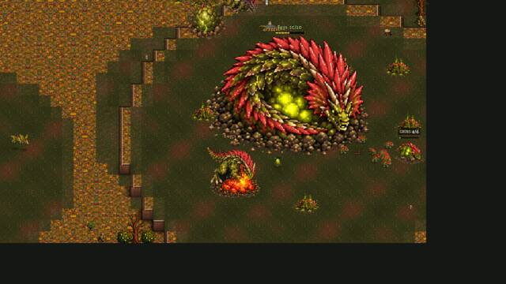

Fix 7, the wave's sums (in _nb_join_fresh and _nb_wave_tick, mirror only): reinforcements add their value to what went
out (`_wave_v0`), so the retreat rules see the real losses; and a wave down to a quarter goes on while it has killed at
least what it lost and sees no more than itself ahead.

## Round 6: fixes 1 to 7 (the seeds of the mistakes: Highmoor 2, Hollowfen 1, Greenhold 1, Kestrel Rise 1)

| map | result | before (the round the mistake was named) | now |
|---|---|---|---|
| Highmoor 2 | P1 wins 13:15 | round 5: a draw, P1's wave of 6:30 "attacking" to 15:00, 13,750 killed by the defender | the wave pulls back at 8:42 (725 of 3,290 left), gathers, goes again at 11:31 with 134; 12:06 "goes for the enemy Mother with 43", 13:06 with 86 |
| Hollowfen 1 | draw, even | round 4: P1's column eaten at 9:04, P2 wins 11:12 | 10:48 "its wave closes up before it meets an enemy army of 1,265 (16 of 38 supply at its head)"; three even trades |
| Kestrel Rise 1 | draw, even (both at 200 supply) | round 2: the base trade at 6:30 and 8:35 | 6:44 / 6:47 both waves close up and meet in the middle; 8:40 the armies fight face to face |
| Greenhold 1 | draw, even (both at 200 supply) | round 3: the Mother not finished; round 4: even | even to the end |

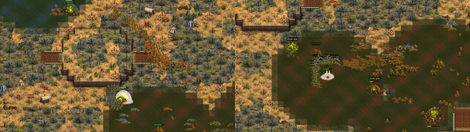
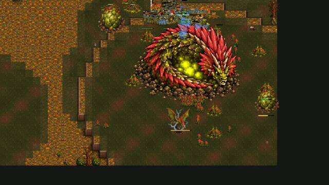

(Also as a gif: shots/brood-v-brood-coach/kestrel_base_trade_before_after.gif.)

### Coach's notes, round 6

- Every mistake named above is gone on its own seed. The games left are even games: the same computer on both sides on
  a mirrored map, both at 9,500-10,000 earned at 8:00 and at the supply cap from about 13:00, with waves of 100-135
  supply trading in the middle. A draw at 15:00 between two live armies of 4,000 is the honest result of an even
  mirror; the draws of rounds 1-3 were dead games (a Mother at a fifth of her health, a side with no army for four
  minutes) and those are the ones that no longer happen on these seeds.
- What I still see and did not change: a Brood at the cap banks food (Kestrel Rise P1 2,117 at 15:00, Highmoor 2 P1
  1,244 at 8:00): the Mother's laying, not food, is the limit (her eggs), and the computer's RICH branch already sends
  the extra food to maturing, Brutes and research. Waves are mostly Raptors (75-110 of 120-135); Spitters are a fifth
  of the army at most (plan "mixed": one Spitter for two Raptors while the Venom Sire is beside her, but the Raptor line
  hatches faster).

(Measuring batch below.)

## What changed in the code (for the merges)

Everything is in `scripts/ai_brood_new.gd` (the Brood computer), plus three AI STORY rows (`scripts/ai_story_lines.gd`)
and their pt/es lines (`tools/i18n/49_spectator.txt`, built into `scripts/lang/`). Every new behaviour is gated by
`_foe_is("brood")` (the enemy is a Brood) except fix 2, which can only change anything when an enemy Brood unit is on
the field. No number of any unit, building or economy changed.

New functions (no other job's code calls them):
- `_nb_brood_greedy(halls, mil)`: the mirror's read of greed (fix 1).
- `_nb_meet_army(q, mid, left)`: the meeting (fix 3).
- `_nb_wave_gather(mid, left)`: the wave closes up (fix 6).
- `_nb_queen_hunt(mid, left)`: the Queen hunt (fix 4).
- `_nb_sire_stays(q, f)`: the laying Sire keeps his nest (fix 5).

Shared functions changed (each a few lines, each marked "brood-v-brood-coach" in a comment):
- `AIBroodNew.is_rider` (static): false for any unit of the Brood faction (fix 2). Only the Brood computer calls it.
- `_nb_read`: a GREEDY read of an enemy Brood is kept only if `_nb_brood_greedy` says so, else it reads NORMAL
  ("a standard opening", an existing translated phrase) (fix 1).
- `_nb_wave_tick`: calls `_nb_wave_gather`, `_nb_meet_army` (returning early while they steer) and `_nb_queen_hunt`
  before the written build's push; the "down to a quarter" retreat rule is held back against a Brood while the wave
  has killed at least what it lost and sees no more than itself ahead (fix 7).
- `_nb_join_fresh`: against a Brood the reinforcements' value is added to `_wave_v0` (fix 7).
- `_nb_one_father` and `_nb_defend`: a Sire for whom `_nb_sire_stays` is true is not got up or put in the defence
  squad (fix 5).
- `_nb_growth_keep`: against a Brood, no food is kept for her next stage while a big enemy army is at her (fix 5).

The AI STORY gets three new lines: "%s turns its wave to meet an enemy army of %s heading for its Mother.", "%s's wave
goes for the enemy Mother with %s creatures.", "%s's wave closes up before it meets an enemy army of %s." (pt and es
in tools/i18n/49_spectator.txt).

The tool: `tools/shot_brood_mirror.gd` (new; `fa:`/`fb:` pick other factions for the check batches, then the lines have
no Mother and the AI fields read -1 where that computer has none).
