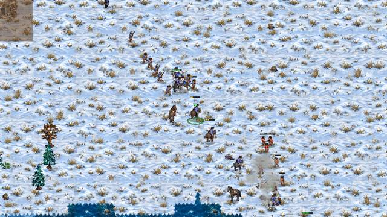
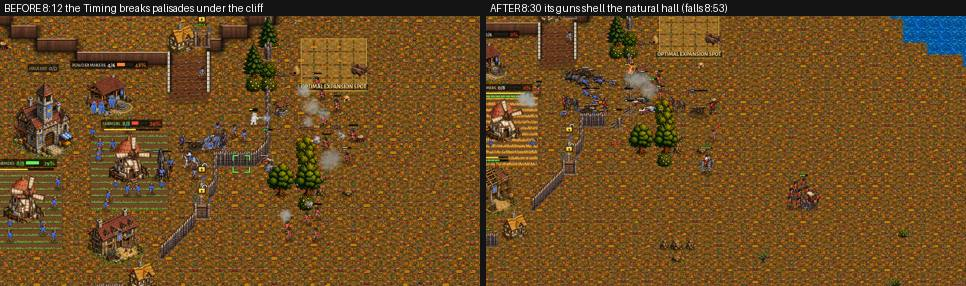
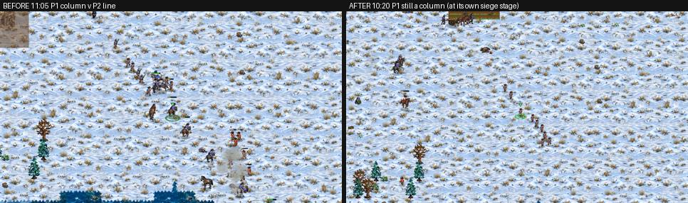
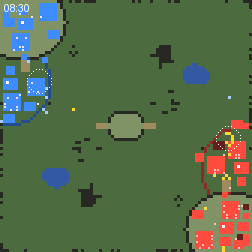
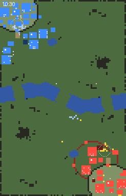

# crown-v-crown-coach: the Crown mirror, coached and filmed

The owner (2026-11-11 22:35) asked for every matchup to be COACHED and FILMED "with the same level of scrutiny and
attention" as the Crown v Brood job. This is the Crown mirror: Hard Crown OPTIMAL against Hard Crown OPTIMAL. Coaching as a
human coach does it: film real games, watch them, name each mistake with its time and a picture, find the decision behind
it in the code, fix that decision, play the same seed again and look at the same moment.

Rules followed: docs/design_principles.md (1 fairness: a mirror must be decided by play, 2 anti-snowball: the defender's
advantage early that FADES so a winner can finish, 4 epic battles that carry the weight of the match) and the owner's Crown
rules in CLAUDE.md (Foundry before the 2nd Barracks, 3 Field Cannons before any Mortar, the walled natural with its gate
toward the ramp, the army at the gate, OPTIMAL picks by read). No unit, building or economy number was changed.

**Everything new is gated to the mirror** (the Crown computer facing a Crown, Normal and up: `AICrown.mirror()`), lives in a
new file, `scripts/ai_crown_mirror.gd` (class `AICrownMirror`), and is switched off with `-- mirror:off` for comparison
games. The shared code only calls in (section "Shared functions changed").

**In short.** Five coaching rounds on twelve maps (8 games filmed with the camera, every game with a map picture every
15 s). The Crown computer in the mirror now marches its waves as one and forms up before an enemy army, brings its Field
Cannons up to shell a walled Town Hall over its wall (and holds its line out of reach while they do), answers a lone
raider among its labourers with Musketeers, keeps its farms crewed before its Powder Mills, keeps the Timing attack's
timing, lets no small raid keep its Siege push home, and hunts a beaten enemy over a token army, halls first. Measured on
the same 16 games: a won field now turns into enemy halls 60% of the time (36% on main), 1.9 halls fall a game (1.2), the
armies stay closer at 10:00; but the games still mostly run to 15:00 (2 of 16 decided, as on main): a Crown's main on its
plateau rarely falls by then. The other matchups are untouched (all of it is gated to the mirror).

## Tools

- `tools/film_coach.gd` (new): `tools/qa_match.gd`'s measured match (result.json, story.txt, log.txt) plus
  - a MAP picture every 15 s (`map_MMSS.png`, 3 px a cell, works headless): high ground lighter, water blue, each side's
    buildings in its colour (walls and gates darker, sites dark), soldiers as bright dots (P1 light blue, P2 yellow), workers
    as small pale dots, each army's centre as a white ring;
  - a coach's line every 15 s (`coach.txt`): per side its plan, bank, labourers and what they do, army value and kinds,
    halls, the wave (its men, where, how spread out, the siege piece), the army's centre and its distance from both mains;
  - with `shots:1` under xvfb: camera pictures of each army every 30 s (`focus:MMSS-MMSS` every 5-15 s), each hall every
    2 minutes and the fights.
- `tools/study/crown_v_crown_report.py`: the measuring table of a batch.

## The "before": 16 games on main (0.33.16)

Hard OPTIMAL v Hard OPTIMAL, 8 maps (Greenhold, Highmoor, Dune Sea, Red Coast, Thornwood Maze, Hollowfen, Frostmere,
Kestrel Rise), the QA study's two seeds of each (docs/qa_2026_11_08_matches), to 15:00.

| batch | games | decided (P1-P2) | P1 won or led | decided by | median length decided | army 8:00 | 10:00 | income 8:00 | 10:00 | lead ratio army 10:00 (median) | halls lost / game | waves / game | pull-backs / game | dominant minutes -> enemy hall lost in 3 min |
|---|---|---|---|---|---|---|---|---|---|---|---|---|---|---|
| before | 16 | 2 (1-1) | 7 | 2 before 15:00 | 13:56 | 738 | 1249 | 5130 | 7944 | 1.52 | 1.2 | 2.6 | 1.2 | 61 -> 22 |

In short: **the mirror does not end** (14 of 16 draws). A side with an army 1.8 times the other's (and 800+) for a minute
saw an enemy hall fall in the next three minutes only 22 times in 61 such minutes. Every opening read was UNKNOWN (the
Crown walls its ramp at 0:22 and the scout sees nothing; OPTIMAL then plays the NORMAL table), so the picks were
Balanced, Dragoon raids, Economy and Timing about equally.

## Round 1: the 16 games of main, four of them filmed

Coach's notes (P1 = the first start spot; times are game time; "army" is the value of the soldiers):

- **Frostmere 1148** (P1 Dragoon raids v P2 Balanced, filmed). P1's economy runs ahead (38 v 18 labourers at 11:00) and its
  army is ahead from 4:00 (230 v 0) to 11:00 (1,625 v 1,370), yet it first goes out at 10:49, twenty seconds after P2's
  wave left. The two waves meet in the open at 11:05: **P1 comes in a column** (Dragoons and Horsemen first, the Musketeers
  strung out behind, spread 7 tiles), P2 in a formed line of 15 Musketeers with a gun. 1,625 falls to 540 against 1,550 in
  fifteen seconds; P2's wave walks on and takes P1's main hall at 14:09. Pictures: `r1_frostmere_1100_p1_column.jpg`
  (P1's wave leaving its natural), `r1_frostmere_1105_column_v_line.jpg` (the meeting).
  
- **Hollowfen 1154** (Dragoon raids v Dragoon raids, filmed). Nobody attacks for 11 minutes (both raid with Horsemen, both
  build 40 labourers on four halls). P1's first wave (16 men) is spread 9 tiles at 11:30 and **14 tiles at 11:45** when it
  meets P2's (spread 8): 1,665 to 1,010 in thirty seconds (`r1_hollowfen_1146_trickle.jpg`, `r1_hollowfen_1206_scattered.jpg`).
  P2's own waves are strung over 29-40 tiles from 12:45 (reinforcements walking alone) but P1 has nothing left to punish it.
- **Highmoor 1143** (P1 Economy v P2 Timing, filmed). P2's timing goes at 7:28 with 1,470 against 295 into **P1's walled
  natural, which sits under P1's main cliff**: the musket line on the high ground and a gun behind the palisade
  (`r1_highmoor_0812_natural_under_cliff.jpg`, `..._0833...`). It trades about even and kills no labourer (P1 47 v P2 23
  labourers at 8:00); P1's economy wins the game, but from 12:15 P1's own waves trickle along the road one man at a time
  into P2's cliff line (`r1_highmoor_maps_1130_1430.jpg`: the light blue dots strung across the map).
- **Thornwood Maze 1136** (P1 Balanced v P2 Economy, filmed) and **Greenhold 1140** (Balanced v Dragoon raids): **the
  Balanced plan's economy stops**. After its opening (Powder Mill at 3:20) its milestones put a Foundry, a second Powder
  Mill and a Horse Breeder in at 14-15 labourers; the Mills take the hands (the crew follows the powder bank alone), the
  Farms stand half empty and the gold stops: Thornwood 1,900 earned at 4:00 and at 5:00, Greenhold 2,280 from 5:00 to 7:00.
  No soldier is trained (the Barracks stood from 1:25) and a single enemy Horseman (the Dragoon plan's scout, 4:15) rides
  through the labourers for three minutes: Greenhold 16 -> 3 labourers, the game lost at 13:06 (9:20 in the replay).
  `r1_thornwood_maps_economy_stall.jpg`.
- **Greenhold 1103** (Timing v Dragoon raids): P1's Timing army is 2.4 times P2's at 7:00 (1,515 v 640). In one replay it
  goes at 6:48, walks to P2's walled natural and pulls back at 7:42 having lost 10 for 0; **in another replay OPTIMAL turned
  the Timing attack into the Economy race at 6:31** on a late greedy read ("too late to punish: out-expand it") and the army
  sat at home on one hall.
- **Red Coast 1164** (Balanced v Economy -> Siege push, filmed): the Siege push trades even at 9:10-10:31 and then **stays
  home for four minutes with 2,050-2,880 of army** because "an enemy force (465) is at our buildings" (P1's riders at the
  edge of its base).
- The rest (Dune Sea, Red Coast 1127, Kestrel Rise, Thornwood 1173, Hollowfen 1191): the same shapes. A side ahead
  sits at home until a GO rule fires (often "no attack for 300-500 s"); waves go strung out; the defender's natural under its
  cliff holds; and a side that wins the field takes minutes to break palisade after palisade (Frostmere 1148: 14 palisades
  broken one by one from 12:11 to 14:12, the natural's hall at 13:17, the main never reached).

The biggest mistakes, and the decision behind each:

| # | mistake | seen | the decision (file, function) |
|---|---|---|---|
| 1 | the wave meets the enemy strung out (a column against a line) and reinforcements walk alone | Frostmere 11:05, Hollowfen 11:45, Highmoor 12:15 | AI._army (attacking): each idle man of the wave is sent to the target on his own; nothing keeps the wave together |
| 2 | the Mills take the farm hands, the gold stops | Thornwood 4:00-5:00, Greenhold 5:00-7:00 | AICrown._mill_feedback: after the opening the crew follows the powder bank only |
| 3 | no soldier against a lone raider among the labourers | Greenhold 4:15-7:50 | nothing trains a soldier for a raid: the Balanced plan's gold goes to milestones and walls; the shared defence has no army to send |
| 4 | the Timing attack is turned into the Economy race just as it is ready | Greenhold 6:31 | AIOptimal._punish: after TOO_LATE a greedy read is "out-expand it" for every plan |
| 5 | the Siege push stays home for a small raid | Red Coast 11:00-15:00 | AICrownSiege._maybe_go: any force of 250+ at our buildings holds it, whatever the push is worth |
| 6 | a won field takes minutes to turn into halls (palisade after palisade) | Frostmere 12:11-14:12, Highmoor 12:39-14:30 | AI._siege_plan / _enemy_base: looked at in round 2 |

The fixes (all in `scripts/ai_crown_mirror.gd` unless said, all only in the mirror):

1. **The wave marches as one** (`AICrownMirror.cohesion`, called from `AI._army` through the new virtual `AI._cohesion`):
   while no enemy soldier is within 300 px of the wave and no siege is on, a wave whose BODY (the men within 12 tiles of
   the one with the most others near him) is spread over 5 tiles stops: the head waits where it is (riders stop in the
   saddle), the tail walks up to the middle; with an enemy army in sight ahead (worth a quarter of the wave) it forms up
   tighter (3 tiles) before it walks into musket range. It goes on together at 2.2 tiles apart, or after 14 s; the next
   regroup waits 18 s. Stragglers far behind are called up and not counted (the first version counted a man still at the
   gate: "goes on together (27 tiles apart)").
2. **The farms before the Mills** (`AICrownMirror.farms_starved`, from `AICrown._mill_feedback`): with 30 powder in the bank
   and a Farm short of half its crew, the Mills give a hand back to the farms (never below one a Mill).
3. **The raider gets an answer** (`AICrownMirror.raid_answer`, from `AICrown._think_stage` stage 2, before the plan's
   gold is set aside): an armed enemy within 300 px of a labourer, and our soldiers within 700 px of it worth less than
   1.5 times it: Musketeers into the Barracks queues first (up to 3 at a time).
4. **The Timing keeps its timing** (`AIOptimal._mirror_keep`): in the mirror a greedy read keeps the Timing attack.
5. **A raid does not hold the siege at home** (`AICrownMirror.threat_small`, from `AICrownSiege._maybe_go`): a force at our
   buildings worth under a quarter of the push is the guards' business; the push goes.

**Replayed** (the same seeds; the games are not deterministic, so a replay is the same start, not the same game: the QA
study saw the same map and seed agree about 2 times in 3): Frostmere 1148, Hollowfen 1154, Thornwood 1136, Greenhold 1140,
Highmoor 1143, Greenhold 1103. The waves now close up ("P2 Crown's wave strung out on the march: 16 men 5.0 tiles apart
close up before going on" ... "goes on together (3.0 tiles apart)"), and three of the six games ended before 15:00
(Highmoor 1143: P2's Timing attack, formed up, took P1's natural at 9:22 and the game at 12:33; it had lost that fight in
the film above). Thornwood's Balanced kept its farms going (18 labourers at 5:00, 13 before). But:
- the first cohesion counted every man of the wave, also one still at its own gate: "goes on together (20.4 tiles apart)"
  after its 14 s; hence the BODY (above);
- Greenhold 1140's Balanced still lost: the raider got its Musketeers (3:37, 5:01, 5:56: "trains 1 Musketeer first: raiders
  (115) at its labourers and no soldier to meet them") (the line now reads "enemy soldiers (115) at its labourers and too few of its own to meet them") but the labourers then all went to the natural's palisade (build
  7-10 of 10 at 6:15-6:45) and the gold stopped again; the 8 Musketeers stood on the main's high ground (the doctrine)
  while the labourers at the natural died. Left open (see "What is still wrong").

## Round 2: Greenhold 1140, Dune Sea 1109, Kestrel Rise 1170, Red Coast 1127 (filmed), and a siege map dump

- **Dune Sea 1109, 7:00-7:53** (P2 Timing): the wave planned its siege of P1's ramp gate the moment it left home, 70 tiles
  away, and the march to it had no cohesion (round 1's regroup was off "while a siege is on"): spread 2 -> 8 -> 11 -> 28
  tiles, it reached the gate a few men at a time and "pulls back from the gate: the wave is dying and the piece stands"
  (`r2_dune_sea_0743_timing_strung_at_gate.jpg`, `r2_dune_sea_maps_0700_0745.jpg`). **Fix:** a siege planned at a wall far
  off is a march: the wave closes up on the way (`AI._siege_paused` holds the siege's own orders while it does); within
  560 px of the piece the siege's order (stage, face, shooters' spots) takes over.
- **Frostmere 1148, 12:11-14:12, Highmoor 1143, 12:39-14:30** (round 1): palisade after palisade. A new tool line,
  `siege_MMSS_t<team>.txt` (the ground round each new siege piece as text), showed why: the objective is a hall behind
  several layers (the natural's ring, the wall slots of its buildings, the main's ramp wall) and the siege takes "the piece
  we can reach nearest to the target" each time, so the army walks along the rings breaking one palisade after another,
  while its Field Cannons (430 px; 200 a shot against a building: three take a Town Hall in about 12 s) fire at the same
  palisades. **Fix: the guns shell the hall** (`AICrownMirror.guns_at_hall`, from `AI._army` through `AI._guns_at_hall`):
  the wave's guns within 900 px of the target hall go to a spot outside its wall in range of the hall (and out of reach of
  the shooters they see) and fire at the hall itself; the siege leaves them alone (`AI._siege_skip`).
- **Frostmere and Thornwood after that fix**: the halls fell to cannon (Thornwood 9:51, Frostmere 11:57), but the game did
  not end: the hunt began and ended every 5-15 s ("hunts: the enemy has no army left" / "ends the hunt: the enemy has an
  army again", one Musketeer out of a Barracks) and went for the nearest building first. **Fix: the winner finishes**
  (`AICrownMirror.hunt_anyway` / `hunt_goal`, through `AI._hunt_anyway` / `AI._hunt_goal` in `AIHunt.tick`): with an army
  of 1,200+ the hunt goes on over an enemy army under 15% of it (and under 450), and it goes for the halls first.
- **Red Coast 1127 and Kestrel Rise 1170**: the raid answer came every time a lone rider reached the labourers (Kestrel
  8:12, 11:06, 12:05; Dune Sea 3:40, 9:32, 13:45) and the Horseman scouts no longer emptied a natural.

## Round 3: Greenhold 1103, Dune Sea 1109, Highmoor 1143, Kestrel Rise 1133 (filmed), and the new test

- **Highmoor 1143, 8:19-8:53** (P2 Timing): "brings its guns up to shell the enemy hall over its wall" and P1's natural
  falls to cannon at 8:53 (`r3_highmoor_0830_guns_shell_natural.jpg`). **Kestrel Rise 1133**: P2's line forms up tight
  outside P1's natural palisade (`r3_kestrel_0930_formed_line_at_natural.jpg`), its guns take the natural (10:18) and the
  main (11:40), the hunt finishes: P1 beaten at 12:59 (`r3_kestrel_finish_0830_1245.gif`; on main this seed went to P1
  at 14:47).
- **Greenhold 1103, 8:03-8:45** (P1 Timing, 1,670 against 590): at P2's natural gate the siege weighed itself lost ("down in
  ~2 s, too dear under 79 dps of fire": the musket line on the cliff above the gate). In round 1 that was a pull-back home
  with three Field Cannons that outrange those muskets by 240 px. **Fix: the line holds off while the guns shell the hall**
  (`AICrownMirror.bombard`, through `AI._siege_hold_off` in `AI._siege_plan`'s lost branch): with 2+ guns the men without
  guns stand back at the siege's own retreat spot and the guns shell the hall for 40 s; then the siege is weighed up again
  (once a hall every 120 s). Its first version sent the line back on an ATTACK-move: the men stopped to shoot at the gate
  under the cliff and died there (1,670 -> 565 by 8:45, `r3_greenhold_0828_line_went_in_on_amove.jpg`,
  `r3_greenhold_maps_0800_0845.jpg`); now it is a plain walk out of reach, as the siege's own pull-back, and the guns'
  spots keep out of reach of the shooters they see.
- **`tools/test_crown_mirror.gd`** found a dead end in the regroup: the meeting point was the middle of the body, so the
  head (ahead of it) and the men at the middle all held, and the tail had nobody to walk to... and the men behind the middle
  were within the point's 2.5 tiles: the whole wave stood on HOLD for 14 s. The meeting point is now the body's HEAD (the
  man nearest the target): it waits where it stands and everyone behind walks up to it.

## Rounds 4 and 5: four new maps on the final code (filmed): Border March 1124, Glimmerdeep 1145, Ashford Crossing 1130, Twin Fords 1115

Maps the fixes were not made on, to see what carries over and what is left (no code changed after them but two words of a
log line):
- **Border March 1124** (Balanced v Economy): even to 10:00 (1,645 v 1,580); P2's wave 2 (41 supply) closes up twice on
  the way ("27 men 5.1 tiles apart"), forms its line at P1's natural palisade (`r4_border_march_1200_formed_line_at_palisade.jpg`),
  goes in through the breach (`r4_border_march_1230_in_through_the_breach.jpg`), hunts from 12:17 and takes all three of
  P1's halls by 14:33 (0 labourers left at 15:00). On main this seed's QA game was a draw.
- **Glimmerdeep 1145** (Dragoon raids v Siege push -> Economy): P2 takes P1's natural under P1's cliff with cannon at 12:53
  (`r4_glimmerdeep_1223_natural_under_the_cliff.jpg`: P1's musket line on the high ground above it); ahead on income
  (17,740 v 12,920) but behind on army at 15:00. Seen once more here: **a wave pulled back one second after it went out**
  ("pulls back from the palisade: down in ~3 s, too dear under 7 dps of fire"): the siege's race is run from home against
  the whole enemy army behind the wall, and an even army (the GO rule's "not behind") cannot win it. In the final batch it
  happened 0 times in 43 waves (5 in 42 on main): the march's regroup now holds the siege's judgement until the wave is near.
- **Ashford Crossing 1130** (Siege push v Economy): **the Siege push's own march is not coached here** (AICrownSiege moves
  its push itself: no regroup, no guns on the hall): it went out at 8:42 with 1,480 just as P2's wave came the other way and
  lost 880 for 315; P2's Economy then took P1's natural at 11:16 and led 21,540 to 12,160 in income.
- **Twin Fords 1115** (Economy v Economy): even to 11:00; P1's wave 2 closes up (22 men), takes P2's natural at 12:45, and
  P2 ends with 6 labourers against 66. **A wording slip:** the raid answer said "raiders (840)" when a whole enemy wave was at
  the labourers; the line now says "enemy soldiers (840) at its labourers and too few of its own to meet them".

## The other matchups

All of this job's play is behind `AICrown.mirror()`, null unless the Crown faces a Crown. Six games of the Crown's cross
matchups on this branch (the crown-ai-v2 "after" seeds: Greenhold 1100/1101, Hollowfen 1151/1152, Dune Sea 1106/1107, Hard
OPTIMAL, to 15:00): not one mirror line in their logs, and the same outcomes as crown-ai-v2's measured games of those seeds
(against the Brood lost at 9:55, 11:42 and 13:35, there 10:25, 11:56 and a draw at 15:00 behind; against the Clockwork draws
at 15:00, behind on Greenhold and Hollowfen, ahead on Dune Sea, as there).

## Tests

| test | result |
|---|---|
| test_crown_mirror (new) | ALL PASS: no mirror play against the Brood or the Clockwork; a Musketeer queued 0.2 s after a raider reaches the labourers; the late greedy read keeps the Timing attack; the hunt over a token army (and not with a small army), for a hall; a strung-out wave closes up and goes on 2.2 tiles apart |
| test_ai_optimal | ALL PASS |
| test_rules_fixes | 0 failures (the hunt, the beaten side) |
| test_crown_gate, test_crown_siege, test_crown_hold, test_crown_build_order, test_crown_lost_hall, test_ai_expand_wall, test_crown_owner_eco, test_ai_wall_vs_rush, test_crown_stall | PASS |
| test_crown_dragoon_raid | 1 failure ("[plan] ... a group out by 690 s (formed true, rode false)"): **the same on main** (run on a main worktree: the same failure), not this job's |
| test_files | 1303 checks, 0 failures |
| test_i18n | PASS |
| test_ai_brood, test_ai_cw_horse_raid (the other factions' computers through the shared hooks) | 0 failures / ALL PASS |

## Shared functions changed (for the merges)

Six coaching jobs run at once on the AI scripts. Everything of this job's play is in the new `scripts/ai_crown_mirror.gd`;
the shared code only got small hooks whose default does exactly what it did before (so the other matchups play as on main):

| file | function | change | why |
|---|---|---|---|
| scripts/ai.gd | `_army` (the attacking branch) | calls `_guns_at_hall(wave)` and `_cohesion(wave)`; when `_cohesion` is true the wave's men are not sent on this think | fixes 1 and 5 |
| scripts/ai.gd | `_siege_tick` | returns at once while `_siege_paused()`; its `ground` leaves out the units `_siege_skip(u)` | fixes 1 (the march to a far wall), 5, 7 |
| scripts/ai.gd | `_siege_plan` (the lost branch) | asks `_siege_hold_off(wave, piece, back)` before pulling the wave back | fix 7 |
| scripts/ai.gd | new virtuals `_cohesion`, `_guns_at_hall`, `_siege_skip`, `_siege_paused`, `_siege_hold_off`, `_hunt_anyway`, `_hunt_goal` | defaults: false / nothing / the shared hunt target | the hooks |
| scripts/ai_hunt.gd | `tick` | `has_army(...) and not ai._hunt_anyway(...)`; the goal from `ai._hunt_goal(...)` (default `_target`) | fix 6 |
| scripts/ai_crown.gd | `_think_stage` | stage 2 starts with `cm.raid_answer()` in the mirror | fix 3 |
| scripts/ai_crown.gd | `_mill_feedback` | steps the crew down also on `cm.farms_starved(...)` in the mirror | fix 2 |
| scripts/ai_crown.gd | new: `cm`, `mirror()`, the virtuals' overrides | `mirror()` is null unless the foe is a Crown (and `-- mirror:off` is not given) | |
| scripts/ai_crown_siege.gd | `_maybe_go` | the "an enemy force is at our buildings" hold skips a force under a quarter of the push (mirror) | fix 4 |
| scripts/ai_optimal.gd | `_punish` (the Crown's branch), new `_mirror_keep` | a greedy read keeps the Timing attack in the mirror | fix 8 (round 1's 4) |

## Before and after, the same start

The games are not deterministic, so "the same moment" is the same map, seed and plans at about the same time:

- Highmoor 1143, P2's Timing attack at P1's walled natural under P1's cliff. Before (main, 8:12): the wave breaks palisades
  under the cliff line, trades even and kills no labourer; P1's economy wins the game. After (8:30): its guns stand off and
  shell the natural's hall, which falls at 8:53.
  
- Frostmere 1148, P1's Dragoon-raid army leaving for P2. Before (11:05): a column into P2's line, 1,625 -> 540 in fifteen
  seconds. After (10:20): **still a column** in this replay: the wave had planned its siege of P2's natural and its body
  read under 5 tiles apart (the riders far ahead are outside its body); it met P2's wave on the frozen lake and lost far less
  (1,485 -> 1,185 against 1,285 -> 1,400). The regroup does not catch every column (see "What is still wrong").
  
- Kestrel Rise 1133 after, the finish as a map film (P2 yellow, P1 light blue; 8:30-12:45): the formed line at P1's
  natural, the guns, the hunt; P1 beaten at 12:59 (on main: P1 won at 14:47).
  
- Frostmere 1148 before, the column as a map film (10:30-11:45): 

## Measured: 16 games before and after

The same 16 games as the "before" (8 maps, the QA seeds, Hard OPTIMAL v Hard OPTIMAL, to 15:00), on this branch's final
play code (`python3 tools/study/crown_v_crown_report.py DIR`; the runs: `tools/film_coach.gd`, headless):

| batch | games | decided (P1-P2) | P1 won or led | decided by | median length decided | army 8:00 | 10:00 | income 8:00 | 10:00 | lead ratio army 10:00 (median) | halls lost / game | waves / game | pull-backs / game | dominant minutes -> enemy hall lost in 3 min |
|---|---|---|---|---|---|---|---|---|---|---|---|---|---|---|
| before | 16 | 2 (1-1) | 7 | 2 before 15:00 | 13:56 | 738 | 1249 | 5130 | 7944 | 1.52 | 1.2 | 2.6 | 1.2 | 61 -> 22 |
| after | 16 | 2 (0-2) | 3 | 2 before 15:00 | 14:09 | 796 | 1321 | 5368 | 8028 | 1.23 | 1.9 | 2.7 | 1.1 | 43 -> 26 |

"Decided" = a side beaten before 15:00; "won or led" = decided, or ahead at 15:00 by 10% on income + 2 x army (P1's, a
control: it should sit near half); "army / income 8:00, 10:00" = the mean of both sides; "lead ratio" = the median of the
bigger army over the smaller at 10:00; "dominant minutes" = minutes where a side's army was 1.8 times the other's and 800+,
and how many of those were followed by an enemy hall lost within three minutes.

What changed, in the numbers:
- **A won field now turns into halls**: 60% of the dominant minutes were followed by an enemy hall lost within three minutes
  (26 of 43), 36% before (22 of 61); halls lost per game 1.9 (1.2 before). The guns took most of them ("lost a Town Hall to
  P2 Crown (cannon)").
- **Fewer one-sided armies at 10:00** (the median lead 1.23, 1.52 before): the raid answer and the farms keep the side being
  raided in the game, and a wave that marches as one trades evenly instead of melting in a column.
- **Not changed: the games still mostly run to 15:00** (2 of 16 decided, as before). A Crown's main sits on its plateau
  behind its ramp gate and its cliff line; the natural falls, the main does not by 15:00, and the "beaten" rule wants a side
  with nothing at all. The study's 15:00 cutoff is short for a mirror where both sides wall and saturate 40-60 labourers.
- P1 won or led 3 of 16 (7 before). Both sides play the same code, so this is the maps and the seeds (the QA study saw a
  start-spot edge too; the start-spots-fix job measures it), made bigger by play in which a lead now converts.
- Noise: the same seed agrees with itself about 2 times in 3, so one game's flip says little; the per-game table:

| game | before (main) | after |
|---|---|---|
| dune_sea_1109 | dragoon(led) v timing(behind) end 900 | dragoon(led) v timing(behind) end 900 |
| dune_sea_1146 | balanced(behind) v balanced(led) end 900 | balanced(behind) v balanced(led) end 900 |
| frostmere_1148 | dragoon(led) v balanced(behind) end 900 | dragoon(behind) v balanced(led) end 900 |
| frostmere_1185 | dragoon(behind) v economy(led) end 900 | dragoon(L) v economy(W) end 882 |
| greenhold_1103 | timing(behind) v dragoon(led) end 900 | timing(behind) v dragoon(led) end 900 |
| greenhold_1140 | balanced(L) v dragoon(W) end 786 | balanced(L) v dragoon(W) end 816 |
| highmoor_1106 | economy(behind) v economy(led) end 900 | economy(led) v economy(behind) end 900 |
| highmoor_1143 | economy(behind) v timing(led) end 900 | economy(led) v timing(behind) end 900 |
| hollowfen_1154 | dragoon(led) v dragoon(behind) end 900 | dragoon(behind) v dragoon(led) end 900 |
| hollowfen_1191 | timing(led) v balanced(behind) end 900 | dragoon(behind) v balanced(led) end 900 |
| kestrel_rise_1133 | balanced(W) v dragoon(L) end 887 | balanced(behind) v dragoon(led) end 900 |
| kestrel_rise_1170 | balanced(led) v timing(behind) end 900 | balanced(behind) v timing(led) end 900 |
| red_coast_1127 | dragoon(behind) v balanced(led) end 900 | dragoon(behind) v balanced(led) end 900 |
| red_coast_1164 | balanced(behind) v economy(led) end 900 | balanced(behind) v economy(led) end 900 |
| thornwood_maze_1136 | balanced(led) v economy(behind) end 900 | balanced(behind) v economy(led) end 900 |
| thornwood_maze_1173 | dragoon(behind) v timing(led) end 900 | dragoon(behind) v timing(led) end 900 |

What OPTIMAL played (its pick at 5:00; won or led counts a side):

| plan (as OPTIMAL played it at 5:00) | before: games, won or led | after |
|---|---|---|
| balanced | 10, 5 | 10, 4 |
| dragoon | 10, 5 | 11, 5 |
| economy | 6, 3 | 6, 5 |
| timing | 6, 3 | 5, 2 |

The Dragoon raids did worse in round 3's games than on main while the raid answer was new (their raiders now meet
Musketeers), and as well as before in the final batch; the Economy race did best (5 of 6).

## What is still wrong

- **The opening read is blind in the mirror.** Every opening read in these games was UNKNOWN: the Crown walls its ramp
  at 0:22 and the labourer scout sees nothing inside, so OPTIMAL rolls its NORMAL table (Economy 3, Balanced 2, Dragoon
  raids 2, Siege push 1, Timing 1) instead of answering what the enemy does. A scout that looks at the natural (a hall away
  from the start is read even with the main unseen) comes only with the later trips. Not changed here (the scout is shared
  by all six coaching jobs).
- **The Balanced plan is the weak pick of the mirror.** In the rounds it lost Greenhold 1140 (twice), Thornwood 1136,
  Kestrel 1133 and Red Coast 1127 (its milestones put a Foundry, a second Mill and a Horse Breeder in at 14 labourers; its
  natural's palisade took up to 10 of its 10 labourers at once at 6:15-6:45; its army stood on the main's high ground while
  the natural's labourers died). Fixes 2 and 3 helped (Greenhold 1140 in the final batch: P1 Balanced led 20,400 to 15,840)
  but its milestones were not touched (they are the plan's identity, shared with the other matchups).
- **A column is not always caught**: the regroup measures the wave's BODY (12 tiles round its densest man), so riders far
  ahead of it are stragglers, not a spread (Frostmere 1148 after, 10:20); and the Siege push marches on its own code
  (AICrownSiege), which this job did not coach (Ashford Crossing 1130: its push met P2's wave in the open and lost 880 for 315).
- **The siege's race is run from home**: a wave sent out "not behind" (the GO rule's even army) can be pulled back by the
  siege in the same second ("down in ~3 s, too dear under 7 dps of fire": the race counts the whole enemy army behind the
  wall). Rare now (0 in 43 waves in the final batch, 5 in 42 on main), seen once on Glimmerdeep and once on Border March.
- **The siege through layered walls** still takes the piece "nearest the target" ring by ring for the men; the guns now go
  round it (fix 5) and a dominant army hunts (fix 6), but a musket wave without guns still chews palisades.
- **The games are not deterministic** (a replay of a seed is a new game): before/after of "the same moment" is the same
  start and the same plans, not the same fight; the measuring batch is what counts.
- **Games that a side has won still often run to 15:00** (the hunt and the guns start late, 13:00-14:30). The "beaten" rule
  (rules-fixes) ends a game only when a side has nothing; a Crown with one hall and a few labourers lives on.

## Claude's choices (for the owner to confirm)

1. **Everything is gated to the mirror**, though fixes 1 (the wave marches as one), 2 (farms before Mills), 3 (the raider
   gets an answer), 5 (the guns shell the hall) and 6 (the winner finishes) look right for the Crown in every matchup. Six
   coaching jobs change the AI at once, so I kept them to this matchup; opening them to the Crown's other matchups is one
   line each in `AICrown.mirror()`'s callers, worth a measured batch after the merges.
2. **The regroup's numbers**: a wave closes up when its body is spread over 5 tiles on the march (3 with an enemy army in
   sight ahead), until 2.2 tiles or 14 s, at most every 18 s; never within 300 px of an armed enemy, and at a siege's wall
   (560 px) the siege's own order rules. Riders stop in the saddle (a Dragoon told to hold gets off his horse).
3. **The raid answer overrides "the plan owns the gold"**: up to 3 Musketeers go into the queues before the opening's next
   step when a raider is among the labourers and nothing meets it (a Musketeer without powder comes out with its bayonet).
4. **The guns shell the hall** from within 900 px of it, at a spot 70-85% of their range from the hall and out of reach
   (+50 px) of the shooters they see; **the bombardment** needs 2 guns, lasts 40 s, once a hall every 2 minutes, the line
   standing at the siege's own retreat spot.
5. **The hunt over a token army**: our army 1,200 or more, theirs under 15% of it and under 450; halls first.
6. **The Timing attack keeps its timing** on a late greedy read in the mirror (it was turned into the Economy race).
7. **No balance change proposed.** The mirror is fair by construction; nothing seen needed a number changed.

