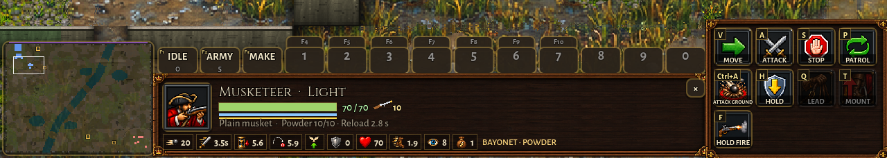
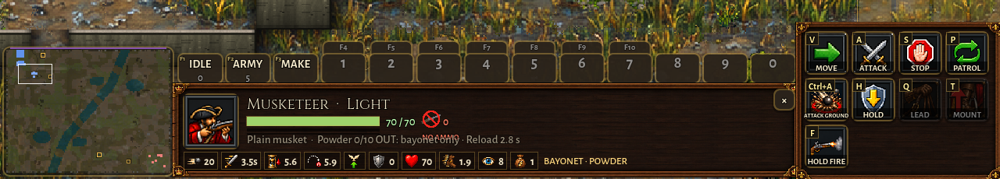
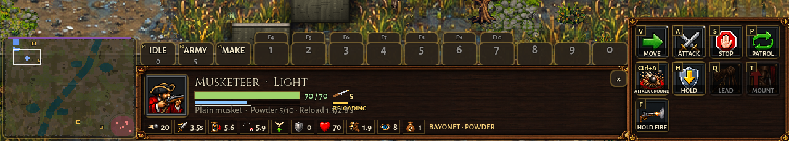
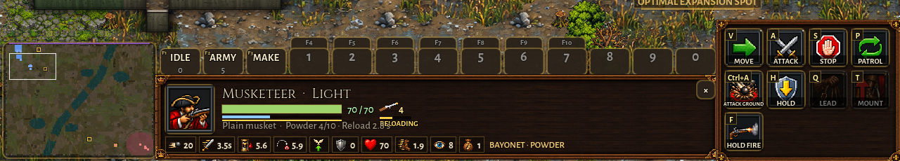
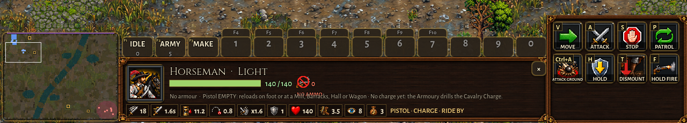
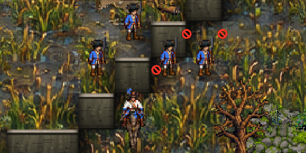
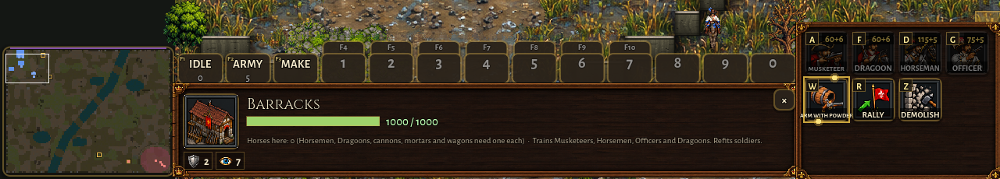
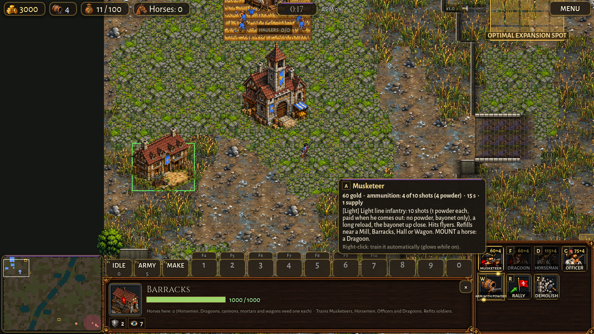
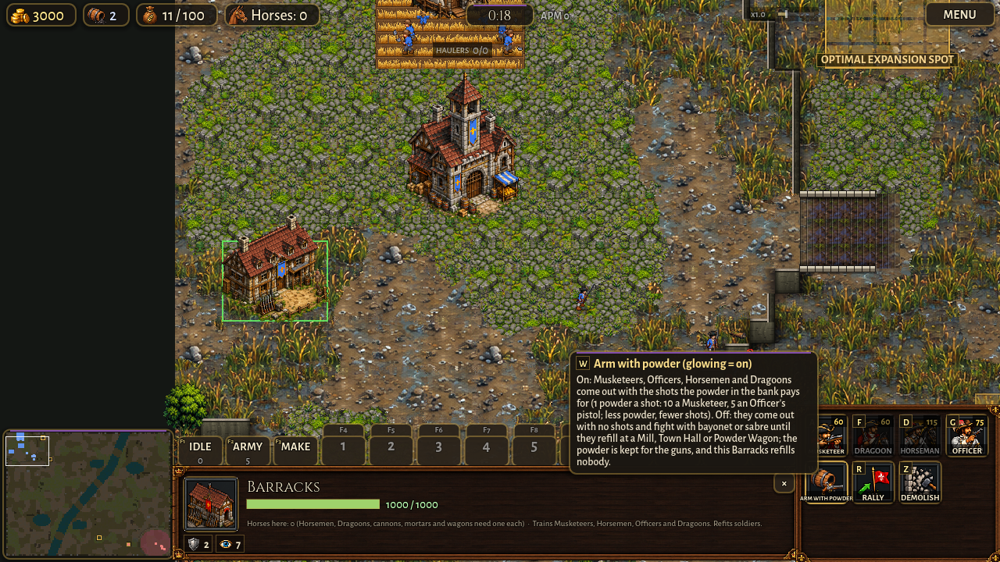

# Crown ammunition, no powder lock (crown-ammo, 0.32.0)

The owner's rule of 2026-11-05 (07:48 to 07:58), built on the branch `crown-ammo`.

## The rule

1. **No powder lock.** Barracks units need no other building: the Musketeer no longer needs the Powder Mill, the
   Officer no longer needs the Horse Breeder (an Officer without a horse walks). Mounted and limbered units keep the
   Horse Breeder requirement: the Horseman (and the Cuirassier), the Dragoon (it needed the Mill AND the Breeder; now
   only the Breeder), the guns and the wagon. A Horseman with no horse is an Officer, as before.
2. **Powder buys the shots.** Every Barracks soldier with a firearm pays powder for his ammunition when he comes out
   (`Game.arm_recruit`, `Defs.AMMO`):
   - with a full load's powder in the bank he comes out armed;
   - with less he takes what there is (a PARTIAL load: 6 powder, 6 shots);
   - with none (or ARM WITH POWDER off) he comes out with ZERO shots and fights with his melee weapon (the Musketeer's
     bayonet, the Officer's and Horseman's sabre) until he refills.
   The powder is taken when he comes out, not when he is queued (the bank as it is then decides his load).
3. **Refills are paid from the bank, shot by shot**, at a Mill, Barracks, Town Hall or Powder Wagon (the wagon's
   own load, already paid, as before). No free refills (there were none before either).
4. **ARM WITH POWDER**, a toggle on the Barracks' command card (on by default; glowing = on), with a tooltip, in
   en/pt/es. Off: its recruits come out with no shots, the powder is kept for the guns, and that Barracks is not a
   reloading point (otherwise a dry man coming out of it would refill on the spot and the toggle would save nothing).
5. **The gold-only rush is allowed**: the Horseman rush (the Horse Breeder costs only gold) works as before; its riders
   come out with the sabre only until there is powder in the bank.
6. **The ammo icon on the unit card** for every firearm (below).

## The numbers (what I chose)

| | full load | powder | how |
|---|---|---|---|
| Musketeer, Guardsman | 10 shots | 10 | his old price: 10 powder for his 10 shots, so **1 powder a shot** |
| Dragoon (on foot: a Musketeer) | 10 shots | 10 | the same |
| Officer, Armoured Officer | the loaded pistol + 4 charges = 5 shots | 5 | **1 powder a pistol shot**, like a musket ball (he cost 0 powder before; the pistol's 4 charges cost 0.5 each to refill) |
| Horseman, Cuirassier | the same 5 | 5 | the same pistol |

- **Refills: 1 powder a shot** for muskets and pistols (they were 0.5). Training at 1 a shot and refilling at 0.5 would
  have made training a man dry and refilling him at the Barracks the cheap way (5 powder instead of 10), and the
  toggle would have saved nothing. Cannons and mortars keep 1.5 a shot.
- **The Powder Wagon fills at 1 powder a shot** (it was 1 per 2 shots), so a shot from the wagon costs what a shot from
  the bank costs; a keg (30 shots) is 30 powder; a cannon shot takes 1.5 of the wagon's musket shots (was 3).
- **The Shot Pouch**: a soldier refitted with it carries 20 shots; the extra 10 are bought at the next refill, 1 powder
  each (a bigger load costs more powder). Recruits still don't come with it.
- **An empty pistol is loaded at a reloading point**, even in the saddle (before, a Horseman could only reload on foot:
  a dry Horseman would never get his shot otherwise). On foot the Officer still reloads by himself (4 s, a charge).
- **The guns** (proposal, not changed): the Field Cannon still comes out with its 8 shots for 0 powder, the Mortar with
  its 6 shells for 20 powder paid when queued. The same rule would fit them plainly (a cannon load: 8 x 1.5 = 12 powder,
  a mortar load: 6 x 1.5 = 9 powder, taken when it comes out, partial loads, the Mortar's 20 queued powder dropped), but
  it changes the guns' price and the Foundry's opening, so it waits for the owner.
- **The Crown starts with 0 powder** (unchanged): an early Barracks soldier comes out dry until a Mill grinds.

## The card's ammo icon

The Horseman's pistol icon (bright loaded, smoking empty) after the health figures is now the ammo icon of every
firearm: the musket (Musketeer, Guardsman, Dragoon), the pistol (Officer, Horseman, Cuirassier), the cannon ball
(Field Cannon) and the mortar shell (Mortar). The musket, the ball and the shell are drawn in code (logged in
docs/art_style_inconsistency.md); the pistols are the painted icons.

- beside it, **the shots left** (a pistol counts its loaded shot and its charges);
- **0 shots**: a red "no" sign (a ring with a slash) over the weapon and **NO AMMO** under it;
- **reloading** (between shots, the Officer reloading his pistol, or refilling at a reloading point or a wagon): a bar
  under the icon fills up with **RELOADING** under it (refilling: the bar is the load filling up);
- on the field, a small red "no" mark beside the health bar of your men (and allies') with no shot.
- The train button's corner shows gold + powder (`60+10`; `60+6` with 6 in the bank; `60` alone when he'd come out
  dry), and its tooltip's cost line says it: `60 gold · ammunition: 10 powder for 10 shots`, `6 of 10 shots (6 powder)`,
  `no ammunition (no powder)` or `no ammunition (ARM WITH POWDER off)`.

Pictures (docs/shots/crown_ammo/, tools/shot_crown_ammo.gd):

| | |
|---|---|
|  | a full Musketeer: the musket and 10 |
|  | 0 shots: NO AMMO |
|  | RELOADING between shots |
|  | RELOADING while he refills at the Town Hall |
|  | a dry Horseman: NO AMMO on the pistol |
|  | the no-ammo marks on the field |
|  | the Barracks' card: ARM WITH POWDER, the train buttons' powder |
|  | the Musketeer button's tooltip with 6 powder in the bank |
|  | ARM WITH POWDER off, its tooltip |

## The Crown computer (scripts/ai_crown_ammo.gd, every plan)

1. **It trains armed men**: a Musketeer or Dragoon is queued only with a full load's powder in the bank (as when he
   cost 10 powder) and ARM WITH POWDER on (AI._soldier_key and the Dragoon raids ask `musket_ok`). Riders are queued
   as before (a dry rider has his sabre). A deliberate rush (the Horse Breeder opening) never waits for powder.
2. **It keeps powder for its guns** with the toggle: off at every Barracks while a Mortar waits in a Foundry's queue
   or one of its guns is under half its shots, and the bank is under 30; on again at 40. (A first version also switched
   it off while a Foundry had no gun yet: in the first coached game the Economy plan then trained no Musketeers for
   minutes. Dropped.)
3. **It sends empty men to refill before a fight**: every 2 s, a man with a firearm under 40% of his load (a pistol:
   empty with no charge), with no enemy within 10 tiles and a reloading point within 22 tiles (a Mill, Town Hall or
   armed Barracks with powder in the bank, or the stocked Powder Wagon), walks to it and stays out of the army's orders
   (AI._on_errand) until he is full, the powder runs out or 30 s pass. A deliberate rush's riders are left alone.
4. **It never sends bayonet-only Musketeers into a gunfight on purpose**: they are not trained dry (1), and dry ones go
   to refill (3); a wave already out keeps its men (only those near a reloading point are pulled back).
5. **The Horseman rush is unchanged** (its riders come out dry until the first Mill grinds).

## Coached games

Hard Crown computer (Balanced, Economy, Rush, Siege push, Dragoon raids) against a Hard Brood and a Hard Clockwork
(both on Balanced) on Highmoor, Redrock Canyon and Greenhold, to 8:00, headless (`tools/play_crown_ammo.gd`; the same
tool run on main for the comparison): 45 games a side (the Brood games twice, seeds 1 and 2; the Clockwork games
once). Raw lines: docs/crown_ammo/games_new.jsonl, games_main.jsonl, games_half_price.jsonl; the full table below
(`python3 tools/crown_ammo/report.py docs/crown_ammo/games_new.jsonl docs/crown_ammo/games_main.jsonl`).
"Empty-fight man-seconds": each second, every Crown firearm man with no shot and an enemy within 200 px (a musket's
reach), counted the same way on main. Army value counts a Musketeer's 10 powder on both sides.

| opponent | games | army supply at 8:00 (new / main) | lost | killed | powder left | empty-fight man-seconds |
|---|---|---|---|---|---|---|
| brood | 30 | 384 / 488 | 407 / 305 | 695 / 752 | 2569 / 3072 | 629 / 251 |
| clockwork | 15 | 243 / 231 | 81 / 90 | 159 / 127 | 1723 / 1874 | 720 / 0 |

| plan | games | army supply at 8:00 (new / main) | lost | killed | powder left | empty-fight man-seconds |
|---|---|---|---|---|---|---|
| balanced | 9 | 147 / 144 | 95 / 92 | 160 / 180 | 791 / 1070 | 31 / 63 |
| dragoon | 9 | 87 / 103 | 97 / 74 | 157 / 176 | 553 / 777 | 23 / 61 |
| economy | 9 | 152 / 182 | 193 / 154 | 165 / 217 | 1036 / 1010 | 26 / 116 |
| rush | 9 | 115 / 151 | 22 / 15 | 149 / 85 | 1132 / 1330 | 1254 / 0 |
| siege | 9 | 126 / 139 | 81 / 60 | 223 / 221 | 778 / 758 | 15 / 11 |

What it says:

- **Income is the same** (gold earned identical to 6:00 in every game; powder earned within 1%). The games run the
  same until the first big fight (6:00 to 8:00); from there one lost fight swings the 8:00 army by 30 supply and the
  Brood's spoils snowball it, so single games differ a lot both ways.
- **Against the Clockwork: even** (army 243 / 231, losses 81 / 90, kills 159 / 127).
- **Against the Brood: the Crown came out worse**: about a fifth less army at 8:00 and a third more losses over 30
  games (the new rule had the bigger army in 16 of the 45 games, main in 28). I could not pin it on the ammunition
  itself: on the Balanced, Economy, Siege and Dragoon plans no recruit came out dry, there were almost no blows struck
  without a shot (3 to 10 a plan over 9 games), few refill errands (1 to 10), and those plans fought empty LESS than on
  main (95 man-seconds against 251). A third run with the refill price left at 0.5 a shot (and a 5-powder Musketeer:
  games_half_price.jsonl, the 30 Brood games) did no better (army 369 against 384 at 1 a shot and 488 on main), so the
  price is not it either. What is left: the powder the riders and Officers now pay (5 each), the powder taken when a
  man comes out instead of when he is queued, and the noise of these games. More seeds would settle it; I would not
  change a number on this alone.
- **The Rush plan's riders fight with the sabre** (1,254 empty man-seconds over 9 games, 61 riders out dry: the Crown
  starts with no powder, as the rule says): they killed MORE (149 / 85) and lost a little more (22 / 15); their army at
  8:00 was smaller (115 / 151), the rush's pistols bought later.
- **Powder**: the Crown spent 5,340 powder arming recruits and 1,724 on refills over the 45 games (about 120 and 38 a
  game); it had 13% less powder in the bank at 8:00.

Every game (new / main)

| plan | foe | map | gold in 8:00 (new / main) | powder in | powder left | army supply 8:00 | army value | killed / lost | halls | out dry / partial | empty-fight s | empty blows | refill errands | powder: arming / refills |
|---|---|---|---|---|---|---|---|---|---|---|---|---|---|---|
| balanced | brood | greenhold (seed 2) | 4560 / 4940 | 276.5 / 282.5 | 111.5 / 78.0 | 20 / 13 | 1155 / 800 | 18/7 / 30/13 | 1 / 1 | 0 / 0 | 0 / 0 | 0 | 0 | 115.0 / 20.0 |
| balanced | brood | greenhold | 5320 / 4560 | 268.9 / 268.8 | 99.4 / 195.3 | 19 / 4 | 1085 / 280 | 33/14 / 23/8 | 2 / 1 | 0 / 0 | 20 / 25 | 0 | 0 | 130.0 / 9.5 |
| balanced | brood | highmoor (seed 2) | 4940 / 4940 | 271.5 / 289.1 | 107.5 / 121.1 | 12 / 20 | 730 / 1155 | 35/14 / 31/13 | 1 / 2 | 0 / 0 | 9 / 18 | 0 | 0 | 125.0 / 9.0 |
| balanced | brood | highmoor | 5700 / 4940 | 273.7 / 265.2 | 68.7 / 106.7 | 24 / 21 | 1340 / 1220 | 16/14 / 21/12 | 1 / 1 | 0 / 0 | 0 / 8 | 0 | 0 | 140.0 / 23.0 |
| balanced | brood | redrock_canyon (seed 2) | 5320 / 4560 | 274.0 / 280.8 | 65.0 / 100.3 | 14 / 21 | 980 / 1225 | 18/12 / 32/11 | 2 / 1 | 0 / 0 | 2 / 0 | 0 | 0 | 140.0 / 69.0 |
| balanced | brood | redrock_canyon | 5320 / 4940 | 276.5 / 311.1 | 73.5 / 125.6 | 16 / 14 | 970 / 980 | 22/14 / 28/8 | 2 / 1 | 0 / 0 | 0 / 12 | 0 | 0 | 120.0 / 53.0 |
| dragoon | brood | greenhold (seed 2) | 4560 / 4560 | 286.0 / 267.1 | 0.1 / 85.6 | 9 / 10 | 630 / 700 | 47/11 / 43/3 | 2 / 2 | 0 / 0 | 0 / 14 | 0 | 0 | 150.0 / 135.9 |
| dragoon | brood | greenhold | 4940 / 4180 | 254.9 / 265.9 | 97.9 / 108.4 | 16 / 7 | 985 / 490 | 0/1 / 20/10 | 2 / 2 | 0 / 0 | 0 / 1 | 0 | 0 | 125.0 / 2.0 |
| dragoon | brood | highmoor | 4560 / 4560 | 254.7 / 260.4 | 84.7 / 72.9 | 2 / 4 | 100 / 280 | 23/24 / 28/16 | 2 / 2 | 0 / 0 | 0 / 46 | 0 | 0 | 100.0 / 40.0 |
| dragoon | brood | highmoor (seed 2) | 4560 / 4560 | 286.3 / 264.7 | 43.3 / 87.2 | 0 / 0 | 0 / 0 | 22/23 / 20/22 | 2 / 2 | 0 / 0 | 13 / 0 | 3 | 1 | 150.0 / 93.0 |
| dragoon | brood | redrock_canyon | 4560 / 4560 | 270.4 / 261.6 | 45.4 / 88.6 | 7 / 14 | 490 / 980 | 25/14 / 15/6 | 2 / 2 | 0 / 0 | 10 / 0 | 0 | 0 | 150.0 / 75.0 |
| dragoon | brood | redrock_canyon (seed 2) | 4560 / 4560 | 266.2 / 265.9 | 46.2 / 69.4 | 14 / 17 | 980 / 1055 | 17/7 / 24/7 | 2 / 1 | 0 / 0 | 0 / 0 | 0 | 0 | 145.0 / 55.0 |
| economy | brood | greenhold (seed 2) | 8740 / 7980 | 405.5 / 343.5 | 48.5 / 53.0 | 33 / 14 | 1735 / 610 | 53/10 / 8/34 | 2 / 2 | 0 / 0 | 0 / 0 | 0 | 7 | 230.0 / 56.0 |
| economy | brood | greenhold | 7980 / 8740 | 316.1 / 418.5 | 69.1 / 94.0 | 13 / 45 | 600 / 2495 | 9/41 / 57/9 | 2 / 2 | 0 / 0 | 0 / 60 | 0 | 0 | 190.0 / 6.0 |
| economy | brood | highmoor | 9120 / 8360 | 343.3 / 422.5 | 61.3 / 142.5 | 38 / 40 | 2030 / 2280 | 50/15 / 63/5 | 2 / 2 | 0 / 0 | 26 / 48 | 3 | 3 | 205.0 / 27.0 |
| economy | brood | highmoor (seed 2) | 7600 / 8360 | 334.5 / 396.6 | 81.5 / 111.6 | 2 / 14 | 195 / 710 | 22/41 / 47/20 | 2 / 2 | 0 / 0 | 0 / 8 | 0 | 0 | 195.0 / 8.0 |
| economy | brood | redrock_canyon | 7980 / 8360 | 411.4 / 421.8 | 178.4 / 119.8 | 8 / 3 | 330 / 225 | 5/26 / 6/32 | 2 / 2 | 0 / 0 | 0 / 0 | 0 | 0 | 200.0 / 3.0 |
| economy | brood | redrock_canyon (seed 2) | 8360 / 8360 | 407.1 / 387.8 | 157.1 / 81.8 | 8 / 14 | 330 / 655 | 3/33 / 16/24 | 2 / 2 | 0 / 0 | 0 / 0 | 0 | 0 | 200.0 / 0.0 |
| rush | brood | greenhold (seed 2) | 4180 / 4560 | 212.5 / 233.3 | 139.5 / 173.3 | 14 / 22 | 695 / 1050 | 9/1 / 9/0 | 2 / 2 | 6 / 0 | 102 / 0 | 23 | 4 | 30.0 / 43.0 |
| rush | brood | greenhold | 4940 / 5320 | 199.3 / 187.7 | 96.1 / 116.2 | 8 / 17 | 465 / 810 | 28/4 / 9/1 | 2 / 2 | 5 / 0 | 102 / 0 | 48 | 5 | 50.0 / 23.2 |
| rush | brood | highmoor | 4180 / 4560 | 216.5 / 229.7 | 120.5 / 189.7 | 9 / 16 | 535 / 740 | 9/2 / 6/0 | 2 / 2 | 7 / 0 | 64 / 0 | 25 | 1 | 20.0 / 46.0 |
| rush | brood | highmoor (seed 2) | 4180 / 5700 | 212.8 / 201.6 | 151.8 / 131.6 | 11 / 21 | 580 / 980 | 21/2 / 5/0 | 2 / 2 | 6 / 0 | 85 / 0 | 52 | 4 | 30.0 / 31.0 |
| rush | brood | redrock_canyon (seed 2) | 5320 / 5320 | 206.5 / 192.5 | 108.5 / 132.0 | 17 / 22 | 905 / 1050 | 2/0 / 7/0 | 2 / 2 | 6 / 0 | 113 / 0 | 37 | 9 | 50.0 / 37.9 |
| rush | brood | redrock_canyon | 4940 / 5320 | 193.8 / 185.3 | 137.0 / 84.8 | 13 / 23 | 625 / 1120 | 8/2 / 10/0 | 2 / 2 | 6 / 0 | 68 / 0 | 17 | 8 | 20.0 / 36.8 |
| siege | brood | greenhold | 4940 / 4560 | 247.4 / 254.6 | 63.4 / 69.6 | 0 / 8 | 0 / 450 | 23/15 / 47/10 | 2 / 2 | 0 / 0 | 0 / 0 | 0 | 0 | 120.0 / 64.0 |
| siege | brood | greenhold (seed 2) | 4560 / 4560 | 275.8 / 232.8 | 53.8 / 89.3 | 8 / 19 | 355 / 1030 | 33/13 / 24/3 | 2 / 2 | 0 / 0 | 0 / 0 | 0 | 0 | 130.0 / 92.0 |
| siege | brood | highmoor | 4560 / 4560 | 270.9 / 246.5 | 51.9 / 83.5 | 7 / 11 | 285 / 730 | 34/14 / 19/14 | 2 / 2 | 0 / 0 | 0 / 2 | 0 | 0 | 115.0 / 104.0 |
| siege | brood | highmoor (seed 2) | 5320 / 4560 | 262.6 / 259.8 | 77.6 / 46.8 | 7 / 15 | 395 / 845 | 24/15 / 36/6 | 2 / 2 | 0 / 0 | 0 / 5 | 0 | 0 | 130.0 / 55.0 |
| siege | brood | redrock_canyon | 4940 / 5320 | 250.1 / 236.8 | 40.6 / 28.3 | 21 / 22 | 1155 / 1215 | 55/8 / 40/11 | 1 / 2 | 0 / 0 | 15 / 4 | 10 | 2 | 115.0 / 94.5 |
| siege | brood | redrock_canyon (seed 2) | 4560 / 4940 | 243.4 / 220.0 | 89.4 / 85.5 | 14 / 17 | 775 / 1055 | 31/10 / 28/7 | 1 / 2 | 0 / 0 | 0 / 0 | 0 | 1 | 100.0 / 54.0 |
| balanced | clockwork | greenhold | 7980 / 7980 | 296.2 / 386.5 | 41.2 / 77.5 | 13 / 28 | 665 / 1650 | 3/16 / 5/0 | 2 / 2 | 0 / 0 | 0 / 0 | 0 | 0 | 155.0 / 0.0 |
| balanced | clockwork | highmoor | 6840 / 5700 | 355.2 / 280.6 | 130.2 / 189.6 | 16 / 4 | 930 / 185 | 8/2 / 3/23 | 2 / 2 | 0 / 0 | 0 / 0 | 0 | 0 | 115.0 / 1.0 |
| balanced | clockwork | redrock_canyon | 6460 / 6840 | 319.1 / 310.2 | 94.1 / 76.2 | 13 / 19 | 720 / 935 | 7/2 / 7/4 | 2 / 2 | 0 / 0 | 0 / 0 | 0 | 0 | 90.0 / 43.0 |
| dragoon | clockwork | greenhold | 4940 / 4560 | 265.8 / 282.2 | 73.8 / 80.7 | 15 / 21 | 1050 / 1240 | 9/2 / 6/2 | 2 / 2 | 0 / 0 | 0 / 0 | 0 | 0 | 150.0 / 42.0 |
| dragoon | clockwork | highmoor | 4560 / 5320 | 274.2 / 317.4 | 112.2 / 66.9 | 10 / 13 | 700 / 910 | 6/9 / 10/6 | 2 / 2 | 0 / 0 | 0 / 0 | 0 | 0 | 150.0 / 12.0 |
| dragoon | clockwork | redrock_canyon | 4560 / 4940 | 246.7 / 292.6 | 49.7 / 117.6 | 14 / 17 | 980 / 1095 | 8/6 / 10/2 | 2 / 2 | 0 / 0 | 0 / 0 | 0 | 0 | 140.0 / 37.0 |
| economy | clockwork | greenhold | 7600 / 7600 | 254.4 / 343.9 | 146.4 / 93.9 | 19 / 28 | 935 / 1740 | 4/1 / 2/0 | 3 / 2 | 0 / 0 | 0 / 0 | 0 | 0 | 75.0 / 3.0 |
| economy | clockwork | highmoor | 7220 / 6840 | 271.6 / 252.9 | 108.6 / 131.9 | 10 / 9 | 415 / 440 | 9/25 / 5/22 | 2 / 2 | 0 / 0 | 0 / 0 | 0 | 0 | 155.0 / 8.0 |
| economy | clockwork | redrock_canyon | 6840 / 6460 | 393.7 / 251.1 | 185.7 / 181.6 | 21 / 15 | 1280 / 735 | 10/1 / 13/8 | 2 / 3 | 0 / 0 | 0 / 0 | 0 | 0 | 165.0 / 43.0 |
| rush | clockwork | greenhold | 4180 / 4560 | 186.7 / 188.1 | 103.7 / 168.1 | 14 / 13 | 775 / 625 | 33/4 / 16/3 | 2 / 2 | 7 / 0 | 370 / 0 | 257 | 3 | 45.0 / 38.0 |
| rush | clockwork | highmoor | 3800 / 4180 | 189.2 / 193.4 | 144.2 / 171.9 | 17 / 12 | 850 / 610 | 15/3 / 11/5 | 2 / 2 | 6 / 0 | 127 / 0 | 62 | 3 | 20.0 / 25.0 |
| rush | clockwork | redrock_canyon | 3800 / 4180 | 174.5 / 199.7 | 131.1 / 163.2 | 12 / 5 | 690 / 255 | 24/4 / 12/6 | 2 / 2 | 6 / 0 | 223 / 0 | 141 | 2 | 30.0 / 13.4 |
| siege | clockwork | greenhold | 5320 / 5320 | 274.3 / 261.7 | 137.3 / 103.2 | 27 / 19 | 1535 / 1180 | 4/2 / 12/4 | 2 / 2 | 0 / 0 | 0 / 0 | 0 | 0 | 130.0 / 7.0 |
| siege | clockwork | highmoor | 5320 / 5320 | 280.4 / 260.2 | 123.9 / 114.2 | 22 / 14 | 1280 / 885 | 12/2 / 8/3 | 2 / 2 | 0 / 0 | 0 / 0 | 0 | 0 | 105.0 / 51.5 |
| siege | clockwork | redrock_canyon | 4560 / 4940 | 270.0 / 265.8 | 141.0 / 138.3 | 20 / 14 | 1035 / 775 | 7/2 / 7/2 | 2 / 2 | 0 / 0 | 0 / 0 | 0 | 0 | 95.0 / 34.0 |

Totals over the games both sides finished (new / main, the change):

- gold_in: 249280 / 250040 (-0%, 45 games)
- powder_in: 12321 / 12441 (-1%, 45 games)
- bank2: 4292 / 4947 (-13%, 45 games)
- army_sup: 627 / 719 (-13%, 45 games)
- army_val: 35275 / 40475 (-13%, 45 games)
- empty_s: 1349 / 251 (+437%, 45 games)
- killed: 854 / 879 (-3%, 45 games)
- lost: 488 / 395 (+24%, 45 games)

## Open questions for the owner

- **The refill price.** I made a shot cost 1 powder everywhere (training, refills, the wagon) so that training dry and
  refilling is never cheaper. It doubles what refills cost the Crown. The other way: keep 0.5 a shot everywhere and
  make a full Musketeer 5 powder (half what he cost); in 30 computer games against the Brood that did no better.
- **The Crown computer against the Brood** came out about a fifth smaller at 8:00 than on main (above); the cause is
  not clear from 30 games. Worth a longer study (more seeds, to 12:00) before any balance change.
- **The guns** under the same rule (above): a cannon load 12 powder, a mortar load 9, taken when they come out?
- **The Horseman rush's pistols**: the riders now come out with no pistol shot (the Crown starts with 0 powder). A
  small starting powder (say 25) would give the first five riders their shot; it would also arm the first Musketeers.
- **The Officer** needs nothing now: 75 gold, 3 supply, a pistol and a sabre on foot from the first Barracks. Is he too
  early a unit against the Brood's first Raptors? (Not seen in the coached games: the computer doesn't train Officers.)
- **The dry men's refill at the Barracks they come out of**: with ARM WITH POWDER on and powder arriving later, a dry
  recruit standing by the Barracks fills up by himself; with it off, that Barracks never refills anyone. Fine?

## Tests

- `tools/test_crown_ammo.gd` (new, all pass): no requirement for the Musketeer and the Officer (the Dragoon and the
  Horseman still need the Breeder); gold only: 0 shots, the bayonet and the sabre work, the empty blows are counted;
  a full bank: 10 shots for 10 powder, the Officer's pistol and 4 charges for 5; 6 powder: 6 shots; ARM WITH POWDER
  off: 0 shots, the bank untouched, that Barracks refills nobody, on again it does; the refill at a Mill takes 1 powder
  a shot and waits with the bank empty; a dry Horseman's pistol is loaded at the Mill in the saddle; the card's state:
  NO AMMO at 0 shots, RELOADING while refilling, between shots and while the Officer reloads; the cost line.
- Kept passing on this branch: test_crown_build_order, test_crown_dragoon_raid, test_crown_siege, test_crown_balloon,
  test_ai_wall_vs_rush (wall at 37 s, Musketeers at 128, 143, 158 s), test_crown_owner_eco, test_crown_v_brood,
  test_campaign_m1, test_tutorial. After the last change to the computer's toggle, test_crown_ammo,
  test_crown_build_order and test_crown_siege passed again; test_crown_dragoon_raid failed once (its [plan] check: twelve
  Dragoons formed a group but it had not ridden out by 11:30) while another game ran beside it, and passed on the next
  run (four Dragoons out by 690 s): worth watching.
- Pictures: `xvfb-run -a godot --rendering-driver opengl3 --resolution 1280x720 --script res://tools/shot_crown_ammo.gd -- /abs/out`.
