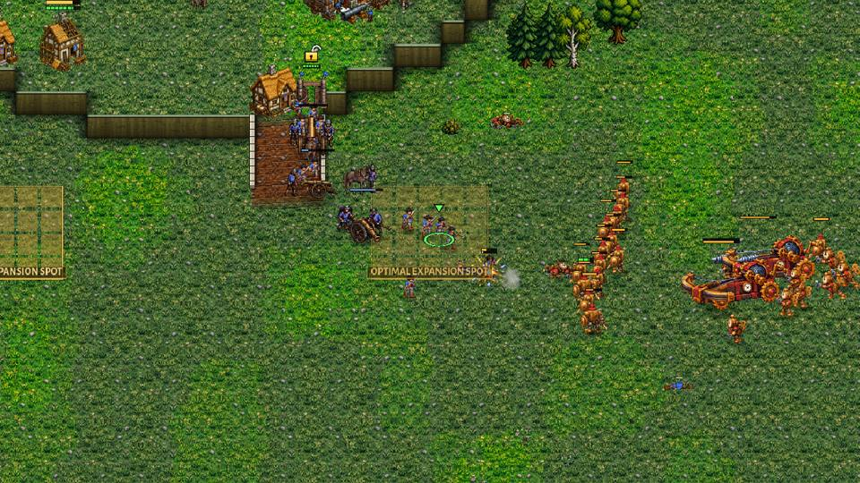
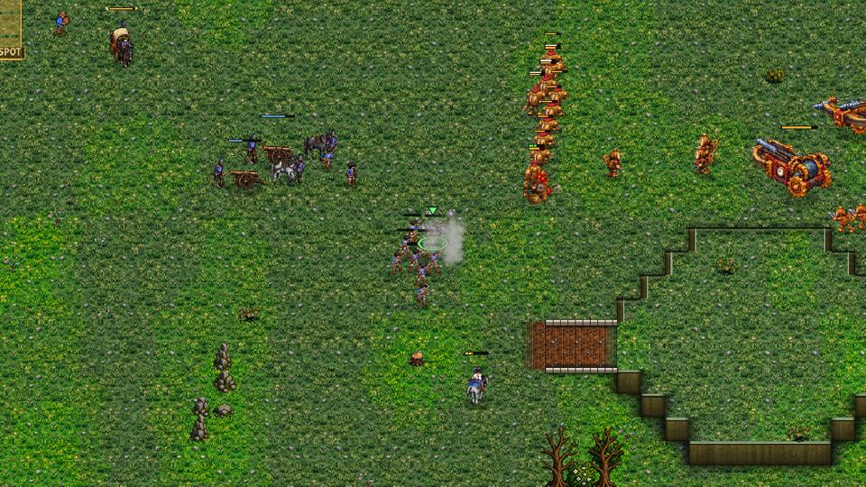
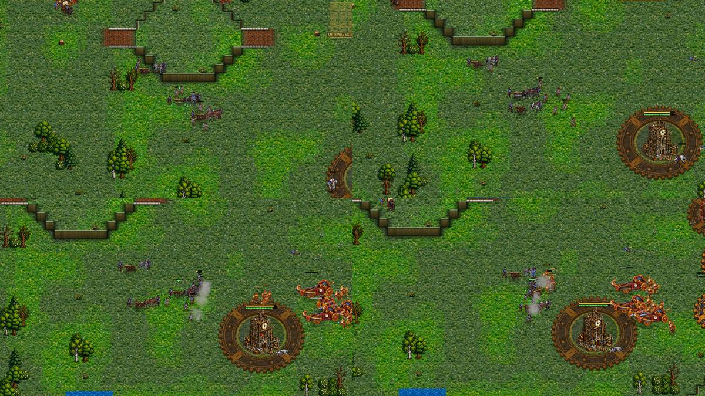
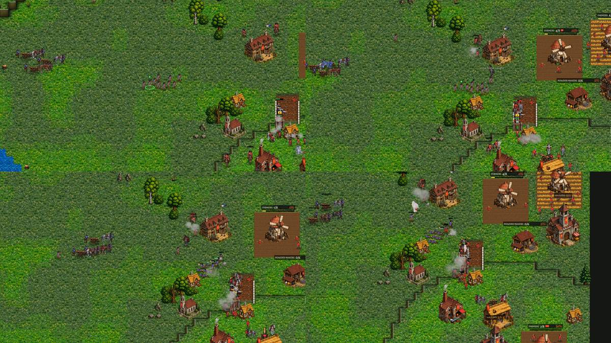
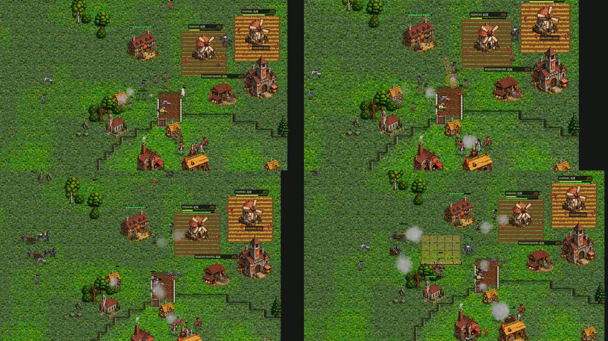

# crown-line-fight: the Crown computer fights in a line

The owner (2026-11-12 07:59): "Maybe there is one thing the Crown isn't doing: the drag-to-draw line of Musketeers. This
line of fire and cannon placement could help in fights." A human Crown player drags a LINE for his Musketeers
(`Game.line_move`) so every musket fires at once, and puts his Field Cannons behind it where they shoot over it. The
computer attack-moved its wave as a blob to a point: the Musketeers met the enemy in a clump or a column and only the
front rows fired (docs/crown_v_brood_coach.md, docs/crown-v-clockwork-coach.md "a Crown march with a formed line and guns
is the next job", docs/crown-v-crown-coach.md: the column into the enemy, the blob at the gate).

Rules followed: docs/design_principles.md 1 (fairness: the computer uses the player's own tool, the drag-a-line, and only
what it knows: an enemy in sight or seen in the last 20 s), 4 (battles that carry the weight of the match: formed lines
and guns). The owner's Crown rules are untouched (the walled natural with its gate toward the ramp and the army at the
gate, 3 Field Cannons before any Mortar, the Foundry before the second Barracks, the OPTIMAL opening). No unit, building
or economy number was changed. The Horseman rush, the raids (Horsemen, Dragoons) and the Balloon harass keep their own
play: the line is for the main army's waves and its defence. The Clockwork and Brood computers are untouched (the line is
in `AICrown`; the shared code only calls in).

**Switch:** `-- line:off` plays the old way (comparison games).

## What was built (`scripts/ai_crown_line.gd`, class `AICrownLine`)

1. **The line is the player's drag.** `Game.line_move` now hands its orders to `Game.line_orders` (the same spot
   assignment: spots evenly along the line, men matched to them in order so their paths don't cross, a spot on a cliff's
   rim or a tree moved to free ground on its level), which the computer calls too; only the click's ring is the player's.
   `AICrownLine.lay` lays the shooters (Musketeers, Guardsmen, Dragoons, the dismounted) across the approach facing the
   enemy: one rank, two from 14 shooters (RANK2), 0.95 tiles apart, the front rank the men nearest the enemy; the melee
   (Horsemen, Officers, Pikemen) on the flanks beyond the ends of the front rank; the Field Cannons 2.6 tiles behind the
   front rank spread along it, Mortars 6 tiles behind; everyone on the line's own level (a flank or gun spot over a rim is
   pulled back).
2. **The march** (`AICrownLine.march`, called from `AI._army` through `AICrown._cohesion` while a wave is out):
   - strung out with nothing ahead: the head waits, the tail closes up (as the mirror's cohesion did, now in every
     matchup: `AICrownMirror.cohesion` is not used while the line is on);
   - an enemy army ahead (in sight, or seen in the last 20 s where it was seen: the scouts' and the army's own eyes;
     worth a quarter of the wave or more): it stops out of reach (330 px from the nearest enemy, never ahead of its head),
     FORMS the line facing the enemy's middle, the guns behind; then it STEPS on with its guns (128 px a step, the line
     waits for the guns at each halt) until the nearest enemy is in the guns' reach from behind the line; there the guns
     SET UP and the line holds until they have; then the line walks on alone, an attack-move to just inside musket reach
     (each man stops to fire as he comes in reach, so they fire together);
   - a siege ahead (a wall or gate the wave must break, `AI._siege_plan`): with guns in the wave the line forms facing the
     piece the same way, steps up with the guns, holds while they set up, and hands over to the siege only then;
   - contact met unformed (an enemy at a turn of the road, at a ramp's foot): the men already firing stay; the rest
     DEPLOY into a line through them, across the enemy's direction; the guns go behind it;
   - in the fight the held line shoots what comes in reach; a line with nothing left in reach for 4 s steps on toward the
     nearest enemy (a winning line pushes on); a line losing the trade (lost 260+, over 1.6 times what it killed) FALLS
     BACK 150 px toward its guns in order and holds there 9 s, then fights on; with no enemy left it says so and goes on
     (and forms again at the next enemy).
3. **The defence** (`AICrownLine.defend`, from `AI._defend` through `AI._def_line`): a detachment sent to a force at our
   buildings with 4 shooters or more arrives as a line facing it, 150 px short of it (inside musket reach), on an
   attack-move, its guns behind; the defence leaves the men be while they walk to their spots.
4. The home posts (the ramp post, the cliff edge, the natural's gate post, `scripts/ai_crown_hold.gd`) already lay their
   muskets in rows across the ramp's top, along the cliff's lip or along the palisade behind the gate, with the guns
   behind; they are kept as they are (the owner's doctrine).

The match log has new lines (and the AI STORY rows for them, `scripts/ai_story_lines.gd`, pt and es in
`tools/i18n/62_crown_line.txt`): "'s wave forms its line before the enemy army ahead (350): 8 muskets in 1 rank, 3 guns
behind", "'s wave forms its line before the enemy's gate: ...", "'s wave meets the enemy before its line is formed: 11
muskets deploy into a line through the 0 already firing", "'s line has won the field: it forms up again and goes on",
"'s line is losing the fight (410 lost for 210): it falls back toward its guns in order and forms again", "meets the force
at its buildings with a line: 5 muskets facing it, 2 guns behind".

## Tools

- `tools/film_line.gd`: `tools/film_coach.gd`'s coached film (a map picture and a coach's line every 15 s, `shots:1` for
  camera pictures) plus every ENGAGEMENT of a Crown army in `engage.json`: when it began (a Crown shooter with an armed
  enemy within 215 px after 12 s without), the shooters near the contact and their shape (across the line to the enemy /
  deep along it), how many of them fired in the first 5 s, the guns near (set up, behind the shooters, fired), and the
  value killed and lost by every unit that came within 700 px while it lasted.
- `tools/study/crown_line_fight.py`: the batches (the qa-matches base tags and seeds on 8 maps, both start slots, Hard
  OPTIMAL against Hard Brood, Clockwork and Crown OPTIMAL: 16 games a matchup); `tools/study/crown_line_report.py` the
  tables.
- `tools/test_crown_line.gd`: a defending Crown army forms a line across the approach with its guns behind and gets to
  it; a marching wave forms before contact (at contact the muskets stand wider than deep across the line to the enemy and
  the guns are behind them); `line_orders` gives each man his own spot in order along the line.

## The sessions (coached and filmed)

(Times are game time; P1 is the first start spot. The games are not deterministic: a replay of a seed is the same start,
not the same game.)

### One rank or two (`tools/study_line_ranks.gd`)

A line of N Musketeers laid with `line_orders` (one rank, two ranks, or the old blob: every man sent to the same point
with a little scatter), on HOLD, two Field Cannons set up behind it; an enemy force walks into it on an attack-move from
600 px (the force grows with N). Killed / lost, three runs each:

| | 14 muskets: blob | 1 rank | 2 ranks | 24 muskets: blob | 1 rank | 2 ranks |
|---|---|---|---|---|---|---|
| v Raptors (70 / 120) | 2.82 | **5.20** | 3.80 | 2.26 | **2.98** | 2.47 |
| v Clock Soldiers (28 / 48) | 7.54 | 10.89 | **12.25** | 3.67 | 3.17 | **6.50** |
| v Musketeers (22 / 37) | 2.06 | **2.54** | 2.36 | 1.17 | 0.84 | **1.21** |

A line beats the blob in every case but one: a 24-man single rank (730 px wide) against Clock Soldiers or Musketeers who
come on in a column hit one end of it while the far end cannot reach. So the line stands in one rank against the Brood's
swarm up to 26 shooters (a wide front catches more of it), in two ranks from 12 against the Clockwork, from 16 in the
mirror (`AICrownLine.rank2`).

### Round 1: Greenhold 1101, Crown OPTIMAL (Timing) v Clockwork OPTIMAL

The first cut formed a line only before an enemy army in sight. **7:08-7:16:** the wave went out from the cliff edge where
its line had been shooting down at the Clockwork army at the ramp's foot (contact from the first moment, so no forming),
the fight there went its way (980 killed for 180), "the line has won the field" and it walked down the ramp in a column
into a formed line of Clock Soldiers waiting at the foot (`r1_greenhold1101_0716_column_down_the_ramp.jpg`). The same
again at 7:26 and 7:41: contact met unformed. The cause: a musket sees 8 tiles (256 px) and a contact is 250 px, so an
enemy is first SEEN at contact; the line never had warning.

**Fixes:** the line knows an enemy seen in the last 20 s where it was seen (the scouts', the cliff line's and the wave's
own eyes, `AICrownHold._seen` and its own memory); a contact met unformed DEPLOYS the rest into a line through the men
already firing; riders skirmishing out ahead are not the line's contact.

### Round 2: Greenhold 1101 replayed

**7:00:** the wave meets the Clock Soldiers in the open and deploys: 11 muskets in a line across their approach, the guns
behind (`r2_greenhold1101_0701_deploys_into_line.jpg`); all 11 fired in the first 5 s, 770 killed for 360. **8:04:** the
wave formed its line before the enemy at a Clocktower (350) with 3 guns, then stepped forward with the guns limbered
among the muskets; the Clockwork came on, contact mid-step, the guns never set up (`r2_..._0800-0815_guns_limbered_in_the_line.jpg`):
810 lost for 350, the line fell back toward its guns in order at 8:21.

**Fixes:** the line steps toward an enemy beyond the guns' reach WITH its guns (the line waits at each halt for them);
once the enemy is in their reach from behind the line they set up and the line holds until they have; the guns rolling
with the line when a fight starts (or when the enemy walks into their reach) set up where they stand if behind the front
rank, or go back behind it first.

### Round 3: Dune Sea 1106, Crown OPTIMAL v Brood OPTIMAL

The Crown's Horseman rush failed (5:31) and its army stayed small (8 Musketeers at 8:00); the Brood took its natural's
wall at 7:44-8:30 and the game at 10:36. No line fight to coach: the fights were at the natural's palisade, the hold
module's "inside the wall" post (`AICrownHold._wall_plan`), not the line's. Left as it is (the Crown v the Brood is
crown-v-brood-coach's matter: the economy and the rush).

### Round 4: Greenhold 1103, Crown OPTIMAL v Crown OPTIMAL (the mirror)

**8:08:** P1's wave formed its line in the open before P2's army (295), stepped on, and at P2's ramp gate the SIEGE took
it over (a wave within 560 px of a siege's piece follows the siege's own orders); its two guns were still rolling 900 px
behind. The muskets clumped at the gate under the ramp's line and gun: 540 lost for 120, "pulls back from the gate: too
dear" at 8:21. Replayed (8:05-8:16): the wave walked to the gate without forming at all (the siege was planned before any
enemy was seen) and pulled back the same way (`r4_greenhold1103_0805-0815_at_the_gate_without_guns.jpg`).

**Fixes:** a siege ahead with guns in the wave: the line forms facing the piece out of reach, steps up with its guns,
holds while they set up in reach of it, and only then hands over to the siege (the siege waits while the line forms).

### Round 5: Greenhold 1103 replayed

**7:13:** "forms its line before the enemy's gate: 8 muskets in 1 rank, 2 guns behind to break it"; by 7:50 the guns had
come up and set up behind the line and were firing at the gate and the enemy behind it
(`r5_greenhold1103_0730-0750_line_before_the_gate_guns_set.jpg`); at 8:18 the mirror's bombard (crown-v-crown-coach)
held the line out of reach while the guns shelled the hall.

ROUND6

## Numbers

NUMBERS

## What is still wrong

WRONG

## Claude's choices for the owner to confirm

CHOICES
