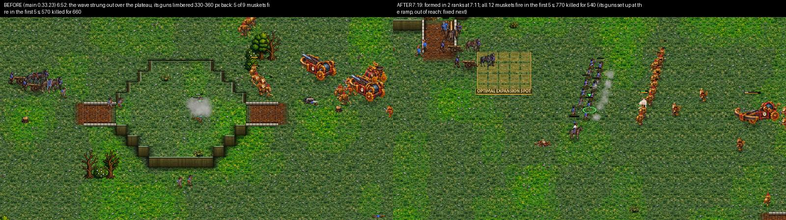
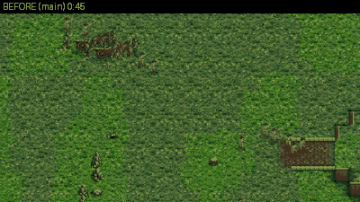
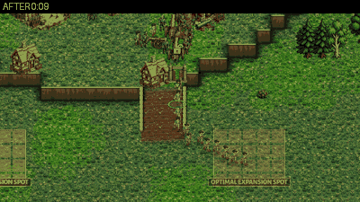
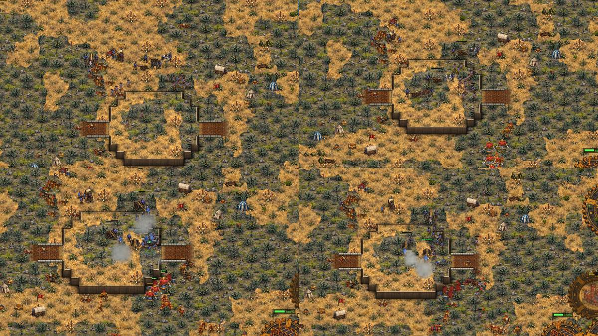

# crown-line-fight: the Crown computer fights in a line

The owner (2026-11-12 07:59): "Maybe there is one thing the Crown isn't doing: the drag-to-draw line of Musketeers. This
line of fire and cannon placement could help in fights." A human Crown player drags a LINE for his Musketeers
(`Game.line_move`) so every musket fires at once, and puts his Field Cannons behind it where they shoot over it. The
computer attack-moved its wave as a blob to a point: the Musketeers met the enemy in a clump or a column and only the
front rows fired (docs/crown_v_brood_coach.md, docs/crown-v-clockwork-coach.md "a Crown march with a formed line and guns
is the next job", docs/crown-v-crown-coach.md: the column into the enemy, the blob at the gate).

Rules followed: docs/design_principles.md 1 (fairness: the computer uses the player's own tool, the drag-a-line, and only
what it knows: an enemy in sight or seen in the last 20 s), 4 (battles that carry the weight of the match: formed lines
and guns). The owner's Crown rules are untouched (the walled natural with its gate toward the ramp and the army at the
gate, 3 Field Cannons before any Mortar, the Foundry before the second Barracks, the OPTIMAL opening). No unit, building
or economy number was changed. The Horseman rush, the raids (Horsemen, Dragoons) and the Balloon harass keep their own
play: the line is for the main army's waves and its defence. The Clockwork and Brood computers are untouched (the line is
in `AICrown`; the shared code only calls in).

**Switch:** `-- line:off` plays the old way (comparison games).

**In short.** Eight coached rounds on five maps (Greenhold, Dune Sea, Red Coast, Kestrel Rise; Greenhold filmed four
times), a ranks study and two batches of 48 games. The Crown computer's waves now form a line across the enemy's approach
(the player's own drag-a-line orders) with the Field Cannons set up behind it: before an enemy army it knows of, before a
wall or gate it must break, and at a halt out of reach of the enemy's base; met by surprise it deploys into a line under
fire; its guns step with the line and set up once in reach; a losing line falls back toward the guns. Defence detachments
arrive as a line; the ramp post's muskets stand in one line along the ramp's top. In the waves' fights against the
Clockwork it now kills 1.67 for each 1 lost (1.36 on main) and more of its muskets fire in the first 5 s (68%, was 64%;
the mirror 60%, was 54%); the results by 12:00 did not move (no Crown win against Hard Brood or Clockwork either way; the
four games lost that main drew were lost by a Horseman-rush opening, not the line). Most fights still begin unformed (an
enemy is first seen at contact): the rider screen (the next job) is the answer.

## What was built (`scripts/ai_crown_line.gd`, class `AICrownLine`)

1. **The line is the player's drag.** `Game.line_move` now hands its orders to `Game.line_orders` (the same spot
   assignment: spots evenly along the line, men matched to them in order so their paths don't cross, a spot on a cliff's
   rim or a tree moved to free ground on its level), which the computer calls too; only the click's ring is the player's.
   `AICrownLine.lay` lays the shooters (Musketeers, Guardsmen, Dragoons, the dismounted) across the approach facing the
   enemy: one rank, two from 14 shooters (RANK2), 0.95 tiles apart, the front rank the men nearest the enemy; the melee
   (Horsemen, Officers, Pikemen) on the flanks beyond the ends of the front rank; the Field Cannons 2.6 tiles behind the
   front rank spread along it, Mortars 6 tiles behind; everyone on the line's own level (a flank or gun spot over a rim is
   pulled back).
2. **The march** (`AICrownLine.march`, called from `AI._army` through `AICrown._cohesion` while a wave is out):
   - strung out with nothing ahead: the head waits, the tail closes up (as the mirror's cohesion did, now in every
     matchup: `AICrownMirror.cohesion` is not used while the line is on);
   - an enemy army ahead (in sight, or seen in the last 20 s where it was seen: the scouts' and the army's own eyes;
     worth a quarter of the wave or more): it stops out of reach (330 px from the nearest enemy, never ahead of its head),
     FORMS the line facing the enemy's middle, the guns behind; then it STEPS on with its guns (128 px a step, the line
     waits for the guns at each halt) until the nearest enemy is in the guns' reach from behind the line; there the guns
     SET UP and the line holds until they have; then the line walks on alone, an attack-move to just inside musket reach
     (each man stops to fire as he comes in reach, so they fire together);
   - a siege ahead (a wall or gate the wave must break, `AI._siege_plan`): with guns in the wave the line forms facing the
     piece the same way, steps up with the guns, holds while they set up, and hands over to the siege only then;
   - contact met unformed (an enemy at a turn of the road, at a ramp's foot): the men already firing stay; the rest
     DEPLOY into a line through them, across the enemy's direction; the guns go behind it;
   - in the fight the held line shoots what comes in reach; a line with nothing left in reach for 4 s steps on toward the
     nearest enemy (a winning line pushes on); a line losing the trade (lost 260+, over 1.6 times what it killed) FALLS
     BACK 150 px toward its guns in order and holds there 9 s, then fights on; with no enemy left it says so and goes on
     (and forms again at the next enemy).
3. **The defence** (`AICrownLine.defend`, from `AI._defend` through `AI._def_line`): a detachment sent to a force at our
   buildings with 4 shooters or more arrives as a line facing it, 150 px short of it (inside musket reach), on an
   attack-move, its guns behind; the defence leaves the men be while they walk to their spots.
4. The home posts (the ramp post, the cliff edge, the natural's gate post, `scripts/ai_crown_hold.gd`) already lay their
   muskets in rows across the ramp's top, along the cliff's lip or along the palisade behind the gate, with the guns
   behind; they are kept as they are (the owner's doctrine).

The match log has new lines (and the AI STORY rows for them, `scripts/ai_story_lines.gd`, pt and es in
`tools/i18n/62_crown_line.txt`): "'s wave forms its line before the enemy army ahead (350): 8 muskets in 1 rank, 3 guns
behind", "'s wave forms its line before the enemy's gate: ...", "'s wave meets the enemy before its line is formed: 11
muskets deploy into a line through the 0 already firing", "'s line has won the field: it forms up again and goes on",
"'s line is losing the fight (410 lost for 210): it falls back toward its guns in order and forms again", "meets the force
at its buildings with a line: 5 muskets facing it, 2 guns behind".

## Tools

- `tools/film_line.gd`: `tools/film_coach.gd`'s coached film (a map picture and a coach's line every 15 s, `shots:1` for
  camera pictures) plus every ENGAGEMENT of a Crown army in `engage.json`: when it began (a Crown shooter with an armed
  enemy within 215 px after 12 s without), the shooters near the contact and their shape (across the line to the enemy /
  deep along it), how many of them fired in the first 5 s, the guns near (set up, behind the shooters, fired), and the
  value killed and lost by every unit that came within 700 px while it lasted.
- `tools/study/crown_line_fight.py`: the batches (the qa-matches base tags and seeds on 8 maps, both start slots, Hard
  OPTIMAL against Hard Brood, Clockwork and Crown OPTIMAL: 16 games a matchup); `tools/study/crown_line_report.py` the
  tables.
- `tools/test_crown_line.gd`: a defending Crown army forms a line across the approach with its guns behind and gets to
  it; a marching wave forms before contact (at contact the muskets stand wider than deep across the line to the enemy and
  the guns are behind them); `line_orders` gives each man his own spot in order along the line.

## The sessions (coached and filmed)

(Times are game time; P1 is the first start spot. The games are not deterministic: a replay of a seed is the same start,
not the same game.)

### One rank or two (`tools/study_line_ranks.gd`)

A line of N Musketeers laid with `line_orders` (one rank, two ranks, or the old blob: every man sent to the same point
with a little scatter), on HOLD, two Field Cannons set up behind it; an enemy force walks into it on an attack-move from
600 px (the force grows with N). Killed / lost, three runs each:

| | 14 muskets: blob | 1 rank | 2 ranks | 24 muskets: blob | 1 rank | 2 ranks |
|---|---|---|---|---|---|---|
| v Raptors (70 / 120) | 2.82 | **5.20** | 3.80 | 2.26 | **2.98** | 2.47 |
| v Clock Soldiers (28 / 48) | 7.54 | 10.89 | **12.25** | 3.67 | 3.17 | **6.50** |
| v Musketeers (22 / 37) | 2.06 | **2.54** | 2.36 | 1.17 | 0.84 | **1.21** |

A line beats the blob in every case but one: a 24-man single rank (730 px wide) against Clock Soldiers or Musketeers who
come on in a column hit one end of it while the far end cannot reach. So the line stands in one rank against the Brood's
swarm up to 26 shooters (a wide front catches more of it), in two ranks from 12 against the Clockwork, from 16 in the
mirror (`AICrownLine.rank2`).

### Round 1: Greenhold 1101, Crown OPTIMAL (Timing) v Clockwork OPTIMAL

The first cut formed a line only before an enemy army in sight. **7:08-7:16:** the wave went out from the cliff edge where
its line had been shooting down at the Clockwork army at the ramp's foot (contact from the first moment, so no forming),
the fight there went its way (980 killed for 180), "the line has won the field" and it walked down the ramp in a column
into a formed line of Clock Soldiers waiting at the foot (`r1_greenhold1101_0716_column_down_the_ramp.jpg`). The same
again at 7:26 and 7:41: contact met unformed. The cause: a musket sees 8 tiles (256 px) and a contact is 250 px, so an
enemy is first SEEN at contact; the line never had warning.

**Fixes:** the line knows an enemy seen in the last 20 s where it was seen (the scouts', the cliff line's and the wave's
own eyes, `AICrownHold._seen` and its own memory); a contact met unformed DEPLOYS the rest into a line through the men
already firing; riders skirmishing out ahead are not the line's contact.

### Round 2: Greenhold 1101 replayed

**7:00:** the wave meets the Clock Soldiers in the open and deploys: 11 muskets in a line across their approach, the guns
behind (`r2_greenhold1101_0701_deploys_into_line.jpg`); all 11 fired in the first 5 s, 770 killed for 360. **8:04:** the
wave formed its line before the enemy at a Clocktower (350) with 3 guns, then stepped forward with the guns limbered
among the muskets; the Clockwork came on, contact mid-step, the guns never set up (`r2_..._0800-0815_guns_limbered_in_the_line.jpg`):
810 lost for 350, the line fell back toward its guns in order at 8:21.

**Fixes:** the line steps toward an enemy beyond the guns' reach WITH its guns (the line waits at each halt for them);
once the enemy is in their reach from behind the line they set up and the line holds until they have; the guns rolling
with the line when a fight starts (or when the enemy walks into their reach) set up where they stand if behind the front
rank, or go back behind it first.

### Round 3: Dune Sea 1106, Crown OPTIMAL v Brood OPTIMAL

The Crown's Horseman rush failed (5:31) and its army stayed small (8 Musketeers at 8:00); the Brood took its natural's
wall at 7:44-8:30 and the game at 10:36. No line fight to coach: the fights were at the natural's palisade, the hold
module's "inside the wall" post (`AICrownHold._wall_plan`), not the line's. Left as it is (the Crown v the Brood is
crown-v-brood-coach's matter: the economy and the rush).

### Round 4: Greenhold 1103, Crown OPTIMAL v Crown OPTIMAL (the mirror)

**8:08:** P1's wave formed its line in the open before P2's army (295), stepped on, and at P2's ramp gate the SIEGE took
it over (a wave within 560 px of a siege's piece follows the siege's own orders); its two guns were still rolling 900 px
behind. The muskets clumped at the gate under the ramp's line and gun: 540 lost for 120, "pulls back from the gate: too
dear" at 8:21. Replayed (8:05-8:16): the wave walked to the gate without forming at all (the siege was planned before any
enemy was seen) and pulled back the same way (`r4_greenhold1103_0805-0815_at_the_gate_without_guns.jpg`).

**Fixes:** a siege ahead with guns in the wave: the line forms facing the piece out of reach, steps up with its guns,
holds while they set up in reach of it, and only then hands over to the siege (the siege waits while the line forms).

### Round 5: Greenhold 1103 replayed

**7:13:** "forms its line before the enemy's gate: 8 muskets in 1 rank, 2 guns behind to break it"; by 7:50 the guns had
come up and set up behind the line and were firing at the gate and the enemy behind it
(`r5_greenhold1103_0730-0750_line_before_the_gate_guns_set.jpg`); at 8:18 the mirror's bombard (crown-v-crown-coach)
held the line out of reach while the guns shelled the hall.

### Round 6: Red Coast 1125, Crown OPTIMAL v Clockwork OPTIMAL

No wave went out (the Clockwork pushed first). **8:04-8:06:** "holds the top of its ramp: the force below (1,140) is
more than its army at home (772) can beat"; eight Musketeers stood three deep behind the ramp's gate (the ramp post's rows
of 6) while the Clockwork burned the Cottage at the natural below; only the front row reached, and a Field Cannon stood
limbered at the ramp's foot, in front of everyone (`fight_0806`). 1,365 lost for 1,815 at home.

**Fix:** with the line on, the ramp post's first row is as long as its muskets (6 to 12) before a second row: one line
across the ramp's top and along the lip either side of it (`AICrownHold._row_len`; test_crown_hold passes).

### Round 7: Greenhold 1101, main against the line, the same first fight

The key picture. On main (0.33.23) the first wave met the Clockwork's line of Clock Soldiers at 6:50 strung out over the
mid plateau, its guns limbered 330-360 px back: 5 of 9 muskets fired in the first 5 s, 570 killed for 660. With the line
(7:11): "forms its line before the enemy army ahead (420): 12 muskets in 2 ranks, 3 guns behind"; at contact (7:18) all 12
held their place and all 12 fired in the first 5 s, 770 killed for 540.

 

But its three guns set up at the ramp's top 400-590 px behind the line, out of reach of the Clock Soldiers (the rule "a
gun behind the line sets up where it stands" did not ask how far behind). **Fix:** a gun behind the line sets up where it
stands only when a known enemy is in its reach; else it comes up behind the line first.

### Round 8: the first after-batch games, and Kestrel Rise 1131 (Crown OPTIMAL v Clockwork OPTIMAL)

The first ten games of the after batch (the code of round 7) said the line forms BEFORE contact rarely: of 28 contacts
of a Crown wave, 24 were met unformed and deployed into a line under fire, 4 formed first. A musket sees 8 tiles and
reaches 6, so an enemy is first seen at contact; most of those contacts were at the enemy's natural or main. The owner's
ask was "gather out of the enemy's reach, form the line facing the target, then advance in line". **Fix:** a wave that
knows of no enemy ahead halts 900 px from its target (the enemy's base), forms its line facing it with the guns behind,
and walks on in line with its guns (the steps; the guns set up once the target is in their reach), then alone to musket
reach; once a target, again after a won fight. The after batch was started again with it.

Kestrel Rise 1131 with the halt: 6:56 the wave met Clock Soldiers on the road and deployed (12 muskets, 9 fired in the
first 5 s): 800 killed for 60. 7:34 formed before the enemy army (425): 15 muskets in two ranks, 3 guns. 7:57 halted out
of reach of the enemy's base and formed (14 muskets, 3 guns); the fight at the plateau above the enemy's natural from
8:00: 1,760 killed for 535, the guns 45-103 px behind the line and all three fired
(`r8_kestrel1131_0745-0815_halt_form_and_fight.jpg`: at 8:00 the muskets stand along the plateau's edge).

## Numbers

The batch: `tools/study/crown_line_fight.py` (Hard Crown OPTIMAL against Hard Brood, Clockwork and Crown OPTIMAL; the
qa-matches base tags and seeds on 8 maps of different shapes: Greenhold, Dune Sea, Hollowfen, Kestrel Rise, Ashford
Crossing, Red Coast, Frostmere, Border March; both start slots; 16 games a matchup) to **12:00** (not 15:00: the machine
had two cores and the batches had to fit; both batches the same), measured with `tools/film_line.gd`; tables by
`tools/study/crown_line_report.py docs/crown_line_fight/data/before docs/crown_line_fight/data/after`. The data (each
game's result.json, engage.json and the Crown's lines of the match log) is in `docs/crown_line_fight/data/`. "Fights" are
every engagement of a Crown army (both Crowns in the mirror); "away from home" are those more than 900 px from all its
halls (the waves); "firing in 5 s" is the share of the shooters near the contact that fired in its first 5 seconds.

**Before** (main, 0.33.23; 48 games):

| matchup | games | Crown W-D-L | won or led | army 8:00 | 10:00 | income 8:00 | 10:00 | Crown halls lost / game |
|---|---|---|---|---|---|---|---|---|
| v Brood | 16 | 0-11-5 | 1 of 16 | 808 | 980 | 5628 | 7671 | 1.50 |
| v Clockwork | 16 | 0-16-0 | 3 of 16 | 983 | 861 | 5177 | 6863 | 1.12 |
| mirror | 16 | 0-32-0 | 11 of 32 | 844 | 1284 | 5367 | 8288 | 0.41 |

| matchup | fights | killed / lost (ratio) | away from home: fights, killed / lost (ratio), firing in 5 s | won | shooters firing in the first 5 s | shape at contact across / depth (median, 6+ shooters) | in a line (across > 1.5 depth) | guns near: set up / behind / fired |
|---|---|---|---|---|---|---|---|---|
| v Brood | 47 | 40230 / 20640 (1.95) | 2: 1725 / 660 (2.61), 66% | 29 | 37% | 106 / 123 | 23% | 43: 9% / 69% / 58% |
| v Clockwork | 59 | 38110 / 20470 (1.86) | 31: 15325 / 11235 (1.36), 64% | 37 | 62% | 135 / 206 | 32% | 72: 23% / 70% / 63% |
| mirror | 99 | 41800 / 38455 (1.09) | 47: 19815 / 21380 (0.93), 54% | 50 | 43% | 120 / 153 | 27% | 92: 18% / 85% / 53% |

| matchup | formed before an army | halted before the base | formed before a wall | deployed under fire | fell back in order | defence lines | waves out | pulled back |
|---|---|---|---|---|---|---|---|---|
| v Brood | 0 | 0 | 0 | 0 | 0 | 0 | 7 | 0 |
| v Clockwork | 0 | 0 | 0 | 0 | 0 | 0 | 17 | 0 |
| mirror | 0 | 0 | 0 | 0 | 0 | 0 | 30 | 4 |

**After** (this branch at 5a615aac, the final line code; 48 games):

| matchup | games | Crown W-D-L | won or led | army 8:00 | 10:00 | income 8:00 | 10:00 | Crown halls lost / game |
|---|---|---|---|---|---|---|---|---|
| v Brood | 16 | 0-9-7 | 2 of 16 | 725 | 833 | 5391 | 7220 | 1.38 |
| v Clockwork | 16 | 0-14-2 | 2 of 16 | 1018 | 804 | 5130 | 6916 | 1.12 |
| mirror | 16 | 0-32-0 | 11 of 32 | 791 | 1354 | 5331 | 8193 | 0.50 |

| matchup | fights | killed / lost (ratio) | away from home: fights, killed / lost (ratio), firing in 5 s | won | shooters firing in the first 5 s | shape at contact across / depth (median, 6+ shooters) | in a line (across > 1.5 depth) | guns near: set up / behind / fired |
|---|---|---|---|---|---|---|---|---|
| v Brood | 38 | 32240 / 20230 (1.59) | 2: 870 / 235 (3.70), 0% | 20 | 37% | 169 / 160 | 20% | 29: 3% / 68% / 51% |
| v Clockwork | 53 | 36745 / 20585 (1.79) | 25: 16845 / 10070 (1.67), 68% | 37 | 64% | 120 / 104 | 40% | 73: 27% / 71% / 69% |
| mirror | 106 | 37400 / 32650 (1.15) | 42: 14880 / 16410 (0.91), 60% | 57 | 44% | 132 / 172 | 19% | 77: 6% / 70% / 58% |

| matchup | formed before an army | halted before the base | formed before a wall | deployed under fire | fell back in order | defence lines | waves out | pulled back |
|---|---|---|---|---|---|---|---|---|
| v Brood | 0 | 0 | 0 | 0 | 0 | 9 | 8 | 0 |
| v Clockwork | 10 | 9 | 0 | 21 | 0 | 8 | 14 | 0 |
| mirror | 11 | 6 | 7 | 43 | 8 | 27 | 31 | 4 |

**In short.**
- **The waves' fights** (away from home), the line's own ground: against the Clockwork the Crown now kills 1.67 for each
  1 it loses (1.36 on main: 16,845 for 10,070 against 15,325 for 11,235) and 68% of its muskets fire in the first 5 s
  (64%); in the mirror 60% fire in the first 5 s (54%) and the trade is as even as before (0.91, 0.93). The line formed
  before an army 10 times and halted before the base 9 times against the Clockwork, before a wall 7 times in the mirror,
  and deployed under fire 21 and 43 times (see "What is still wrong" 1).
- **Results did not move**: the Crown still wins no game against the Hard Brood or Clockwork by 12:00 (the Brood 0-9-7,
  was 0-11-5; the Clockwork 0-14-2, was 0-16-0; won or led 2 and 2 of 16, were 1 and 3). The four games it lost that it
  drew before (Frostmere 1146, Red Coast 1125 against the Clockwork; Border March 1121, Red Coast 1161 against the Brood)
  were lost by the opening, not the line: in all four the OPTIMAL plan read GREEDY at 1:33-1:46 and picked the Horseman
  rush (3 Horsemen out at 3:42-4:04), the army stood at 40-370 for the next five minutes, and the line was used once in
  the four games (one defence line) (`crownlog.txt`: "holds the top of its ramp:
  the force below (1305) is more than its army at home (40)"). The games are not deterministic and one opening swings a
  game; 16 games a matchup at 12:00 cannot show a change this size in results.
- **Against the Brood the line is rarely used**: its waves are the Horseman rush (riders, not formed) and its fights are
  at home behind the natural's palisade (the hold module's posts); 9 defence lines in 16 games. Its numbers there move
  with the games' noise (killed / lost at home 1.95 on main, 1.59 after).
- The economy is untouched (income at 8:00 and 10:00 within 1-6% either way, the noise of the games).
- The Clockwork and Brood computers are untouched: everything is in `AICrown` (and `AICrownHold`'s ramp row with the line
  on); the shared code only calls in (`AI._def_line`, `AI._def_walking` are false for them; `Game.line_orders` is the
  player's own drag-a-line code, unchanged in what it does).

**Tests** (tools/test_ai_*.gd, tools/test_crown_*.gd, 38 tests, on the branch): all pass but test_ai_rush (1),
test_ai_rush_followup (14) and test_crown_dragoon_raid (1), which fail the same way on main (pre-existing), and
test_ai_worker_safety, flaky (its brute case failed and passed both with the line and with `line:off`); test_crown_mirror
reads the line's close-up when the line is on. New: tools/test_crown_line.gd (all pass).

## What is still wrong

1. **Most fights still begin unformed.** A musket sees 8 tiles and reaches 6: an enemy army is first seen at contact
   unless something else saw it (the cliff line, a scout). The halt before the enemy's base helps (round 8), but an enemy
   army that comes out to meet the wave between the halt and the base, or after a won fight, is met unformed and the line
   deploys under fire (in the after batch "deployed under fire" still outnumbers "formed before an army" and "halted before
   the base" together against the Clockwork). The queued job crown-rider-screen (Horsemen ahead and on the flanks of the
   marching line) is the answer: the line forms on what the screen sees.
2. **After its last step the line goes on as a crowd.** When the line has walked on to musket reach of the target (the
   enemy's base) and finds nobody there, it hands the wave back to the shared attack-move to the target: the next contact
   inside the base is met unformed. A line that keeps stepping on in line until contact is the next change (not made: the
   after batch was running; it needs its own measured batch).
3. **The guns set the pace.** A Field Cannon rolls at 38, a Musketeer walks at 62: a line stepping with its guns moves at
   the guns' pace and an attack from the halt takes 20-30 s longer. The guns are often still 300-600 px back when the
   enemy comes on (the fights' "guns set up at contact" stays low: they set up a few seconds in, and most of them fire).
4. **Home fights are the hold module's.** Against the Brood almost every fight is at the Crown's own natural, behind the
   palisade ("inside the wall of its new hall", the gate post): the line changes little there (only the defence
   detachments and the ramp post's row). The Crown v Brood numbers move with the noise of the games.
5. **The measure of a line's shape** at contact (`engage.json` across / depth) counts every shooter within 520 px of the
   contact, the posts and stragglers too; it rarely shows a clean line even when the pictures do. The pictures and the
   share of muskets firing in the first 5 s are the better measure.
6. The games are not deterministic: one seed's replay is the same start, not the same game; 16 games a matchup at 12:00
   move with that noise (a single game swings the Crown's killed / lost by thousands).
7. Pre-existing test failures (on main too): test_ai_rush ("workers before the Brood Mother"), test_ai_rush_followup (14),
   test_crown_dragoon_raid ("a group out by 690 s ... rode false"). Flaky either way: test_ai_worker_safety (the brute case
   failed and passed with and without the line), test_crown_build_order (passed on a rerun).

## Claude's choices for the owner to confirm

1. **One rank or two by the enemy** (the ranks study): one rank against the Brood up to 26 shooters, two ranks from 12
   against the Clockwork, from 16 in the mirror.
2. **Where it forms:** 330 px from the nearest known enemy (a musket reaches 190, a cannon 430); the halt before the
   enemy's base at 900 px from it; a defence line 150 px short of the force it meets (inside musket reach at once).
3. **What it knows:** an enemy in sight, or seen in the last 20 s where it was seen; nothing more (fair: what a player
   watching his army would know).
4. **The guns walk with the line** (it waits for them at each 128 px halt) until the enemy is in their reach; then they set
   up and the line holds until they have (8 s at most); then the line walks on alone. A gun behind the line sets up where
   it stands only with an enemy in its reach.
5. **The siege waits** for the line's guns to set up before it takes the wave (with guns in the wave).
6. **Falling back:** a line that lost 260 or more and over 1.6 times what it killed in this fight steps back 150 px toward
   its guns and holds 9 s, then fights on (the shared pull-back rules still decide whether the wave goes home).
7. **The march's close-up is the line's in every matchup** (it was the mirror's, crown-v-crown-coach); the mirror's bombard
   (the guns shell a walled hall while the line holds out of reach) is kept.
8. **The ramp post's first row is as long as its muskets** (6 to 12) before a second row; the gate post and the cliff edge
   are unchanged.
9. The raids (the Horseman rush, the Dragoon raids, the Balloon harass) keep their own play: a wave mostly of Horsemen is
   not formed; Dragoons in a mixed wave stand in the line (they dismount to hold).
