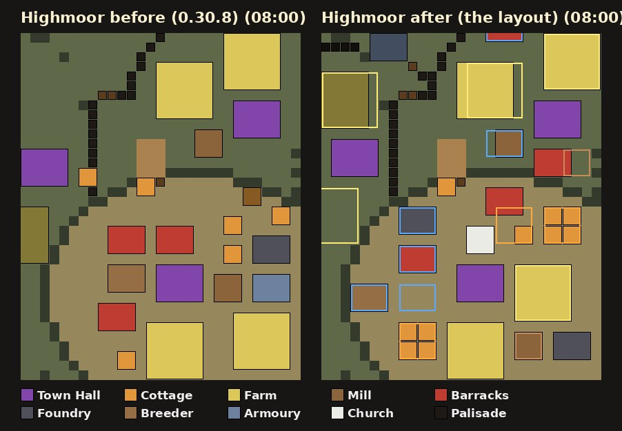
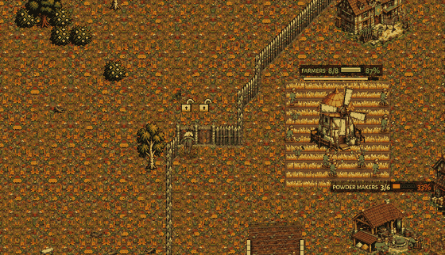

# The Crown computer plays the owner's economy (0.30.9, branch crown-owner-eco)

The owner (2026-11-04 19:46 and 19:57): "First we need a better Crown AI. Can you analyse my log to improve the Crown AI?"
He wants the Crown computer to play his way. His log: `docs/playtests/2026-11-04/human_crown_v_brood_brute_siege_highmoor_0308.txt`
(the owner playing the Crown by hand, about 130 actions a minute, against a Hard Brood on its Brute siege plan, Highmoor; he
held it for 16 minutes and kept pace with the Brood's income). His three newest points came from watching Hard Crown Economy
against Hard Brood Economy on 0.30.8 (pictures `eco_v_eco_1..5` in the same folder):

- **A. No early Barracks without a reason**: "Why did it build a Barracks? It built it too soon; I don't think it scouted
  anything ... If you scout a rush you need a Barracks, but if you don't scout that, why make a Barracks?"
- **B. Base layout**: picture 1 (the computer's base) is "a mess"; picture 2 (his) is "much more organized; pay attention to
  the minimap so you can see my base logic and structure".
- **C. Defend at the wall, not on the high ground**: "the Crown army should have left the high ground for the palisade of
  the natural base; the high ground only makes sense when there is no wall".

Design rules followed (docs/design_principles.md): 2 (the defender's advantage: walls and gates, then the high ground; a
small lead must not decide the game, so no hall the army cannot hold), 3 (meaningful base building: placement that has a
reason, builders with an opportunity cost) and 5 (the owner's extreme-rush anchor: the wall and Musketeers in time against
a scouted rush). No unit or building number was changed; proposals are in section 9.

Pictures: `docs/shots/crown_owner_eco/` (captions in its `captions.md`).

## 1. His game as a timeline

Highmoor, 0.30.8, the owner's Crown against the Hard Brood's Brute siege (seed 935948638). From his match log:

| time | labourers | gold earned | army (value) | what he built |
|---|---|---|---|---|
| 0:36 | | | | the ramp Cottage, and the Gate at 0:37: the ramp is shut |
| 1:00 | 8 | 380 | 0 | the second Farm done 1:14 |
| 2:00 | 13 | 760 | 0 | a Cottage 1:52; the second Town Hall going up (laid ~1:46) |
| 3:00 | 17 | 1,520 | 0 | **the SECOND HALL DONE 2:46, before any Barracks**; a Farm at it 3:01 |
| 4:00 | 25 | 2,280 | 0 | the Mill 3:20, Barracks 3:29 and 3:45, 9 palisade pieces at the natural 3:49 |
| 5:00 | 30 | 3,800 | 240 (4 Musketeers) | the first Musketeer 4:27, the Breeder 4:32, a Farm 4:50, the Foundry 4:56, 22 palisade 4:55-4:59 |
| 6:00 | 32 | 5,320 | 580 (9 Musketeers) | the third Barracks 5:19, three Cottages 5:17-5:26, 13 palisade 5:36-5:42 |
| 7:00 | 38 | 6,840 | 1,360 (17 + 2 Field Cannon) | four Cottages 6:18-6:39, Barracks 4-6 at 6:38-6:53 |
| 8:00 | 42 | 8,740 | 2,080 (29 + 2 guns) | two Churches 7:36-7:41, the second Mill 7:47, gates 7:14 and 8:02 |
| 9:00 | 48 | 10,640 | 2,180 | **the third hall 8:15** |
| 10:00 | 58 | 12,540 | 2,710 | 10 more palisade 9:05; the Brutes die at his natural's palisade 9:36-10:46 |
| 12:00 | 59 | 17,360 | 3,450 (46 Musketeers) | 13 Barracks by 11:12, research from 11:21 (2,000 gold in the bank), the third Mill 11:37 |
| 13:00 | 62 | 19,260 | 2,840 | **the fourth hall 12:25** |

His farms paid 63-72% early against the computer's 44-58%. What not to copy: from 9:00 to 11:00 he sat supply-blocked at
105-114 of 126 with 1,400-2,600 gold unspent, and at 15:20 his four Powder Wagons, parked together by the army, blew up in a
chain and the army fell from 4,755 to 1,320.

He laid his second Barracks (3:45) before the Foundry (4:56), against his own rule FOUNDRY BEFORE THE SECOND BARRACKS,
ALWAYS (CLAUDE.md). The computer keeps the rule (question 1 in section 8).

## 2. What changed

All of it on the Economy and Balanced plans (`AICrown.PLANS[...]["owner"]`), Normal and up. `-- owner:off` on the command
line plays as 0.30.8 (the old openings and milestones, none of the rules below): the "before" games here are that.

### 2.1 No Barracks without a reason (point A)

`scripts/ai_crown.gd` PLANS:
- **Economy**: the ramp Cottage and Gate, the second Farm at 7 labourers, the **second hall at 11 labourers** (laid ~1:30,
  standing ~2:05), the Mill at 15 and the **Barracks at 17 labourers once the second hall is laid** (~3:10; the owner's
  3:29), Musketeers from then on, the Foundry at 21, the Breeder at 23. Milestones after it: the second Barracks right after
  the Foundry, the third at 26 labourers, the fourth at 32, a Church at 38, the Armoury at 42.
- **Balanced**: the same opening, the Barracks and the Mill at 14 labourers after the hall, more Musketeers; the opening
  ends there (the Foundry, the second Barracks and the Breeder are milestones: an opening that went on to them kept the army
  at 8 supply till 6:30); **when the scout's first look saw nothing** ("could not see the enemy": its verdict
  "uncertain") the Barracks and the Mill come next (`AICrown._safe_reason`, `_bo_safe`).
- **A scouted rush** (the scout's "rush" verdict, rush evidence) still inserts the wall, the Barracks and the Mill at once,
  soldiers first (`_bo_defence`, both plans); its new hall's gold is no longer held while the rush is feared.
- **The scout leaves at once** (2 s, with four labourers; `AIScout.min_workers`, `OWNER_SCOUT_AT`): it is at the enemy's
  base at ~1:05-1:10 instead of ~1:20, in time to see a rush.
- A wall slot of the new hall takes no Barracks before the plan's own Barracks step (`slot_barracks_ok`, asked by
  `AIExpandWall._fill_slot`).
- **Against the Brood the Balanced plan keeps its Barracks and Mill at 7 labourers** (`bo_brood`): the Brood's fastest
  rush has Raptors at the ramp by ~1:50 and the first look comes at ~1:10; a Barracks laid on the look (tried: 1:11) gave
  the first Musketeer at 2:39 and the gate fell at 2:16 (`tools/test_ai_wall_vs_rush.gd`, the owner's 6-pool anchor).
  The reason is the matchup. The Economy plan against the same rush: section 6.

### 2.2 A Farm at every new hall at once

`AICrown._hall_farm`: the Farm's gold is set aside while the new hall's last fifth goes up, and the Farm is laid the moment
the hall stands, on the spot the layout kept for it (section 3). Measured: 9-19 s after the hall stood (the owner's 15 s;
0.30.8 waited from 3:52 to 5:14 in the eco v eco game).

### 2.3 Cottages ahead of the supply

`AICrown._supply_ahead` replaces the one-at-a-time Cottage: as many Cottages go up at once as the Barracks, Foundries and
halls eat in 26 s (a Cottage's 20 s build and the walk), four at most; in the opening the old margin (two, and two a
Barracks: a Cottage too early is a Musketeer missing against a rush). Measured: never supply-blocked with 300+ gold
while the Crown stood, in any after game (section 6).

### 2.4 The natural's palisade ring by 4-6 minutes, in every matchup

`AICrown.owner_walls` lets AIExpandWall wall the new hall at once (the rule crown-v-brood made for the Brood) in every
matchup, from 45 s after the hall stands; until the ring is closed (85%) its pieces come before the next labourers.
Measured (Economy): 19-53% closed at 5:00, 49-91% at 6:00 (Highmoor: closed at 7:00). Balanced against the Brood lays its ring
late (0-19% at 6:00: the first gun's gold and two Musketeers' come first): question 7.

### 2.5 The third hall when the army can hold it; production scaled to the income

- `AICrown.owner_hall_ok`: from the third hall on, the next comes with 40 labourers (50 for the fourth) and an army of
  0.7 times the labourers in supply, or when the best soil is under 35% (the shared rule wanted one hall per 16 labourers:
  the third at 5:50, which took the army's gold and was the first hall lost). It also holds the shared bank's hall.
- **Labourers non-stop** (`AICrown.owner_labs`): up to 40 labourers the army's share of the economy no longer holds the
  halls' training back (only the Brood army reckoned from crown-v-brood still does), nor does round 5's hold against the
  Clockwork (`AIRound5.hold_labourers`), unless a rush is feared or the enemy is at our buildings (his 38 at 7:00).
- `AICrown._scale_prod`: once the milestones are up, a Barracks (a Foundry every fifth) while what the production can spend
  (a Barracks 240 gold a minute, a Foundry 320) is under 85% of the gold earned in the last 90 s, less the labourers' share,
  every Barracks is busy and nothing else is going up. The first Field Cannon's gold no longer holds the production
  milestones back (the tech still waits for it).

### 2.6 The base layout (point B), 2.7 the wall post (point C), 2.8 the wagons

Sections 3 and 4; the wagons: `AICrown._spread_wagons` puts every Powder Wagon at home by a different hall, six tiles apart
at least (one wagon stays by the main hall as before).

## 3. The base layout

`scripts/ai_crown_layout.gd` (AICrownLayout). Every hall of the Crown computer gets a plan the moment it stands:

1. **Its ground**: the cells on the hall's level (off ramps and terrain) joined to it, within 24 tiles (the main) or 14
   (another hall; inside its wall ring when AIExpandWall planned one).
2. **The economy first**: spots for the Farms and the Mill the hall still lacks, nearest the hall; nothing else is laid
   within a tile of them.
3. **A lattice of 5 x 4 blocks**: a block holds one production building (4 x 3: Barracks, Foundry, Breeder, Armoury, or a
   3 x 3 Church) with a one-tile lane on its right and below, or four Cottages packed in a 4 x 4 square. Of the 20 ways to
   lay the lattice the one with the most whole blocks is taken. Blocks off the ground, at a ramp's mouth, touching the hall,
   over an economy spot or within 2 tiles of the walk from the hall to the ramp's top are dropped.
4. **The Cottage block**: on the main, up to six blocks (at most 45%) that sit farthest at the back (away from the map's
   middle and from the ramp) and on the plateau's edge hold the Cottages, filled from the outermost cell in; the rest are
   production rows, nearest the hall first.
5. Nothing is placed where it would cut part of the ground off (Game._plateau_reach).

The ramp Cottage, a new hall's wall slots and the Farms keep their own spots; when the layout has no room the shared search
places the building. `-- layout:off` switches it off.

- `01_main_before_0700.jpg` / `02_main_after_0700.jpg`: the owner's Highmoor main at 7:00, the same camera as his picture 2:
  before, the buildings wherever the shared search found room; after, four Cottages in a square at the main's back corner
  (and four more by the Farms), the production in a column with lanes down the plateau's west side, the Farms and the Mill
  by the hall. `03`/`04` the same at 10:00.
- `05_layout_map_before_after_0800.jpg` (above): the main as a map at 8:00, one square a tile (`tools/crown_layout_pics.py`,
  from the game's own ground and buildings: `base_MMSS.json` written by the coach); after, the layout's blocks outlined
  (orange Cottage blocks, blue production rows, yellow Farm spots, brown Mill spots). `06_layout_plan_main.jpg`: the plan at
  5:00, before most of it is built. `15_layout_redrock_before_after_0800.jpg`: Redrock Canyon's bigger plateau: one
  production row across the middle, a Cottage block either side.
- Highmoor's corner main is small: about 5-6 production blocks after the Farms, the Mill and the walk to the ramp; the rest
  of the production goes into the natural's wall slots, then (layout full) the shared search.

## 4. The wall post (point C)

`scripts/ai_crown_hold.gd` section 6 (`_wall_plan`, called first by `hold_top`): when the threat is at a hall whose wall
ring is at least 70% closed, the army goes to the **inside of that wall where it is hit**: the Musketeers on HOLD in rows
1-3.3 tiles behind the palisade nearest the claws (a musket reaches 190 px: over the stakes), the guns 3.6-6.5 tiles
behind them, facing out; labourers mend the most hurt piece of that stretch (the edge post's menders, who run back into the
base when a claw comes). The cliff edge (crown-cliff-edge) is kept for a hall with no wall, the ramp post for the main.
`-- wallpost:off` switches it off.

- `11_before_army_on_the_high_ground_0855.jpg`: 0.30.8, the army at the main's ramp top while the Brood is at the natural.
- `12_after_wall_post_0815.jpg`, `13_after_wall_post_0821.jpg`, `14_after_menders_at_the_wall_0829.jpg`: after, the Brood
  (Raptors, Spitters, Tyrant Challengers, Brutes) at the natural's palisade, the Musketeers and two Field Cannon inside the
  wall at its gate, firing over it.
- In the coached games the wall post took the army 4-27 times a game in every game whose natural was walled (column "wall
  post / cliff edge moves" in section 6), 0 in the three Balanced games against the Brood whose ring was not closed; the
  cliff edge still moves for an attack on a hall without a closed wall (a third hall laid outside the ring).

## 5. The computer against his numbers

The owner's game against the same set-up played by the computer (Highmoor, seed 935948638, the Crown in the second slot,
the Hard Brood's Brute siege; Economy plan; "before" = `-- owner:off`, "after" = this branch; numbers from the match's own
counters, `tools/play_crown_owner_eco.gd` owner.txt):

| time | labourers: owner / before / after | gold earned | army value | supply-blocked with 300+ gold, s so far: before / after |
|---|---|---|---|---|
| 02:00 | 13 / 10 / 12 | 760 / 760 / 760 | 0 / 0 / 0 | 0 / 0 |
| 03:00 | 17 / 15 / 16 | 1520 / 1140 / 1520 | 0 / 60 / 0 | 0 / 0 |
| 04:00 | 25 / 20 / 26 | 2280 / 1900 / 2280 | 0 / 180 / 0 | 0 / 0 |
| 05:00 | 30 / 21 / 33 | 3800 / 2660 / 3800 | 240 / 240 / 120 | 0 / 0 |
| 06:00 | 32 / 29 / 40 | 5320 / 3800 / 5320 | 580 / 570 / 340 | 0 / 0 |
| 07:00 | 38 / 35 / 40 | 6840 / 5700 / 7220 | 1360 / 745 / 1135 | 0 / 0 |
| 08:00 | 42 / 40 / 42 | 8740 / 7600 / 9120 | 2080 / 1320 / 1975 | 0 / 0 |
| 09:00 | 48 / 27 / 37 | 10640 / 9120 / 10640 | 2180 / 1440 / 1975 | 0 / 0 |
| 10:00 | 58 / 26 / 40 | 12540 / 9880 / 11780 | 2710 / 225 / 3010 | 0 / 0 |

- **The economy now has his shape**: the second hall laid at 1:33 (his ~1:46), the first Barracks at 3:07 after it (his
  3:29), 26 labourers at 4:00 (his 25), 40 at 6:00 (his 32); the gold earned is his to the coin from 2:00 to 8:00 (the farms
  pay in 380-gold harvests: equal harvests, equal sums) and a little ahead at 7:00-8:00; before it was 1,140 behind at 6:00.
- **The army**: behind him from 5:00 to 7:00 (120 / 340 / 1,135 against his 240 / 580 / 1,360: he put more of the same
  gold into Barracks earlier, two by 3:45, against the Foundry rule, question 1), level at 8:00 (1,975 against 2,080), ahead
  at 10:00 (3,010 against 2,710). Before, 1,320 at 8:00 and the Brood in the base by 10:00 (225).
- **Never supply-blocked with 300+ gold** in either game (column 5). He sat blocked at 105-114 of 126 from 9:00 to 11:00
  with 1,400-2,600 in the bank; the computer's Cottages go up ahead (two to four at once).
- **The natural's ring**: half closed at 5:00, 76% at 6:00, closed by 7:00 (his 3:49-5:42); before, 6%.
- After, the Brood took one hall (the third, laid outside the ring at 7:50) and at 12:00 the Crown stood on three halls with
  43 labourers; its first attack went out at 10:05 with 52 supply. Before, four halls fell and the main was razed by 12:00.
  He held all of his for 16 minutes.

## 6. The coached games, before and after

Hard Crown (Economy "eco" or Balanced "bal") against the Hard Brood (Brute siege, Spitter timing, Economy, Timing, Rush) and
the Hard Clockwork (Balanced, Economy, Rush, Timing) on Highmoor (hm), Redrock Canyon (rr), Thornwood Maze (tw) and Greenhold
(gh), to 12:00. Seeds: the owner's (Highmoor 935948638 and Redrock 2554909278, the Crown in the second slot as in his logs),
Thornwood 2103718835, Greenhold 11. Columns: labourers / gold earned / army value at each minute; supply-blocked with 300+
gold (seconds, whole game); the first Barracks and why; the second hall laid; the share of the natural's ring closed at
5:00 / 6:00; the wall post / cliff edge moves; halls lost by 12:00; the clock at the end (12:00 or the game's end). The games
are not exactly repeatable (the same seed played twice parts after a few minutes): read the patterns.
`python3 -I tools/crown_owner_eco_report.py DIR` makes this table.

| game | 4:00 labs / gold / army | 5:00 | 6:00 | 7:00 | 8:00 | blocked with 300+ gold (s, to 12:00) | first Barracks | 2nd hall | natural closed 5:00 / 6:00 | wall post / cliff edge moves | halls lost | end |
|---|---|---|---|---|---|---|---|---|---|---|---|---|
| the owner (Highmoor, by hand) | 25 / 2280 / 0 | 30 / 3800 / 240 | 32 / 5320 / 580 | 38 / 6840 / 1360 | 42 / 8740 / 2080 | 0 to 9:00 (then 105-114/126) | 3:29 (after the 2nd hall) | 1:46 (done 2:46) | ring 3:49-5:42 | (at the palisade) | 0 | held 16 min |
| hm_eco_brute before | 20 / 1900 / 180 | 21 / 2660 / 240 | 29 / 3800 / 570 | 35 / 5700 / 745 | 40 / 7600 / 1320 | 0 | 0052 (no hall 2 yet, no rush scouted) | 0309 | 0.06 / 0.06 | 0 / 15 | 4 | 1200 |
| hm_eco_brute after | 26 / 2280 / 0 | 33 / 3800 / 120 | 40 / 5320 / 340 | 40 / 7220 / 1135 | 42 / 9120 / 1975 | 0 | 0307 (after the 2nd hall) | 0133 | 0.50 / 0.76 | 8 / 1 | 1 | 1200 |
| hm_bal_spitter before | 15 / 1520 / 420 | 16 / 2280 / 540 | 17 / 2660 / 810 | 24 / 3800 / 850 | 25 / 4560 / 950 | 54 | 0042 (no hall 2 yet, no rush scouted) | 0524 | -1.00 / 0.00 | 0 / 24 | 2 | 1200 |
| hm_bal_spitter after | 14 / 1520 / 240 | 17 / 2280 / 240 | 22 / 3040 / 240 | 27 / 4180 / 525 | 27 / 5700 / 1065 | 16 | 0044 (no hall 2 yet, no rush scouted) | 0325 | 0.00 / 0.03 | 4 / 27 | 2 | 1200 |
| rr_eco_eco before | 19 / 1900 / 180 | 22 / 2660 / 240 | 26 / 3800 / 380 | 32 / 5320 / 745 | 39 / 6460 / 1270 | 0 | 0052 (no hall 2 yet, no rush scouted) | 0312 | 0.06 / 0.06 | 0 / 8 | 2 | 1200 |
| rr_eco_eco after | 23 / 1900 / 0 | 32 / 3420 / 180 | 37 / 4940 / 340 | 40 / 6840 / 845 | 42 / 8740 / 1830 | 95 | 0324 (after the 2nd hall) | 0134 | 0.25 / 0.49 | 8 / 1 | 3 | 1200 |
| rr_bal_brute before | 15 / 1520 / 420 | 16 / 2280 / 540 | 18 / 3040 / 870 | 23 / 3800 / 970 | 23 / 4940 / 1025 | 0 | 0041 (no hall 2 yet, no rush scouted) | 0524 | -1.00 / 0.04 | 0 / 27 | 2 | 1200 |
| rr_bal_brute after | 14 / 1520 / 240 | 19 / 2280 / 300 | 24 / 3420 / 420 | 28 / 4180 / 750 | 29 / 6080 / 1100 | 0 | 0044 (no hall 2 yet, no rush scouted) | 0324 | 0.00 / 0.00 | 0 / 24 | 1 | 1200 |
| tw_eco_spitter before | 18 / 1900 / 180 | 19 / 2660 / 300 | 22 / 3420 / 560 | 27 / 4560 / 965 | 32 / 5700 / 1145 | 0 | 0052 (no hall 2 yet, no rush scouted) | 0307 | 0.06 / 0.06 | 0 / 13 | 2 | 1200 |
| tw_eco_spitter after | 23 / 2280 / 0 | 33 / 3420 / 120 | 37 / 4940 / 240 | 45 / 6460 / 400 | 45 / 7600 / 555 | 18 | 0325 (after the 2nd hall) | 0135 | 0.26 / 0.65 | 4 / 5 | 0 | 1200 |
| tw_bal_rush before | 13 / 1520 / 420 | 14 / 2280 / 600 | 17 / 2660 / 640 | 20 / 3800 / 640 | 27 / 4560 / 935 | 0 | 0042 (no hall 2 yet, no rush scouted) | 0534 | -1.00 / 0.00 | 0 / 14 | 1 | 1200 |
| tw_bal_rush after | 15 / 1520 / 360 | 16 / 2280 / 420 | 15 / 3040 / 420 | 20 / 3420 / 480 | 22 / 4560 / 890 | 0 | 0045 (no hall 2 yet, no rush scouted) | 0410 | 0.19 / 0.19 | 0 / 15 | 1 | 1200 |
| gh_eco_tim before | 18 / 1900 / 120 | 19 / 2660 / 180 | 27 / 3800 / 530 | 29 / 4940 / 690 | 17 / 5320 / 1010 | 0 | 0052 (no hall 2 yet, no rush scouted) | 0311 | 0.06 / 0.12 | 0 / 16 | 2 | 1148 |
| gh_eco_tim after | 23 / 2280 / 0 | 30 / 3800 / 180 | 39 / 4940 / 280 | 39 / 6840 / 1050 | 21 / 7600 / 570 | 66 | 0320 (after the 2nd hall) | 0135 | 0.35 / 0.53 | 13 / 1 | 2 | 1117 |
| gh_bal_eco before | 15 / 1520 / 420 | 16 / 2280 / 540 | 17 / 2660 / 810 | 22 / 3800 / 925 | 27 / 4940 / 1025 | 0 | 0042 (no hall 2 yet, no rush scouted) | 0527 | -1.00 / 0.00 | 0 / 18 | 0 | 1200 |
| gh_bal_eco after | 14 / 1520 / 240 | 17 / 2280 / 240 | 20 / 3040 / 300 | 27 / 3800 / 560 | 29 / 5320 / 1110 | 0 | 0045 (no hall 2 yet, no rush scouted) | 0330 | 0.00 / 0.00 | 0 / 35 | 1 | 1200 |
| hm_eco_cw before | 16 / 1520 / 120 | 22 / 2660 / 300 | 26 / 3800 / 420 | 34 / 5320 / 850 | 40 / 6840 / 1360 | 53 | 0052 (no hall 2 yet, no rush scouted) | 0307 | 0.06 / 0.06 | 0 / 5 | 0 | 1200 |
| hm_eco_cw after | 22 / 2280 / 0 | 27 / 3040 / 0 | 37 / 4180 / 100 | 43 / 6460 / 605 | 45 / 8740 / 1250 | 0 | 0326 (after the 2nd hall) | 0147 | 0.53 / 0.91 | 27 / 0 | 0 | 1200 |
| rr_bal_cw before | 14 / 1520 / 420 | 16 / 2280 / 480 | 21 / 3040 / 600 | 28 / 4180 / 835 | 36 / 5320 / 1180 | 0 | 0041 (no hall 2 yet, no rush scouted) | 0452 | 0.00 / 0.04 | 0 / 1 | 0 | 1200 |
| rr_bal_cw after | 21 / 2280 / 0 | 29 / 2660 / 115 | 36 / 4560 / 275 | 40 / 6460 / 555 | 40 / 7980 / 1165 | 0 | 0306 (after the 2nd hall) | 0134 | 0.04 / 0.18 | 5 / 0 | 0 | 1200 |
| tw_eco_cw before | 14 / 1900 / 240 | 17 / 2660 / 360 | 20 / 3420 / 420 | 25 / 4180 / 600 | 28 / 5320 / 1070 | 0 | 0052 (no hall 2 yet, no rush scouted) | 0311 | 0.13 / 0.13 | 0 / 5 | 0 | 1200 |
| tw_eco_cw after | 19 / 1900 / 0 | 22 / 2660 / 60 | 26 / 3420 / 180 | 26 / 4180 / 425 | 30 / 5700 / 755 | 4 | 0331 (rush scouted () | 0147 | 0.19 / 0.65 | 6 / 9 | 0 | 1200 |
| gh_bal_cw before | 14 / 1520 / 420 | 16 / 2280 / 480 | 22 / 3040 / 640 | 28 / 4180 / 815 | 35 / 6080 / 1155 | 0 | 0042 (no hall 2 yet, no rush scouted) | 0448 | 0.00 / 0.06 | 0 / 3 | 0 | 1200 |
| gh_bal_cw after | 16 / 1900 / 0 | 24 / 2660 / 60 | 28 / 3800 / 215 | 38 / 5320 / 610 | 40 / 7600 / 1145 | 8 | 0320 (after the 2nd hall) | 0147 | 0.29 / 0.29 | 18 / 3 | 0 | 1200 |

In sum (averages per game):

| | games | halls lost (all games) | gold earned by 8:00 | army at 6:00 | army at 8:00 | labourers at 8:00 |
|---|---|---|---|---|---|---|
| Economy v Brood, before | 4 | 10 | 6,270 | 510 | 1,186 | 32 |
| Economy v Brood, after | 4 | 6 | 8,265 | 300 | 1,232 | 37.5 |
| Balanced v Brood, before | 4 | 5 | 4,750 | 782 | 983 | 25.5 |
| Balanced v Brood, after | 4 | 5 | 5,415 | 345 | 1,041 | 26.75 |
| Economy v Clockwork, before | 2 | 0 | 6,080 | 420 | 1,215 | 34 |
| Economy v Clockwork, after | 2 | 0 | 7,220 | 140 | 1,002 | 37.5 |
| Balanced v Clockwork, before | 2 | 0 | 5,700 | 620 | 1,167 | 35.5 |
| Balanced v Clockwork, after | 2 | 0 | 7,790 | 245 | 1,155 | 40 |

Read:
- **No Barracks without a reason**: every Economy game after laid its first Barracks after the second hall (3:07-3:31;
  on Thornwood against the Clockwork the scout had also just called a rush); before, at 0:52 in every game. Balanced: after
  the hall against the Clockwork (3:06-3:20); against the Brood at 0:44 (the matchup, section 2.1).
- **The second hall at 1:33-1:47** in every Economy game and Balanced against the Clockwork (before 3:07-3:12, Balanced
  4:48-5:34); Balanced against the Brood 3:24-4:10.
- **More gold, more labourers**: by 8:00 the after games had earned 14-37% more on average, with 4-6 more labourers.
- **Fewer halls lost against the Brood with Economy** (10 to 6 over four games), the same with Balanced (5 to 5), none
  against the Clockwork either way. The owner's hand-play held for 16 minutes.
- **The army is smaller from 5:00 to 7:00** in every after game (300 against 510 at 6:00 with Economy; the owner's own was
  580): the gold goes to the second hall, the labourers and the ring first, as in his game; it catches up by 8:00 against the
  Brood, not quite against the Clockwork (whose early army never punished it in these games). See question 1 and section 9.
- **Supply-blocked with 300+ gold**: never while the Crown still stood, in any after game (the 66 s and 95 s in two rows
  came after the Brood had razed every hall and Cottage: no cap left); before, 53-54 s in two games.
- **Losses**: on Redrock against the Brood's Economy (the owner's seed) the after game lost all three halls by 10:00
  (before: two by 12:00); on Greenhold against the Timing both lost two, the after game earlier (9:00 against 11:48). The
  Hard Brood still beats the Crown computer in most of these games; what changed is the economy and the shape of the base,
  not yet the result.
- One rule was tried and backed out: the natural's ring before the first gun's gold. It closed the ring by 6:00 in every
  Economy game but gave 20 labourers at 4:00 instead of 26 and a smaller army at 8:00 (1,605 against 1,975 on Highmoor).

## 7. Tests

- `tools/test_crown_owner_eco.gd` (new; Greenhold seed 11, Hard Crown Economy against a Hard Brood Economy that sends no
  army): no Barracks before the second hall without a scouted rush; the second hall by 3:00; every new hall's Farm within
  20 s; never supply-blocked over 15 s at a stretch with 300+ gold; 22 labourers or more at 4:00; the Cottages in the
  layout's Cottage block and the production buildings in its rows (75% or more); eight Raptors put at the natural's
  palisade at 6:30 bring the army inside that wall (the wall post), not to the main's cliff edge. ALL PASS.
- Still passing on this branch: `test_crown_v_brood` (0 failures), `test_crown_build_order` (ALL PASS; its plan table now
  knows the triggers "halls" and "look"), `test_crown_siege`, `test_crown_balloon`, `test_expansion_spots` (ALL OK) and
  `test_ai_wall_vs_rush` (ALL PASS in 3 of 4 runs; the fourth lost 4 units by 3:20, two Musketeers in the fight at the
  gate, with the same timeline: Barracks and Mill at 0:46, Musketeers at 2:08, 2:23, 2:38; the game is not exactly
  repeatable; `-- owner:off` passed 2 of 2).
- `-- crown:economy` on `test_ai_wall_vs_rush` (not a test the plan must pass, question 3): the Barracks on the scout's
  rush evidence at 1:35, the first Musketeer at 2:46, 3 units lost.
- Tools: `tools/play_crown_owner_eco.gd` (the coached games: owner.txt, base_MMSS.json, main/natural/wall post pictures
  and a clip), `tools/crown_owner_eco_report.py` (section 6's table), `tools/crown_layout_pics.py` (the layout maps).

## 8. Open questions (the owner decides)

1. **The Foundry before the second Barracks** (CLAUDE.md, DECIDED 2026-11-03): in his own game he laid two Barracks (3:29,
   3:45) before the Foundry (4:56). The computer keeps the rule (the Economy plan's second Barracks comes right after the
   Foundry, ~4:30). Should the owner's economy opening go two Barracks first, the Foundry third?
2. **Balanced against the Brood**: its Barracks and Mill stay at 7 labourers (`bo_brood`), the matchup being the reason
   (section 2.1); its second hall now comes at 12 labourers (~3:25) instead of 15 (~5:25). Its army at 6:00 is about half
   of before's (345 against 782 on average: the hall's and the labourers' gold), about the same at 8:00 (1,041 against
   983), and it lost as many halls (5 in four games). Keep it, or make Balanced wait for the scout too and accept that the
   Brood's fastest rush breaks the gate (section 2.1)?
3. **The Economy plan against the Brood's fastest rush** (the scripted extreme rush of `tools/test_ai_wall_vs_rush.gd`,
   `-- crown:economy`): its Barracks comes on the scout's evidence at 1:35, the first Musketeer at 2:46, 3 units lost by
   3:20 (the test asks 2 at most and 3 Musketeers by 2:40, which only an early Barracks gives). That is the gamble the
   owner's rule takes ("if you don't scout that, why make a Barracks?"); the Balanced plan is the safe one.
4. **The scout's first look at the Brood is blind** in most games ("could not see the enemy: the Mother, 0 Rootmaws and 0
   grubs seen"): it sees the Mother and walks home. A wider loop round the Mother (where the Rootmaws and grubs are) would
   give the Economy plan its "no rush" answer and Balanced a real reason; worth a job of its own.
5. **The third hall** comes with 40 labourers and an army of 0.7 times them (his: 42 and 29 Musketeers at 8:15); the fourth
   with 50. Right numbers?
6. **The layout's Cottage block** is chosen at the main's back edge, away from the ramp; on a small plateau (Highmoor's
   corner main) it holds about 5-6 blocks of production, the rest of the production goes into the natural's ring (its
   wall slots first) or, when the layout is full, the shared search. His own base packed the Cottages along the map's
   edge in two columns: the computer's are 4 x 4 squares with a lane between columns.
7. **Balanced against the Brood lays its natural's ring late** (0-19% at 6:00): the anti-rush Barracks at 0:44, the early
   Musketeers, the first Field Cannon's gold and the wall's keep for two Musketeers all come before it. Should the owner's
   ring rule go before the gun there too? (Tried for every plan and backed out: it cost the Economy plan labourers.)

## 9. Proposals (balance, not changed here)

- None of the owner's points needed a number changed. Two ideas from these games:
- His farms paid 63-72% early, the computer's 44-58% (0.30.8) and about the same now: the farms pay in lumps (a harvest
  every ~40 s with a full crew), so a labourer walking between a far farm and the hall loses a harvest's share. Farms next
  to their hall (the layout now keeps their spots by the hall) are the AI's half; a smaller lump paid more often (the same
  total) would make every early reserve wait less (also proposed in docs/crown_v_brood.md).
- Against the Clockwork the round-5 rule held the Crown's labourers until its army caught up; on the owner's plans it no
  longer does up to 40 labourers (section 2.5). If the Clockwork's early pushes punish that in the owner's own games, a
  lighter hold (the Clock Soldiers seen at our wall, not the clock) is the place to look.

