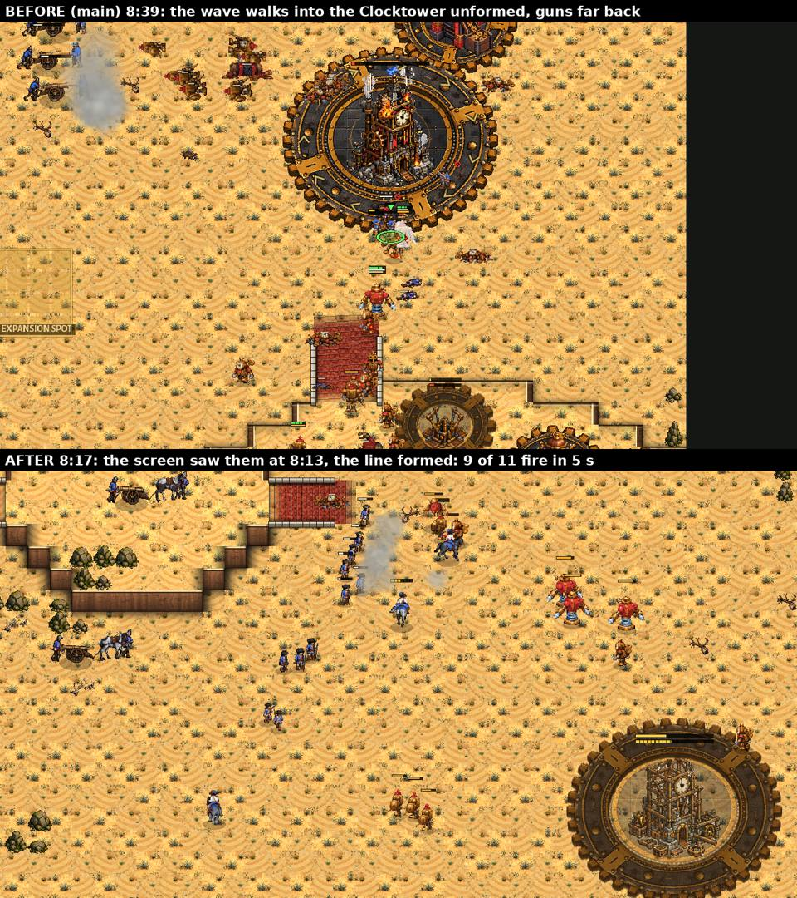
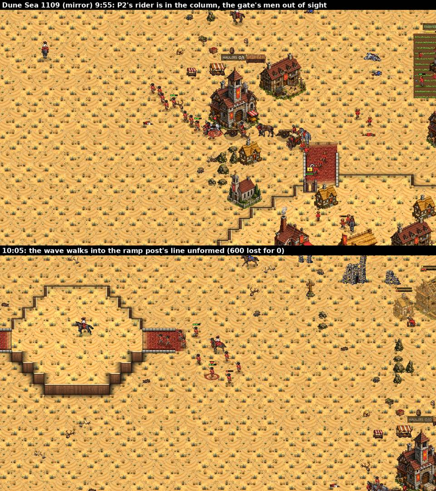
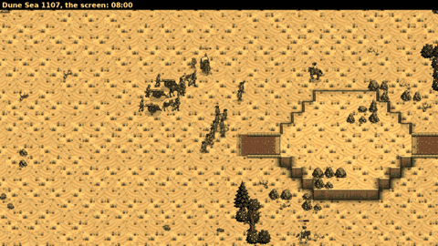

# crown-rider-screen: Horsemen ahead of the Crown's line

The owner (2026-11-12 08:03): "This line movement work is great and also should be paired with Horsemen on front
scouting." crown-line-fight (0.33.24, docs/crown_line_fight.md) made the Crown computer's waves form the player's
drag-a-line with the guns behind it, but found that most fights still began unformed: the line forms only on what the
Crown knows (an enemy in sight or seen in the last 20 s), a musket sees 8 tiles and reaches 6, so the enemy army was
first seen at contact. It named the rider screen as the answer.

Rules followed: docs/design_principles.md 1 (fair: the computer uses its riders as a player would and knows only what they
see) and 4 (scouting reveals strategy; battles with formed lines). The owner's Crown rules are untouched (the walled
natural with its gate toward the ramp and the army at the gate, 3 Field Cannons before any Mortar, the Foundry before the
second Barracks, the OPTIMAL opening). No unit, building or economy number was changed. The Horseman rush, the raids
(Horsemen, Dragoons) and the Balloon harass keep their own riders and play. The Clockwork and Brood computers are
untouched (everything is in `AICrown`; the shared code only calls in).

**Switch:** `-- screen:off` plays as before (no screen, no picket, no riders trained for them).

## What was built (`scripts/ai_crown_screen.gd`, class `AICrownScreen`)

1. **The screen ahead.** While a Crown wave marches (the main army's wave with a line to form: not a riders' wave, not
   the Horseman rush), 2 Horsemen ride for it (3 from 20 supply, 4 from 40): its own Horsemen first, then the free ones
   at home, then the map loop's rider scouts (AICrownHold: while a wave's screen is short the loop takes no new scout).
   The lead rides 620 px ahead of the wave's head along its road (`Game.find_path` to the wave's target, looked up every
   3 s), two flankers 300 px ahead and 430 px out to each side, a fourth beside the lead. They never fight the enemy
   army: each keeps 360 px from every enemy soldier known (its spot pulled back along the road), and backs off toward the
   wave from anything that can catch it (as fast as 85% of a Horseman, within 300 px), shoot it (a reach of 80+, within
   its reach + 110 px) or stands next to it, and from a Ratchet Turret's reach. A rider below 30% of its hit points
   leaves the screen; none below 45% is taken.
2. **The line knows what the screen sees.** `AICrownLine._known` takes the riders as the wave's eyes: an armed enemy in
   sight within 300 px of a screen rider (a Horseman sees 256) counts as "ahead" while it is within 1,300 px of the
   wave's body (the line's own eyes reach 760), and is remembered 20 s where it was seen, as before. So the line HALTS
   and FORMS on the screen's sighting, out of reach and facing the enemy (the line's own rules: 330 px from the nearest
   enemy, never ahead of its head; then it steps on with its guns). The log says so: "forms its line before the enemy
   army ahead (480): 10 muskets in 1 rank, 2 guns behind (its screen saw it 555 px off)".
3. **At contact** (the line's fight, or its falling back) the riders pull back: the flankers to beyond the line's ends,
   a little behind the front rank; the lead behind the guns, off to one side; a rider in front of the line rides out
   round its end first (never through its fire). Then the FLANK WORK, each from its post on a 620 px leash: what comes
   at our guns first, then enemy workers, the hurt (under 40%) and the stragglers and scouts alone; never a prey with two
   enemies beside it that can catch or shoot a rider, never one in front of the muskets. Won the field, the riders take
   their places on the screen again.
4. **The picket at home.** While the army is at home (and not in the Horseman rush), one free Horseman stands 520 px
   forward of the army's post (the natural's gate post once there is one, else the cliff edge's line, else the ramp's
   top) along the road toward the enemy's base, on HOLD. When it sees an armed force worth 150 or more it says so in the
   log, rides back to the post (behind the gate post's line, or into the main behind the ramp post) and stays back while
   the enemy is about (25 s at least); anything that can catch or shoot it sends it back at once. When a wave goes out
   short of riders, the picket rides with it.
5. **Riders for it.** The Barracks trains a Horseman for the screen and the picket (the screen's own training, every
   second, with 40 gold to spare over its price, not while the hall plan keeps its gold or the enemy is at home) while
   fewer than 3 sound Horsemen (45%+) are free for them (the loop's scouts count) and fewer than 5 are alive and in
   training, once the plan has a Horse Breeder, 4:00 has passed and the line has 8 supply of muskets. The shared
   training reaches its turn too, but it seldom does (the Barracks wait for the guns' gold, crown-hold).

The riders are out of the shared army's orders while on the screen or the picket (`AI._on_errand`), so the line, the
harass's strays and the micro leave them alone. The match log's new lines have AI STORY rows (`scripts/ai_story_lines.gd`,
pt and es in `tools/i18n/63_crown_screen.txt`): "'s wave sends 2 Horsemen ahead and to its flanks as a screen", "'s screen
pulls back to the line's flanks at contact", "'s screen rider rides down a worker on the flank", "'s screen rider is
lost", "sets a Horseman as a picket on the road 520 px out from its post", "'s picket sees a force coming (490: 7
soldiers) and rides back to the post".

## Tools

- `tools/film_line.gd` (crown-line-fight's film, extended; it changes no rule): every engagement in `engage.json` now has
  its WARNING (how long the enemy soldiers in it had been in the Crown's sight when it began: each enemy soldier's
  sighting starts when it comes into sight; `warn` is the median of those near the contact, `warn_first` the earliest,
  60 s at most), the line's state just before it (`prev_st`: form / step / set / advance / back = FORMED) and the seconds
  since the line was last laid; `screen.json` has the screen's counts per Crown side (riders sent, lost on the screen,
  pickets lost, the line formed on the screen's sightings, the picket's warnings, the flank work's rides, riders
  trained).
- `tools/study/crown_screen_report.py`: crown-line-fight's tables plus the screen's (away fights formed when they began,
  the warning, the trade, the screen's counts).
- `tools/test_crown_rider_screen.gd`: a marching wave sends its Horsemen ahead; a rider gets 250+ px ahead of the
  muskets; the screen sees an enemy army 1,100 px down the road and the line forms on it at least 4 s before contact;
  at contact the riders pull back (none in front of the muskets), none is lost; at home a picket stands 300+ px forward
  of the post toward the enemy, sees a force coming, warns and rides back.

## The sessions (coached)

(Times are game time; P1 is the first start spot. The games are not deterministic: a replay of a seed is the same start,
not the same game. Main = 0.33.24, the line without the screen.)

### Round 1: Greenhold 1101 (Crown v Clockwork), Kestrel Rise 1130 (v Brood), the first cut

- **Greenhold 1101, 6:44:** the first wave went out with one Horseman, and he was the loop's scout, hurt (he had been
  handed to the harass at 5:09 and came home at 5:55): the screen had nobody, the wave met the Clock Soldiers at 7:01
  unformed. No rider was trained for the screen in 12 minutes: the shared training reaches the screen's turn only after
  a random pick and the scout's, and the Barracks were held for the guns' gold (crown-hold's first Field Cannons) most of
  the time. **Fix:** the screen trains its own rider (point 5).
- **Kestrel Rise 1130, 3:04:** the picket took one of the three Horsemen the Rush plan was gathering for its Horseman
  rush (4:51). **Fix:** no picket during the rush (as the loop's scouts: none then).
- A counter (`pulled`) counted contacts with no rider out (91 in one game). Fixed.

### Round 2: Greenhold 1103 (the mirror), Dune Sea 1107, Kestrel Rise 1131 (v Clockwork)

- **Greenhold 1103 (mirror), P2 11:41-11:45:** the wave sent 2 riders ahead; 4 s later "forms its line before the enemy
  army ahead (345): 10 muskets in 1 rank, 1 gun behind (its screen saw it 717 px off)". P1's wave (7:07) sent 3 riders,
  but at 7:12 it met an enemy scout party at a turn of the road before the screen was out in front.
- **The picket "warned" for one enemy scout** (115: 1 soldier) six times in the mirror: anything that could catch it sent
  it back with a warning. **Fix:** a warning only for a force worth 150 or more (a scout sends it back without one).
- **Every game:** a hurt rider (under 60%) was never taken, and most of the Crown's Horsemen were hurt from the harass.
  **Fix:** a rider from 45% may screen (it keeps out of reach: it is there to see), and leaves the screen under 30%.
- **The loop's scout and the screen fought over the newest rider** (7:46: "sends a Horseman to scout the map" and "the
  wave sends 1 Horseman ... as a screen" in the same second). **Fix:** the loop takes no new scout while a wave's screen
  is short (`AICrown.screen_short`).

### Round 3: Dune Sea 1107 (Crown v Clockwork), filmed, main against the screen

The key picture. On main the wave walked into the Clockwork's Clocktower at 8:39-8:40 strung out, its three guns far back
on the left ("meets the enemy before its line is formed: 6 muskets deploy into a line through the 4 already firing").
With the screen (8:13): "forms its line before the enemy army ahead (450): 11 muskets in 1 rank, 3 guns behind (its screen
saw it 334 px off)"; at 8:15 the fight began with the line formed: 9 of its 11 muskets fired in the first 5 s, 1,615
killed for 360. The riders worked the flank (8:15 "rides down a worker on the flank", 9:05 a hurt Clock Soldier, 9:29 a
hurt Springer); 12 flank rides, no rider lost.

But at 8:17 (the lower picture) the lead rider, riding back from ahead, stood in front of the line's muskets, in their
fire. **Fix:** a rider in front of the line rides out round its end first, then to its post.

### Round 4: Kestrel Rise 1133 (the mirror), Hollowfen 1151 (v Brood), Ashford Crossing 1128 (v Clockwork)

- **Ashford Crossing 1128, P2 8:08-8:37:** the wave sent its rider at once; at 8:31 "forms its line before the enemy army
  ahead (270): 10 muskets in 1 rank, 2 guns behind (its screen saw it 799 px off)", contact at 8:37 (6 s): 8 of 10
  muskets fired in the first 5 s, but the Clockwork army was the bigger one (590 killed for 1,055) and the line fell back
  in order at 8:45.
- **Kestrel Rise 1133 (mirror), P1 10:27:** formed on the screen's sighting 476 px off; 17 flank rides in the game (the
  enemy's workers, hurt Musketeers, two Horsemen), no rider lost. P2's picket stood on the road from its ramp from 5:49,
  but P1's three attacks (8:43, 9:10, 10:26) came at its natural from the other side: it warned once (10:58). One picket
  on one road (see "What is still wrong").
- **Hollowfen 1151 (v Brood):** the Horseman rush succeeded (5:10), the picket stood from 5:51 and warned at 9:34 ("a
  force coming (150: 6 soldiers)"); the Brood came to the walled natural at 9:36, the fight began with 2.5 s of warning
  by the measure (17.5 s for the first enemy seen) and the Crown won it, 1,165 killed for 230. No Crown wave went out in
  12 minutes (the Brood army was reckoned bigger), so no screen.

### Round 5: the first after batch, cut at 18 games; Dune Sea 1109 (the mirror) filmed

The first after batch (the code of round 4) was looked at game by game after 18 games (its data: the measure of the
first cut, below). The screen went out with most waves (25 riders sent in the 9 Clockwork and mirror games looked at, none
lost), but the line formed on its sighting in only 2 of them. Dune Sea 1109 (the mirror), P2's second wave, filmed every
5 s from 9:40: its two riders backed off "from the enemy (1 near)" at 9:47, 9:55 and 10:06, the line never formed, and at
10:06 the wave walked into P1's ramp post unformed, 13 muskets deploying under its fire: 600 lost for 0, falling back at
10:39. The screen had seen two or three of P1's Musketeers at the ramp's gate (the rest of the ramp post's line stood
behind the lip, out of a rider's sight from below), worth under a quarter of the wave: the line's rule for an army ahead
(SEE_SHARE).

**Fixes:** what the screen sees counts from 8% of the wave (100 at least: `AICrownLine.SCREEN_SHARE`, `SCREEN_MIN`): a few
seen up ahead are often the front of more. Replayed (headless, the same start): P2's first wave formed at 7:26 "before the
enemy army ahead (115) ... (its screen saw it 975 px off)". And the picket rode back from the first enemy musket without a
warning (a musket's reach, 190 + 110 px, is longer than a Horseman's sight, 256): two soldiers that can catch or shoot it
are now a warning too. The after batch was started again with this code.

The Dune Sea 1107 screen at work (the after picture above, every 10 s from 8:00):

## Numbers

The batches: `tools/study/crown_line_fight.py` (crown-line-fight's: Hard Crown OPTIMAL against Hard Brood, Clockwork and
Crown OPTIMAL; the qa-matches base tags and seeds on 8 maps of different shapes: Greenhold, Dune Sea, Hollowfen, Kestrel
Rise, Ashford Crossing, Red Coast, Frostmere, Border March; both start slots; 16 games a matchup) to 12:00, filmed with this
job's `tools/film_line.gd` (so main has the warning and the line's state too); tables by `python3
tools/study/crown_screen_report.py docs/crown_rider_screen/data/main docs/crown_rider_screen/data/after`. The data (each
game's result.json, engage.json, screen.json, coach.txt and the Crown's lines of the match log) is in
`docs/crown_rider_screen/data/` (main, after; cut1 = the first after batch, cut at 18 games in round 5). "Away fights" are
the engagements of a Crown army more than 900 px from all its halls (the waves); "formed when it began" = the line's state
just before the fight was a formed one (form, step, set, advance, back), or it was in a fight already on a line laid
formed (the line's own contact comes a moment before the film's); "warning" = how long the enemy soldiers near the
contact had been known when the fight began (median of the fights).

**Main** (0.33.24, the line without the screen; 48 games):

| matchup | games | Crown W-D-L | won or led | army 8:00 | 10:00 | income 8:00 | 10:00 | Crown halls lost / game |
|---|---|---|---|---|---|---|---|---|
| v Brood | 16 | 0-10-6 | 0 of 16 | 752 | 954 | 5581 | 7676 | 1.38 |
| v Clockwork | 16 | 0-14-2 | 3 of 16 | 1141 | 864 | 5106 | 6935 | 1.19 |
| mirror | 16 | 0-32-0 | 12 of 32 | 860 | 1382 | 5343 | 8229 | 0.41 |

| matchup | away fights | formed when it began | line log: formed before an army / (that + deployed under fire) | warning (median s), 5 s or more | killed / lost (ratio) | firing in 5 s | home fights: warning (median s) |
|---|---|---|---|---|---|---|---|
| v Brood | 5 | 2 of 5 (40%) | 2 / 2 (100%) | 20.5, 100% | 2765 / 1055 (2.62) | 35% | 28.0 |
| v Clockwork | 28 | 8 of 28 (28%) | 11 / 27 (40%) | 9.8, 64% | 14240 / 11640 (1.22) | 62% | 15.0 |
| mirror | 44 | 10 of 44 (22%) | 13 / 60 (21%) | 7.5, 54% | 17735 / 19065 (0.93) | 44% | 8.5 |

| matchup | formed before an army | halted before the base | formed before a wall | deployed under fire | fell back in order | defence lines | waves out | pulled back |
|---|---|---|---|---|---|---|---|---|
| v Brood | 2 | 0 | 0 | 0 | 0 | 15 | 8 | 0 |
| v Clockwork | 11 | 10 | 0 | 16 | 4 | 7 | 16 | 0 |
| mirror | 13 | 7 | 9 | 47 | 7 | 42 | 35 | 4 |

**After** (this branch at 855837b8, the screen; 48 games):

| matchup | games | Crown W-D-L | won or led | army 8:00 | 10:00 | income 8:00 | 10:00 | Crown halls lost / game |
|---|---|---|---|---|---|---|---|---|
| v Brood | 16 | 0-14-2 | 4 of 16 | 823 | 1419 | 5628 | 8312 | 1.19 |
| v Clockwork | 16 | 0-14-2 | 1 of 16 | 1206 | 813 | 5225 | 7006 | 0.94 |
| mirror | 16 | 0-32-0 | 13 of 32 | 826 | 1495 | 5308 | 8360 | 0.38 |

| matchup | away fights | formed when it began | line log: formed before an army / (that + deployed under fire) | warning (median s), 5 s or more | killed / lost (ratio) | firing in 5 s | home fights: warning (median s) |
|---|---|---|---|---|---|---|---|
| v Brood | 0 | - | 0 / 0 (-) | -, - | 0 / 0 (0.00) | - | 21.8 |
| v Clockwork | 27 | 8 of 27 (29%) | 14 / 30 (46%) | 2.5, 40% | 16960 / 15000 (1.13) | 60% | 22.2 |
| mirror | 35 | 17 of 35 (48%) | 27 / 47 (57%) | 10.5, 57% | 11785 / 14180 (0.83) | 53% | 16.2 |

| matchup | riders sent to the screen | lost on the screen | pickets lost | the line formed on the screen's sighting | picket warnings | flank rides |
|---|---|---|---|---|---|---|
| v Brood | 0 | 0 | 5 | 0 | 47 | 0 |
| v Clockwork | 24 | 3 | 0 | 10 | 25 | 49 |
| mirror | 112 | 4 | 0 | 24 | 19 | 159 |

| matchup | formed before an army | halted before the base | formed before a wall | deployed under fire | fell back in order | defence lines | waves out | pulled back |
|---|---|---|---|---|---|---|---|---|
| v Brood | 0 | 0 | 0 | 0 | 0 | 20 | 9 | 0 |
| v Clockwork | 14 | 12 | 0 | 16 | 4 | 14 | 16 | 0 |
| mirror | 27 | 6 | 8 | 20 | 7 | 28 | 38 | 1 |

**In short.**
- **The screen goes out and keeps alive.** 136 riders were sent to the screens of the waves (24 for the Clockwork's 16 waves, 112
  for the mirror's 38); 7 were lost on the screen (5%), 5 pickets were lost (all against the Brood: Raptors outrun a
  Horseman). The line formed on the screen's sighting 34 times (10 against the Clockwork, 24 in the mirror); the
  riders rode down 208 prey on the flanks (workers most of all, then the hurt and the lone; the log says it at most
  every 12 s, so this is fewer than there were). The pickets warned 91 times (47 against the Brood).
- **The line forms before contact more often in the mirror, not against the Clockwork.** In the mirror the waves' fights
  began with the line formed 48% of the time (main 22%), and "formed before an army" is 57% of the line's formings
  against "deployed under fire" (main 21%: 13 formed and 47 deployed, now 27 and 20); its muskets fired more in the
  first 5 s (53%, main 44%). Against the Clockwork almost nothing moved: formed 29% (main 28%), the log's share 46%
  (main 40%), firing in 5 s 60% (62%). Against the Brood the Crown's waves still almost never go out (9 and 8 waves in 16
  games, no away fight; main had 5 away fights), so the screen hardly rides there.
- **The trade did not get better.** The waves' fights: against the Clockwork 1.13 killed for each 1 lost (main 1.22), in
  the mirror 0.83 (0.93). One game swings these by thousands (Ashford Crossing 1128: a formed line of 16 lost 1,300 for
  280 at 10:36 against a bigger Clockwork army); see the noise check below.
- **The warning measure did not show what the pictures do.** Median warning for the waves' fights: against the Clockwork
  2.5 s (main 9.8 s), the mirror 10.5 s (7.5 s); at home (the picket's ground) the Clockwork 22.2 s (15.0), the mirror
  16.2 s (8.5), the Brood 21.8 s (28.0). Riders do see the enemy first (34 formings on their sightings, 2-14 s before
  contact in the coached games), but they back off from a musket's reach (longer than their sight), so the enemy
  soldiers drop out of sight again and the measure starts over when the line's own men see them; on main the enemy is
  often in sight a long time before a fight because the wave walks up to it.
- **Results:** against the Brood 0-14-2 and 4 games won or led of 16 (main 0-10-6 and none), the Crown's halls lost 1.19
  a game (1.38); against the Clockwork 0-14-2 both, won or led 1 (main 3), halls lost 0.94 (1.19); the mirror 13 of 32
  won or led (12). The Brood's numbers are the picket's ground (home fights only) but they moved as much as the noise of
  the games does (below); the economy is the same within 1-8% (the army at 10:00 against the Brood is bigger, 1,419 against 954: fewer halls
  lost).
- The Clockwork and Brood computers are untouched: everything is in `AICrown`, `AICrownLine` (its eyes and one share)
  and `AICrownHold` (the loop's scout waits while a wave's screen is short); the shared code only calls in
  (`AI._screen_tick`, `_screen_has`, `_screen_rider` do nothing for them).

**Tests** (tools/test_ai_*.gd, tools/test_crown_*.gd, 39 tests, on the branch): all pass but test_ai_rush (1),
test_ai_rush_followup (14) and test_crown_dragoon_raid (1), which fail the same way on main (crown-line-fight's list),
and two flaky ones: test_ai_worker_safety (the brute case, as before) and test_ai_cw_horse_raid (a Clockwork test with
the Crown's computer off: failed once on the branch, passed on a rerun, and passes on main). New:
tools/test_crown_rider_screen.gd (all pass); test_crown_line passes.

## What is still wrong

1. **Against the Clockwork the line still forms before contact only a third of the time.** The screen finds the enemy
   (10 formings on its sightings in 16 games), but most of the waves' fights against the Clockwork are at the enemy's
   natural or main, where Clock Soldiers come out of buildings, from behind Clocktowers and round turrets at a few
   seconds' notice, and after a won fight the line marches on as a crowd (crown-line-fight's "still wrong" 2: the line
   hands the wave back to the shared attack-move after its last step). A screen that rides INTO the enemy's base is a
   dead screen; the next change is the line stepping on in line until contact once it is inside the enemy's base.
2. **A Horseman cannot watch a musket line.** A Musketeer reaches 190 px (300 with the screen's margin), a Horseman sees
   256: a rider that sees enemy muskets is already in their reach and backs off, losing sight. So against the Crown the
   screen sees the enemy's front once and the line must form on that (hence the screen's 8% share, round 5); a gate's
   or ramp post's line on the high ground is out of a rider's sight from below. Tried after the batch: remembering what
   the screen saw 45 s (not 20) while the line forms; a second batch of 48 games showed no forming was ever given up for
   want of sight (`lost_sight` 0 in every game), so it was taken out again (the log line stays for the coach).
3. **The trade did not get better** (the waves' fights against the Clockwork 1.13 killed per 1 lost, main 1.22; the
   mirror 0.83, 0.93). A line formed before a bigger army loses anyway, and a halted line gives the enemy time to gather
   too; the numbers move with the noise (below).
4. **One picket, one road.** The picket stands on the road from the army's post toward the enemy's main; an attack that
   comes at the natural from another side is not seen (Kestrel Rise 1133: P2's picket on its ramp road saw one of three
   attacks). Against the Brood the pickets are caught by Raptors (5 lost in 16 games, 47 warnings).
5. **Riders are few.** The Crown computer has 1-3 sound Horsemen for most of a game (the loop's scout comes home hurt
   from the harass); the screen's own training waits for 40 gold to spare and the first wave often goes out with one
   rider or none (Greenhold 1101 in three of four filmed games).
6. **The warning measure** (the film's) counts how long the enemy soldiers in a fight had been known; the riders see
   first but lose sight again (2), so it starts over; it showed no gain for the waves. The share of fights begun formed
   and the line's log lines are the better measure.
7. The games are not deterministic: a replay of a seed is the same start, not the same game, and 16 games a matchup at
   12:00 move with that noise (see the noise check).
8. Pre-existing test failures (on main too): test_ai_rush (1), test_ai_rush_followup (14), test_crown_dragoon_raid (1);
   flaky: test_ai_worker_safety, test_ai_cw_horse_raid.

## Claude's choices for the owner to confirm

1. **How many riders:** 2 on the screen (3 from 20 supply, 4 from 40); the wave's own Horsemen first, then free ones at
   home, then the map loop's scouts (the loop waits while a wave's screen is short).
2. **Where they ride:** the lead 620 px ahead of the wave's head along its road, flankers 300 px ahead and 430 px out;
   360 px from any enemy soldier known; back off from what can catch (85% of a Horseman's speed) or shoot it.
3. **What the line makes of it:** an enemy the screen sees counts as "ahead" within 1,300 px of the wave (its own eyes:
   760), and the line forms on it from 8% of the wave's worth (100 at least; its own sightings: 25%).
4. **The flank work** at contact: the guns' attackers first, then workers, the hurt (under 40%), stragglers and lone
   scouts; never a prey with two who can catch or shoot a rider by it, never in front of the muskets; a 620 px leash.
5. **The picket:** one rider 520 px forward of the army's post (gate post, cliff edge, ramp top) along the road toward the
   enemy's main; it warns of a force worth 150 or two soldiers that can catch or shoot it, and stays back 25 s.
6. **Training:** the screen trains its own Horseman (40 gold to spare) while fewer than 3 sound ones are free for it and
   fewer than 5 are alive, once there is a Horse Breeder, after 4:00, with 8 supply of muskets; this goes past round 5's
   "two riders against the Clockwork" cap (that cap is for the random picks; the screen's riders do not fight).
7. **Hurt riders:** one at 45% or more may screen (it keeps out of reach); under 30% it leaves.
8. **Dragoons** do not screen (they stand in the line); the Horseman rush, the raids and the Balloon harass keep their
   riders, and no picket stands during the Horseman rush.
