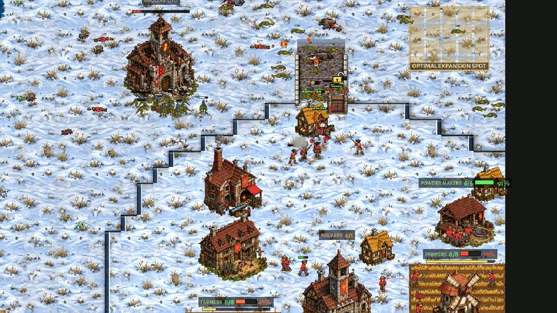
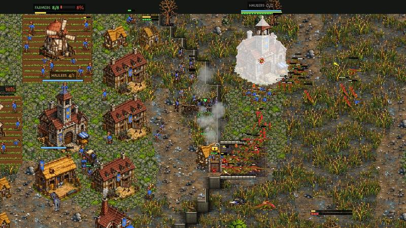
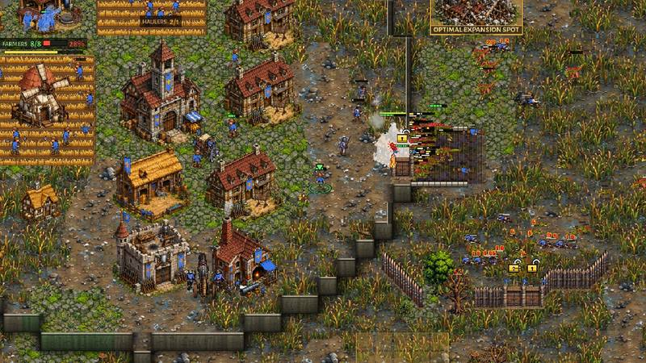

# crown-v-brood-coach: the Crown computer against the Brood, coached (0.33.17)

The owner (2026-11-11 22:28): "I think crown can beat brood, it's crown AI that is bad. Do a detailed multiple coached and
filmed sessions to make crown AI better." So this job is COACHING, as a human coach would do it: film real Hard v Hard
games, look at them, name each mistake with its time, its picture and the decision behind it in the code, fix that
decision, play the same seed again and check the mistake is gone. Only the Crown computer's play changed: no unit,
building, economy or Brood number was touched (section 8 has the evidence and a proposal for the owner, not applied).

Design rules followed (docs/design_principles.md): 1 (counterplay: answer what the scout sees, not a fixed script),
2 (the defender's advantage needs defenders; a lost raid must not be a lost game) and 3/4 (every choice has an opportunity
cost: buildings that idle, powder nobody uses, a farm that is not built).

**In short.** Six coaching rounds, 14 filmed games and 112 measured ones (92 of them Crown v Brood) found the Crown computer losing to the Brood
mostly BEFORE the fighting: its Horseman rush walked into the Raptors with a Musketeer wave behind it, its rush opening
farmed ONE Farm with 8-9 labourers until 4:15, the failed rush handed it to a Balanced plan that starved its labourers
(13-20 at 8:00 against the Brood's 41-51), and from 4:00 to 8:00 its army stood still while idle Barracks, a Church, an
Armoury, research and powder nobody used took the gold. Those decisions are fixed (section 6). Measured on the same 16
OPTIMAL games and 24 plan games as main (section 7): the Crown's labourers at 8:00 rose from 20.5 to 24.8 in the OPTIMAL
games (from 20 to 30 on the Rush plan against the Brood's Economy, where the owner says the rush shines), its income at
8:00 from 0.66 to 0.77 of the Brood's (0.60 to 0.86 for that Rush), its army at 8:00 from 0.38 to 0.54 of the Brood's;
over the 40 Crown v Brood games won-or-led went from 2 to 4, W-D-L from 0-14-26 to 1-18-21 (the first Crown win against
the Brood in these studies: Balanced against the Brood's Rush on Hollowfen, 14:51). The OPTIMAL games themselves: 0-2-14 before,
0-4-12 after, one led at 15:00. **It still loses most games against the Hard Brood**: the Brood's grubs still double the
Crown's labourers by 8:00 and its Timing waves (6:00-9:30) still take the natural (section 8). Crown v Clockwork and the
Crown mirror did not get worse (section 7).

## 1. How the coaching ran

- **Filming** (`tools/shot_ai_match.gd`, extended): `pa:` / `pb:` set each computer's plan, `coach:1` writes a status line
  for each side every 15 s (`coach.txt`: gold earned and in the bank, powder, labourers, supply, halls, the army by kind
  and where it stands, value killed and lost, which halls / Barracks / Foundries / Breeder are training, the Farms' and
  Mills' crews, the labourers' orders, and the Crown computer's own reckoning: the Brood army it reckons, whether its
  soldiers are due, whether its labourers may come, whether it thinks it is behind), films the Crown's army every 30 s
  (`army_MMSS.jpg`), the riders every 10 s while they are out (`raid_MMSS.jpg`), both mains every 2 minutes and every
  fight (`fight_*.jpg`; `gap:` / `from:` film the fights more often from a given time). Pictures as jpg. The runs:
  `xvfb-run -a godot --rendering-driver opengl3 --resolution 1280x720 --fixed-fps 30 --script res://tools/shot_ai_match.gd
  -- a:crown b:brood pa:optimal pb:optimal map:greenhold seed:1100 swap:0 out:DIR coach:1 end:900`.
- **Measuring** (`tools/study/crown_v_brood_coach.py`, `tools/study/crown_v_brood_coach_report.py`): the 16 Crown v
  Brood OPTIMAL games of docs/crown_ai_v2.md (8 maps, 2 seeds, sides swapped), the Crown's plans (OPTIMAL, Economy, Rush,
  Balanced) against the Brood's Economy and Rush on Kestrel Rise, Hollowfen and Dune Sea, and the controls (Crown v
  Clockwork, the Crown mirror); `quick` = 4 of the measure games, for a round's check. The "before" is main at
  95436831 (0.33.16), run alongside in a worktree.
- The games are not exactly repeatable: the same map and seed parts after a few minutes (the QA study: the result agrees
  2 times in 3). A "replay of the same seed" here is the same start; the same moment is compared, not the same frame.

Pictures: `docs/shots/crown_v_brood_coach/` (`rN_` = the round they belong to).

## 2. Round 1: the "before" games, the coach's notes

Hard Crown OPTIMAL v Hard Brood OPTIMAL on main (0.33.16): Greenhold seed 1100 (Crown top-left), Dune Sea 1106, Hollowfen
1188, and the 16 measure games (section 7). For comparison one game with the Crown on its Economy plan (Greenhold 1100).

### Greenhold 1100 (lost at 11:27)

| time | what happened |
|---|---|
| 0:00 | OPTIMAL leans to the Horseman rush before it scouts ("Horsemen are good against the Brood's grubs"). |
| 0:55-1:26 | Barracks at 7 labourers, Horse Breeder at 8; ONE Farm. |
| 1:27 | The scout sees the Mother and a Mound Turtle on new ground, 2 Rootmaws, 5 grubs: reads GREEDY, keeps the rush. |
| 1:35 | The Brood sees the Horse Breeder and no Powder Mill: "riders are coming. Raptors now". |
| 2:19-2:47 | Two Musketeers from the Barracks next to the first Horseman. Labourers 8-9. |
| 3:28 | The first attack: 3 Horsemen and 2-3 Musketeers walk to the Brood's main as a wave. |
| 4:02 | Rush FAILED ("the defenders are worth more than the riders"): 12 Raptors by the Mother. 50-200 killed. The plan becomes Balanced. |
| 4:00-8:00 | The army stands still at 585 (3 Horsemen, 4 Musketeers); labourers 13 -> 20; the gold (475 a minute) goes to the Powder Mill, the Foundry, the hall (6:09), two Farms, a second Mill and a second Barracks; powder piles up to 178 with nothing training. |
| 7:39-8:36 | The Brood's Timing wave (21 supply, then 825 of army at 8:04): the natural's Farms stand empty (`r1_03`), the army holds the ramp's top. |
| 9:49-10:22 | Both halls razed. |

The Brood at 8:00: 45 grubs, 6,188 gold earned (the Crown 3,800 with 20 labourers).

### Dune Sea 1106 (lost at 10:38)

The same opening (OPTIMAL picks the rush on the GREEDY read at 1:27); the riders go at 3:56 with 2 Musketeers behind
them, ride up the Brood's main ramp to a Rootmaw with no grub on it while the Raptors bite at the ramp (`r1_01`); FAILED
at 4:30. Then the same four flat minutes: army 465 from 4:00 to 8:00, labourers 13 -> 26, a second and a third Barracks at
7:35 and 8:35 that never trained. The Brood came at 8:04 with 20 Raptors and 16 Spitters (1,495) and had 3,700 by 10:00.

### Hollowfen 1188 (lost at 12:40)

Here the rush SUCCEEDED at 4:25 (525 killed, the riders kept hunting), yet the army stayed at 300-600 from 4:00 to 8:00,
an Armoury and two researches (Armour, Socket Bayonet) were bought at 8:13-9:00 with 590 of army, the first Field Cannon
came at 10:17 (the Foundry stood from 7:31). At 8:39 the army (522) stood on HOLD at its natural's gate, facing out at
nothing, while 325 of Raptors and Spitters inside the half-closed wall razed the Powder Mill and two Farms behind it
(`r1_02`: the line at the bottom gate, the Brood at the Mill at the top): "holds its natural's gate: the force outside
(325) is too strong to go out to with its army at home (522), out at 650".

### The Economy plan on the same Greenhold seed (draw at 12:00, army wiped at 9:20)

The owner's own opening: 23 labourers at 4:00, 41 at 7:00, 44 at 8:00; its income was the Brood's (8,740 against 9,233 at
8:00, 10,640 against 10,623 at 9:00). But its army was half the Brood's (1,525 against 2,780 at 8:00): at 8:34 four
Barracks and the Foundry stood idle with 35 gold in the bank, a Church went up at 8:47 and a second Foundry at 8:59.
At 9:00 22 Musketeers and 3 guns stood packed behind the natural's gate (`r3_01`) against 34 Spitters, 14 Raptors and 7
Challengers (2,780) and were wiped in 20 s, 850 killed for 3,020. In a second run of the same seed (the games part) the
same line, a little bigger and with the wall closed, held: 2,205 killed for 1,130 lost by 9:49 (`r3_02`: the Musketeers
behind the palisade, the Raptors dying at it). The defence works when the army is there.

### The mistakes of round 1

1. **The rush walks into the Raptors** (Greenhold 3:28, Dune Sea 3:56). The Horseman rush rides out WITH the wave (the
   Musketeers walking behind) to the Brood's main, where the Raptors stand by the Mother; 34 s later "the defenders are
   worth more": FAILED. Code: `AI._raid` (`opening == "breeder" and strategy == "rush"`: the riders go with the wave),
   `AI._rush_verdict`.
2. **After the rush, Balanced starves.** The failed rush hands the plan to Balanced (`AI._rush_failed`), whose labourers
   wait for soldiers against the Brood's reckoning (`AICrown._army_due`) while its milestones take the gold: 13-20
   labourers at 8:00 against the Brood's 41-51 in every one of the 16 measure games (section 7), the army flat from
   4:00 to 8:00.
3. **Buildings that never work.** Against the Brood the milestones are not held when the army is behind
   (`AICrown.army_lags` is off against the Brood; `_mid_tick`): idle Barracks, a Church, an Armoury and research with
   no army, the Foundry idle for want of gold, 3 guns for 22 Musketeers.
4. **The gate post faces out while the enemy is inside** (Hollowfen 8:39; `AICrownHold.hold_top`, section 7 of that
   file).
5. **The read**: the Brood roots a Mound Turtle on new ground at 0:00 in every plan, so "GREEDY" is read at 1:27-1:32 in
   every game (as docs/crown_ai_v2.md saw); the Brood in turn reads the Horse Breeder at 1:35 and lays Raptors. Kept as
   the owner's rule (section 8).

## 3. Round 2: the fixes of round 1, and what the replay showed

(see section 6 for each fix in the code)

- The rush rides as a RAIDING PARTY against the Brood (`AICrown._rush_with_wave` false: the shared raid with AIHarass's
  micro), the Musketeers stay home; Raptors at the riders do not end the rush while the riders are whole: the raid pulls
  back and comes again at ANOTHER Rootmaw (`raid_spot_bad`, the Mother's ground last).
- After a rush that is over, the ECONOMY plan, not Balanced (`AICrown._after_rush_brood`).
- Against the Brood the milestones and the research are held while the army is under the Brood army it reckons or a
  Barracks or Foundry stands idle for gold (`AICrown.brood_spend_army`), and the Barracks wait for a gun's gold while
  there are more than 4 Musketeers a Field Cannon (`AICrown._gun_share`).

Replay, Greenhold 1100 (`r1_gh`, `r2_gh`): the riders now raid the outlying Rootmaws and pull back from the guard (the
Brood answers the way docs/brood_anti_riders.md says: its grubs run to 12-18 Raptors at the Rootmaw, "no chase past 15
tiles"), FAILED on "no headway in 90 s" at 5:00, the plan passes to Economy at 5:05. But the labourers were still 8-9
from 1:30 to 4:30 and 17 at 8:00. The status lines said why: **the Crown farmed ONE Farm until 4:15** (`r2_01`): the
Rush plan's second Farm waited for its first rider ("at": labs 9, army 3) and the riders' gold, the Farm's 8 posts were
full, so no labourer had work; and while the Barracks trained a Horseman a Musketeer came beside it, and the hall
trained labourers only when the Barracks was busy (`bo_army_first`, `_soldiers_first`). The owner's own rush (docs/
playtests/2026-11-06, Hollowfen): 10 labourers at 2:00, 11 at 3:00, 15 at 4:00, the second Farm at 2:05, no Musketeer
before 7:00 and 805 gold in the bank at 4:00.

## 4. Round 3: the rush's own opening against the Brood

- The Rush plan has its own build order against the Brood (`PLANS["rush"]["bo_brood"]`): ramp Cottage, Barracks at 7,
  Horse Breeder at 8, **the second Farm at 9**, riders, labourers uncapped, the Gate, the raid, the Powder Mill, the
  second hall at 13.
- **The hall never stops in the rush** against the Brood (`_soldiers_first`: up to RUSH_LABS 16 labourers the hall keeps
  one coming) and the Barracks train riders only while the rush is on (`_rush_horse_only`: no dry Musketeers).
- **The Farms' posts before the powder** (`AICrown._mill_cap`): with a Farm post free and 30 powder in the bank, the
  Mills get at most one hand per 5 labourers (6 of 14 labourers ground 61 -> 127 powder nobody used at 5:33-6:34 while the
  Farms had 5-8 of 16 hands and no gold came in for 90 s); a bank three times the want sends two hands back at a time,
  and hands are added only while something trains with the powder (`_mill_feedback`).

Replay (`r4_gh`): two Farms at 3:00 (`r2_02`), labourers 15 at 4:00, 23 at 6:00, 38 at 8:00, 45 at 9:00 (the Brood 44-46);
gold earned 6,080 at 8:00 (the owner's own game: 6,080) and 8,740 at 9:00 against the Brood's 8,842: **the income gap is
gone in this game**. But the army stood at 5 Horsemen (575) from 4:30 to 7:34: the first Musketeer came at 7:40, the
first gun at 8:30, and the Brood's wave of 2,305 at 9:30 met 1,515 and took the natural.

## 5. Round 4: the army grows with the economy

The reckoning said "not behind": HOLD_SHARE asks only 0.6 of the Brood army it reckons (575 against 966 x 0.6 at 6:30),
so every coin went to labourers, the walled natural's palisade (19 pieces at 6:37-6:41 before the first Musketeer at
6:51 in `r5_gh`) and buildings. The owner's game had 6 Musketeers and 4 Horsemen behind the natural's palisade at 7:00 and
held 2,325 of Brood at 8:05.

- **The army grows with the economy** (`AICrown.army_grows`): from 5:30, against the Brood, while the army is under the
  smaller of 0.85 of the Brood army it reckons and 40 a labourer, a hall trains a labourer only when every Barracks is
  busy; the natural's ring waits for it (`wall_first` off) and two Musketeers' gold is kept from the palisade while a
  Barracks stands idle (`brood_wall_keep`).
- **The gate post turns to an enemy inside the wall** (`AICrownHold._inside_natural`): a threat nearer the natural's hall
  than its gate is met the usual way when the army at home is worth as much (it held the gate at half that before).

Replay (`r5_gh`): the riders out at 4:03 sat by Rootmaws whose grubs had run to the Raptors (`r4_01`: "GRUBS 0/4"), the
rush FAILED at 5:33 on "no headway"; the first Musketeer still came at 6:51, after 19 pieces of the natural's palisade, and
the Brood's Timing wave at 7:16 broke in where the wall was not finished, with one Musketeer and a gun at the gap
(`r4_02`). The round's check (`quick`: Greenhold, Dune Sea, Frostmere, Hollowfen, round 0, against the same four "before"
games): the games lasted longer (lost at 11:20-13:40 against 8:41-10:58, one "behind" at 15:00 before became a loss at
13:40), labourers 27 at 8:00 against 15, the income at 8:00 0.76 of the Brood's against 0.65, the army 0.55 against 0.38;
still four losses.

## 5b. Rounds 5 and 6: the Timing wave at the natural

Frostmere (seed 1145, `r6_fm`): the Brood had 40 Raptors at 6:04 and took the natural at ~7:00 while the Crown's army was
635, mostly the rush's riders; the main's ramp held (`r5_01`: four Musketeers and the ramp Cottage, Raptors dead in front
of the Gate), the natural and its labourers did not. In the measure games of round 5 (8 games, `after_r5`) the story said
why on Amberfall Vale: "holds the top of its ramp: against the force below (375) its army (639) goes down only at 750"
from 7:20 to 9:08, while the Brood ate the natural below: with the natural's ring held back for the army (round 4) there
was no gate post at the natural, so the army stood on the main's high ground. Round 6 gave the ring its time back (only
two Musketeers' gold is kept from it while a Barracks is idle). The ramp post's own edge against the Brood (2.0) was left
as it is: its reason (Musketeers sent down one by one into 20 Raptors, docs/crown_v_brood.md) still holds.

Hollowfen (seed 1188) on the final build (`r6_hf`) against the same seed on main (`r0_hf`): the rush SUCCEEDED and kept
hunting (250 killed), labourers 35 at 8:00 and 38 at 9:00 (main: 23, 24), and the decisive fights went the Crown's way:
by 12:35 it had killed 6,705 for 5,425 lost (main: 3,260 for 6,680, dead at 12:40); at 10:04 the line on the main's high
ground with a gun shot the Raptors piling at the ramp Gate (`r6_01`), where main's game had three Musketeers left at the
same ramp at 10:18 and no natural (`r6_02`). It still lost the natural at ~11:00 and the game was even-ish at 13:00
(1,355 of army at 10:05 against 2,145).

## 6. The fixes in the code

Each is against the Brood only (`_foe_is("brood")`) unless said, on Normal and up, and has a study switch to play the
old way (`-- name:off` on the command line).

| # | fix | where | switch | the mistake it answers |
|---|---|---|---|---|
| 1 | THE RIDERS HUNT THE GRUBS, NOT THE MOTHER: the Horseman rush rides as a raiding party (the shared raid and AIHarass's micro: kite the slow, pull back from what can catch it, come again), three riders together, the Musketeers kept home (the plan's attack step is done when the party is out; their wave waits); Raptors at the riders do not end the rush while the riders are whole (`_rush_kites`); the spot the raid was chased off is left 45 s and another Rootmaw is raided (`raid_spot_bad`, AIHarass.work_line, `_prey_spot`); the Mother's ground last, and there the raid waits 6 tiles out where the grubs walk in, never at her | `scripts/ai.gd` hooks `_rush_with_wave`, `_raid_group_min`, `_rush_kites`, `_raid_chased`, `raid_spot_bad`; `scripts/ai_crown.gd` "THE RIDERS HUNT THE GRUBS"; `scripts/ai_harass.gd` work_line | `rushraid:off` | round 1, 1 |
| 2 | AFTER THE RIDERS, THE OWNER'S ECONOMY: a rush that is over (failed, or succeeded and done hunting) hands the plan to Economy (labourers non-stop to two halls, the walled natural, its milestones), not Balanced; the Breeder's riders keep scouting and raiding | `AICrown._after_rush_brood` | `afterrush:off` | round 1, 2 |
| 3 | THE GOLD ON THE FIELD: the milestones are held as when the army lags (no Church, Armoury or research; a Barracks or Foundry only when every one of its kind is busy) while the army is under the Brood army it reckons or a Barracks / Foundry stands idle for gold; the research waits while the army is under 0.6 of the reckoning | `AICrown.brood_spend_army`, `_mid_tick`, `_research` | `broodspend:off` | round 1, 3 |
| 4 | A GUN FOR EVERY 4 MUSKETEERS: the Barracks wait for a Field Cannon's gold while a Foundry may cast one and the line has more than 4 Musketeers a gun (CANNONS_FIRST's massing, kept on) | `AI._gun_share`, `AICrown._gun_share` (GUN_SHARE_BROOD 4) | `broodspend:off` | round 1, 3 |
| 5 | THE RUSH'S OWN OPENING: the second Farm at 9 labourers (not after the first rider), labourers uncapped, the Powder Mill and the second hall behind the raid | `PLANS["rush"]["bo_brood"]` | - | round 2 |
| 6 | THE HALL NEVER STOPS IN THE RUSH: up to 16 labourers the hall keeps one coming while the riders are trained; the Barracks train riders only while the rush is on (no Musketeer without powder beside them) | `AICrown._soldiers_first`, `_rush_horse_only`, `AI._produce` hook | `rushlabs:off` | round 2 |
| 7 | THE FARMS' POSTS BEFORE THE POWDER: with a Farm post free and 30 powder banked, the Mills get one hand per 5 labourers; (all matchups) a bank three times the want sends two hands back at a time, and a hand is added only while a Barracks or Foundry trains | `AICrown._mill_cap`, `_mill_feedback` | `millfeed:off` | round 3 |
| 8 | THE ARMY GROWS WITH THE ECONOMY: from 5:30, while the army is under the smaller of 0.85 of the Brood army it reckons and 40 a labourer, a hall trains a labourer only when every Barracks is busy, and two Musketeers' gold is kept from the natural's palisade while a Barracks is idle (round 4 also held the natural's ring back for the army; round 6 undid that part) | `AICrown.army_grows`, `_army_due`, `brood_wall_keep` | `armygrow:off` | round 4 |
| 9 | THE GATE POST TURNS TO AN ENEMY INSIDE: (all matchups) a threat nearer the walled natural's hall than its gate is met the usual way when the army at home is worth as much | `AICrownHold._inside_natural`, `hold_top` | `gatepost:off` (the whole post) | round 1, 4 |

The AI STORY has rows for the new match log lines (`scripts/ai_story_lines.gd`, pt and es in
`tools/i18n/49_spectator.txt`): the riders chased off a Rootmaw, the rush handing over to the Economy plan, the gate post
turning to an enemy inside the wall.

Tests changed: `tools/test_ai_optimal.gd` (the Powder Mill behind the raid may come after the second hall: the riders ride
at ~4:00 now that the labourers keep coming) and `tools/test_crown_build_order.gd` (against the Brood the rush is a raiding
party, and its opening goes on to the Mill and the hall after it).

## 7. Numbers

`python3 tools/study/crown_v_brood_coach.py run OUT --data DATA --only measure+controls+plans --jobs 2` (Hard v Hard to
15:00), `python3 tools/study/crown_v_brood_coach_report.py DATA [--games]`. BEFORE = main at 95436831 (0.33.16, the game
the same but the version), AFTER = this branch at c7d4672c (the final AI; later commits are the doc, the tests, the
version and the AI STORY rows). Data: `docs/crown_v_brood_coach/data/before`, `.../after` (and `.../after_round5`: the 8
round-0 measure games of round 5, before the natural's ring got its time back: 0-2-6, income 0.79 at 8:00, army 0.51).
The coached films' status lines: `docs/crown_v_brood_coach/films/*_coach.txt`.

"brood" = Crown OPTIMAL v Brood OPTIMAL, the 16 games of docs/crown_ai_v2.md (8 maps, 2 seeds, sides swapped); "brood (X v
br-Y)" = the Crown on plan X against the Brood on plan Y, on Kestrel Rise, Hollowfen and Dune Sea (sides alternating);
"clockwork" = Crown OPTIMAL v Clockwork OPTIMAL (Greenhold, Dune Sea, Hollowfen, both seeds); "crown" = the mirror on 4 maps
(the P1 side's numbers: a control). "won or led": won, or a draw at 15:00 with income + 2 x army 10% ahead; ratios are
the Crown's over its foe's (the army: the sum over the games).

| Crown v (plan v Brood plan) | | games | W-D-L | won or led | labourers 6:00 (Crown / foe) | 8:00 | income 5:00 | 8:00 | 10:00 | army 8:00 (sum ratio) | halls 8:00 (Crown / foe) | Crown halls lost | lost games ended (mean) |
|---|---|---|---|---|---|---|---|---|---|---|---|---|---|
| brood | before | 16 | 0-2-14 | 0 | 18.7 / 33.6 | 20.5 / 47.4 | 0.90 | 0.66 | 0.60 | 0.38 | 1.9 / 3.5 | 35 | 11:41 |
|  | after | 16 | 0-4-12 | 1 | 21.9 / 33.6 | 24.8 / 47.1 | 0.98 | 0.77 | 0.70 | 0.54 | 1.9 / 3.2 | 34 | 11:39 |
| brood (balanced v br-economy) | before | 3 | 0-1-2 | 0 | 20.7 / 42.3 | 24.3 / 57.0 | 0.66 | 0.52 | 0.50 | 0.44 | 2.0 / 3.7 | 7 | 11:46 |
|  | after | 3 | 0-0-3 | 0 | 19.0 / 43.0 | 22.3 / 56.3 | 0.68 | 0.48 | 0.49 | 0.38 | 2.0 / 3.7 | 6 | 11:23 |
| brood (balanced v br-rush) | before | 3 | 0-2-1 | 0 | 21.0 / 23.0 | 26.3 / 48.3 | 1.42 | 0.83 | 0.80 | 1.53 | 2.0 / 3.7 | 9 | 13:00 |
|  | after | 3 | 1-2-0 | 1 | 18.0 / 22.3 | 22.3 / 48.0 | 1.57 | 0.84 | 0.77 | 1.87 | 2.0 / 3.7 | 4 | - |
| brood (economy v br-economy) | before | 3 | 0-2-1 | 0 | 33.3 / 43.0 | 48.3 / 56.0 | 0.90 | 0.87 | 0.90 | 0.76 | 2.0 / 3.7 | 7 | 14:13 |
|  | after | 3 | 0-1-2 | 0 | 33.7 / 42.7 | 46.0 / 56.3 | 0.93 | 0.89 | 0.86 | 0.85 | 2.0 / 3.7 | 9 | 12:30 |
| brood (economy v br-rush) | before | 3 | 0-1-2 | 0 | 25.3 / 21.7 | 35.0 / 40.7 | 1.65 | 1.13 | 1.05 | 1.16 | 2.0 / 3.3 | 9 | 14:31 |
|  | after | 3 | 0-2-1 | 0 | 18.3 / 20.0 | 24.7 / 42.3 | 1.20 | 0.94 | 0.79 | 1.01 | 1.7 / 3.3 | 4 | 13:01 |
| brood (optimal v br-economy) | before | 3 | 0-0-3 | 0 | 16.0 / 31.7 | 23.0 / 55.7 | 0.82 | 0.62 | 0.58 | 0.66 | 2.0 / 3.7 | 8 | 12:26 |
|  | after | 3 | 0-1-2 | 0 | 22.0 / 38.0 | 29.3 / 56.3 | 0.97 | 0.72 | 0.71 | 0.74 | 2.3 / 3.7 | 7 | 13:07 |
| brood (optimal v br-rush) | before | 3 | 0-2-1 | 2 | 17.0 / 18.7 | 19.7 / 35.0 | 1.37 | 0.99 | 0.85 | 1.07 | 2.0 / 3.0 | 6 | 13:27 |
|  | after | 3 | 0-3-0 | 0 | 24.0 / 17.7 | 26.0 / 36.7 | 1.48 | 1.27 | 1.13 | 1.70 | 2.0 / 3.3 | 8 | - |
| brood (rush v br-economy) | before | 3 | 0-1-2 | 0 | 15.7 / 33.3 | 20.3 / 55.3 | 0.88 | 0.60 | 0.57 | 0.66 | 2.0 / 3.7 | 6 | 11:35 |
|  | after | 3 | 0-2-1 | 0 | 21.7 / 36.3 | 30.3 / 54.0 | 1.02 | 0.86 | 0.86 | 1.05 | 2.0 / 3.7 | 3 | 11:42 |
| brood (rush v br-rush) | before | 3 | 0-3-0 | 0 | 15.3 / 11.3 | 20.3 / 25.7 | 1.51 | 1.28 | 1.14 | 1.59 | 2.0 / 3.0 | 2 | - |
|  | after | 3 | 0-3-0 | 2 | 19.0 / 11.0 | 27.7 / 15.7 | 1.67 | 1.91 | 1.89 | 1.29 | 2.0 / 2.3 | 2 | - |
| clockwork | before | 6 | 1-2-3 | 1 | 19.0 / 26.3 | 20.3 / 29.0 | 0.61 | 0.68 | 0.64 | 0.92 | 1.3 / 2.5 | 13 | 13:56 |
|  | after | 6 | 0-4-2 | 1 | 19.3 / 26.5 | 21.3 / 29.0 | 0.68 | 0.73 | 0.68 | 1.56 | 1.8 / 2.5 | 10 | 14:00 |
| crown | before | 4 | 0-4-0 | 3 | 19.5 / 18.0 | 24.8 / 21.0 | 1.00 | 1.06 | 1.13 | 1.07 | 2.0 / 2.0 | 1 | - |
|  | after | 4 | 0-4-0 | 1 | 16.0 / 18.5 | 21.0 / 24.2 | 0.93 | 0.97 | 0.96 | 0.97 | 2.0 / 1.8 | 7 | - |

Read:
- **The OPTIMAL games**: the economy is better at every minute (labourers +3 at 6:00, +4 at 8:00; income 0.66 -> 0.77 at
  8:00, 0.60 -> 0.70 at 10:00), the army at 8:00 0.38 -> 0.54 of the Brood's, 2 draws more, one led; the lost games end at
  the same time (11:41 / 11:39). The per-game spread (the QA study: the same seed agrees on the result 2 times in 3, the
  income ratio's standard deviation 0.14-0.20) makes the result change (2 games) within noise; the economy and army changes
  are larger than it.
- **The Rush plan against the Brood's Economy** (the owner's case): labourers at 8:00 20 -> 30, income 0.60 -> 0.86, army
  0.66 -> 1.05: the raid plus the economy behind it is a real gain; 0-1-2 -> 0-2-1.
- **Against the Brood's Rush** every Crown plan does well (the Brood's Rush is thin): the Crown's Rush now earns 1.9 times
  the Brood's at 8:00 and led 2 of 3; Balanced won once (Hollowfen, 14:51). OPTIMAL against the Brood's Rush led 2 of
  3 before and none after (all three draws, income 1.27 against 0.99 at 8:00): within noise, but noted.
- **Worse**: the Economy plan against the Brood's Rush (labourers 35 -> 25 at 8:00, income 1.13 -> 0.94): the army now grows
  with the economy from 5:30 (army_grows) against a reckoning made for the Brood's usual army, and the Brood's Rush has
  less; the plan held more often (0-1-2 -> 0-2-1). Balanced against the Brood's Economy was as bad as before (0.48).
- **Controls**: against the Clockwork 1-2-3 -> 0-4-2 (won or led 1 both), income 0.68 -> 0.73, army 0.92 -> 1.56, halls lost
  13 -> 10: not worse (the changes that reach this matchup: the Mill's crew and the gate post turning inward). The mirror
  stays all draws; its P1 side led 3 of 4 before and 1 of 4 after (a mirror with 4 games: noise).

Tests run on the final build: test_files (1,303 checks, 0 failures), test_i18n PASS, test_ai_optimal ALL PASS (updated),
test_crown_v_brood 0 failures, test_ai_rush ALL PASS, test_ai_harass ALL PASS, test_crown_gate PASS, test_crown_lost_hall
PASS, test_crown_hold ALL PASS, test_ai_wall_vs_rush ALL PASS, test_crown_build_order ALL PASS (updated), test_crown_owner_eco
ALL PASS, test_ai_expand_wall PASS, test_crown_stall PASS, test_crown_ammo 0 failures. On the way test_ai_rush failed once
("workers before the Brood Mother": the raid rode to the Mother when no Rootmaw was in sight; it now waits 6 tiles out where
the grubs walk in) and test_ai_optimal / test_crown_build_order needed the rush's new shape (section 6).

## 8. What is still wrong, and Claude's choices for the owner

### Still wrong

1. **The Brood out-grows the Crown.** Even with the Crown's labourers non-stop, the Brood has 46-54 grubs at 8:00 against
   the Crown's 22-37: its eggs hatch grubs in clutches (23 -> 42 in one minute at 6:00-7:00, Greenhold), while a Crown hall
   trains one labourer every 12 s. And where the incomes met (the Economy plan, Greenhold 1100: 8,740 against 9,233 at 8:00)
   the Brood's army was still nearly twice the Crown's (2,780 against 1,525): at 8:00 roughly half of the Crown's gold had
   gone into buildings (Cottages for supply, Farms, Mills, halls, Barracks, a Foundry, the palisade), the Brood's into eggs.
   That is the game's economy, not the computer (see the proposal below).
2. **The Horseman rush against the current Hard Brood kills little.** The Brood reads the Horse Breeder at ~1:35 ("riders
   are coming. Raptors now") and has 12-18 Raptors at its Rootmaws by 4:00 with its grubs run to them
   (docs/brood_anti_riders.md); the raid now rides round them, comes again elsewhere and stops the grubs' work while it is
   there (`r4_01`), but the kills stay at 100-500. The owner's own rush (0.33.3, docs/playtests/2026-11-06) met 8 Raptors and
   killed 25 grubs. With the hall never stopping, the riders now ride at ~4:00 instead of ~3:30.
3. **The Brood's Timing waves take the natural** (6:00-9:30): first natural lost at 7:55-14:30 after, 7:00-14:10 before.
   When the line stands behind a closed palisade with guns it trades 2:1 or better (`r3_02`, `r6_01`); when the wall is
   not closed or the line is packed at the gate (`r3_01`) it trades 1:4.
4. **A hunt that goes on keeps the Rush plan**: the hand-over to the Economy plan waits for the hunt to end; on Hollowfen
   (`r6_hf`) the riders hunted to 12:35 and the base played the Rush plan's milestones all game (it still made 38
   labourers). Handing over at 6:00 whatever the riders do is the next thing to try.
5. **The read**: "GREEDY" (a second base and little army) is what the Brood shows at 1:30 in every plan (its first Mound
   Turtle roots on new ground at 0:00), so OPTIMAL's punish (the owner's rule) answers every Brood with the riders.

### Claude's choices for the owner to confirm

1. **The rush rides as a raiding party against the Brood** (not with the Musketeer wave): three riders together, the
   Musketeers at home; the Raptors at the riders do not end the rush while the riders are whole (the shared verdict's
   other ends stay: riders cut down, no headway in 90 s, out of time); a spot it was chased off is left 45 s. Against
   the Clockwork and the Crown the rush is unchanged.
2. **After the rush, the Economy plan** (not Balanced) against the Brood. Balanced against the Brood's Economy was the worst
   row of the study (income 0.48-0.52 at 8:00, before and after).
3. **The rush keeps the hall training** up to 16 labourers and trains only riders while it is on: the riders ride ~30 s
   later than before; the owner's own rush had 15 labourers at 4:00 and no Musketeer before 7:00.
4. **The numbers chosen**: the army keeps up from 5:30 with the smaller of 0.85 of the Brood army reckoned and 40 a
   labourer; a Field Cannon for every 4 Musketeers; the Mills one hand per 5 labourers while a Farm post is free; the gate
   post turns inward at an even army (1.0). The ramp post's own edge against the Brood (2.0) is left as it was.
5. **The read stays the owner's rule** (GREEDY -> the riders). A proposal to try: against the Brood, "GREEDY" only when the
   scout sees a second Mound Turtle on new ground or no Raptor by its second look; the Brood's usual opening read NORMAL,
   where OPTIMAL picks the Economy race 3 : Balanced 1 (docs/crown_ai_v2.md). The study here does not settle it: OPTIMAL
   (the rush) against the Brood's Economy now earns 0.72 at 8:00, the fixed Economy plan 0.89, but neither won.

### A balance proposal (NOT applied: the owner decides; design rules 1 and 2)

The evidence (point 1 above): at equal income the Brood fields about twice the Crown's army at 8:00, and the Brood's grubs
double the Crown's labourers by 8:00 whatever the Crown computer does (its labourers now come non-stop from every hall).
Two small, quiet levers that would let the Crown keep up without touching the Brood: a Cottage giving 10 supply instead of
8 (a Crown army of 100 supply costs ~12 Cottages, 1,200 gold, today), or the Town Hall training two labourers at once
(the Brood's clutches against one Crown labourer every 12 s). Both should be measured the same way (the 16 OPTIMAL games and
the plan games) before the owner chooses; the Brood's FOOD_BONUS stays as the owner set it.
