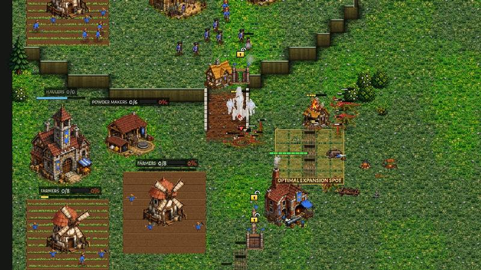
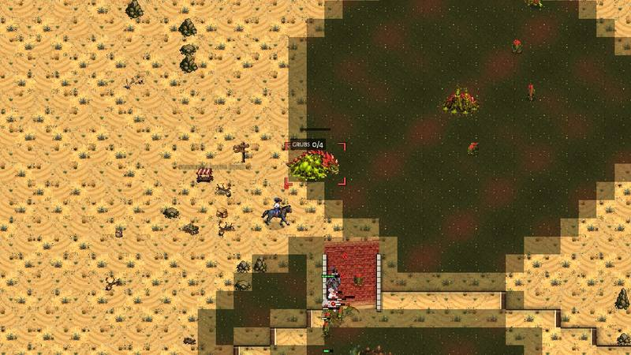
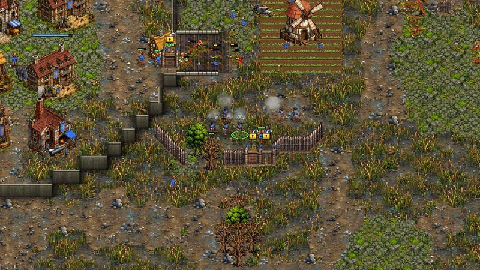
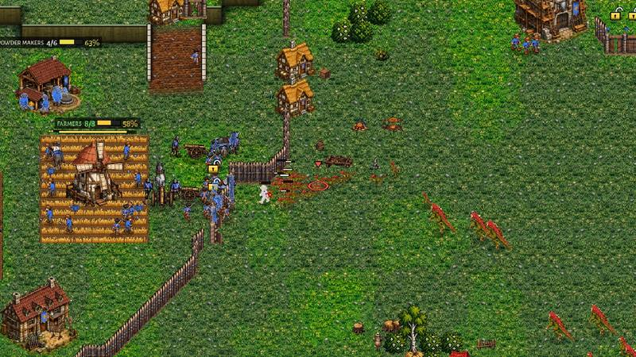
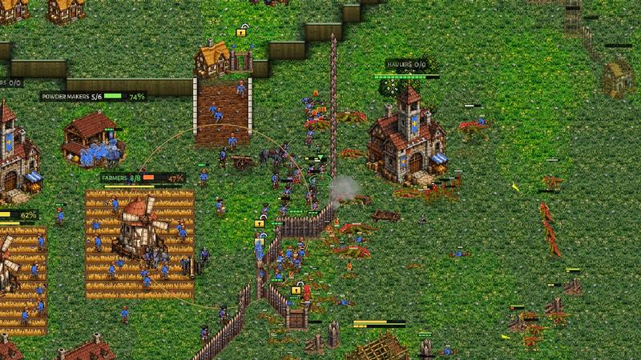
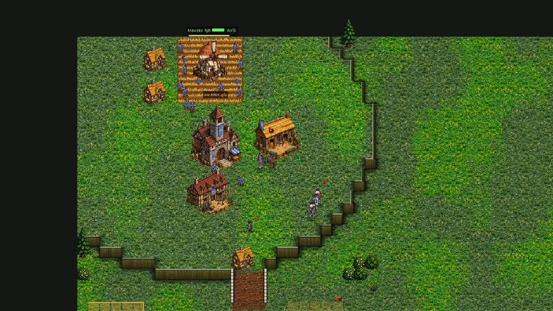
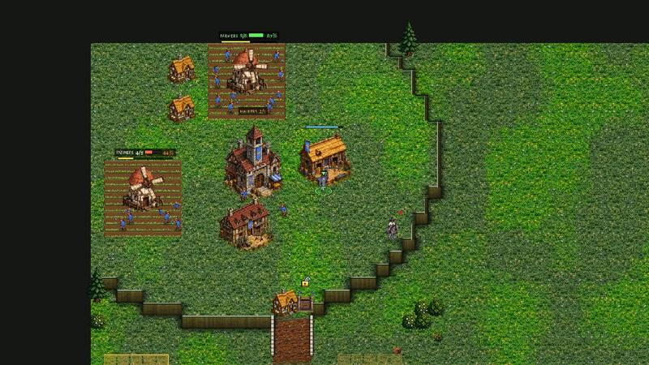
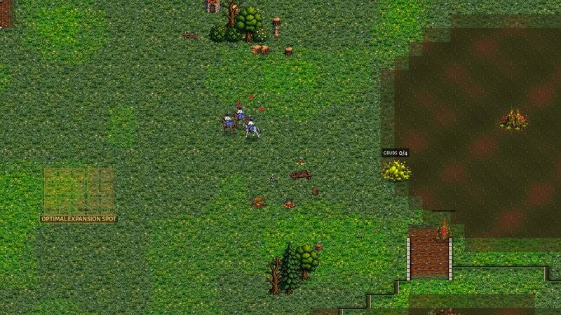
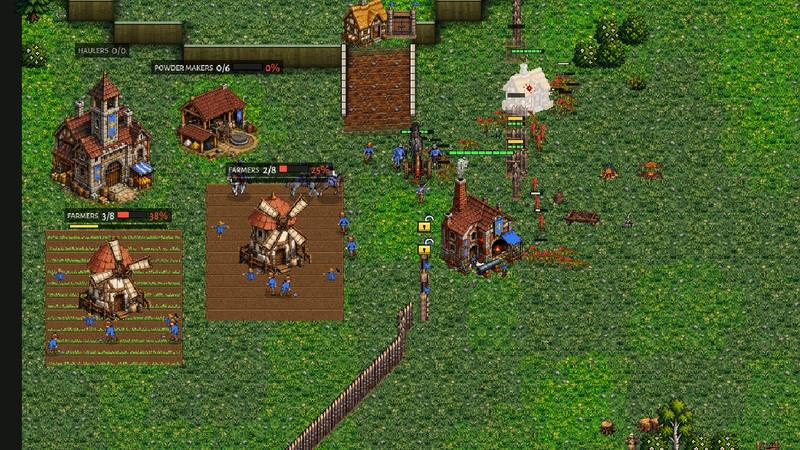

# crown-v-brood-coach: the Crown computer against the Brood, coached (0.33.17)

The owner (2026-11-11 22:28): "I think crown can beat brood, it's crown AI that is bad. Do a detailed multiple coached and
filmed sessions to make crown AI better." So this job is COACHING, as a human coach would do it: film real Hard v Hard
games, look at them, name each mistake with its time, its picture and the decision behind it in the code, fix that
decision, play the same seed again and check the mistake is gone. Only the Crown computer's play changed: no unit,
building, economy or Brood number was touched (section 8 has the evidence and a proposal for the owner, not applied).

Design rules followed (docs/design_principles.md): 1 (counterplay: answer what the scout sees, not a fixed script),
2 (the defender's advantage needs defenders; a lost raid must not be a lost game) and 3/4 (every choice has an opportunity
cost: buildings that idle, powder nobody uses, a farm that is not built).

**In short.** (filled in at the end, section 7)

## 1. How the coaching ran

- **Filming** (`tools/shot_ai_match.gd`, extended): `pa:` / `pb:` set each computer's plan, `coach:1` writes a status line
  for each side every 15 s (`coach.txt`: gold earned and in the bank, powder, labourers, supply, halls, the army by kind
  and where it stands, value killed and lost, which halls / Barracks / Foundries / Breeder are training, the Farms' and
  Mills' crews, the labourers' orders, and the Crown computer's own reckoning: the Brood army it reckons, whether its
  soldiers are due, whether its labourers may come, whether it thinks it is behind), films the Crown's army every 30 s
  (`army_MMSS.jpg`), the riders every 10 s while they are out (`raid_MMSS.jpg`), both mains every 2 minutes and every
  fight (`fight_*.jpg`; `gap:` / `from:` film the fights more often from a given time). Pictures as jpg. The runs:
  `xvfb-run -a godot --rendering-driver opengl3 --resolution 1280x720 --fixed-fps 30 --script res://tools/shot_ai_match.gd
  -- a:crown b:brood pa:optimal pb:optimal map:greenhold seed:1100 swap:0 out:DIR coach:1 end:900`.
- **Measuring** (`tools/study/crown_v_brood_coach.py`, `tools/study/crown_v_brood_coach_report.py`): the 16 Crown v
  Brood OPTIMAL games of docs/crown_ai_v2.md (8 maps, 2 seeds, sides swapped), the Crown's plans (OPTIMAL, Economy, Rush,
  Balanced) against the Brood's Economy and Rush on Kestrel Rise, Hollowfen and Dune Sea, and the controls (Crown v
  Clockwork, the Crown mirror); `quick` = 4 of the measure games, for a round's check. The "before" is main at
  95436831 (0.33.16), run alongside in a worktree.
- The games are not exactly repeatable: the same map and seed parts after a few minutes (the QA study: the result agrees
  2 times in 3). A "replay of the same seed" here is the same start; the same moment is compared, not the same frame.

Pictures: `docs/shots/crown_v_brood_coach/` (`rN_` = the round they belong to).

## 2. Round 1: the "before" games, the coach's notes

Hard Crown OPTIMAL v Hard Brood OPTIMAL on main (0.33.16): Greenhold seed 1100 (Crown top-left), Dune Sea 1106, Hollowfen
1188, and the 16 measure games (section 7). For comparison one game with the Crown on its Economy plan (Greenhold 1100).

### Greenhold 1100 (lost at 11:27)

| time | what happened |
|---|---|
| 0:00 | OPTIMAL leans to the Horseman rush before it scouts ("Horsemen are good against the Brood's grubs"). |
| 0:55-1:26 | Barracks at 7 labourers, Horse Breeder at 8; ONE Farm. |
| 1:27 | The scout sees the Mother and a Mound Turtle on new ground, 2 Rootmaws, 5 grubs: reads GREEDY, keeps the rush. |
| 1:35 | The Brood sees the Horse Breeder and no Powder Mill: "riders are coming. Raptors now". |
| 2:19-2:47 | Two Musketeers from the Barracks next to the first Horseman. Labourers 8-9. |
| 3:28 | The first attack: 3 Horsemen and 2-3 Musketeers walk to the Brood's main as a wave. |
| 4:02 | Rush FAILED ("the defenders are worth more than the riders"): 12 Raptors by the Mother. 50-200 killed. The plan becomes Balanced. |
| 4:00-8:00 | The army stands still at 585 (3 Horsemen, 4 Musketeers); labourers 13 -> 20; the gold (475 a minute) goes to the Powder Mill, the Foundry, the hall (6:09), two Farms, a second Mill and a second Barracks; powder piles up to 178 with nothing training. |
| 7:39-8:36 | The Brood's Timing wave (21 supply, then 825 of army at 8:04): the natural's Farms stand empty (`r1_03`), the army holds the ramp's top. |
| 9:49-10:22 | Both halls razed. |

The Brood at 8:00: 45 grubs, 6,188 gold earned (the Crown 3,800 with 20 labourers).

### Dune Sea 1106 (lost at 10:38)

The same opening (OPTIMAL picks the rush on the GREEDY read at 1:27); the riders go at 3:56 with 2 Musketeers behind
them, ride up the Brood's main ramp to a Rootmaw with no grub on it while the Raptors bite at the ramp (`r1_01`); FAILED
at 4:30. Then the same four flat minutes: army 465 from 4:00 to 8:00, labourers 13 -> 26, a second and a third Barracks at
7:35 and 8:35 that never trained. The Brood came at 8:04 with 20 Raptors and 16 Spitters (1,495) and had 3,700 by 10:00.

### Hollowfen 1188 (lost at 12:40)

Here the rush SUCCEEDED at 4:25 (525 killed, the riders kept hunting), yet the army stayed at 300-600 from 4:00 to 8:00,
an Armoury and two researches (Armour, Socket Bayonet) were bought at 8:13-9:00 with 590 of army, the first Field Cannon
came at 10:17 (the Foundry stood from 7:31). At 8:39 the army (522) stood on HOLD at its natural's gate, facing out at
nothing, while 325 of Raptors and Spitters inside the half-closed wall razed the Powder Mill and two Farms behind it
(`r1_02`: the line at the bottom gate, the Brood at the Mill at the top): "holds its natural's gate: the force outside
(325) is too strong to go out to with its army at home (522), out at 650".

### The Economy plan on the same Greenhold seed (draw at 12:00, army wiped at 9:20)

The owner's own opening: 23 labourers at 4:00, 41 at 7:00, 44 at 8:00; its income was the Brood's (8,740 against 9,233 at
8:00, 10,640 against 10,623 at 9:00). But its army was half the Brood's (1,525 against 2,780 at 8:00): at 8:34 four
Barracks and the Foundry stood idle with 35 gold in the bank, a Church went up at 8:47 and a second Foundry at 8:59.
At 9:00 22 Musketeers and 3 guns stood packed behind the natural's gate (`r3_01`) against 34 Spitters, 14 Raptors and 7
Challengers (2,780) and were wiped in 20 s, 850 killed for 3,020. In a second run of the same seed (the games part) the
same line, a little bigger and with the wall closed, held: 2,205 killed for 1,130 lost by 9:49 (`r3_02`: the Musketeers
behind the palisade, the Raptors dying at it). The defence works when the army is there.

### The mistakes of round 1

1. **The rush walks into the Raptors** (Greenhold 3:28, Dune Sea 3:56). The Horseman rush rides out WITH the wave (the
   Musketeers walking behind) to the Brood's main, where the Raptors stand by the Mother; 34 s later "the defenders are
   worth more": FAILED. Code: `AI._raid` (`opening == "breeder" and strategy == "rush"`: the riders go with the wave),
   `AI._rush_verdict`.
2. **After the rush, Balanced starves.** The failed rush hands the plan to Balanced (`AI._rush_failed`), whose labourers
   wait for soldiers against the Brood's reckoning (`AICrown._army_due`) while its milestones take the gold: 13-20
   labourers at 8:00 against the Brood's 41-51 in every one of the 16 measure games (section 7), the army flat from
   4:00 to 8:00.
3. **Buildings that never work.** Against the Brood the milestones are not held when the army is behind
   (`AICrown.army_lags` is off against the Brood; `_mid_tick`): idle Barracks, a Church, an Armoury and research with
   no army, the Foundry idle for want of gold, 3 guns for 22 Musketeers.
4. **The gate post faces out while the enemy is inside** (Hollowfen 8:39; `AICrownHold.hold_top`, section 7 of that
   file).
5. **The read**: the Brood roots a Mound Turtle on new ground at 0:00 in every plan, so "GREEDY" is read at 1:27-1:32 in
   every game (as docs/crown_ai_v2.md saw); the Brood in turn reads the Horse Breeder at 1:35 and lays Raptors. Kept as
   the owner's rule (section 8).

## 3. Round 2: the fixes of round 1, and what the replay showed

(see section 6 for each fix in the code)

- The rush rides as a RAIDING PARTY against the Brood (`AICrown._rush_with_wave` false: the shared raid with AIHarass's
  micro), the Musketeers stay home; Raptors at the riders do not end the rush while the riders are whole: the raid pulls
  back and comes again at ANOTHER Rootmaw (`raid_spot_bad`, the Mother's ground last).
- After a rush that is over, the ECONOMY plan, not Balanced (`AICrown._after_rush_brood`).
- Against the Brood the milestones and the research are held while the army is under the Brood army it reckons or a
  Barracks or Foundry stands idle for gold (`AICrown.brood_spend_army`), and the Barracks wait for a gun's gold while
  there are more than 4 Musketeers a Field Cannon (`AICrown._gun_share`).

Replay, Greenhold 1100 (`r1_gh`, `r2_gh`): the riders now raid the outlying Rootmaws and pull back from the guard (the
Brood answers the way docs/brood_anti_riders.md says: its grubs run to 12-18 Raptors at the Rootmaw, "no chase past 15
tiles"), FAILED on "no headway in 90 s" at 5:00, the plan passes to Economy at 5:05. But the labourers were still 8-9
from 1:30 to 4:30 and 17 at 8:00. The status lines said why: **the Crown farmed ONE Farm until 4:15** (`r2_01`): the
Rush plan's second Farm waited for its first rider ("at": labs 9, army 3) and the riders' gold, the Farm's 8 posts were
full, so no labourer had work; and while the Barracks trained a Horseman a Musketeer came beside it, and the hall
trained labourers only when the Barracks was busy (`bo_army_first`, `_soldiers_first`). The owner's own rush (docs/
playtests/2026-11-06, Hollowfen): 10 labourers at 2:00, 11 at 3:00, 15 at 4:00, the second Farm at 2:05, no Musketeer
before 7:00 and 805 gold in the bank at 4:00.

## 4. Round 3: the rush's own opening against the Brood

- The Rush plan has its own build order against the Brood (`PLANS["rush"]["bo_brood"]`): ramp Cottage, Barracks at 7,
  Horse Breeder at 8, **the second Farm at 9**, riders, labourers uncapped, the Gate, the raid, the Powder Mill, the
  second hall at 13.
- **The hall never stops in the rush** against the Brood (`_soldiers_first`: up to RUSH_LABS 16 labourers the hall keeps
  one coming) and the Barracks train riders only while the rush is on (`_rush_horse_only`: no dry Musketeers).
- **The Farms' posts before the powder** (`AICrown._mill_cap`): with a Farm post free and 30 powder in the bank, the
  Mills get at most one hand per 5 labourers (6 of 14 labourers ground 61 -> 127 powder nobody used at 5:33-6:34 while the
  Farms had 5-8 of 16 hands and no gold came in for 90 s); a bank three times the want sends two hands back at a time,
  and hands are added only while something trains with the powder (`_mill_feedback`).

Replay (`r4_gh`): two Farms at 3:00 (`r2_02`), labourers 15 at 4:00, 23 at 6:00, 38 at 8:00, 45 at 9:00 (the Brood 44-46);
gold earned 6,080 at 8:00 (the owner's own game: 6,080) and 8,740 at 9:00 against the Brood's 8,842: **the income gap is
gone in this game**. But the army stood at 5 Horsemen (575) from 4:30 to 7:34: the first Musketeer came at 7:40, the
first gun at 8:30, and the Brood's wave of 2,305 at 9:30 met 1,515 and took the natural.

## 5. Round 4: the army grows with the economy

The reckoning said "not behind": HOLD_SHARE asks only 0.6 of the Brood army it reckons (575 against 966 x 0.6 at 6:30),
so every coin went to labourers, the walled natural's palisade (19 pieces at 6:37-6:41 before the first Musketeer at
6:51 in `r5_gh`) and buildings. The owner's game had 6 Musketeers and 4 Horsemen behind the natural's palisade at 7:00 and
held 2,325 of Brood at 8:05.

- **The army grows with the economy** (`AICrown.army_grows`): from 5:30, against the Brood, while the army is under the
  smaller of 0.85 of the Brood army it reckons and 40 a labourer, a hall trains a labourer only when every Barracks is
  busy; the natural's ring waits for it (`wall_first` off) and two Musketeers' gold is kept from the palisade while a
  Barracks stands idle (`brood_wall_keep`).
- **The gate post turns to an enemy inside the wall** (`AICrownHold._inside_natural`): a threat nearer the natural's hall
  than its gate is met the usual way when the army at home is worth as much (it held the gate at half that before).

Replay (`r5_gh`, `r5_hf`) and the round's check (`quick`, 4 of the measure games): see section 7.

## 6. The fixes in the code

(filled in at the end)

## 7. Numbers

(filled in at the end)

## 8. What is still wrong, and Claude's choices for the owner

(filled in at the end)
