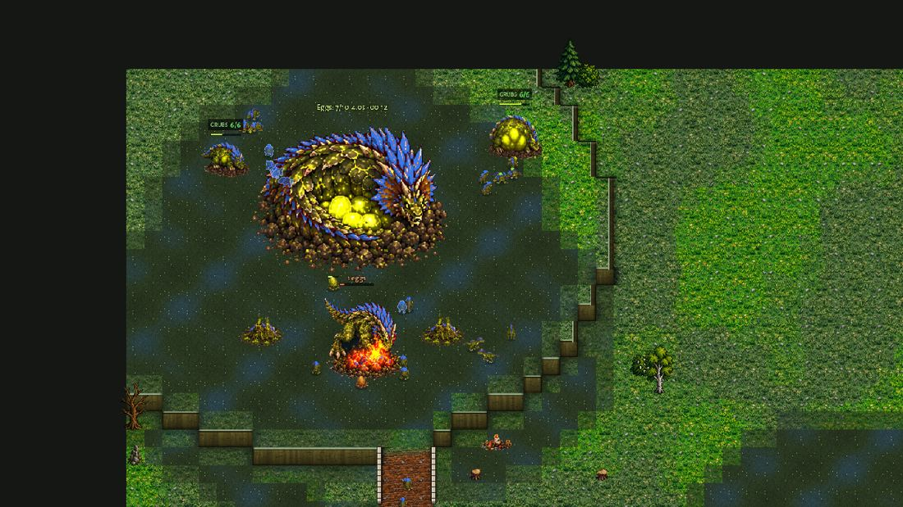
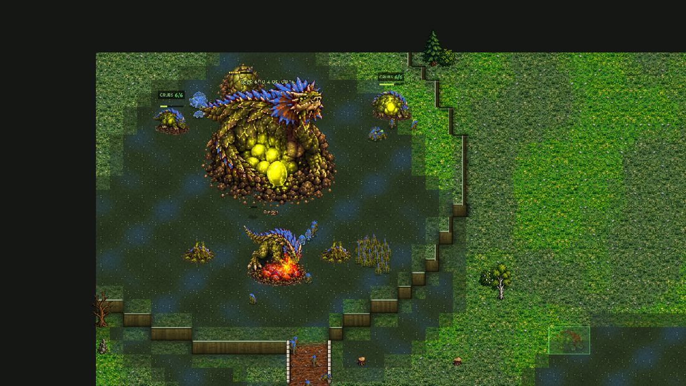

# Econ coach: the Brood computer (job econ-coach-brood)

The owner (2026-11-13 01:18): "The computers reach only part of what their faction could earn ... This must be corrected
with AI coaching before we ever touch balance. The AI must be 100% or as close as possible to what it could do, so we
have a complete picture and then make decisions."

**Only how the Brood computer plays its economy changed** (scripts/ai_brood_new.gd). No unit, building, price, yield or
rule number was touched; the Crown and Clockwork computers and the shared files are untouched. Design rules followed
(docs/design_principles.md): 2 (the economy forces expansion: fill the ground it has, take the next), 4 (mastery of
the economy and production, every choice an opportunity cost: a fix stays only if the economy rises without the army or
the defence falling apart).

## In short

1. **Alone (the bench's setup, the computer playing) the Brood computer already reaches its economy's design from
   8:00 on** (Economy 1.12-1.14 of the bench, Balanced 1.06-1.09, the timings 0.96-1.01); it loses only in the opening
   (0.72-0.76 at 3:00-5:00 on Greenhold). The games' bigger gap (0.66 / 0.79 / 0.76 of the bench at 5 / 8 / 10 minutes in
   the 36 Brood games) is mostly the opponent and the computer's ANSWERS to it: against the Clockwork its under-armed
   rule took every egg after its rush (14-18 grubs from 4:00 to 9:00), against the Crown its rider read laid only Raptors
   for minutes before any rider came.
2. **Kept (measured, behind switches)**: the second Rootmaw before the natural's turtle (fix 3); a grub in every three
   eggs under a SOFT danger, i.e. under-armed or the alarm with no enemy at the Mother (fix 2); a grub for a warrior egg
   while riders are read but not seen coming, once half the warriors wanted stand (fix 5).
   **Tried and left off**: supply ahead by her laying rate (fix 1: no blocks and +12% army at 8:00 but -1% income, and it
   starved the later Sires: switch `nbsupply:on`), her growth when the food outruns her laying (fix 4: stage 2 45 s earlier,
   no gain; taken out).
3. **The games (36, the economy-parity tags; before = the win-rate study's same games)**: income +5% at 5:00, +7% at
   8:00, +7% at 10:00 (all Brood sides); **against the Clockwork +25% at 8:00 and 10:00** (its income 0.62 -> 0.80 of the
   Clockwork's at 8:00; won or led 4 -> 7 of 12; W-D-L 3-3-6 -> 4-5-3; supply 100 at 9:30, was never by 15:00 in most);
   against the Crown +7% / +4% / +7% (W-D-L 7-5-0 -> 8-4-0); the mirror +3%. Army at 8:00 unchanged (1,268 -> 1,270).
   Bench shares: 0.66 / 0.79 / 0.76 -> **0.70 / 0.84 / 0.81** at 5 / 8 / 10 minutes.
4. **What is left** (section 6): the opening (food-bound: the Tyrant Sire's 200, the watching grub, the turtle's 100
   before the bench's), the Clockwork games' OPTIMAL rush pick on a GREEDY read (a strategy pick, left alone), the Crown's
   Horseman raids (legitimate). **For the owner**: with the Brood computer playing nearer its economy the Brood closes most
   of its income gap to the Clockwork computer (0.89 of its income at 10:00, was 0.77) and wins or leads 7 of 12 (was 4); the two sister jobs (Crown,
   Clockwork) change their sides too: the picture for balance is the three merged.

## 1. How it was measured

- **The bench** (tools/econ_bench.gd, docs/economy_parity.md section 1): the Brood economy's DESIGN, a scripted ideal
  build alone on the map, on its own clock (new ground at 1:00, 6:00, 10:00). Greenhold: 1,436 / 4,344 / 9,237 / 14,074 /
  25,585 biomass earned by 3:00 / 5:00 / 8:00 / 10:00 / 15:00; Hollowfen 1,039 / 3,429 / 7,559 / 11,667 / 22,096.
- **The computer alone** (new: `tools/econ_ai_alone_brood.gd`): the bench's setup (one faction alone, an idle dummy on the
  other side) with the Hard Brood COMPUTER playing instead of the script, one plan at a time. The dummy can't be hurt
  (its health is put back every frame), so the game never ends and the computer's own waves cost it what they cost. Every
  5 s it looks at supply and cap, the bank, her eggs and clutch, her growth, grubs (at work, idle, morphing, harvesting,
  in eggs), the posts its Rootmaws offer, Rootmaws, turtles (home, new ground), army; per minute: income, the share of
  looks SUPPLY-BLOCKED, EGGS FULL (her clutch full: laying lost), EGGS LOW (eggs hold it back), banks, idle grubs, empty
  posts. `vs=<faction>` plays a real game instead (a Hard computer on the other side) with the computer's own state in
  each look (grubs pulled off work, short of warriors against riders, under-armed, the alarm): how this job saw what the
  opponent costs it.
  The alone games are deterministic for a map (seeds 1, 2, 3 gave the same game to the digit), so the A/B runs average
  over SIX maps (Greenhold, Hollowfen, Dune Sea, Frostfang, Ashford Crossing, Cinder Steps; 10:00) and three plans
  (Economy, Balanced, Timing): 18 runs a configuration.
- **The real games** (`tools/study/econ_coach_brood.py`): the economy-parity set (`qa_matches.py --only parity`: 6 maps
  x 2 rounds, the qa-matches tags and seeds), Hard OPTIMAL v Hard OPTIMAL to 15:00, only the pairings with a Brood side:
  12 games v the Crown, 12 v the Clockwork, 12 mirrors (24 Brood sides). BEFORE = the same 36 tags of the win-rate study
  (docs/winrate_2026_11_12/winrate-a/b/c/data, main 0.33.25; the AI code has not changed since: only art and texts were
  merged after it).

## 2. Where it lost (before)

### 2.1 Alone: the computer's own macro

(Biomass earned by the minute, in brackets the share of the bench on the same map. Hollowfen was not run for every
plan before. 15:00 runs.)

| plan, map | 3:00 | 5:00 | 8:00 | 10:00 | 15:00 | blocked 4:00-6:00 | grubs 5:00 / 8:00 | stage 2 |
|---|---|---|---|---|---|---|---|---|
| **bench, Greenhold** | 1,436 | 4,344 | 9,237 | 14,074 | 25,585 | | | |
| **bench, Hollowfen** | 1,039 | 3,429 | 7,559 | 11,667 | 22,096 | | | |
| Economy, Greenhold | 1,050 (0.73) | 3,090 (0.71) | 10,339 (1.12) | 15,767 (1.12) | 29,165 (1.14) | 36% | 35 / 58 | 6:00 |
| Economy, Hollowfen | 1,136 (1.09) | 3,039 (0.89) | 8,895 (1.18) | 13,347 (1.14) | 22,673 (1.03) | 22% | 30 / 55 | 6:30 |
| Balanced, Greenhold | 1,072 (0.75) | 3,284 (0.76) | 9,850 (1.07) | 14,977 (1.06) | 27,797 (1.09) | 33% | 34 / 54 | 5:50 |
| Balanced, Hollowfen | 1,181 (1.14) | 3,527 (1.03) | 9,100 (1.20) | 13,543 (1.16) | 22,786 (1.03) | 25% | 31 / 52 | 6:30 |
| Timing, Greenhold | 1,030 (0.72) | 3,160 (0.73) | 9,173 (0.99) | 13,713 (0.97) | 25,217 (0.99) | 30% | 34 / 46 | 5:50 |
| Timing, Hollowfen | 1,075 (1.03) | 3,389 (0.99) | 7,858 (1.04) | 11,922 (1.02) | 21,197 (0.96) | 22% | 31 / 45 | 6:45 |
| Spitter, Greenhold | 1,066 (0.74) | 2,607 (0.60) | 8,958 (0.97) | 13,546 (0.96) | 25,733 (1.01) | 8% | 24 / 50 | 6:35 |
| Brute, Greenhold | 1,066 (0.74) | 3,189 (0.73) | 9,012 (0.98) | 13,493 (0.96) | 25,158 (0.98) | 19% | 31 / 49 | 4:55 |
| Air, Greenhold | 1,037 (0.72) | 2,792 (0.64) | 8,064 (0.87) | 12,370 (0.88) | 22,010 (0.86) | 11% | 23 / 44 | 5:15 |
| Optimal, Greenhold | 1,066 (0.74) | 2,607 (0.60) | 8,958 (0.97) | 13,519 (0.96) | 25,662 (1.00) | 8% | 24 / 50 | 6:35 |
| Rush, Greenhold | 791 (0.55) | 1,638 (0.38) | 4,111 (0.45) | 7,149 (0.51) | 13,658 (0.53) | 5% | 15 / 27 | 7:25 |
| Rush, Hollowfen | 820 (0.79) | 1,689 (0.49) | 5,174 (0.68) | 7,988 (0.68) | 14,722 (0.67) | 0% | 16 / 28 | 6:50 |
| Xrush, Greenhold | 711 (0.50) | 1,224 (0.28) | 2,118 (0.23) | 3,343 (0.24) | 6,113 (0.24) | 0% | 6 / 11 | 9:50 |

Reading it (Greenhold, the eco plans):
- **From 8:00 on the computer alone is AT or ABOVE the bench** (Economy 1.12-1.14, Balanced 1.06-1.09, Timing and the
  written builds 0.96-1.01). The bench is no ideal from there: it stops at 7 Rootmaws and banks 20,000 by 15:00; the
  computer keeps expanding. So its mid- and late-game macro, alone, is not where the games' gap comes from.
- **The early game is where it loses: 0.72-0.76 of the bench at 3:00 and 5:00** (OPTIMAL 0.60 at 5:00: alone it reads the
  idle dummy as GREEDY and picks the Spitter timing). Minute by minute (Economy, Greenhold):
  1. **The second Rootmaw came at 0:50.** At 0:00 her swamp is not down yet: no Rootmaw spot is found, so the 100 food
     went on the natural's Mound Turtle (the "no room: new ground makes room" rule) and the second Rootmaw waited for
     food that came in meanwhile. The bench roots its second Rootmaw at once.
  2. **Supply-blocked in 25-36% of the looks from 4:00 to 6:00**, and in 21% of all looks from 2:00 to 8:00 her clutch
     still held eggs and the bank could pay for them (laying lost to the block). The rule was "3 + a minute's worth" of
     supply ahead (6 at 3:00, 8 at 5:00) against a turtle that takes ~40 s from the order to its supply.
  3. Her clutch FULL in 40-48% of the looks from 1:00 to 5:00 with posts empty: FOOD, not eggs, holds it then (the
     Tyrant Sire's 200, the 100 kept for a turtle, the watching grub's trip).
  4. Her stage 2 at 5:45-6:30 (the bench 1:27), her clutch empty from ~5:00 to stage 2.
  5. Banks over 1,000 under the cap are short (~45 s): a Sire researching (Bigger Clutch, Pack Hunt: 35-40 s) while he is
     the only line laying warriors, and the Venom Sire waiting for 25 spoils. Income does not wait for them; army does.

### 2.2 The real games: the opponent and the computer

| v (12 games each, 24 Brood sides in the mirror) | W-D-L | income 5:00 / 8:00 / 10:00 | bench share | grubs 5:00 / 8:00 | blocked 4:00-6:00 |
|---|---|---|---|---|---|
| the Crown | 7-5-0 | 2,722 / 6,815 / 10,110 | 0.63 / 0.74 / 0.72 | 23 / 44 | 22% |
| the Clockwork | 3-3-6 | 2,099 / 4,726 / 7,407 | 0.48 / 0.51 / 0.53 | 16 / 29 | 3% |
| the Brood | 5-14-5 | 3,360 / 8,741 / 12,705 | 0.77 / 0.95 / 0.90 | 33 / 48 | 29% |
| all | 15-22-11 | 2,885 / 7,255 / 10,658 | 0.66 / 0.79 / 0.76 | 26 / 42 | 21% |

(The bench share is against the Greenhold bench; the classic maps give the same.) Against the computer alone (its OPTIMAL
and the plans it picks: ~1.0 of the bench from 8:00) the games lose 20-50% by 8:00 against the Crown and the Clockwork,
5% in the mirror.

The games' gap is mostly the OPPONENT and the computer's answers to it:
- **v the Clockwork (0.48 of the bench at 5:00, 0.51 at 8:00)**: OPTIMAL reads the Clockwork's economic opening as
  GREEDY and rushes (10 of 12 games); the rush comes home at 3:30-4:00 and hands over to Balanced; then the UNDER-ARMED
  rule (warriors first while its army is under 0.7 of what it saw, and never under a floor of 2 a second from 2:00, up to
  800 at 6:40) took EVERY egg: 14-18 grubs and 3-4 Rootmaws from 4:00 to 9:00 with the bank at 30-40 (it lost only 6-39
  units in that time: not the Clockwork's kills, the computer's own choice); its army never caught the floor because the
  income behind it never grew. Her stage 2 at 9:49 in the filmed game.
- **v the Crown (0.63 / 0.74)**: the Crown computer's Horsemen raid it in every game (10-28 "riders" lines a game): grubs
  run to the warriors, the warriors guard them. Legitimate, and the defence works (the Brood lost no game). But the RIDER
  READ (a Horse Breeder seen at 1:33) laid only Raptors from the read until the riders came: in an instrumented Greenhold
  game 8-12 grubs from 1:45 to 4:00 with her clutch full, and the riders came at 4:25.
- **The mirror (0.77 / 0.95)**: close to the computer-alone curve; supply-blocked in 29% of the 4:00-6:00 readings (the
  win-rate study: both films' losers blocked at 4:51-5:51).

## 3. The fixes (each small, each behind a switch, kept only if measured)

Each fix is a switch (an argument the computer reads), so its own effect was measured with the rest the same. The
alone A/B: 18 runs a configuration (Economy, Balanced, Timing x 6 maps, 10:00); BASE = all switches off (the computer as it
was). Income earned by the minute, the mean of the 18:

| configuration | 3:00 | 5:00 | 6:00 | 8:00 | 10:00 | blocked 4:00-6:00 | laying lost to blocks 2:00-8:00 | army 8:00 |
|---|---|---|---|---|---|---|---|---|
| BASE | 1,070 | 3,182 | 4,976 | 9,357 | 14,057 | 29% | 21% | 1,847 |
| fix 3 (second Rootmaw first) | +3.0% | **+5.0%** | +3.1% | +1.7% | +1.4% | 26% | 16% | 2,029 |
| fix 3 + fix 1 from 0:00 | +3.0% | -4.0% | -3.6% | -2.6% | -1.5% | 2% | 2% | 2,002 |
| fix 3 + fix 1 from 4:00 | +3.0% | +4.2% | +2.2% | +0.7% | +0.6% | 15% | 5% | 2,269 |
| fix 3 + fix 1 from 4:00 + fix 4 | +3.0% | +2.7% | +1.7% | +0.5% | +0.4% | 10% | | 2,129 |

**Fix 3: the second Rootmaw before the natural's turtle (KEPT).** At 0:00 her swamp is not down yet, so no Rootmaw spot
was found (and "no room" was cached for 5 s), and the eco plans' first 100 food went on the natural's turtle by the "no
room: new ground makes room" rule; the second Rootmaw rooted at 0:50. Now in the first minute no turtle goes on new
ground while she has fewer than two Rootmaws, the no-room fallback waits for 0:30, and the room is looked for every
second meanwhile: the second Rootmaw roots at 0:30, the natural's turtle at 1:00 (the bench's at 1:36). Also: while one
grub walks to turn into something, a SECOND may go if it turns into a Rootmaw (or a supply turtle at home when supply
is short); before, a second needed 400 food. Alone: +3% at 3:00, +5% at 5:00, +1.4% at 10:00, army +10% at 8:00.

**Fix 2: grubs under a SOFT danger (KEPT).** The under-armed rule (warriors first while its army is under what it saw,
0.7 of it against the Clockwork, with a floor of 2 a second from 2:00 up to 800) and the alarm used to stop the grubs
outright (a grub only with 200 food over the reserve). With no enemy at the Mother, no rush it is short against and no
riders it is short against, a grub now comes after every two warrior eggs while it is under its plan's curve and its
posts; and when its grubs fill its Rootmaws, a Rootmaw may still come (the under-armed rule held them at 4). Alone it
changes little (the idle dummy is no threat); in the games it is the Clockwork fix (section 4.2).

**Fix 5: grubs while riders are read but not seen coming (KEPT).** A rider read (a Horse Breeder seen, no Powder Mill)
laid only Raptors from the read until the riders came: in an instrumented Greenhold game, 8-12 grubs from 1:45 to 4:00
with her clutch full, the riders at 4:25. Now, while no rider was seen out of the enemy's main in the last minute or in
its land, and once HALF the warriors it wants against them stand at home, eggs go one grub for one warrior (the first
half comes as before: with one for one from the start the scripted raid of test_brood_v_riders met too few Raptors and
the Mother got up). Once riders are seen coming it is warriors first as before. v the Crown (with the other fixes): +7% at 5:00, the
defence unchanged (no Brood loss in the 12 games before and after).

**Fix 1: supply ahead by her laying (TRIED, OFF: `nbsupply:on`).** Supply ahead by what she can lay while a turtle takes
to give its supply (~36 s, more for new ground: her rate or the food coming in, 1.5 supply an egg once warriors are laid,
plus half what her stocked eggs and the bank could lay at once), from 4:00 (from 0:00 it cost 4-9% of the income by 5:00:
early a turtle and the grub it takes cost more grubs than a block holds back). It ends the blocks (29% -> 10-15% of the
looks, laying lost 21% -> 5%) and gives +12% army at 8:00 for -1% income. But the supply blocks were what let food pile
up to a later Sire's price: with none, the eggs took every 50 and the Air plan got no Venom Sire in 15 minutes, the
Timing and Balanced plans' stage 3 came late (test_ai_brood). Saving for a due Sire (also in the code, with the switch)
gave the Venom Sire back in Balanced, Timing and Economy but not in Air. Left off; the owner may want it with a
priority redesign (section 6).

**Fix 4: her growth when the food outruns her laying (TRIED, TAKEN OUT).** Stage 2 when the food coming in buys eggs
faster than she lays them (x1.1): stage 2 at 5:19 instead of 6:05, income -1.5% at 5:00, -0.1% at 8:00. No gain.

## 4. Results

### 4.1 The computer alone, per plan (15:00, before / after)

(The same runs on the branch; in brackets the share of the bench. The plans with no Hollowfen "before" show the after
only.)

| plan, map | 3:00 before -> after | 5:00 before -> after | 8:00 before -> after | 10:00 before -> after | 15:00 before -> after | blocked 4:00-6:00 | stage 2 |
|---|---|---|---|---|---|---|---|
| Economy, Greenhold | 1,050 -> 1,068 (0.74) | 3,090 -> 3,114 (0.72) | 10,339 -> 10,098 (1.09) | 15,767 -> 15,407 (1.09) | 29,165 -> 27,473 (1.07) | 36% -> 30% | 6:00 |
| Economy, Hollowfen | 1,136 -> 1,136 (1.09) | 3,039 -> 3,102 (0.90) | 8,895 -> 8,901 (1.18) | 13,347 -> 13,505 (1.16) | 22,673 -> 23,250 (1.05) | 22% -> 14% | 6:30 |
| Balanced, Greenhold | 1,072 -> 1,149 (0.80) | 3,284 -> 3,720 (0.86) | 9,850 -> 10,446 (1.13) | 14,977 -> 15,642 (1.11) | 27,797 -> 28,245 (1.10) | 33% -> 27% | 5:30 |
| Balanced, Hollowfen | 1,181 -> 1,181 (1.14) | 3,527 -> 3,591 (1.05) | 9,100 -> 9,070 (1.20) | 13,543 -> 13,475 (1.15) | 22,786 -> 22,259 (1.01) | 25% -> 38% | 5:30 |
| Timing, Greenhold | 1,030 -> 1,063 (0.74) | 3,160 -> 3,412 (0.79) | 9,173 -> 9,592 (1.04) | 13,713 -> 13,994 (0.99) | 25,217 -> 25,054 (0.98) | 30% -> 22% | 6:35 |
| Timing, Hollowfen | 1,075 -> 1,075 (1.03) | 3,389 -> 3,474 (1.01) | 7,858 -> 7,943 (1.05) | 11,922 -> 11,936 (1.02) | 21,197 -> 21,176 (0.96) | 22% -> 25% | 6:45 |
| Spitter, Greenhold | 1,066 -> 1,116 (0.78) | 2,607 -> 2,746 (0.63) | 8,958 -> 9,257 (1.00) | 13,546 -> 14,012 (1.00) | 25,733 -> 26,099 (1.02) | 8% -> 8% | 6:45 |
| Spitter, Hollowfen | 1,125 (1.08) | 2,671 (0.78) | 8,108 (1.07) | 12,271 (1.05) | 22,519 (1.02) | 11% | 7:10 |
| Brute, Greenhold | 1,066 -> 1,116 (0.78) | 3,189 -> 3,376 (0.78) | 9,012 -> 9,804 (1.06) | 13,493 -> 14,282 (1.01) | 25,158 -> 26,114 (1.02) | 19% -> 30% | 4:45 |
| Brute, Hollowfen | 1,125 (1.08) | 3,193 (0.93) | 8,489 (1.12) | 12,433 (1.07) | 22,286 (1.01) | 8% | 4:35 |
| Air, Greenhold | 1,037 -> 1,044 (0.73) | 2,792 -> 2,837 (0.65) | 8,064 -> 8,431 (0.91) | 12,370 -> 12,659 (0.90) | 22,010 -> 22,910 (0.90) | 11% -> 16% | 5:15 |
| Air, Hollowfen | 1,068 (1.03) | 2,702 (0.79) | 7,714 (1.02) | 11,442 (0.98) | 20,682 (0.94) | 25% | 5:20 |
| Optimal, Greenhold | 1,066 -> 1,116 (0.78) | 2,607 -> 2,724 (0.63) | 8,958 -> 9,274 (1.00) | 13,519 -> 13,971 (0.99) | 25,662 -> 26,113 (1.02) | 8% -> 8% | 6:45 |
| Optimal, Hollowfen | 1,175 (1.13) | 2,868 (0.84) | 8,380 (1.11) | 12,411 (1.06) | 22,514 (1.02) | 13% | 7:15 |
| Rush, Greenhold | 791 -> 885 (0.62) | 1,638 -> 1,681 (0.39) | 4,111 -> 4,069 (0.44) | 7,149 -> 6,898 (0.49) | 13,658 -> 13,277 (0.52) | 5% -> 0% | 7:25 |
| Rush, Hollowfen | 820 -> 907 (0.87) | 1,689 -> 1,699 (0.50) | 5,174 -> 4,901 (0.65) | 7,988 -> 7,832 (0.67) | 14,722 -> 14,672 (0.66) | 0% -> 0% | 7:00 |
| Xrush, Greenhold | 711 -> 711 (0.50) | 1,224 -> 1,224 (0.28) | 2,118 -> 2,118 (0.23) | 3,343 -> 3,328 (0.24) | 6,113 -> 6,111 (0.24) | 0% -> 0% | 9:50 |
| Xrush, Hollowfen | 704 (0.68) | 1,213 (0.35) | 2,103 (0.28) | 3,615 (0.31) | 6,800 (0.31) | 0% | 9:55 |

- **The eco plans and OPTIMAL alone reach or beat the bench from 8:00** (Economy 1.05-1.18, Balanced 1.01-1.20, Timing
  0.96-1.05, OPTIMAL 0.99-1.11, the written builds 1.00-1.12), and the opening is a little better: Balanced 0.76 -> 0.86
  at 5:00, Timing 0.73 -> 0.79, Brute 0.73 -> 0.78, OPTIMAL and Spitter 0.60 -> 0.63 (Greenhold).
- **The aggressive plans trade economy for army on purpose** and were left as they are: the Rush 0.39-0.67 (it holds
  its grubs at 9 until its first wave and, against an unkillable dummy, its waves never come home to hand over to
  Balanced: in a real game the hand-over comes at 3:30-4:00), the Extreme rush 0.24-0.31 (6 grubs until its wave; it
  is a coin flip of a plan, docs/design_principles.md section 5). What such a plan "could reach" is its own grub hold:
  both stand at their holds (9 / 6 grubs) to the egg until their wave goes, and the Rush's grubs then grow at the
  plan's curve; nothing in them is idle (eggs full 40-55% of the time, the bank under 100).
- One map is one deterministic game: a run swings ±5% from a small change (Economy on Greenhold is 2-6% under its
  before from 8:00, on Hollowfen 1-3% over); the six-map A/B (section 3) is the measure of each fix.
- **The Air plan** (0.90-0.98 from 8:00) spends on the Storm line by design (spoils from offered Raptors).

### 4.2 The real games (36: 12 v the Crown, 12 v the Clockwork, 12 mirrors)

| v | W-D-L before / after | income 5:00 / 8:00 / 10:00 before | after | change | bench share after | grubs 5:00 / 8:00 | blocked 4:00-6:00 | army 8:00 / 10:00 |
|---|---|---|---|---|---|---|---|---|
| the Crown | 7-5-0 / **8-4-0** | 2,722 / 6,815 / 10,110 | 2,917 / 7,057 / 10,768 | +7% / +4% / +7% | 0.67 / 0.76 / 0.77 | 23 / 44 -> 26 / 45 | 22% -> 22% | 1,252 / 2,238 -> 1,265 / 2,265 |
| the Clockwork | 3-3-6 / **4-5-3** | 2,099 / 4,726 / 7,407 | 2,278 / 5,930 / 9,275 | +9% / **+25%** / **+25%** | 0.52 / 0.64 / 0.66 | 16 / 29 -> 19 / 39 | 3% -> 17% | 855 / 746 -> 818 / 1,299 |
| the Brood (24 sides) | 5-14-5 / 6-12-6 | 3,360 / 8,741 / 12,705 | 3,473 / 9,034 / 12,769 | +3% / +3% / +1% | 0.80 / 0.98 / 0.91 | 33 / 48 -> 33 / 49 | 29% -> 24% | 1,483 / 2,402 -> 1,498 / 2,240 |
| **all (48 sides)** | 15-22-11 / 18-21-9 | 2,885 / 7,255 / 10,658 | 3,035 / 7,764 / 11,361 | **+5% / +7% / +7%** | **0.70 / 0.84 / 0.81** | 26 / 42 -> 28 / 45 | 21% -> 22% | 1,268 / 1,920 -> 1,270 / 1,989 |

Against the opponent (medians of the game's ratio, Brood / opponent):

| v | income 5:00 / 8:00 / 10:00 before | after | army 8:00 / 10:00 before | after | won or led (won, or 1.2x the army at the end) | supply 100 (median) | decided (median length) |
|---|---|---|---|---|---|---|---|
| the Crown | 0.95 / 1.24 / 1.12 | 1.02 / 1.36 / 1.28 | 1.16 / 1.12 | 1.22 / 0.94 | 11 -> 11 | 9:00 -> 8:30 | 7 (13:13) -> 8 (12:31) |
| the Clockwork | 0.60 / 0.62 / 0.77 | **0.65 / 0.80 / 0.89** | 0.63 / 0.21 | 0.55 / 0.46 | **4 -> 7** | not by 15:00 -> **9:30** | 9 (12:41) -> 7 (13:02) |
| the Brood | 1.00 | 1.00 | 1.00 | 1.00 | 12 -> 10 (of 24) | 8:00 -> 8:00 | 10 (11:18) -> 12 (11:03) |

- **Against the Clockwork** the computer now keeps its economy growing after its rush: grubs at 8:00 29 -> 39, Rootmaws 4.8
  -> 5.4, its income at 8:00 from 0.62 to 0.80 of the Clockwork's; its army at 8:00 is about the same (818, was 855) and
  at 10:00 almost twice (1,299, was 746). It is blocked more at 4:00-6:00 (17%, was 3%): before, it had no economy to
  run into its cap with.
- **Against the Crown** its income runs ahead of the Crown's from 5:00 (1.02, was 0.95); the defence against the raids is
  unchanged (no Brood loss), the results a little better.
- **The mirror** is within noise (both sides changed).
- Single games are noisy (the qa study: the same map and seed agree about 2 times in 3); read the totals. The changes
  are the computer's own: with an opponent the Brood earns 0.70-0.84 of the bench, alone 0.7-0.8 at 5:00 and ~1.0 from
  8:00. The rest is the opponent: its army taking the Brood's supply and food, its raids and its pressure.

### 4.3 Pictures

A Brood v Clockwork game filmed both ways (Greenhold, seed 1102, the Brood on the first start, both OPTIMAL; BEFORE = all
the switches off; tools/shot_ai_match.gd). Both read the Clockwork as GREEDY, rush at 2:50 and come home by 3:40; then:

| the Brood, film | 3:00 | 4:00 | 5:00 | 6:00 | 7:00 | 7:50 |
|---|---|---|---|---|---|---|
| BEFORE: earned / grubs / army | 1,000 / 10 / 300 | 1,494 / 14 / 150 | 2,209 / 16 / 525 | 3,129 / 28 / 550 | 4,617 / 30 / 1,000 | 5,823 / 34 / 1,115 |
| AFTER: earned / grubs / army | 1,051 / 8 / 400 | 1,525 / 16 / 75 | 2,339 / 18 / 475 | 3,557 / 31 / 625 | 5,374 / 42 / 175 | **6,932 / 50 / 735** |
| the Clockwork at 7:50 | | | | | | before 6,533, after 5,476 |

(The AFTER film's army at 7:00 is low because its wave was out; its supply is 78 of 100 at 7:50, the BEFORE film's 85 of 88.)

(The Mother's ground at 6:00, before and after: the same two home Rootmaws full ("GRUBS 6/6"); the difference is out on
the natural and the third ground, out of this picture.) The data of the study: docs/econ-coach-brood/ (alone/: every
alone run, per minute; ab/: the six-map A/B (base = all off, n3 = fix 3, n13 = fix 3 + fix 1 from 0:00, n1b = fix 3 + fix 1 from 4:00,
n14 = n1b + fix 4; fix 2 and 5 off in all); games/: the 36 final games' result.json and story.txt).

## 5. Tests

Run on the branch (and the failing ones on main, for comparison):

| test | branch | main | why |
|---|---|---|---|
| test_ai_brood profile:economy, rush, xrush, air | PASS | PASS | |
| test_ai_brood profile:balanced | stage 3 by 10:20 FAILS | FAILS the same | flaky on main (CLAUDE.md) |
| test_ai_brood profile:timing | stage 3 by 10:40 failed once, passed once (same code) | PASS | flaky like Balanced's: her stage 3 at 10:00-11:00 is a coin |
| test_brood_v_riders | **ALL PASS** | FAILS (5 of 12 grubs lost) | fix 5's grubs and the first half of the warriors as before |
| test_brood_ai_defend | ALL PASS (changed) | PASS | the test sets `maw_first_on = false`: fix 3 roots the second Rootmaw at home before the natural's turtle, so by the test's Rootmaw part (2:24) its home ring was full and the hand-laid Rootmaw had nowhere to root; the opening is not what this test checks |
| test_brood_new_defence | rooted muskets FAILS | FAILS the same | known on main (CLAUDE.md) |
| test_brood_builds, _far, _fixes, _fix3, _mirror, _new, _production, _spend | PASS | | |
| test_ai_optimal, test_ai_rush, test_ai_scout | PASS | | test_ai_rush ("workers before the Brood Mother") failed once with fix 1 on |

With fix 1 on (`nbsupply:on`) test_ai_brood air (no Venom Sire), timing and balanced (no stage 3) fail: why it is off.

## 6. What is left, and what needs the owner

- **The opening is food-bound** (0.70-0.84 of the bench at 3:00-5:00 alone): the Tyrant Sire's 200 food at ~2:00-2:40,
  the watching grub, the eggs held for a turtle, the scout. The bench spends nothing on any of them; a computer that
  must survive a rush has to. What is left is small (her clutch full 40% of the time early is food, not eggs).
- **The bank under the cap** (over 1,000 in 5-6% of the readings) is short and comes from a Sire researching while he is
  the only warrior line, or the Venom Sire's 25 spoils: army time, not income. A proposal for a next job: no Tyrant
  research while he is the only line and her clutch is full with food in the bank.
- **Supply blocks** (21-24% at 4:00-6:00 in the games): fix 1 ends them but needs the morph priorities redone (a due Sire
  or her growth saved for before the laying rule's turtle, any plan); it is in the code behind `nbsupply:on` for that job.
- **OPTIMAL's pick against the Clockwork**: it reads the Clockwork's economic opening as GREEDY and rushes in 10 of 12
  games; the rush comes home by 4:00. A strategy pick (the owner trains against each plan), left alone; with fix 2 the
  economy after it now recovers.
- **For the owner (balance, no rule change proposed here)**: with the Brood computer nearer its design it now earns 0.80
  of the Clockwork computer's income at 8:00 and 0.89 at 10:00 (was 0.62 / 0.77) and 1.28-1.36 of the Crown computer's
  from 8:00. Its sister jobs (econ-coach-crown, econ-coach-clockwork) move the other two the same way, so the balance
  picture is the three merged. Nothing in the Brood's design numbers looked out of line in this job: alone it reaches
  1.0-1.14 of its bench from 8:00, as the bench (docs/economy_parity.md) said its design allows.

## How to run it

- The computer alone: `godot --headless --fixed-fps 30 --script res://tools/econ_ai_alone_brood.gd -- brood plan=<plan>
  [map=greenhold] [minutes=15] [out=file.json] [switches]`; a real game: add `vs=crown|clockwork|brood [side=1]`. About
  3-5 minutes of real time for 15 game minutes.
- The Brood's real games: `python3 tools/study/econ_coach_brood.py run OUT --data DATA [--vs crown|clockwork|brood]
  [--extra nbsoft:off,...] [--root DIR]` (36 games, ~2 hours on 2 cores); `python3 tools/study/econ_coach_brood.py
  report DATA [DATA2 ...]`.
- Switches (all on by default but the first): `nbsupply:on` (fix 1), `nbmawfirst:off` and `nbpair:off` (fix 3),
  `nbsoft:off` (fix 2), `nbriderprep:off` (fix 5); all of these off (and fix 1 not on) = the computer as it was.
