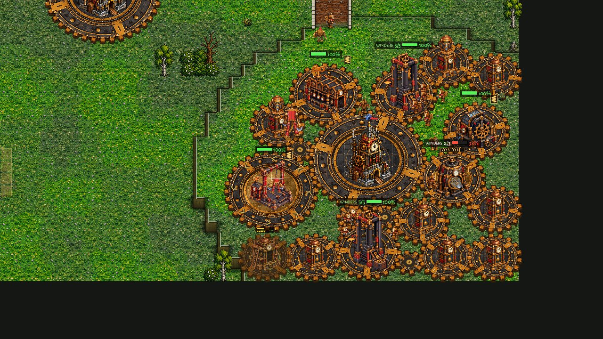
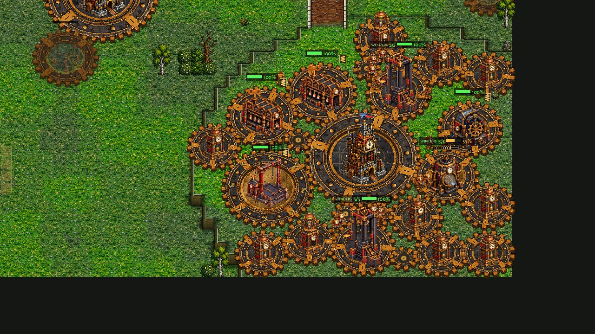

# Coaching the Clockwork computer's economy (job econ-coach-clockwork)

The owner (2026-11-13 01:18): "The computers reach only part of what their faction could earn ... This must be corrected with
AI coaching before we ever touch balance. The AI must be 100% or as close as possible to what it could do, so we have a
complete picture and then make decisions." This job: the Hard Clockwork computer's economy as close as possible to its
design, measured by the economy bench (tools/econ_bench.gd, docs/economy_parity.md section 1). **No rule or number of the
game changed**: no unit, building, price, yield or rule; only how the Clockwork computer plays (scripts/ai_cw_macro.gd, new,
and small hooks in scripts/ai_clockwork.gd and scripts/ai_cw_eco.gd; nothing in the shared scripts/ai.gd). Design rules
followed (docs/design_principles.md): section 2 (an economy that expands and runs out must be worked before the factions can
be compared fairly), section 1 (fairness: the same design, measured, not guessed). `-- cwmacro:off` plays as before.

## In short

1. **Where it lost** (the computer alone against an idle dummy, the bench's own setup, and 36 Hard games): its Winders
   **stopped at 32** (the shared cap counted the 2-12 Winders that walk with the army to wind it among them, so only 20-25
   worked while its presses had 36-46 posts); a **written build kept its own small economy** (a build without "press_new"
   steps stood a second Clocktower with no press beside it: on Hollowfen OPTIMAL earned 9,000 cogs in 15 minutes); **every
   press was on the small ring** (two bases could pay at most 72% of the bench's two); the Regulators came late once four
   or five Clocktowers trained Winders (3-4 minutes supply-blocked); a press at a time after a base ran dry (15-37 Winders
   idle for a minute).
2. **Five fixes** (section 3), each kept because the economy rose without the army falling (the results stay within the
   games' noise).
3. **The computer alone** (OPTIMAL, Economy, Balanced; Greenhold and Hollowfen; cogs as a share of the bench's):
   **0.96 / 0.90 / 0.86 / 0.75 at 5 / 8 / 10 / 15 minutes before, 1.00 / 1.08 / 1.17 / 1.20 after**. Economy and Balanced
   beat the bench from 8:00 on (1.14-1.21 at 8:00); the aggressive plans keep their lean openings and reach 0.95-1.18 at
   15:00 (was 0.65-0.84).
4. **In the games** (Hard OPTIMAL v Hard OPTIMAL, the parity batch's 36 Clockwork games, before = the win-rate study's games
   on the same tags and seeds): the Clockwork's cogs, all 48 Clockwork sides, as a share of
   the bench's: **0.92 / 0.86 / 0.83 / 0.66 at 5 / 8 / 10 / 15 minutes before, 0.92 / 0.93 / 0.98 / 0.90 after** (16,614 ->
   22,662 cogs at 15:00, +36%); 43-53 Winders at 8:00-10:00 against the Crown and in the mirror (29-31 before), its army at
   15:00 bigger (Crown v Clockwork 4,692 -> 5,822; the Brood 2,459 -> 2,885). Results within the games' noise: won or led
   11 -> 11 of 12 against the Crown (more draws: 4-8-0 -> 2-10-0), 8 -> 7 against the Brood (6-3-3 -> 6-4-2), 7 -> 7 in the
   mirror; the defence did not fall apart anywhere (no Clockwork lost more games than before).
5. **What is left** (section 5): the lean early minutes of the aggressive plans (their identity), the bank piling up at the
   200 supply cap (nothing to spend it on), the escorts, the Brood's raids (the opponent's, legitimate), and two RULE
   questions for the owner, proposed, not applied.

## 1. How it was measured

- **The bench** (main, docs/economy_parity/before/fix_clockwork.json and hollowfen/before_clockwork.json): the scripted
  ideal build, 2 big Cog Presses and a Mainspring a Clocktower, Clocktowers at 4:00, 8:00 and 12:00, no army. The yardstick
  is the PRIMARY income, cogs earned (section 3 of docs/economy_parity.md compared the games the same way).
- **The computer alone** (new: tools/econ_alone_cw.gd, run by tools/study/econ_alone_cw.sh, read by
  tools/study/econ_alone_cw_report.py): the bench's setup with the Hard Clockwork computer playing instead of the script,
  on any plan, to 15:00. The dummy (a Crown nobody plays) is kept standing (its buildings healed, its bank full) so the
  computer's attacks never end the game; the computer is NOT peaceful, its scout reads (OPTIMAL picks its build from that:
  against an idle Crown it reads GREEDY and picks the Clock Soldier rush, the punish). A line a minute: cogs and Tension
  earned, Winders (at work, idle, escorts), posts (the crews of its working presses and Mainsprings), presses (big, small,
  spent standing), Clocktowers, bank, supply, army; and the seconds supply-blocked, the Winder-seconds of empty posts, the
  idle-Winder seconds, the seconds a Clocktower stood idle while posts were empty. Data: docs/econ_coach_clockwork/alone/.
- **The games**: tools/study/econ_coach_cw_games.py runs the 36 games of `qa_matches.py --only parity` with a Clockwork
  side (Crown v Clockwork, Brood v Clockwork, the mirror; Greenhold, Dune Sea, Frostfang, Ashford Crossing, Hollowfen,
  Cinder Steps; both rounds), Hard OPTIMAL both sides, 15:00; tools/study/econ_coach_cw_report.py reads them. BEFORE = the
  same tags and seeds from the win-rate study (docs/winrate_2026_11_12/winrate-a/b/c, 0.33.25: the Clockwork computer is
  the same as on main). Data: docs/econ_coach_clockwork/games/.

## 2. Where it lost (before)

The computer alone (cogs earned as a share of the bench's at 5 / 8 / 10 / 12 / 15 minutes):

| plan (what it played) | Greenhold | Hollowfen |
|---|---|---|
| OPTIMAL (Clock Soldier rush; Hollowfen then the Springer timing) | 0.82 / 0.72 / 0.73 / 0.72 / 0.76 | 0.81 / 0.62 / 0.56 / 0.49 / **0.36** |
| Economy | 1.07 / 1.03 / 0.96 / 0.88 / 0.81 | 1.07 / 1.04 / 1.01 / 0.95 / 0.91 |
| Balanced | 1.04 / 1.02 / 0.97 / 0.90 / 0.86 | 0.97 / 0.97 / 0.93 / 0.87 / 0.83 |

The written openings are good (Economy and Balanced are AT or above the bench until 8:00); the computer falls behind from
8:00 on, by the same few mistakes in every plan:

1. **The Winders stopped at 32.** AI._workers (shared) caps the Clockwork at 13 a Clocktower and 32 at most (Hard), and the
   escorts (AI._escort_want: 2 + one for every 5 constructs, up to 10, plus the Great Winder's and the Ballistas' crews), the
   builder and the Winders on the army's errands are among those 32. From 8:00-9:00 every run sat at exactly 32 Winders,
   20-25 at work, while its posts grew to 36-46: 1,000-1,500 Winder-seconds of empty posts a minute (the "empty" column),
   and its Clocktowers stood idle (nothing in training) while posts were empty for 1,250-2,190 Clocktower-seconds a run. This is the "labourers stop at 26-32" of
   economy_parity section 3. In the games: 29-32 Winders at 8:00, 23-32 at 15:00.
2. **A written build kept its own small economy.** While an opening build runs (AIClockwork.bo_on) the shared rules are off:
   only its steps build and its worker goal trains. A build with no "press_new" step (the Clock Soldier rush, the Springer
   timing, the Owls...) laid its second Clocktower and no press beside it. On Hollowfen OPTIMAL picked the Clock Soldier rush
   at 1:45, switched to the Springer timing at 5:17; the Springer timing's steps then waited on a Swift for ten minutes with
   1,000-1,700 cogs in the bank: 13 posts all game (2 small presses and a Mainspring at the main), 21 Winders, 9,000 cogs at
   15:00, the main spent at 12:00 and nothing coming in after.
3. **OPTIMAL's second switch had no time cap** (AIClockwork.opt_switch: a build picked while another written build still
   ran got no OPT_BO_CAP), and the hand-over of a stuck build (no step for 60 s with 1,000 cogs banked) ran only against the
   Brood (clockwork-v-brood-coach's gate).
4. **Every press was small.** The shared rule (AI._want_big_gear) lays a BIG press only when spare Winders already stand, and
   with the Winders trained for the posts there never are; the press steps and the shared rule's spot (laid with `at` given)
   were small anyway. Two small presses take 5 Winders each and press 7.2 cogs a second; two big ones 8 each and 10: two
   bases on small presses can pay at most 4 x 7.2 = 28.8 cogs a second, 72% of the bench's 40, until a third Clocktower
   stands. The big ring costs 25 cogs and 4 s more (Defs.GEAR "big_pick").
5. **Regulators late, presses one at a time.** After the opening the shared supply rule keeps a margin of 3 + 3 a Works,
   not counting four or five Clocktowers training Winders: 3-4 minutes supply-blocked from 6:00 once the Winders could grow
   (it showed only after fix 1). And the shared rule lays one press at a time: when a main ran dry its crews (15-37 Winders)
   stood idle for a minute or more while the next presses went up one by one.

Not losses (checked): the expansions are on time alone (Clocktowers 2 / 3-4 / 4 / 5-6 at 5 / 8 / 10 / 15 minutes, the
bench's 2 / 3 / 3 / 4); the spent presses are pulled down (AI._recycle_spent) when the limit needs it; idle Winders before
9:00 are mostly escorts at rest by the army and the crew trained ahead for a Clocktower going up.

## 3. The fixes, each measured

All in scripts/ai_cw_macro.gd (AIClockwork.macro), Hard and up (Easy and Normal keep their smaller economy):

| # | fix | where | measured |
|---|---|---|---|
| 1 | **Winders for every post**: the count the shared rules train after the opening (AIClockwork._lab_want -> macro.want) is every post of its working presses and Mainsprings (standing or going up) + the escorts + a builder + a press crew ahead for each Clocktower going up, the plan's "workers" share scaling it down (Rush 0.75), at most MAX_WINDERS 54 (the rest of the 200 supply is the army's) | ai_cw_macro.want | with 2-3: alone 0.75 -> 1.15 of the bench at 15:00 (mean of 6) |
| 2 | **The economy under any written build**: while an opening runs, posts left empty get Winders (from the cogs its waiting step leaves), and a standing Clocktower on fresh brass short of its two presses gets one, unless the build lays its own press within its next 4 steps (the opening stays as written) | ai_cw_macro.bo_tick | Hollowfen OPTIMAL 9,000 -> 28,748 cogs at 15:00 |
| 3 | **OPTIMAL's second switch capped** (OPT_BO_CAP 300 s, as the first switch after the opening), and **the stuck-build hand-over against every faction** (it was the Brood only) | ai_clockwork.opt_switch, _stuck_hand_over | the Hollowfen build handed over at 5:26 (stuck 66 s, 1,003 banked) |
| 4 | **Regulators ahead of every maker** after the opening: a margin of 4 + one a Clocktower + 3 a Works (Light or Heavy), two going up at once when tight | ai_cw_macro.supply | supply-blocked 0-78 s a run before; 227-230 s with fix 1 alone (the Winders grew); 0-40 s with this |
| 5 | **Presses after the opening by the macro**, the freshest Clocktower first, **a second at once for 4+ idle Winders**, and **the BIG ring for the first three Clocktowers' presses** (under 140 supply; the press_new steps too; NOT against the Brood, section 4), the small ring later (at the supply cap the small ring's 86 cogs a Winder a minute beat the big one's 75) | ai_cw_macro.presses_after, presses_more, lay_press; ai_cw_eco._press_new | alone 1.15 -> 1.20 at 15:00, 1.01 -> 1.08 at 8:00, 1.08 -> 1.17 at 10:00 |

The computer alone, the mean of OPTIMAL, Economy and Balanced on Greenhold and Hollowfen (share of the bench's cogs):

| | 5:00 | 8:00 | 10:00 | 12:00 | 15:00 |
|---|---|---|---|---|---|
| before (main) | 0.96 | 0.90 | 0.86 | 0.80 | 0.75 |
| fixes 1-4 + presses after (macro 1) | 0.98 | 1.01 | 1.08 | 1.11 | 1.15 |
| + the big ring (macro 2, the branch) | **1.00** | **1.08** | **1.17** | **1.18** | **1.20** |

Per plan, before -> after (cogs at 15:00; share of the bench at 5 / 8 / 10 / 15; Winders at 8 / 10 / 15; army at 15:00):

| plan | before | after |
|---|---|---|
| OPTIMAL Greenhold | 19,055; 0.82 / 0.72 / 0.73 / 0.76; 31 / 30 / 32; 10,870 | 27,616; 0.82 / 0.83 / 0.97 / 1.10; 44 / 54 / 54; 10,115 |
| OPTIMAL Hollowfen | 9,000; 0.81 / 0.62 / 0.56 / 0.36; 21 / 21 / 21; 5,620 | 27,356; 0.94 / 0.99 / 1.10 / 1.10; 54 / 54 / 54; 9,915 |
| Economy Greenhold | 20,237; 1.07 / 1.03 / 0.96 / 0.81; 32 / 32 / 32; 11,510 | 31,570; 1.09 / 1.21 / 1.28 / 1.26; 54 / 54 / 54; 9,895 |
| Economy Hollowfen | 22,524; 1.07 / 1.04 / 1.01 / 0.91; 32 / 32 / 32; 11,695 | 31,489; 1.08 / 1.19 / 1.28 / 1.27; 54 / 54 / 52; 10,020 |
| Balanced Greenhold | 21,606; 1.04 / 1.02 / 0.97 / 0.86; 32 / 32 / 32; 11,715 | 31,281; 1.03 / 1.14 / 1.23 / 1.25; 53 / 54 / 54; 10,080 |
| Balanced Hollowfen | 20,590; 0.97 / 0.97 / 0.93 / 0.83; 32 / 32 / 32; 11,710 | 29,872; 1.01 / 1.08 / 1.17 / 1.20; 46 / 54 / 54; 9,970 |

The other plans, Greenhold (before = the same code with `cwmacro:off`):

| plan | share of the bench at 5 / 8 / 10 / 12 / 15 before | after | Winders 8 / 10 / 15 before -> after |
|---|---|---|---|
| Springer timing | 0.78 / 0.61 / 0.63 / 0.64 / 0.66 | 0.78 / 0.69 / 0.80 / 0.89 / 0.97 | 25/32/32 -> 39/54/54 |
| Pendulums | 0.84 / 0.79 / 0.80 / 0.78 / 0.79 | 0.84 / 0.84 / 0.98 / 1.05 / 1.12 | 32/32/32 -> 45/54/54 |
| Heavy Works push | 0.84 / 0.76 / 0.82 / 0.83 / 0.84 | 0.84 / 0.78 / 0.89 / 0.98 / 1.05 | 31/32/32 -> 38/54/54 |
| Owl raids | 0.79 / 0.67 / 0.70 / 0.67 / 0.66 | 0.79 / 0.67 / 0.74 / 0.85 / 0.95 | 30/32/32 -> 32/53/54 |
| Clock Soldier rush | 0.81 / 0.70 / 0.74 / 0.73 / 0.76 | 0.81 / 0.73 / 0.82 / 0.92 / 1.01 | 30/32/32 -> 36/54/54 |
| Rush | 0.81 / 0.59 / 0.58 / 0.58 / 0.65 | 0.93 / 0.85 / 0.86 / 0.87 / 0.95 | 23/25/32 -> 32/41/44 |
| Timing attack | 0.85 / 0.86 / 0.85 / 0.81 / 0.80 | 0.95 / 0.94 / 1.09 / 1.13 / 1.18 | 32/32/32 -> 50/54/54 |
| mean of the 7 | 0.82 / 0.71 / 0.73 / 0.72 / 0.74 | 0.85 / 0.79 / 0.88 / 0.96 / 1.03 | |

**How to read the aggressive plans**: they trade economy for army ON PURPOSE in their opening (the Springer timing, the Owls,
the Clock Soldier rush: a second Clocktower late, few Winders until the attack has left), so their 5:00-8:00 share stays
low (0.67-0.85): that is the plan, not a mistake, and it is kept (the owner wants to train against each strategy). What
such a plan COULD reach is its own opening and then the economy played fully: before, they never caught up (0.65-0.84 at
15:00, the 32 cap); now they reach the bench by 12:00-15:00 (0.95-1.18). The Economy and Balanced plans beat the bench from
8:00 (more Clocktowers than its schedule: 4 at 10:00, 6 at 15:00).

**What it costs**: alone, at the 200 supply cap (from about 11:00 alone, with no losses), 54 Winders leave less room for the
army: army value at 15:00 about 10,000 against 11,500 before, with 5,000-12,000 cogs banked that the cap does not let it
spend. In the games the cap is rarely reached (armies die), and the army at 15:00 is BIGGER after (section 4).

## 4. The games

Hard OPTIMAL v Hard OPTIMAL, 15:00, 12 games a matchup (6 maps x 2 rounds, the sides swapped), from the Clockwork's view
(the mirror: income of both sides, the result from the P1 spot's). BEFORE = the win-rate study's games (0.33.25, the same
Clockwork computer as main); MACRO 1 = fixes 1-4 and the presses after the opening (small ring); MACRO 2 = + the big ring
everywhere; FINAL = the branch: macro 2 against the Crown and in the mirror, and against the Brood the small ring (the
"macro3_brood" games). Cogs earned (share of the bench's), mean of the games:

| matchup | data | W-D-L | won or led | cogs 5:00 / 8:00 / 10:00 / 15:00 (share of the bench) | the foe's income | Winders 8/10/15 | Clocktowers 5/8/10/15 | army 8/10/15 | idle Winders | decided length |
|---|---|---|---|---|---|---|---|---|---|---|
| Crown v Clockwork | before | 4-8-0 | 11 | 3,922 (0.90) / 8,040 (0.82) / 11,351 (0.82) / 18,781 (0.75) | 2,470 / 5,256 / 6,935 / 9,766 | 29 / 31 / 32 | 2.0 / 2.6 / 3.1 / 4.6 | 1,301 / 1,980 / 4,692 | 2.0 | 13:47 |
| | macro 1 | 4-8-0 | 12 | 4,080 (0.94) / 9,165 (0.94) / 13,823 (1.00) / 25,525 (1.02) | 2,501 / 5,256 / 7,061 / 9,481 | 39 / 49 / 52 | 2.0 / 3.0 / 3.7 / 5.2 | 1,347 / 2,146 / 5,595 | 5.8 | 14:24 |
| | **final** (macro 2) | 2-10-0 | 11 | **4,071 (0.94) / 9,463 (0.97) / 14,129 (1.02) / 26,154 (1.04)** | 2,501 / 5,351 / 7,410 / 11,656 | 43 / 48 / 50 | 2.0 / 3.0 / 3.7 / 4.8 | 1,528 / 2,191 / 5,822 | 5.0 | 13:17 |
| Brood v Clockwork | before | 6-3-3 | 8 | 3,531 (0.81) / 7,346 (0.75) / 9,969 (0.72) / 13,128 (0.52) | 2,098 / 4,726 / 7,407 / 11,196 | 27 / 28 / 23 | 1.8 / 2.0 / 2.9 / 3.1 | 1,340 / 1,800 / 2,459 | 2.6 | 12:41 |
| | macro 1 | 7-4-1 | 11 | 3,566 (0.82) / 7,384 (0.75) / 10,539 (0.76) / 16,759 (0.67) | 2,127 / 5,048 / 7,701 / 11,000 | 28 / 35 / 44 | 1.8 / 2.1 / 2.9 / 3.8 | 1,607 / 2,083 / 3,929 | 3.6 | 12:58 |
| | macro 2 (big ring) | 6-3-3 | 8 | 3,518 (0.81) / 7,538 (0.77) / 11,448 (0.83) / 17,315 (0.69) | 2,140 / 5,168 / 8,123 / 13,260 | 31 / 44 / 36 | 1.9 / 2.3 / 2.9 / 3.3 | 1,246 / 1,659 / 2,996 | 3.0 | 13:14 |
| | **final** (small ring) | 6-4-2 | 7 | **3,513 (0.81) / 7,232 (0.74) / 10,315 (0.74) / 16,516 (0.66)** | 2,190 / 5,217 / 8,366 / 13,508 | 27 / 34 / 35 | 1.9 / 2.0 / 2.6 / 3.2 | 1,320 / 1,720 / 2,885 | 3.5 | 13:25 |
| Clockwork mirror | before | 4-6-2 | 7 | 4,216 (0.97) / 9,092 (0.93) / 12,411 (0.90) / 17,274 (0.69) | (the same) | 31 / 31 / 26 | 2.0 / 2.8 / 3.2 / 3.0 | 1,508 / 2,262 / 3,270 | 1.2 | 13:18 |
| | macro 1 | 4-7-1 | 7 | 4,266 (0.98) / 9,630 (0.98) / 13,863 (1.00) / 21,428 (0.85) | | 40 / 48 / 41 | 2.0 / 3.0 / 3.2 / 3.1 | 1,450 / 2,210 / 4,042 | 5.3 | 13:28 |
| | **final** (macro 2) | 2-9-1 | 7 | **4,239 (0.97) / 9,862 (1.01) / 14,846 (1.07) / 23,990 (0.96)** | | 43 / 53 / 45 | 2.0 / 3.0 / 3.5 / 3.6 | 1,471 / 2,546 / 4,171 | 5.8 | 14:39 |

All 48 Clockwork sides: cogs at 5 / 8 / 10 / 15 minutes 3,971 / 8,393 / 11,536 / 16,614 before, **4,016 / 9,105 / 13,534 /
22,662** after (0.92 / 0.86 / 0.83 / 0.66 -> 0.92 / 0.93 / 0.98 / 0.90 of the bench). No game crashed or stalled, no script
error. (Single games are noisy: the qa study found the same map and seed agree on the result about 2 times in 3; read the
totals.)

**What it shows.**
- **Against the Crown and in the mirror the Clockwork now gets 0.94-1.07 of its design from 5:00 to 15:00** (0.69-0.97
  before): the job's target. The rest to 1.0 at 5:00-8:00 is the opening (OPTIMAL's common opening and its pick) and the
  fights. Its army is as big or bigger at every point (the income pays for both).
- **Results did not move beyond the noise.** Against the Crown it won or led 11 of 12 before and after (two wins became
  draws: with more income both sides' armies were bigger at 15:00 and fewer games ended); the Crown's own income rose a little
  (9,766 -> 11,656 at 15:00: the Crown computer earns more when its foe stays home building, not a change of ours). The
  mirror: 7 of 12 led by the P1 spot either way.
- **Against the Brood the gap is mostly the opponent's**: 0.74 of the bench at 8:00-10:00 and 0.66 at 15:00 (0.52 before):
  the Brood's raids kill Winders and presses (its income is 0.6-0.8 of the Clockwork's; legitimate), and the third Clocktower
  comes later against it (2.6 at 10:00 against 3.5-3.7). The big ring was tried against it (macro 2): +10% cogs at 10:00,
  but its army at 8:00 fell from 1,340-1,607 to 1,246 and it won or led 8 (macro 1: 11); so against the Brood the presses
  stay on the small ring (Raptors come early; the 25 cogs and three Winders a press are army there). With noise this large
  the macro 1 / macro 2 / final results against the Brood (11, 8, 7 of 12 won or led) do not tell the variants apart; the
  army at 8:00 does.

## 5. What is left

- **The aggressive plans' lean openings** (0.67-0.85 of the bench at 5:00-8:00): their identity, kept.
- **The bank at the supply cap**: alone it reaches 200 supply at 11:00-13:00 and banks 5,000-12,000 cogs it cannot spend
  (no army room). Not an economy loss; a sink would be a rule question (below).
- **The escorts**: 2-12 Winders walk with the army to wind it (a Clockwork rule: constructs run down off their gear field);
  they are counted on top of the posts now. At home, resting, they could work a press between pushes: not done (the push
  logic is shared with the army jobs; a small gain, about 5% of the Winders' time).
- **Spent presses standing**: pulled down only when the press limit needs the place (AI._recycle_spent, shared), so 2-6
  stand late in the game; they cost nothing but their place, so left.
- **Against the Brood** the Clockwork still earns 0.6-0.8 of the bench by 15:00 in the games: its raids kill Winders and
  presses (legitimate: the opponent's play). Its third Clocktower comes at about 9:00 against the Brood (8:00 against the
  others), held by the threat checks of the shared expansion rule (AI._hall_first / _more_halls), which this job left alone.
- **Rule questions for the owner (proposed, NOT applied)**:
  1. A Cog Press on spent brass counts against "2 per Clocktower" until it is pulled down, like the Crown's Farms
     (economy_parity section 8.3): should a spent press free its place by itself? The computer pulls them down; a player who
     does not know to is capped.
  2. With the computers now working their economies, the Clockwork alone banks thousands at the 200 supply cap: is the cap
     the brake the owner wants, or should the late game have a cog sink (research, a costlier upkeep)? Only once the other
     two computers are coached (econ-coach-crown, econ-coach-brood), so the three can be compared.

## 6. Tests

Run with tools/study/econ_coach_cw_tests.sh (the 23 AI tests and the Clockwork's 20; each in its own process and user
folder):

| test | verdict | note |
|---|---|---|
| 35 of the 43 | pass | among them test_ai_expand (the POOR Clockwork case: a new Clocktower at 28 s, still earning in the last minute: the stuck-on-spent-brass case of economy_parity and qa_2026_11_08_tests item 3 passes), test_clockwork_eco, _builds_a, _builds_b, _springer_timing, _owls, _army, _home, test_ai_optimal, test_cw_air_ai, test_gear_ai, test_exhaust |
| test_ai_abandoned_site, test_gear_econ | pass | (they print "ALL OK" / "0 failures", not PASS) |
| **test_ai_cw_horse_raid** | **changed** | "a group of Clock Soldiers comes to the press" failed on seeds 5 and 7: with every post of the raided press filled, round 5's group of Winders killed all three riders before the soldiers got there (Winders lost 3-6, was 10-15). The check now also passes when the Winders beat the raid themselves (all riders killed, fewer Winders lost than without round 5). Seed 6 passes either way. |
| test_cw_tier3_ai | flaky | the Netter check ("nets the Cuirassier, not the Labourer") passes and fails both with and without the macro (`cwmacro:off` failed it once): the Netter on HOLD picks a target in the first second, before both are seen. Not changed. |
| test_ai_harass | flaky | failed once ([raid]: Crown riders against the Brood, no Clockwork), passed on the rerun and on the final code |
| test_ai_rush, test_ai_brood, test_ai_rush_followup | not the Clockwork | Crown v Brood games with no Clockwork in them (this job's code does not run): test_ai_rush's "workers before the Brood Mother" passes and fails from run to run; test_ai_brood's stage-3 timing is the known flaky one (CLAUDE.md); test_ai_rush_followup fails 14 checks with `cwmacro:off` too (half stale, qa_2026_11_08_tests item 15) |

After the last change (the small ring against the Brood) test_clockwork_eco, test_ai_expand, test_clockwork_builds_b,
test_ai_harass, test_ai_optimal and test_cw_air_ai were run again: all pass.

## Pictures

A filmed game each side of the change (tools/shot_ai_match.gd coach:1; Greenhold, seed 1101, Crown OPTIMAL v Clockwork
OPTIMAL, to 10:20; before = `cwmacro:off`): docs/econ_coach_clockwork/films/before/ and after/ (the Clockwork's main at
6:00 and 10:00, its fights at 8:00, coach.txt = a status line every 15 s). The Clockwork side, from coach.txt:

| | 4:04 | 6:05 | 8:05 | 10:05 |
|---|---|---|---|---|
| before: cogs earned, Winders, Clocktowers, army | 2,775; 22; 2; 280 | 4,507; 21; 2; 920 | 7,261; 29; 2; 940 | 10,664; 33; 4; 1,900 |
| after | 2,773; 21; 2; 280 | 5,401; 26; 2; 780 | 8,817; 33; 3; 800 | 13,427; 52; 4; 2,290 |

 

(The main at 10:00: before, its Mainspring with 2 of its 3 Winders; after, 3 of 3 and every press full. The bigger
difference is off this picture, at the other Clocktowers: 52 Winders against 33.)

## How to run it

- The computer alone: `godot --headless --fixed-fps 30 --script res://tools/econ_alone_cw.gd -- plan=optimal map=greenhold
  seed=1 minutes=15 [peace=1] [cwmacro:off] out=FILE.json`, or `tools/study/econ_alone_cw.sh OUT 2 "optimal economy" "greenhold
  hollowfen" 1 0 [cwmacro:off]`; the table: `python3 tools/study/econ_alone_cw_report.py DIR [DIR2 ...]`.
- The games: `python3 tools/study/econ_coach_cw_games.py OUT DATA --jobs 2 [--extra cwmacro:off]`; the table:
  `python3 tools/study/econ_coach_cw_report.py BEFORE_DATA AFTER_DATA`.
- The tests: `tools/study/econ_coach_cw_tests.sh OUT 2 [cwmacro:off]`.
