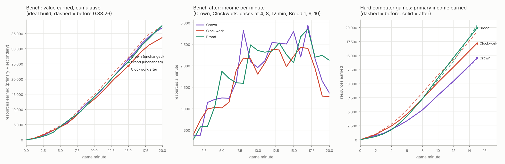

# Economy parity (job economy-parity; its two balance numbers are NOT on main: branch `economy-parity` keeps them. On main since 2026-11-13: the bench, the data and this report. Owner 2026-11-13 01:18: coach the computers to their economy's design FIRST, decide balance after)

The owner (2026-11-12 21:04): "I would like all economies to be about the same level of resources per minute, but
instead of buffing the Crown maybe we should nerf the other factions." He also wants a SLOWER game overall and asked
which RTS the current pace resembles.

Design rules followed (docs/design_principles.md): section 1 (fairness: the same income at the same build, measured,
not guessed), section 2 (depletion forces expansion: a base still runs out when it did), and the owner's own rule for this
job (no Crown buff). docs/exhaust_economy.md's rules (no trickle, spent means spent, the floors) are untouched.

**The branch changes two numbers** (and the texts that quote them): the Clockwork's Cog Press 7.2 -> 6.4 cogs a second
small, 10 -> 8.9 big, and a Clocktower's raw brass 9,000 -> 8,000. The Brood was measured and left alone (a FOOD_BONUS
cut was tried and taken back: section 4). Nothing of the Crown changed. **The owner must approve before it is merged** (section 8).

## In short

1. **By design the three economies were already close.** A new bench (each faction alone, the same ideal build) gives,
   as shares of the Crown's earnings at 5 / 8 / 10 / 15 minutes: Clockwork 1.06 / 1.04 / 1.06 / 1.02 (1.24 at 3:00), Brood
   on its natural expansion clock 1.00 / 0.92 / 1.00 / 0.96 on Greenhold and 0.79 / 0.75 / 0.83 / 0.84 on Hollowfen.
2. **The games' big gaps are the computers'**: the Crown computer gets 53-58% of its economy's design (it expands late
   and rarely, keeps spent Farms under its hall limit, and spreads its labourers thin), the Clockwork computer 72-91%,
   the Brood's 56-68%.
3. **Applied** (owner's rule: nerf the others): the Clockwork -11% (Cog Press 7.2 -> 6.4, 10 -> 8.9; brass 9,000 ->
   8,000 so a base runs out when it did). Bench after: 0.95 / 0.93 / 0.95 / 0.92 of the Crown, still ahead at 3:00 (1.11).
   **The Brood was not nerfed**: FOOD_BONUS 1.0 was tried and put it 20-28% under the Crown on Hollowfen.
4. **In 72 Hard games each way** the Clockwork earns 11-14% less; the Crown/Clockwork income gap goes from 1.33-1.57 to
   1.18-1.38 and the Clockwork no longer wins against the Crown (0-12-0 draws, was 0-8-4); but the Brood now wins or leads 8
   of 12 against the Clockwork (was 4). Crown v Brood is unchanged (0 won or led).
5. **Pace**: first expansion 3:30-6:00, first contact ~6:00, first big fight ~9:00, ~145 supply at 15:00, most games still
   going at 15:00. It plays like **Warcraft III with a StarCraft II opening**; the nerf slows only the Clockwork's side.
6. **The owner decides** (section 8): merge the Clockwork cut (or a smaller one), a Brood ground-price brake, the Crown
   computer's economy fixes (the real lever for parity in games), and how much slower the whole game should be.

## 1. The bench: the design, not the computer

`tools/econ_bench.gd` (new; the old bench of the shelved Line's Boilers and Ore Crushers is in git history) plays ONE
faction alone on a map (the other slot is an idle dummy) with a SCRIPTED IDEAL BUILD, the same for every faction:

- workers without a break from every hall (the Brood: eggs from the Mother) up to the posts its economy offers; each new
  worker takes the game's own first post (Game.free_site / BroodNew.free_source); idle or released workers are sent to a
  free post every 2 s;
- the economy buildings as soon as they can be paid, each hall its own quota (Crown: 2 Farms + a Powder Mill; Clockwork:
  2 Cog Presses on the big ring + a Mainspring; Brood: Rootmaws wherever its spot finder has room, one walking at a time,
  while its grubs fill them); spent ones pulled down (a player frees the hall limit for fresh ground; the Brood's spent
  Rootmaws get up and walk to fresh ground, as its computer does);
- supply just in time (Cottage, Spring Tower, a Mound Turtle);
- the next bases at fixed times: **4:00, 8:00 and 12:00** for the Crown and the Clockwork (Town Hall / Clocktower on the
  computer's own next hall spot); the Brood's "base" is a Mound Turtle on new ground (its far spot finder) and Rootmaws round
  it; the Mother grows to stage 2 at 4:00;
- no army, research or walls: the rest stays in the bank. Buildings are laid where the computer would lay them (its own
  spot finders, on a computer player whose thinking is off) and stand after their build time (one ideal builder, no walk).

**Common value**: primary + secondary at 1 : 1 (gold + powder, cogs + Tension, biomass + spoils): a Musketeer is 60 gold +
10 powder, a Clock Soldier 70 cogs, a Springer 100 cogs + 25 Tension, a Raptor egg 50 biomass for two: a unit of any
resource buys about the same fighting value. Secondary resources are taken out of the pool every second, so a full store
never stops them. Map Greenhold, seed 1 (a second map, Hollowfen, in section 2.3). The Brood has no secondary income here (spoils come from bodies).

### The Brood's clock

With the same clock the Brood is far behind (0.58 of the Crown at 5:00), because its home holds only two Rootmaws (their
circles of ground may not overlap) and its first base is new ground: a Mound Turtle (a grub and 100 biomass) where the
others pay a 400 hall. In real games the Brood takes it at once: the Hard computers' median (the qa-matches games) is a
far turtle at 0:00-1:00, the third ground at 6:00, the fourth at 10:00, against the Clockwork's 4:00 / 7:00 / 11:00 and the
Crown's 5:00 (and rarely a third). So the Brood is benched on **its natural clock, 1:00, 6:00, 10:00**, the Crown and
the Clockwork on 4:00 / 8:00 / 12:00 (a good player's; the Clockwork computer's own is nearly that). The same-clock Brood
row is kept in the table for reference. A greedy run (`exp=auto`: the next base whenever the bases are nearly full) is in
docs/economy_parity/before/auto_*.json: it only shows that every economy runs away without an army to pay for (the
Clockwork fastest), so it is not used for parity.

## 2. Before and after

### 2.1 Value earned, cumulative (Greenhold)

| Greenhold | 3:00 | 5:00 | 8:00 | 10:00 | 12:00 | 15:00 | 20:00 |
|---|---|---|---|---|---|---|---|
| Crown (unchanged; 4/8/12) | 1,903 | 4,364 | 10,034 | 14,079 | 18,735 | 26,559 | 36,866 |
| Clockwork before (4/8/12) | 2,361 (1.24) | 4,634 (1.06) | 10,455 (1.04) | 14,860 (1.06) | 19,829 (1.06) | 27,126 (1.02) | 37,469 (1.02) |
| **Clockwork after** | 2,113 (1.11) | 4,157 (0.95) | 9,377 (0.93) | 13,342 (0.95) | 17,791 (0.95) | 24,351 (0.92) | 33,680 (0.91) |
| Brood (unchanged; its clock 1/6/10) | 1,436 (0.75) | 4,344 (1.00) | 9,237 (0.92) | 14,074 (1.00) | 18,728 (1.00) | 25,585 (0.96) | 37,674 (1.02) |
| Brood with FOOD_BONUS 1.0 (option, not applied) | 1,428 (0.75) | 4,133 (0.95) | 8,741 (0.87) | 13,307 (0.95) | 17,826 (0.95) | 24,608 (0.93) | 35,556 (0.96) |
| Brood on the same clock 4/8/12 (reference) | 1,416 (0.74) | 2,523 (0.58) | 7,074 (0.71) | 10,245 (0.73) | 14,673 (0.78) | 21,374 (0.80) | 32,540 (0.88) |

(in brackets: the share of the Crown's.) The target was within about 10% at 5, 8, 10 and 15 minutes.

**Reading it.** By design, BEFORE this branch, the Crown and the Clockwork were already within 6% of each other at every
point from 5:00 (the Clockwork 24% ahead at 3:00: its start Cog Press pays steadily while the Crown's Farm pays in 380-gold
lumps), and the Brood, on its own clock, within 8%. The big gaps of the computer games (the Clockwork 1.4-1.6 x the Crown,
the Brood 1.2-1.35 x late) are not in the economies' design: they are in how much of it each COMPUTER gets (section 3).

### 2.2 Per minute, per worker, running out

| | per minute at 3 / 5 / 8 / 10 / 15 / 20 | workers at 5 / 8 / 10 / 15 | value a worker a minute at 5 / 10 / 15 |
|---|---|---|---|
| Crown (unchanged; 4/8/12) | 1,143 / 1,248 / 2,816 / 1,955 / 2,797 / 1,363 | 22 / 44 / 40 / 72 | 57 / 49 / 50 |
| Clockwork before (4/8/12) | 1,103 / 1,132 / 2,423 / 1,997 / 2,442 / 1,406 | 20 / 35 / 43 / 49 | 71 / 67 / 56 |
| **Clockwork after** | 991 / 1,016 / 2,176 / 1,803 / 2,217 / 1,273 | 20 / 35 / 43 / 49 | 64 / 60 / 50 |
| Brood (unchanged; its clock 1/6/10) | 589 / 1,867 / 1,589 / 2,354 / 2,068 / 2,123 | 36 / 59 / 59 / 69 | 53 / 44 / 30 |

- **A base, saturated**: Crown 2 Farms (8 each) + a Mill (6) = 22 labourers for 1,140 gold + ~100-110 powder a minute
  (Farm: 380 gold every 40 s with 8 hands, 71 a labourer a minute; a Mill hand ~17 powder a minute); Clockwork 2 big
  Presses (8 each) + a Mainspring (3 on its small ring) = 19 Winders for 1,200 cogs + ~110 Tension a minute before (75
  cogs a Winder a minute on a big press, 86 on a small one), 1,068 cogs after (67 / 77); Brood 2 Rootmaws, 6 grubs each near the Mother
  (36 biomass a grub a minute near, up to 2.2 times far, more grubs far: +1 a 3 tiles past 8 tiles, up to 12).
- **Workers come at very different speeds**: one labourer or Winder every 12 s from each hall; the Mother lays an egg
  every 6 s (x1.0 to x1.9 with her growth, expansions and harvest veterancy): the Brood fills new ground two or three
  times as fast, which is why its curve jumps right after each expansion.
- **Running out** (the "left" column of the data): a Crown hall's 9,000 soil lasts ~7.9 minutes of two full Farms, a
  Clocktower's brass ~7.5 minutes of two full big Presses (9,000 / 1,200 before, 8,000 / 1,068 after: the same), a
  Rootmaw's 3,000 ground ~12.5 minutes near, ~6 far. Every base in the bench was spent by 12-13 minutes after it began:
  the 20:00 points need a 5th base the schedule did not give, which is why all curves bend after 17:00.
- **Infrastructure for one saturated base** (what it costs before it pays): Crown 400 hall + 200 Farms + 100 Mill + 22
  labourers (1,100) = 1,800; Clockwork 400 + 2 x 165 big Presses + 140 Mainspring + 19 Winders (1,140) = 2,010; Brood a far
  Mound Turtle 150 (grub + 100) + 2 Rootmaws 250 + 14-20 grubs (700-1,000) = 1,100-1,400. The Brood's ground is the
  cheapest to take and to fill (section 5).

### 2.3 A second map (Hollowfen)

(The classic maps share their main and natural layout: Dune Sea gave Greenhold's numbers to the cog, so the second map
is a named 1v1 map, Hollowfen.)

| Hollowfen | 3:00 | 5:00 | 8:00 | 10:00 | 12:00 | 15:00 | 20:00 |
|---|---|---|---|---|---|---|---|
| Crown | 1,903 | 4,364 | 10,026 | 14,072 | 18,718 | 26,164 | 36,856 |
| Clockwork before | 2,362 (1.24) | 4,634 (1.06) | 10,439 (1.04) | 14,778 (1.05) | 19,684 (1.05) | 26,911 (1.03) | 37,386 (1.01) |
| **Clockwork after** | 2,113 (1.11) | 4,157 (0.95) | 9,365 (0.93) | 13,273 (0.94) | 17,669 (0.94) | 24,172 (0.92) | 33,612 (0.91) |
| Brood (unchanged; 1/6/10) | 1,039 (0.55) | 3,429 (0.79) | 7,559 (0.75) | 11,667 (0.83) | 16,261 (0.87) | 22,096 (0.84) | 31,085 (0.84) |
| Brood with FOOD_BONUS 1.0 (option) | 1,027 (0.54) | 3,270 (0.75) | 7,227 (0.72) | 11,113 (0.79) | 15,365 (0.82) | 20,847 (0.80) | 29,138 (0.79) |

The Crown and the Clockwork are map-proof (their bases are the same rings and squares everywhere). **The Brood is not**:
on Hollowfen its home and its new ground hold fewer Rootmaws, and it earns 0.75-0.87 of the Crown. So by design the
Brood's economy is at most even with the Crown's (Greenhold) and behind it on a tighter map (Hollowfen). That is why the
Brood was NOT nerfed here (section 4): FOOD_BONUS 1.0, tried first, would have put it 20-28% under the Crown on Hollowfen.

## 3. Design against the computer: who gets what out of its economy

Primary income only (the games' statistic: gold, biomass, cogs), the computer games (docs/qa_2026_11_08_matches.md, 0.33.7,
all 228 base games) against the bench's ideal build (before this branch):

| | 5:00 | 8:00 | 10:00 | 15:00 |
|---|---|---|---|---|
| Crown: games / bench | 2,422 / 4,180 = **0.58** | 5,102 / 9,500 = **0.54** | 7,665 / 13,180 = **0.58** | 12,863 / 24,460 = **0.53** |
| Clockwork: games / bench | 3,951 / 4,354 = **0.91** | 8,343 / 9,796 = **0.85** | 11,427 / 13,865 = **0.82** | 17,979 / 25,087 = **0.72** |
| Brood: games / bench | 2,421 / 4,344 = **0.56** | 5,842 / 9,237 = **0.63** | 9,347 / 14,074 = **0.66** | 17,423 / 25,585 = **0.68** |

The games have enemies (raids, lost workers, money for the army), so no computer reaches 1.0; but the CLOCKWORK computer
gets 72-91% of its design and the CROWN computer 53-58%, all game long. The whole Clockwork-Crown gap of the games (1.4-1.6x)
is there: by design the two were within 6%. Where the Crown computer loses it (from the games' data and the bench):

1. **It expands late and rarely**: its second hall at a median 5:00 (the Clockwork's 4:00), a third almost never by 15:00
   (1.9 halls at 8:00, 2.2 at 15:00; the Clockwork 2.6 and 3.9). The bench's Crown with a hall at 4:00, 8:00, 12:00
   earns twice what the computer does.
2. **Spent Farms keep their place under the hall limit.** A Farm on spent soil still counts against "2 Farms a Town Hall"
   (Game.econ_count counts every Farm), and the computer pulls down spent Mills and Presses (AI._recycle_spent) but not
   Farms. With its main spent and two fresh halls, it may lay only 4 Farms where 6 would work (the bench found it: its
   third hall stood with no Farm until the spent ones were pulled down). A human player who does not know to demolish a
   barren Farm falls into the same trap.
3. **Its labourers do more than farm**: they build the palisade and the gate, haul horses and powder, and 6 a Mill work
   for ~17 powder a minute each (a Farm hand makes 71 gold). Its workers earned 37 a minute each at 8:00 in the games,
   the Clockwork's 53 and the Brood's 34 (the bench: 50-64, 60-70 and ~45).

So **the parity the owner wants in the games needs the Crown computer fixed**, not more nerfs: to bring the games'
Clockwork down to the Crown computer's income it would take about -30% on the cogs, which would leave the Clockwork's design
30% under the Crown's once the Crown is played well (by the owner, or a better computer).

## 4. What each change does (the proposal, applied)

- **Cog Press 7.2 -> 6.4 (small, 5 Winders), 10 -> 8.9 (big, 8)**: -11% on every cog. Per Winder 1.28 (small) and 1.11 a
  second (big), was 1.44 and 1.25. The Clockwork falls from 1.02-1.06 of the Crown to 0.91-0.95 from 5:00 on and keeps its
  early lead at 3:00 (1.11, was 1.24), the identity the owner asked to keep: strong early, a little behind later.
- **Raw brass 9,000 -> 8,000 a Clocktower** (-11%, with the rate): a base runs dry at the same minute as before (about 7.5
  minutes of two full big presses), so the expansion pressure (design rule 2) is unchanged; without it a slower press
  would make each Clocktower last longer and the Clockwork would catch up late.
- **The Brood: no change.** FOOD_BONUS 1.2 -> 1.0 (a far Rootmaw x2.0 instead of x2.2) was applied first: on Greenhold
  it took the Brood from 0.92-1.00 of the Crown to 0.87-0.95, on Hollowfen from 0.75-0.87 to 0.72-0.82. A nerf that puts
  a faction 20-28% under the reference on some maps is not parity, so it was taken back before the game batch (the data
  stays in docs/economy_parity/after/ and hollowfen/ as "option_food_bonus_1.0"). The Brood's lead in the computer games
  is not its income design (section 3) but its computer's better use of it against a weak Crown computer, and its army
  per resource (section 5).
- Not changed: the Winder (60), the Mainspring and Tension (already the Clockwork's tech brake, docs/exhaust_economy.md),
  everything of the Brood (FOOD_RATE, FOOD_BONUS, maw_fill, PIT_GROUND, egg time, laying levers) and of the Crown.

**Equal income is not equal strength** (section 5): the branch does not change a unit price; a proposal is there.

## 5. Army per resource

Equal income is not equal strength. Three measures, none of them changed here:

**a. Equal-cost fights** (the existing tool tools/study_raptor_spitter.gd, run on this branch's base 0.33.25, 4 jittered
seeds a config; data docs/economy_parity/before/fights/). Open ground, the attacker attack-moves into a line on HOLD:

| fight (equal cost, ~1,200 or ~2,000 a side) | result | value left |
|---|---|---|
| Raptors (Brood, 50 an egg of 2) into 15 / 25 Musketeers (mid kit) | Brood 3 of 4 at 1,200, 4 of 4 at 2,000 | Brood 17% / 33%, Crown 13% / 0% |
| Clock Soldiers (70) into Musketeers, no gun | Crown 4 of 4 at 1,200 and at 2,000 | Crown 87-92%, Clockwork 0% |
| Clock Soldiers into Musketeers + 1 Field Cannon | Crown 4 of 4 | Crown 90% |

The Raptor swarm is the most cost-efficient army in the open (it beats an equal-cost Musketeer line, older study:
docs/raptor_spitter_study.md), and the Crown line on HOLD is the most efficient defence (a Clock Soldier wave walking into
it dies). These are one-sided set pieces (an attacker into a waiting line), not a measure of whole armies.

**b. What is not army.** To keep 1,000 of core army in the field each faction also pays for supply and production:

| | core unit (value a supply) | supply for 1,000 of it | production | overhead |
|---|---|---|---|---|
| Crown | Musketeer 60 + 10 powder (70) | 14 supply = 1.75 Cottages, 175 | a Barracks 150 | ~33% |
| Clockwork | Clock Soldier 70 (70) | 14 supply = 1.4 Spring Towers, 140 | a Light Works 150 | ~29% |
| Brood | Raptor 25 (25) | 40 supply = 3.3 Mound Turtles (grub + 100), 500 | a Tyrant Sire (grub + 150), 200 | ~70% |

Per resource the Raptor army costs the Brood MORE in supply, and at the 200 supply cap a Raptor army is worth ~5,000
against ~14,000 of Musketeers. The Brood's real edge is earlier: its **economy** costs less to build (a saturated base
~1,100-1,400 against the Crown's ~1,800 and the Clockwork's ~2,000, section 2.2), its expansions are a 150 turtle, its
eggs fill new ground two to three times as fast as a hall trains, and it has no Barracks to build. In the games that shows
as more army per income in the early and middle game (crown_v_brood_coach.md: at equal income at 8:00 the Brood had
about twice the Crown's army, half of the Crown's gold being in buildings; here: army value / income earned at 5:00 is
0.19 for the Brood, 0.15 the Clockwork, 0.08 the Crown).

**c. The proposal for a unit/price change (NOT applied; the owner decides, after the Crown computer's fixes):**
- Do nothing to unit prices now: the Brood's lead in the games is mostly the Crown computer (section 3), and the Raptor
  already pays supply heavily.
- If the Brood still comes out ahead once the Crown computer expands on time, the quiet lever is the price of its ground,
  not its army: the **Mound Turtle 100 -> 125** (its expansions and its supply cost 25 more; ~+15% on a new base, +17% on
  supply) or the **Rootmaw 75 -> 100**. Both slow how fast the Brood turns income into more income (design rule 2: a quiet
  brake on the leader's growth) without making its army weaker per biomass.
- The Clockwork needs no unit change: its army per income in the games (0.15-0.20) is its computer spending well, and the
  -11% on cogs lowers it with the income.

## 6. The computer games (Hard OPTIMAL v Hard OPTIMAL, 15:00)

72 games each side of the change: 6 maps (Greenhold, Dune Sea, Frostfang, Ashford Crossing, Hollowfen, Cinder Steps) x
the 6 pairings x 2 rounds (the sides swapped), 12 games a pairing, the qa-matches tags and seeds (`--only parity`).
BEFORE = the same 72 tags from the win-rate study now running on main 0.33.25 (branches winrate-a/b/c; same version and
computers, so the only difference is this branch's two numbers). AFTER = this branch (data
docs/economy_parity/games/after/). No game crashed or stalled; no script error. (Single games are noisy: the qa study
found the same map and seed agree on the result about 2 times in 3; read the totals.)

| matchup (first-named's view) | W-D-L before | after | won or led before / after | income ratio 5:00 / 8:00 / 10:00 / 15:00 before | after | army ratio 8:00 before / after | decided length before / after |
|---|---|---|---|---|---|---|---|
| Crown v Brood | 0-5-7 | 0-5-7 | 0 / 0 | 1.08 / 0.86 / 0.86 / 0.80 | 1.08 / 0.84 / 0.83 / 0.72 | 0.87 / 0.75 | 13:13 / 12:33 |
| Crown v Clockwork | 0-8-4 | 0-12-0 | 1 / 2 | 0.63 / 0.66 / 0.61 / 0.55 | **0.70 / 0.76 / 0.72 / 0.75** | 1.22 / 1.55 | 13:47 / none |
| Brood v Clockwork | 3-3-6 | **6-5-1** | 4 / **8** | 0.60 / 0.64 / 0.75 / 0.87 | 0.67 / 0.79 / 1.03 / 1.16 | 0.73 / 3.02 | 12:41 / 14:02 |
| Crown mirror (P1) | 0-12-0 | 0-11-1 | 3 / 0 | 0.94 / 0.88 / 0.87 / 0.85 | 1.00 / 0.97 / 0.92 / 0.72 | 0.91 / 1.14 | none / 14:15 |
| Brood mirror (P1) | 5-7-0 | 6-6-0 | 8 / 9 | 1.07 / 1.13 / 1.14 / 1.10 | 1.07 / 1.13 / 1.16 / 1.11 | 1.57 / 1.51 | 11:18 / 12:49 |
| Clockwork mirror (P1) | 4-6-2 | 4-6-2 | 7 / 7 | 1.04 / 1.03 / 1.03 / 1.13 | 1.01 / 1.00 / 1.02 / 1.04 | 1.40 / 1.39 | 13:18 / 13:57 |

Income earned, all games (primary):

| | 5:00 | 8:00 | 10:00 | 15:00 |
|---|---|---|---|---|
| Crown before / after (unchanged) | 2,605 / 2,557 | 5,336 / 5,312 | 7,915 / 7,931 | 14,430 / 14,541 |
| Clockwork before / after | 3,972 / **3,425 (-14%)** | 8,393 / **7,309 (-13%)** | 11,536 / **10,239 (-11%)** | 19,220 / **17,177 (-11%)** |
| Brood before / after (unchanged) | 2,885 / 2,889 | 7,255 / 7,306 | 10,658 / 11,032 | 20,380 / 19,892 |
| Clockwork / Crown before / after | 1.52 / 1.34 | 1.57 / 1.38 | 1.46 / 1.29 | 1.33 / 1.18 |
| Brood / Crown before / after | 1.11 / 1.13 | 1.36 / 1.38 | 1.35 / 1.39 | 1.41 / 1.37 |

**What it shows.**
- The Clockwork earns 11-14% less in the games, as on the bench; the Crown-Clockwork income gap shrinks from 1.33-1.57 to
  1.18-1.38. **In the Crown v Clockwork games the Crown's income ratio rose from 0.55-0.66 to 0.70-0.76**; the Clockwork
  won none (4 before), every game a draw; the Crown still won none and led 2 (was 1). Its army at 8:00 ratio rose
  (1.22 -> 1.55; the Crown computer's army is the bigger one at 8:00 in this pairing, the Clockwork's comes later).
- **The cost of the nerf is Brood v Clockwork**: the Brood won 6 and led 8 of 12 (was 3 and 4), the Clockwork lost 1 (was 6
  wins). The Brood already edged the Clockwork in the qa study (14-22-2); now it does clearly. If that is not wanted, the
  Clockwork needs its income back against the Brood, or the Brood a brake (section 5c); see section 8.
- The Crown still earns the least by far (0.72-0.85 of the Brood, 0.73-0.85 of the Clockwork after) and still never beats
  the Brood: as section 3 says, the rest of the gap is the Crown computer.
- Mirrors: unchanged within noise (the P1 spot's share as before).

## 7. The pace

Medians over the 72 games (both sides of the change, the same in all but noise):

| | before (0.33.25) | after |
|---|---|---|
| first attack (the computer's own first sortie) | 6:00 | 6:05 |
| first arrival (300+ army value in an enemy base) | 6:30 | 6:40 |
| first big fight (the two armies together lose 500+ value, or 20+ units, in a minute) | 9:00 | 9:00 |
| first expansion: Crown / Brood (third ground) / Clockwork | 5:00 / 6:00 / 3:30 | 6:00 / 6:00 / 4:00 |
| 100 supply: Crown / Brood / Clockwork | 12:00 / 8:00 / 12:00 | 13:00 / 8:00 / 13:00 |
| 150 supply reached by 15:00 (sides of 48) | Crown 6, Brood 35, Clockwork 3 | 4, 35, 1 |
| biggest army supply at 15:00 (median of the bigger side) | 146 | 145 |
| games decided by 15:00 | 31 of 72 (median 12:57) | 27 of 72 (13:39) |

The earliest pressure is the Brood's (first attack 2:55 in Brood v Clockwork, its Raptors), the latest the Crown mirror's
(8:30-8:50). The game slowed only a little: the Clockwork's supply 100 came a minute later, fewer games ended by 15:00.

**Which RTS it resembles** (the other games' numbers are common knowledge of their usual competitive 1v1 play, NOT
measured here, and only approximate):

| | first expansion | first contact | first big fight | max army | usual game length |
|---|---|---|---|---|---|
| StarCraft II | natural 0:30-1:30, third 2:30-4:00 | 2:30-4:00 (harass) | 6:00-9:00 | 200 supply at ~10:00-12:00 | 10-15 min |
| Age of Empires II | a second Town Center in Castle Age, 18:00+ (often never) | 7:00-10:00 (Dark/Feudal raids) | 15:00-20:00 | 200 pop rarely before 30:00 | 25-40 min |
| Warcraft III | 4:00-8:00, often none | 2:00-4:00 (heroes, creeps, harass) | 6:00-10:00 | 100 food (upkeep from 50) | 15-25 min |
| Company of Heroes | no bases: map points from 0:30 | 1:00-2:00 | constant small fights, big at 10:00+ | small squads | 20-40 min |
| Beyond All Reason | continuous build-out, no worker bases | 2:00-4:00 (raids) | 10:00-15:00 | hundreds of units | 20-45 min |
| **Holdfast (Hard computers, now)** | 3:30-6:00 | 3:00-6:30 | **9:00** | 145 supply at 15:00 (cap 200, mostly not reached) | most games still going at 15:00; decided ones ~13:00 |

**Answer**: the opening (first expansion 4-6 min, first pressure 3-6 min) is close to **StarCraft II's** tempo but about
half its macro speed (an army of 100 supply at 8-13 min where StarCraft II reaches 200 by 10-12). The middle and the length
(the first big fight at ~9 min, armies of 100-150, most games past 15 min) are closest to **Warcraft III**. So: Warcraft III's
pace with StarCraft II's opening. A slower game like Age of Empires II or Company of Heroes would need far bigger changes
than this (slower worker production, costlier halls, smaller incomes for every faction), not a two-faction nerf: this job's
nerf makes the Clockwork's side of the game ~12% slower and leaves the rest as it was.

## 8. What the owner must decide

1. **Merge the Clockwork nerf?** (applied on this branch: Cog Press 6.4 / 8.9, 8,000 brass.) By design it puts the
   Clockwork at 0.91-0.95 of the Crown (was 1.01-1.06), early lead kept. In the games the Crown-Clockwork gap shrinks
   (1.33-1.57 -> 1.18-1.38) but the Brood now beats the Clockwork more often (won or led 8 of 12, was 4). Alternatives:
   a smaller cut (7.2 -> 6.8, 10 -> 9.5, 8,500 brass: about -5%, the design back to ~1.0), or keep the cut and give the
   Brood a brake (2).
2. **The Brood**: no income nerf (by design it is even with the Crown on Greenhold and 13-25% under on Hollowfen; FOOD_BONUS
   1.0 was tried and taken back). If its army per resource (section 5) still proves too strong once the Crown computer is
   better, the proposal is a quiet price on its ground: the Mound Turtle 100 -> 125 or the Rootmaw 75 -> 100. Not applied.
3. **The Crown computer** (the real source of the gaps; Claude's proposal, NOT done here, a separate job): expand on time
   (second hall by 4:00, third by 8:00, as the bench and the Clockwork computer do), **pull down spent Farms**
   (AI._recycle_spent skips "farm"), keep labourers on the Farms. And a rule question for the owner: should a Farm on
   spent soil still count against "2 Farms a Town Hall"? (A human who does not demolish it is capped too; Mills and Presses
   have the same rule, but the computer recycles those.)
4. **A slower game overall**: this branch slows only the Clockwork. For the whole game, the lever is shared by everyone:
   e.g. every worker's training 12 -> 15 s and the Mother's egg 6 -> 7.5 s (the speed bases fill), or every yield -15%
   (the Crown's too: not a buff, a slowdown). Not proposed as numbers until the owner says how slow (the Warcraft III /
   StarCraft II table in section 7 is the menu).
5. **The bench's schedule**: the Brood was benched on its own clock (1:00 / 6:00 / 10:00, its computers' medians), the
   others on 4:00 / 8:00 / 12:00. If the owner prefers one clock for all, the Brood is 0.58-0.80 of the Crown on it
   (its home holds two Rootmaws).

Tests: test_exhaust (the old numbers pinned: updated), test_gear_rules (the card's numbers: updated), test_gear_econ,
test_gear_press, test_clockwork_eco, test_clockwork_builds_a, test_clockwork_builds_b, test_clockwork_springer_timing,
test_brood_new, test_brood_builds, test_brood_fixes, test_brood_far, test_ai_brood, test_ai_wall_vs_rush all pass.
**test_ai_expand**'s Clockwork case (a POOR Clockwork on nearly spent brass must still earn in the last minute) failed once
in two runs on the branch and passed on main: with less income before its brass ran out it once spent its last cogs on a
Mainspring and could not pay a Cog Press at the new tower (0 cogs, 0 income). A Clockwork-computer priority to look at
(a press before a Mainspring when broke), made likelier by the nerf.

## How to run it

- Bench: `godot --headless --fixed-fps 30 --script res://tools/econ_bench.gd -- <crown|clockwork|brood> minutes=20
  exp=240,480,720 [map=greenhold] [seed=1] [press=big|small] [out=file.json]` (`exp=auto`: greedy expansions). About 2-4
  minutes of real time a run. The data of this study: docs/economy_parity/before/ and after/ (one JSON a run).
- Games: `python3 tools/study/qa_matches.py run OUT --data DATA --only parity --jobs 2` (72 games: 6 maps x 6 pairings x
  2 rounds, the qa-matches tags and seeds; `--root DIR` runs another checkout, e.g. main). Tables and pace:
  `python3 tools/study/econ_parity_report.py DATA [DATA2 ...]`; chart: `python3 tools/study/econ_parity_chart.py AFTER BEFORE`.
- Equal-cost fights: `tools/study_raptor_spitter.gd` (existing), configs A_1200, A_2000, X_*.
