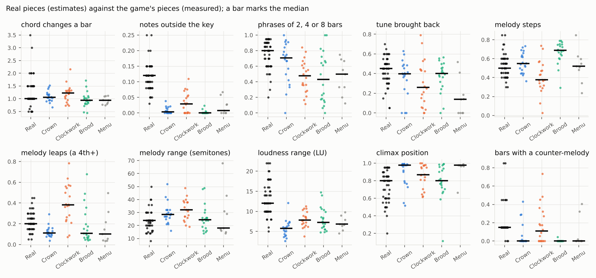
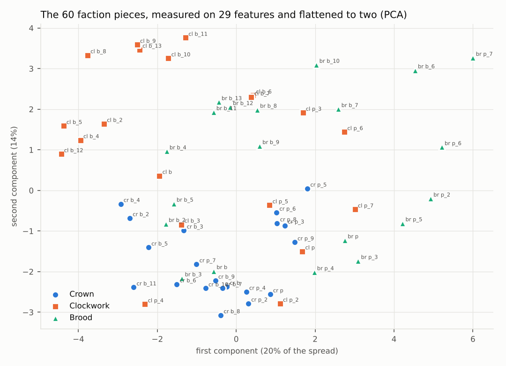
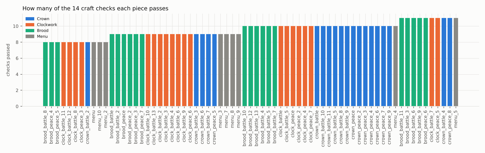
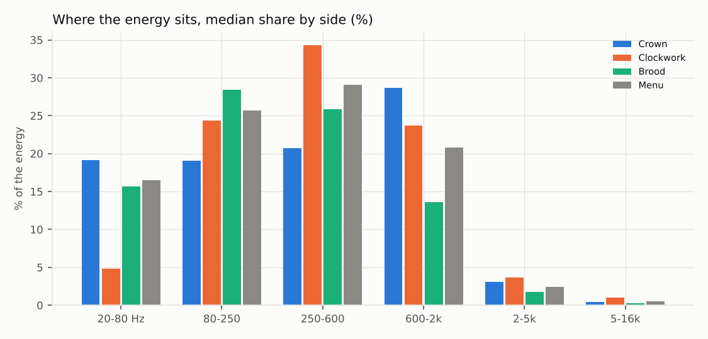
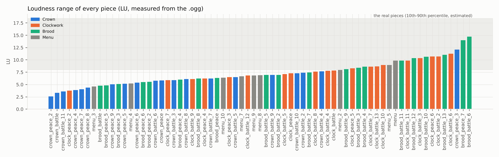
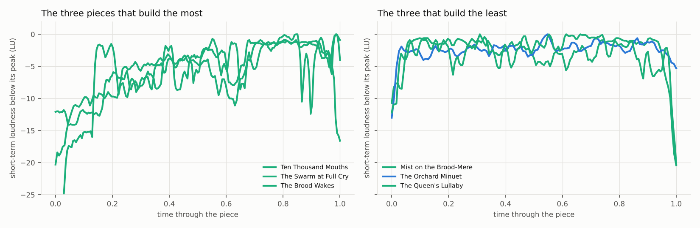

# The game's music against fifty classical pieces

Job music-study, 2026-11-14. The owner sent a book of 50 famous classical pieces and asked for an analysis of the
game's music against real pieces. This is a study. Nothing in the game's music was changed.

The game has 73 pieces: 60 for the three sides, 9 menu overtures and 4 short stings (three victories, one defeat).
Every one was measured twice: from its notes (the score the generator writes) and from its .ogg file.
The real pieces were described in numbers from the reference table (`docs/music_classical_refs.md`) and from
well-known facts about each work. They are estimates, not measurements. See "Limits" before trusting a number.

## Summary

1. **The game's music never leaves its key.** Notes outside the key: 0% in the median game piece, about 12% in the
   real pieces. Only 13 of 69 pieces reach 3%. No other difference is as large or as general. It is why the harmony
   can sound plain even though the chords change as often as in the real pieces.
2. **The chords change at the right speed.** About one new chord a bar, the same as the real pieces (1.04 against
   1.0). The guess "too static harmony" is wrong about speed and right about colour (point 1).
3. **The dynamics are flat.** Loudness range: 6.9 LU in the median game piece, about 12 LU in recordings of the real
   pieces. 22 of 69 pieces are under 6 LU. The Crown is the flattest (5.8 LU). Some of this is right for game music
   under sound effects; most of it is not needed.
4. **The climax comes at the very end.** The loudest moment falls at 94% of the way through in the median game piece
   (98% for the Crown and the menu): the last chord. The real pieces peak at about 80% and then let go.
5. **The same rhythm every bar: confirmed.** In 80% of bars the whole texture has the same rhythm as the bar before.
   The tune itself is not the problem; the accompaniment and the drums are.
6. **Square, loop-like phrases: rejected.** The game's phrases are less regular than the real ones, not more: 56% are
   2, 4 or 8 bars long against about 80% in the real pieces. Clockwork and Brood phrases are short, 2 bars in the
   median. The tune comes back a little less than in real pieces (38% against 45%).
7. **Counter-melodies are almost absent.** The median game piece has a second line against the tune in 0% of its
   bars (doublings of the tune do not count). The Clockwork is the exception (17%). Bass and tune do move against each other well (46% contrary motion).
8. **Motifs are moved and varied, more than only repeated.** 65% of the recurring melodic cells come back moved to
   another pitch or changed. The guess "no development" is too harsh, but there is no real development section.
9. **The three sides do sound different, Crown most clearly.** A piece's nearest piece is from its own side 73% of the
   time (chance is 33%). The Crown forms its own group (18 of its 20 pieces fall together). The Clockwork has no common
   fingerprint beyond its leaps and odd metres. The Brood is recognisable by its stepwise, breathing tunes.
10. **The mix has too much deep bass.** In 21 battle and menu pieces (and the Brood's victory sting) more than a quarter of the energy is below 80 Hz
    (up to 54% in "Hunger"). Phones and laptops cannot play it, and it eats the headroom. The Brood's calm pieces are
    dull (60-75% of the energy in 250-600 Hz, almost nothing above 2 kHz).

The five biggest gains for the least work (details in "Proposals"): a mix pass on the bass, a written dynamic arc for
every piece, chromatic colour at cadences, a varied accompaniment bar at every phrase end, and a counter-melody
on the second statement of each tune.

## What was measured, and how

- **From the notes.** `tools/music/study_export.py` calls every piece function in the generator and keeps its notes
  without rendering audio. The humanised timing jitter is taken out (the random choices stay the same), and the
  Brood's breathing tempo is put back on its nominal grid, with its tempo curve kept apart.
  `tools/music/study_analyse.py` measures each piece: tempo, metre, mode, the tune (the top line of the
  tune-carrying instruments), its steps, leaps and range, the rhythm, the chords (guessed per beat), the cadences,
  the phrases, the form, the motif work, the dynamics, the counterpoint and the bass.
- **From the audio.** `tools/music/study_audio.py` measures each .ogg: loudness (LUFS), loudness range (LU), peaks,
  spectrum, energy in six bands, beat steadiness, start and end, stereo width and reverb tail.
- **The real pieces.** `tools/music/study_refs.py` holds the 49 rows of the reference table as numbers: typical
  tempo, harmonic rhythm, chromatic share, phrase regularity, tune return, melodic steps and leaps, range, loudness
  range of a typical recording, climax position, number of lines and form. Each row has a confidence (high, medium,
  low).
- **The comparison.** `tools/music/study_compare.py` finds the closest real pieces for every game piece on 12 shared
  features, checks each piece on 14 craft checks, clusters the pieces by side and draws the charts in
  `docs/music_study/`. All the numbers per piece are in `docs/music_study/features.csv`.

## The game against the real pieces

Medians. The real pieces are estimates; the game's pieces are measured (69 pieces, the stings left out).

| Feature | Real pieces (median) | All game | Crown | Clockwork | Brood | Menu |
|---|---|---|---|---|---|---|
| tempo (beats a minute) | 100 | 110 | 112 | 121 | 96 | 104 |
| chord changes a bar | 1.00 | 1.04 | 1.06 | 1.22 | 0.94 | 0.94 |
| notes outside the key | 12% | 0% | 0% | 3% | 0% | 1% |
| phrases of 2, 4 or 8 bars | 80% | 56% | 71% | 48% | 43% | 50% |
| tune brought back | 45% | 38% | 40% | 26% | 40% | 14% |
| melody steps | 50% | 55% | 55% | 38% | 69% | 52% |
| melody repeated notes | 10% | 5% | 5% | 5% | 3% | 11% |
| melody leaps (a 4th or more) | 20% | 15% | 11% | 38% | 11% | 10% |
| melody range (semitones) | 24 | 27 | 28 | 32 | 24 | 18 |
| loudness range | 12.0 LU | 6.9 LU | 5.8 LU | 7.8 LU | 7.2 LU | 6.9 LU |
| climax position (0 start, 1 end) | 0.80 | 0.94 | 0.98 | 0.87 | 0.80 | 0.98 |
| bars with a counter-melody | about 15% | 0% | 0% | 17% | 0% | 0% |



## Every side and every job

The closest real pieces, counted over each piece's three nearest. Then the three features where the side's pieces
differ most from the real pieces that do the same job (calm pieces against calm pieces, battles against storms and
marches, skirmishes against dances and marches, openings against overtures and marches, the menu against overtures
and sacred pieces).

| Side, job | Pieces | Closest real pieces | Biggest differences: game / real |
|---|---|---|---|
| Crown, open | 1 | Toreador March, Trepak, Figaro Overture | loudness range 5.8 / 15.1 LU; repeated notes 3% / 20%; outside the key 1% / 10% |
| Crown, calm | 9 | Fantaisie-Impromptu (3), Rondo alla Turca (3), Minute Waltz (3) | outside the key 1% / 12%; loudness range 5.4 / 12.6 LU; tempo 97 / 64 |
| Crown, skirmish | 3 | Ocean Etude (3), Fantaisie-Impromptu (3), Bach C minor prelude (2) | tune brought back 13% / 51%; loudness range 5.6 / 13.3 LU; outside the key 1% / 11% |
| Crown, battle | 7 | Rondo alla Turca (3), Badinerie (3), Fantaisie-Impromptu (3) | outside the key 0% / 12%; loudness range 6.3 / 14.3 LU; regular phrases 45% / 77% |
| Clockwork, open | 2 | Bach C minor prelude, Ocean Etude, Moonlight III | regular phrases 28% / 83%; range 40 / 22; tune brought back 17% / 49% |
| Clockwork, calm | 7 | Bach C minor prelude (3), Bach C major prelude (3), The Swan (2) | outside the key 0% / 12%; loudness range 6.9 / 12.6 LU; tempo 90 / 64 |
| Clockwork, skirmish | 3 | Moonlight III (3), Lyapunov Tarantelle (2), Badinerie (2) | leaps 58% / 24%; range 40 / 24; loudness range 7.6 / 13.3 LU |
| Clockwork, battle | 8 | Bach C minor prelude (6), Moonlight III (6), New World Symphony I (3) | repeated notes 7% / 19%; outside the key 4% / 12%; loudness range 8.7 / 14.3 LU |
| Brood, open | 2 | Fantaisie-Impromptu, Bach C minor prelude, Ocean Etude | regular phrases 12% / 83%; repeated notes 2% / 20%; outside the key 1% / 10% |
| Brood, calm | 7 | Bach C minor prelude (5), Bach C major prelude (4), Fantaisie-Impromptu (4) | outside the key 0% / 12%; loudness range 6.8 / 12.6 LU; chord changes 0.85 / 1.42 a bar |
| Brood, skirmish | 3 | Badinerie (3), Bach C minor prelude (2) | outside the key 0% / 11%; leaps 51% / 24%; repeated notes 2% / 16% |
| Brood, battle | 8 | Rondo alla Turca (8), Alkan Scherzo (6), Fantaisie-Impromptu (6) | outside the key 0% / 12%; steps 72% / 47%; repeated notes 6% / 19% |
| Menu | 9 | Bach C minor prelude (7), Bach C major prelude (6), Chopin Prelude No. 1 (4) | loudness range 7.0 / 15.3 LU; chord changes 0.93 / 1.64 a bar; outside the key 2% / 11% |
| Stings | 4 | (too short to compare) | 7 to 14 s, loudness range 0.8-1.7 LU: a single swell, which is right for a sting |

How to read the closest pieces: the two Bach preludes come up often because the game's pieces share their
traits on these measures: a running figure, little return of a tune, a narrow loudness range, no counter-melody.
That is a fair picture of the menu overtures, which on these numbers behave more like a figuration prelude than an
overture (the Figaro or Barber overtures have a clear tune that returns and a long crescendo).

Each side was also measured against the real pieces the reference table gave it (court and church for the Crown,
machine and drive for the Clockwork, dark and primal dance for the Brood). The Crown sits closest to its own group.
The Clockwork sits as close to the Crown's group as to its own. The Brood is farthest from its own group (Beethoven 7,
the Liszt sonata, the Hungarian Rhapsody, the Trepak), because those pieces swing from very soft to very loud and use
chromatic lines, and the Brood's pieces do neither.

## The guesses, tested

| Guess | Verdict | The numbers |
|---|---|---|
| Too square, loop-like phrases | **Rejected** for the tune, **confirmed** for the accompaniment | 56% regular phrases (real 80%); the tune returns in 38% of the piece (real 45%); no 4-bar block repeats note for note anywhere; but 80% of bars repeat the rhythm of the bar before |
| Little harmonic motion, static harmony | **Rejected** for speed, **confirmed** for colour | 1.04 chord changes a bar (real 1.0); 21 different chords in the median piece; but 0% of notes outside the key (real 12%) and only 3% of chord changes are secondary dominants |
| No real development of motifs | **Partly rejected** | 65% of recurring cells are moved or varied, 23% literal; but no piece has a development section where a motif is broken up and built towards a climax (judgement from the form letters) |
| Flat dynamics | **Confirmed** | loudness range 6.9 LU against about 12 LU; climax at 94% of the piece; after the climax the music falls only 1.9 LU before it ends |
| Melodies with few leaps or no shape | **Confirmed for the Crown and the Brood, reversed for the Clockwork** | leaps: Crown 11%, Brood 11%, Clockwork 38% (real 20%); repeated notes 5% (real 10%); the melody turns direction at 46% of notes (a healthy arch) |
| The same rhythm every bar | **Confirmed** | 80% of bars same as the bar before (Crown 81%, Clockwork 83%, Brood 67%, menu 80%); the median tune uses 6 note lengths; almost no syncopation in the tunes |
| Thin counterpoint | **Confirmed** | a counter-melody in 0% of bars in the median piece; real pieces from Bach's Air to Beethoven 7 lean on one |
| Tempos that do not vary | **Confirmed for the Crown and the Clockwork** | no tempo change inside any Crown or Clockwork piece (the Clockwork on purpose); the Brood's ten newer pieces breathe by 6-26%; across pieces the tempos spread widely (54 to 180) |
| Pieces sound alike within a side | **Confirmed for the Crown's drum-bed marches, rejected for the rest** | three of the four closest pairs in the whole set are among crown_battle_7, 8, 9 and 10; the Crown's pieces are closer to each other (6.2) than the Clockwork's (7.7) or the Brood's (7.1) |



## The five strongest and the five weakest pieces

Each piece was checked on 14 craft checks drawn from the real pieces (loudness range, a climax with a build, chord
speed, colour outside the key, steps and leaps, range, a tune that returns, regular phrases, a rhythm that changes,
a counter-melody, motif work, cadences). Ties were broken by how close the piece sits to a real piece.



**Strongest** (11 of 14):

| Piece | Why |
|---|---|
| The Forlorn Hope (crown_battle_4) | closest to a real piece in the whole set (the Rondo alla Turca); 72% steps, a tune that returns (38%), 7.7 LU range |
| The Iron Anthem (menu_5) | 7% colour outside the key (the most of the menu), a tune that returns (41%), 9 LU range |
| Ten Thousand Mouths (brood_battle_13) | 11 LU range with a long build, regular phrases, motifs varied more than repeated |
| The Swarm Rises (brood_battle_3) | 80% regular phrases, a climax at 73% with a real build, 8.4 LU; close to Alkan's Scherzo focoso |
| The Swarm at Full Cry (brood_battle_11) | 9.9 LU, a long build, the tune returns in half the piece |

Also at 11: The Lantern Waltz, Court Waltz by Candlelight, The Queen's Lullaby, The Scent of Blood. Their misses are the
common ones: no colour outside the key, the same rhythm every bar, a narrow loudness range.

**Weakest** (8 of 14):

| Piece | Why |
|---|---|
| Rust and Rain (clock_peace_3) | no tune returns (0%), 3% steps and 78% leaps: the top line is a broken-chord figure, not a tune (this may be meant as rain); irregular phrases (27%) |
| Mist on the Brood-Mere (brood_peace_5) | 4.8 LU, its loudest moment at 11% of the piece and only 2.6 LU of build; phrases of odd length (14% regular) |
| Something in the Water (brood_battle_8) | 68% leaps (real skirmishes about 24%), irregular phrases (25%), the same rhythm in two of three bars |
| Cathedral of Gears (clock_battle_11) | the tune never returns (3%), 57% leaps, 29% regular phrases; 2.2 chord changes a bar, above the real battles and marches (1.0-1.5) |
| Anvil Chorus of a Thousand Hands (clock_battle_12) | the opposite: its tune returns in 79% of the piece and 85% of bars repeat the bar before; motifs mostly literal |

Also at 8: Grand Overture (menu), The Banners Rise (menu_2), The Queen Stirs (brood_peace_4), Volley Fire
(crown_battle_2). The Queen Stirs is an opening piece for every Brood match, so it is heard often.

## Do the three sides sound different?

Yes, on paper, and most for the Crown.

- A piece's nearest piece (on 29 features) is from its own side 73% of the time; chance would be 33%.
- Three groups found without labels (k-means): one holds 18 of the 20 Crown pieces (with 5 Brood and 5 Clockwork);
  one holds 12 of the 20 Clockwork pieces (with 8 Brood and 2 Crown); the third is 7 Brood and 3 Clockwork pieces.
- The features that set the sides apart most: the tune's register, steps against leaps, how clear the key is, the
  Brood's breathing tempo, the 2-5 kHz presence, notes outside the key and the density of running figures.
- Features that tell little apart: the number of notes a second, the reverb, the tune's return, the number of instruments.

What makes each side recognisable:

- **The Crown:** the clearest keys (key clarity 0.95), regular 4-bar phrases (71%), stepwise tunes in a middle-high
  register, authentic cadences (4 a minute, the most), the brightest mix (centroid 1,790 Hz), steady tempo. It sounds
  like one family. That is its strength and its risk: the drum-bed marches (crown_battle_7-10, menu_7-10) are nearly
  the same piece four times.
- **The Clockwork:** odd metres (6 of 20 in 5, 7, 9 or 11), leaping tunes (38% leaps), the most chord changes (1.22 a
  bar), the most colour outside the key (3%), the only counter-lines (17% of bars), long bass pedals (4 bars), dead
  steady time. It has the most variety and the least common sound: its pieces sit apart from each other as much as
  from the other sides.
- **The Brood:** stepwise tunes (69% steps), low register, the darkest modes (phrygian in 8 of 20), phrygian cadences
  (flat II to I, about 2 a minute, unique to the Brood), breathing tempo, the darkest mix (centroid 1,260 Hz), the
  widest stereo. Its battles build the best (up to 15 LU).

## Mix and audio

| Measure | Game (median) | Note |
|---|---|---|
| Loudness | -12.8 LUFS (from -15.0 to -10.5) | the pieces are matched within about 1 LU, apart from the Crown's drum-bed battle pieces (-14.2 to -15.0, about 2 LU quieter) and The King's Muster and the Ballad (about -10.6, 2 LU louder) |
| True peak | -1.6 dBTP | safe; 9 pieces between -1.0 and -0.6 dBTP |
| Spectral tilt | -6.0 dB an octave | darker than typical commercial mixes (about -4.5 to -5); the Brood -6.6 |
| Energy below 80 Hz | Crown 19%, Brood 16%, Clockwork 5% | 21 pieces over 25%, the worst Hunger (54%), Teeth in the Reeds (50%), The Hive Unleashed (46%), The Forlorn Hope (46%), Tattoo at Dusk (45%) |
| Energy 250-600 Hz | Clockwork 34%, Brood calm pieces 57-75% | boxy and muddy: Spawning Pools, Moonlit Mudflats, The Queen's Lullaby, The Brood Wakes, Winding the Spring, Rust and Rain |
| Energy 2-5 kHz | 3% (Brood 2%) | no harshness anywhere; the brightest are Gearstorm, The Assembly Line, Fifes at First Light (8-10%) |
| Stereo side / mid | -6.6 dB | the Brood's calm pieces are very wide (-2.4 to -3.5 dB), which can sound hollow on one speaker |
| Reverb | most pieces moderate | the drum-bed marches and Anvil Chorus are very dry; Night over the Drowned Wood is very wet |
| Ends | the level falls 26 dB over the last 4 s | most pieces end with a held chord or a fade; Pike and Shot and The Watchful Gear stop with little fall (6-7 dB) |
| Beat steadiness | 2-4% beat-to-beat spread | the Brood breathes the most (4%), the Clockwork is steadiest (2%) |





## Rules for the generator, drawn from the real pieces

Every rule names the real pieces that show it and the game number it would move.

### For every side

- **Colour outside the key, 5-12% of notes.** A secondary dominant before the main cadences (V of V, V of IV), a
  chromatic passing note in the bass between two chords, a borrowed minor iv in a major key. Shown by Mozart's
  Symphony 40, Chopin's Nocturne, the Habanera's falling chromatic line, Für Elise's E and D sharp. Today: 0%.
- **A dynamic arc.** Start 6-10 LU below the top; reach the top at 65-80% of the piece; fall at least 4 LU before the
  end. Beethoven 7 II starts at pp with one rhythm and adds a layer every 8 bars; Rossini builds his overture
  crescendo over 16 bars and more; Barber's Adagio climbs once and then falls silent. Today: range 6.9 LU, top at 94%,
  release 1.9 LU.
- **A different bar at every phrase end.** The cadence bar (every 4th or 8th) gets its own rhythm: a held chord, a
  fill, a stop. Radetzky, Eine kleine Nachtmusik and the Rondo alla Turca all do it. Target: under 60% of bars equal to
  the bar before. Today: 80%.
- **A counter-melody on the second statement of a tune.** Longer notes than the tune, moving against it. Bach's Air,
  the Radetzky trio, Beethoven 7's second layer. Target: 15-30% of bars. Today: 0%.
- **The tune returns, changed.** Bring the main tune back at least once (25-60% of the piece), in a new key or a new
  colour the second time. Every rondo and ternary piece in the book does this.

### The Crown (court, church, march)

- **4 + 4 bars, a half cadence in bar 4, a full cadence in bar 8.** Eine kleine Nachtmusik, Radetzky March, Minute
  Waltz, Rondo alla Turca. The Crown already has 71% regular phrases: keep it.
- **March-trio-march.** The trio in the key a fourth up, softer, then the march back louder. Radetzky March,
  Toreador March, Chopin's polonaise. It gives the drum-bed marches a real change of key and dynamics.
- **Repeated-note fanfares and dotted rhythms in the tune.** Radetzky opens on repeated notes; the Toreador swaggers in
  dotted rhythm; Mozart 40 sighs on repeated notes. Target: 10-15% repeated notes. Today: 5%.
- **Waltzes hold a chord for a bar or two.** About 0.5-1 chord change a bar, an introduction, then a chain of waltz
  tunes and a coda. Blue Danube, Waltz of the Flowers, Voices of Spring.
- **Church and calm pieces: a walking bass and suspensions.** Bach's Air (two to four chord changes a bar over a
  walking bass, suspensions that resolve down by step); the Pavane (a rondo, A-B-A-C-A).
- **Terraced dynamics.** Whole sections loud or soft, the Baroque way (the Badinerie, the Air's repeats), so the
  Crown's range rises from 5.8 LU to 8+ without losing its poise.
- **Ritardando at the last cadence of the calm pieces.** The Nocturne, the Pavane and Clair de Lune all slow at the end.

### The Clockwork (machine and drive)

- **Keep the figure, move the harmony every bar.** Bach's two preludes keep one figure the whole way and change the
  chord every bar, with a long dominant pedal before the end. The Clockwork already keeps the figure (83% of bars
  the same rhythm, its identity) and long pedals; move the bass by step or round the circle of fifths under it.
- **Stepwise tunes over a leaping machine.** The tune should be mostly steps (the Ocean Etude's tune in the thumbs,
  the Moonlight III's second theme), leaving the leaps to the figure and the motif's fifth. Target 20-25% leaps.
  Today: 38% (58% in the skirmishes).
- **4-bar units.** Join the 2-bar fragments into 4-bar phrases that end on a cadence. Target 60%+ regular. Today: 48%.
- **Sudden contrast.** The Moonlight III crashes into two sforzando chords; the Waldstein starts pp and pulses;
  the Figaro overture whispers before the full band. Subito pp and sf give the strict machine a loudness range of
  9-12 LU without bending its tempo.
- **Let it run down.** A real ritardando or the machine winding down at the very end, once, is the only tempo change
  the Clockwork needs (a judgement, in the spirit of docs/music_clockwork.md).

### The Brood (dark, primal, dance)

- **One ostinato, built in layers.** Beethoven 7 II: the long-short-short-long-long rhythm, starting low and soft,
  a counter-melody added above it, every 8 bars a new layer, the top at about half way, then a fugato. The Brood's
  battles already build well (up to 15 LU); its calm pieces should do it too (today 6.8 LU).
- **Chromatic lines in the dark modes.** The Liszt sonata's falling scale, the Habanera's chromatic descent, the
  Hungarian Rhapsody's augmented seconds (the "gypsy" scale, close to the Brood's phrygian dominant). Target 5-10%
  outside the mode. Today: 0%.
- **Proud leaps and grace notes in the slow tunes.** The Hungarian Rhapsody's lassan declaims with leaps and crushed
  grace notes; the Tarantelle and the Trepak leap in their dances. Brood tunes are 69-72% steps with 11% leaps:
  raise the leaps to about 20% in the battles, keep the stepwise Hive Call in the calm pieces.
- **Keep the phrygian cadence and the breathing tempo.** Both are unique to the Brood and match its brief.
- **Irregular phrases on purpose, regular in the dances.** The Brood's odd phrase lengths (43% regular) can stay in
  the calm pieces; its skirmishes and battles are dances (Trepak, Tarantelle: 90%+ regular).

## Proposals, biggest gain for least work first

1. **Mix pass, no recomposition.** A high-pass at about 40 Hz and a lower bass-drum and taiko level in the battle
   pieces; a high layer (a shimmer, an air band lift) in the Brood's calm pieces; a cut around 300-500 Hz in the
   Clockwork's. Match the drum-bed marches to the others (+2 LU). It reaches the 21 pieces over 25% sub-bass and the 10 over
   55% low-mid. Work: one change to the mastering chain plus a re-render.
2. **A dynamic arc in the generator.** One helper that scales velocities by section along a planned curve (start
   low, top at 0.65-0.8, release), used by every piece. Gain: loudness range, climax position and release all move
   towards the real pieces. Work: small, one function and a parameter per piece.
3. **Chromatic colour at cadences.** A helper that inserts a secondary dominant before cadences and chromatic passing
   notes in the bass, with a per-side flavour (Crown V/V, Clockwork chromatic bass descent, Brood augmented second).
   Gain: the largest single gap. Work: small to medium.
4. **A different cadence bar.** In the drum and accompaniment patterns, swap in a fill, a held chord or a rest on the
   last bar of every 4 or 8. Gain: bars with the same rhythm from 80% to about 55%. Work: small (the drums() helper
   already takes a fill; use it on every phrase end, not only the last bar of a section).
5. **Counter-melodies.** A helper that writes a slower second line in contrary motion on the second statement of a
   tune. Gain: texture and the "real orchestra" feel. Work: medium.
6. **Melody shape per side.** Fewer leaps in the Clockwork's tunes, more leaps and repeated notes in the Crown's and
   the Brood's. Work: medium, piece by piece.
7. **Make the drum-bed marches different from each other.** A trio in another key, a different tune shape and form
   for each of crown_battle_7-10 and menu_7-10. Work: medium.
8. **Tempo shaping in the Crown's calm pieces.** A ritardando into the last cadence. Work: small (BSong already has
   a tempo curve; the Crown's Song could use the same).

**Rewrite first** (weakest, or heard most, or both): The Queen Stirs (brood_peace_4, opens every Brood match),
Mist on the Brood-Mere (brood_peace_5), Something in the Water (brood_battle_8), Cathedral of Gears
(clock_battle_11), Anvil Chorus of a Thousand Hands (clock_battle_12), Grand Overture (menu), and the four
near-identical drum-bed marches. Rust and Rain (clock_peace_3) only if its rain figure is not meant to be the tune.

## A demo rewrite

One demo, for listening, in `docs/music_study/demos/` (written by `tools/music/study_demos.py`; no game file is
touched): **The Queen Stirs**, which opens every Brood match and scored 8 of 14.
`queen_stirs_current_first_minute.ogg` is the game's piece cut at one minute; `queen_stirs_demo.ogg` keeps the same
tune and applies the rules: a dynamic arc (heartbeat alone, the tune in the low choir, then the second statement
louder), a major V at the half cadence, a chromatic lament bass (G, F sharp, F, E) under the second statement, a horn
counter-line with a raised fourth leading to the fifth, a different drum bar at every phrase end, and a soft return
of the tune's opening at the close.

Measured, the current first minute against the demo: loudness range 5.2 to 8.6 LU; the loudest moment at 66% with 2 LU
of release, against 77% with 4 LU of release and a start 10 LU below it; notes outside the mode 0% to 6%; bars with
the same rhythm as the bar before 67% to 30%; bars with a counter-line 0% to 36%. Whether it sounds better is for the
owner's ear.

## Owner decisions waiting

1. Which proposals to build, and whether the mix pass (proposal 1) should come before any rewriting.
2. How much loudness range the game music should have under the sound effects (a target of 8-10 LU is proposed,
   below concert music's 12+).
3. Whether the Clockwork keeps its dead steady tempo everywhere, or may wind down once at the end of a piece.
4. Whether the Brood's irregular phrases are wanted (they are part of its strangeness) or should become regular in
   its dances.
5. Whether to rewrite the drum-bed marches or retire some of them.

## Limits

- **No human ear was used.** Everything here is a measurement or a judgement from numbers.
- **Measured:** every game number (from the notes and from the .ogg files). **Estimated:** every real piece's number,
  from well-known facts about the works, not from the owner's book (a copyrighted edition, not used) or a recording.
  The real pieces' loudness ranges are typical values for recordings. The Alkan pieces, the polonaise and the
  Lyapunov are low-confidence rows. The "counter-melody" share of the real pieces is a rough mapping from their
  number of lines.
- **Judgement:** the craft checks' thresholds, which real pieces count for which job, the form labels, and every
  rule and proposal.
- **Method limits.** The tune is found automatically (the top line of the tune-carrying instruments); where a piece
  hands the tune between octaves, the measured range grows (The Iron Anthem's 68 semitones is that). The chord
  guesser over-counts by about 0.15-0.3 changes a bar on pieces whose written chords are known (The King's Muster:
  0.91 measured, 0.75 written). The cadence counts follow the chord guesses. Drum beds taken from recordings (the
  snare solos under the drum-bed marches) are not in the notes, only in the audio numbers.
- The stings are too short to compare with the real pieces and are only described.

## Files

- `tools/music/study_export.py` (notes out of the generator), `study_analyse.py` (notes), `study_audio.py` (audio),
  `study_refs.py` (the real pieces as numbers), `study_compare.py` (comparison, charts, tables).
- `tools/music/study_demos.py` (the demo) and `docs/music_study/demos/` (its two .ogg files).
- `docs/music_study/`: the charts, `features.csv` (every number per piece), `symbolic.json`, `audio.json`,
  `compare.json` (closest pieces, craft checks, group summaries).
- To run it again:

```
python3 tools/music/study_export.py /tmp/ex
python3 tools/music/study_analyse.py /tmp/ex /tmp/sym.json
python3 tools/music/study_audio.py /tmp/audio.json          # about 15 minutes
python3 tools/music/study_compare.py /tmp/sym.json /tmp/audio.json docs/music_study
```

## Addendum: six real pieces measured from MIDI (2026-11-14, after the job)

The owner downloaded six piano MIDI files from MuseScore (user arrangements; they stay out of the repository). Only
summary numbers were kept: `docs/music_study/real_midi_features.json`, made by `tools/music/study_midi_feats.py`.
They check three of the study's estimates with real notes instead of descriptions.

| Piece | Key found | Notes outside the 7 main pitch classes | Tempo changes written in the file | Loudness levels |
|---|---|---|---|---|
| Für Elise | A minor | 13% | 7 (48-72) | one fixed level |
| Clair de Lune | D-flat major | 6% | 56 (9-102) | 81 levels, 16-96 |
| Nocturne Op. 9 No. 2 | E-flat major | 12% | 12 (20-80) | 54 levels, 55-127 |
| Gymnopédie No. 1 | D major | 9% | 3 (34-54) | 32 levels, 33-64 |
| Chopin's Waltz in A minor | A minor | 10% | none | one fixed level |
| Pachelbel's Canon | D major | 1% | none | 10 levels, 49-96 |

- **Colour outside the key: confirmed.** Five of the six use 6-13% notes outside the key (the estimate was about
  12%); only the Canon, a strict ground bass, sits near the game's 0%. Proposal 3 stands.
- **Tempo that breathes: confirmed for the slow pieces.** The arrangers wrote the rubato into the files: Clair de
  Lune changes tempo 56 times, the Nocturne 12 times, Für Elise 7. The game's calm pieces keep one tempo (the Brood's
  breathing curve is the exception). Proposal 8 (a ritardando into cadences) should reach every side's calm pieces.
- **Dynamics:** where the arranger wrote dynamics, the range is wide (16-96, 55-127); two files carry no dynamics at
  all, so they say nothing.
- The step and leap shares of the "top note" are not reliable for piano writing (the accompaniment often sits above
  the tune), so they are left out.
