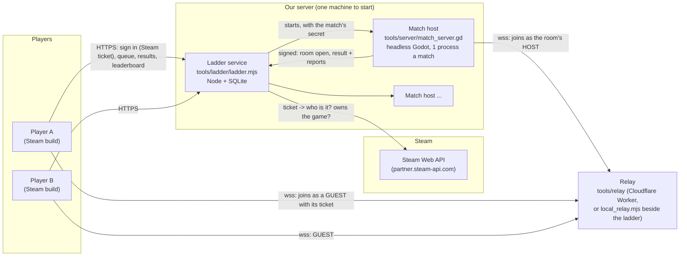

# Ranked online play (prototype, 0.34.0)

The owner's decisions (2026-11-13 01:04): for RANKED play **our server runs every match** (both players are guests: no
map hacks, no faked results); the ranked ladder is **Steam players only** at launch (the SteamID64 is the account;
Android and web keep today's friendly online with room codes); **build a working prototype now**; **ban cheaters by
their Steam account** (our own ban list by SteamID64, optionally Steam's official game ban).

This is that prototype. Everything ranked sits behind its own path: the friendly online game (a player hosts, a
friend joins by code) works as before, with one change that helps it too (the fog leak, below).

## The pieces

One match, step by step:

1. The game signs in: `POST /login` with a Steam Web API ticket (or, on a test server, the DEV sign-in). The ladder asks
   Steam whose ticket it is and whether that account owns the game, refuses banned accounts, and gives a session token.
2. FIND A MATCH: `POST /queue` (faction, region). The ladder pairs two players of close rating (150 points, widening 15 a
   second; other regions after 30 s), makes a match id, a 10-letter room code and a seed, and starts a match host.
3. The match host opens the room on the relay as its host and tells the ladder (`/internal/ready`). Only then does
   `GET /queue` answer "found" with the room, the relay and the player's **ticket**: the ladder's HMAC-SHA256 signature
   over (match, SteamID64, seat, expiry) with a secret that only the ladder and the match hosts know.
4. Each player joins the room as a guest and says its ticket in its first word (`hi`). The host seats a guest only on a
   good ticket for this match and that seat (`NetLobby._ranked_hi`, `LadderTicket.check`): a doctored, expired, other
   match's or other seat's ticket is refused. The players cannot change their faction in the room.
5. Both seated: the host starts the match (the same `Main.start` as any game, with every slot "remote"). The 3-2-1 is
   held until both players have loaded, as in friendly online.
6. The match ends (a side destroyed, a surrender, a player who leaves forfeits, or the time limit: a draw). The host
   copies the replay into its results folder, writes the result JSON and posts it to the ladder, signed with the secret.
7. The ladder moves both ratings (Glicko-2), stores the match and files a report for any player whose orders looked
   like cheating. The players' games ask `GET /match/<id>` and show VICTORY +16 → 1516 on the battle report.

### Why server-authoritative

Today's friendly online runs the match on the host player's device. Whoever runs the match knows everything: a modified
host can lift its own fog, change any number and report any result. Online games that rank people therefore run the match
somewhere neither player controls. The game was already built this way round (the host runs the real game, a guest is a
puppet that applies pictures and sends orders: `docs/multiplayer_plan.md`), so the server is the same game with no
player of its own: no new netcode, no lockstep, no cross-device determinism needed (the risk the owner was told about for
web v Android, 2026-10-27).

What the server guarantees: a player gets **only what its side can see** (the pictures are cut per side, below); every
order is **checked** (the units are its own, the arguments make sense, it can pay: `NetCommands`); the result and the
replay come from the server.

### The match host (tools/server/match_server.gd)

`godot --headless --script res://tools/server/match_server.gd -- relay:... room:... match:... secret:... ladder:...
map:... seed:... f0:... f1:... sid0:... sid1:... out:... [maxsecs:3600] [noshow:90] [fogaudit]`

- The ladder starts one process per match (simple, a crash takes down one match, the operating system shares the cores).
- It **joins the relay as the room's host** instead of listening on a WebSocket of its own. Why: the connection is
  outbound, so a match host needs no open port, no TLS certificate and works behind any NAT or a home connection; the
  relay already carries `wss://` to browsers and phones; NetLink, NetLobby and NetSession are used unchanged. The cost is
  one hop more (the relay should sit in the same region as the match hosts, or on the same machine:
  `local_relay.mjs`). A direct WebSocket server can come later without changing the clients' protocol.
- `game.dedicated` (with `demo`, no local player): messages for players go to the guests (`Game.tell`), no AI is run.
- Ranked rules on the session: `strict` (below), `flood_max` 40 orders a second, the audit (below).
- A player who leaves forfeits at once (the prototype has no reconnect). Nobody joins within 90 s: a no-show (no rating
  change). A match host that dies without a result: the ladder aborts the match (no rating change).
- Brood surrender fixed on the way: `player_surrender` only destroyed buildings, and the Brood has none (it lives while
  its Mother does), so a Brood player could not give up; now the Mother falls too (all modes).

### The ladder service (tools/ladder/)

Node 22.5+ with no packages (`node:http`, `node:sqlite`, `node:child_process`), one SQLite file.
Why not the existing Cloudflare Worker with D1: the ladder has to start match host processes and hear from them, which a
Worker cannot do, and the free tier's CPU limits per request don't suit a matchmaker that runs every second. A small
program beside the match hosts is free on the same machine, simple to back up (one file) and easy to read.

| Path | What |
|---|---|
| `POST /login` | `{provider: "steam", ticket}` or `{provider: "dev", id}` (only with `--dev`) -> token, profile; 403 banned |
| `GET /me` | rating, games, placement left, rank, season, the last 10 matches |
| `POST /queue`, `GET /queue`, `DELETE /queue` | join (faction, region, game version), poll (searching / starting / found), leave |
| `GET /match/<id>` | a match as that player sees it: result, rating change, placement left |
| `GET /leaderboard[?faction=]` | top 100 of the season (players past placement), your place; by main faction |
| `POST /appeal` | a banned player's appeal text |
| `POST /internal/ready`, `/internal/result` | the match hosts only (X-Ladder-Sig: HMAC of the body) |

- **Ratings**: Glicko-2 (Glickman 2013; checked against his worked example), one match = one rating period. A new player
  starts at 1500 ± 350. **Placement**: the first 5 matches; until then a player is not on the leaderboard and sees
  "PLACEMENT: n matches left". **Seasons**: `admin.mjs season new "Season 2"`; a player's first match of a new season
  starts from last season's rating pulled halfway back to 1500, with more uncertainty.
- **Factions**: the player picks one (or RANDOM). The leaderboard's faction tabs rank players by the faction they played
  most this season (one rating per player; separate ratings per faction can come later if wanted).
- **Records**: every match (players, factions, map, seed, length, outcome, rating changes, the replay's path).

## Fog: the keyframe leak, closed

The host never sent a guest the enemy units its side could not see... except in **keyframes** (every 3 s: "every row
whole, unseen enemies too"), so a modified guest could read the whole enemy army every 3 seconds. And the filter used
the sight of all guests together, which on a dedicated host (both players are guests) would have shown each player
everything.

Now (`NetView`, `NetSnapshot.build(s, view)`; ranked AND friendly):

- **One picture per side**: each side's guests get their own (co-op guests on one side share it).
- **Units**: an enemy is sent only while that side sees it (its last row as it walks out of sight, so its picture stays
  where it went, under the fog). Keyframes too. A keyframe's id list names only what the side holds.
- **Buildings**: an enemy building is sent only while the side sees some of it, never another side's planned sites;
  one seen and left stays on the player's screen as last seen (the game's FogMemory). An enemy thing that disappears
  out of sight is reported gone only when the side looks at its last known spot again (no news of deaths in the fog).
- **Effects** (shots, explosions, marks): only where the side sees them (a shot: either end).
- **Ranked (`strict`)**: the enemy's bank (gold, the second resource, supply) is sent as 0 and the battle report only at
  the end.

`tools/test_net_fog.gd` (one process, a Hard v Hard match with two guests on opposite sides): 0 rows a side could not see
in 240 game seconds (3,236 enemy rows, 120 keyframes a side, 14,822 effects); the old keyframes would have sent 3,152
unseen enemy rows in the same match. The end-to-end test checks every picture the real match host sends (`fogaudit`).

Still sent whole to everyone (small, listed for honesty): the Clockwork Line's pipes and its trains, powder kegs on the
ground and the Rootmaws' ground; the net ids an own unit points at (its target); the replay at the end has everything
(the match is over). These can be cut per side later the same way.

## Identity (scripts/net/identity.gd)

- **Steam** (the Steam build): GodotSteam's `getAuthTicketForWebApi("triumviwar-ladder")`; its signal
  `get_ticket_for_web_api` gives the ticket, sent as hex. The ladder calls `ISteamUserAuth/AuthenticateUserTicket`
  (with the identity string) and `ISteamUser/CheckAppOwnership` on `partner.steam-api.com` with the publisher key, and
  refuses a bad ticket, a publisher-banned account and an account that does not own the game. The client never says its
  own SteamID: the server learns it from Steam. Family-shared copies are accepted; the owner's id is kept.
- **DEV**: a made-up SteamID64 (7656119 + 10 digits), only when the ladder runs with `--dev` and the game is started with
  the user argument `ranked_dev` (or `HOLDFAST_RANKED_DEV=1`). For tests and local play; never on a public server.
- **None**: the RANKED button is not shown (Android, web, a build without GodotSteam).

Every Steam call is guarded (`Engine.has_singleton("Steam")`, `has_method`): a build without GodotSteam runs as before.
The Steam paths are tested against answers in the documented shapes (`tools/ladder/fixtures/`, `node
tools/ladder/test_ladder.mjs`); there is no App ID yet to record real ones (replace them once there is).

### Adding GodotSteam (the Steam build only)

GodotSteam is not in this repository (its binaries are large and the Steamworks SDK's redistributables have their own
licence). For the Steam build:
1. Download the GodotSteam **GDExtension** release for Godot 4.7 (godotsteam.com, "GDExtension"; MIT licence) and
   unzip its `addons/godotsteam/` into the project. It brings the Steamworks redistributables (`steam_api64.dll`,
   `libsteam_api.so`, `libsteam_api.dylib`) under Valve's Steamworks SDK licence: ship them only in the Steam build.
2. Put `steam_appid.txt` (the App ID) next to the executable while testing outside Steam.
3. At start, the Steam build calls `Steam.steamInitEx()` (an autoload in the Steam export only; not added here so other
   builds stay untouched). After that `Identity.provider()` is "steam" and RANKED shows on the ONLINE page.
4. Keep `addons/godotsteam` out of the web and Android exports (export presets' exclude filter).

## Anti-cheat: what is real, what is not

Real, because the server runs the match:
- **No map hack**: a player is never sent what its side cannot see (above; keyframes included).
- **No faked results, resources or units**: the server's game is the only real one; a guest's game is a picture.
- **Orders checked**: orders for units not the player's own are refused; foreign ids slipped into a list are stripped;
  malformed and unknown orders refused; more than 40 orders in a second dropped. Each is **counted against the SteamID**
  (`NetSession.audit`): the result carries it, the ladder files a report, flagged at 5 impossible orders, 5 foreign
  units or 20 dropped orders in one match. A fair client never sends any of these (the end-to-end test's fair player:
  0); lag can make a few "target is gone" refusals, which are not counted.
- **Accounts are Steam accounts**: a ban costs a cheater a copy of the game, not a new free account.

Not covered (be honest with players about it):
- **Automation**: a script or bot that plays through legitimate orders (perfect macro, inhuman reaction) sends nothing
  impossible. Detecting it needs statistics over many matches (orders per minute, reaction times, the replay) and human
  review; the replays and the order counts are kept for that, the analysis is not built.
- **Information already on the player's screen** (its own fog memory, sounds): fine by design.
- **The small leaks listed in Fog**, the relay seeing the traffic (it is ours), denial of service against our servers,
  smurfing and account sharing, win trading between two accounts (watch for pairs that meet often).
- **Reconnects**: a dropped connection is a loss in this prototype.

## Bans and appeals

Our own list, by SteamID64 (`bans` table). `node tools/ladder/admin.mjs ban <steamid64> --reason "..." --evidence
<match id or link> [--days N] [--steam] [--delay]`:
- A ban is refused at sign-in and at the queue, and ends the player's sessions at once. `--days`: temporary; none: for good.
- `--steam` also asks for **Steam's official game ban** (ICheatReportingService: `ReportPlayerCheating` gives a report
  id, then `RequestPlayerGameBan` with the duration; `--delay` lets Steam apply it later so a cheater can't tell which
  match caught him). A game ban of a year or more shows on the player's Steam profile. It needs the publisher key (server
  side only). `unban ... --steam` calls `RemovePlayerGameBan`. Check the exact parameters on the Steamworks
  ICheatReportingService page before the first real one (this is written from the documentation, not tried).
- **Evidence**: the match's replay stays in the ladder's data folder (name `<match id>.hfr`), the report rows and the
  match record; `admin.mjs player <id>` lists them all. Keep replays of banned players for as long as the ban (and any
  appeal) lasts.

**Policy (proposal for the owner):** a first proven cheat (map hack, modified client, orders for others' units on
purpose) = a ban for good on ranked, and Steam's game ban once the evidence is clear (a replay plus the reports);
automation = 30 days, then for good. Flagged reports are looked at by a person before any ban; nothing is banned
automatically.

**Appeal flow:** the refusal tells the player the reason and where to appeal (`LADDER_APPEAL`, a page or an email); a
signed-in banned player can also send text (`POST /appeal`, listed by `admin.mjs appeals`). Someone other than the one
who banned looks again at the replay; the answer within 14 days; `unban --reason "appeal accepted"` (and `--steam`) if it
was wrong.

## Capacity and cost

Measured with `tools/server/capacity_bench.gd` (a Hard v Hard match standing in for two players' armies, with the
server's two fog-filtered pictures 15 times a second; the computers' own thinking subtracted, a ranked host does not run
it), on this cloud machine (x86, 2 cores, Godot 4.7 headless):

CAPACITY_TABLE

The end-to-end test's match host (the first 80 s, real players' orders over the relay): CAPACITY_E2E.

What this means: a match's cost grows with the armies (qa-perf found the same: 1.5 ms a game tick at 1:00, 11 to 14 ms
at 10:00 to 15:00, 24 ms on the busiest map), so a core holds several early games but only a few late ones. Plan on
**about CAP_PLAN matches at once per core** (late games set the limit), plus a few hundred MB of memory each.

- **Oracle Cloud Always Free (Ampere A1)**: since 18 August 2026 2 ARM cores and 12 GB (it was 4 and 24). That is room
  for about CAP_FREE matches at once with the ladder and the relay on the same machine: plenty for a launch with a few
  hundred players (most are not in a match at the same time). Free machines can be hard to get in busy regions and may be
  reclaimed when idle; keep the database backed up (one file).
- **Paid, when it grows**: a small ARM machine (e.g. Hetzner's CAX line, a few euros a month; Hetzner raised cloud prices
  in 2026, check the current list) holds the same per core; add machines with more match hosts and point the ladder at
  them (the next step for the code: a match host runner on each machine). The relay on Cloudflare Workers stays free up to
  100,000 requests a day (the WebSocket messages themselves bill differently on paid plans; check before growing).
- Bandwidth: a picture stream is about PIC_KB KB/s per player late in a big game (below the 40 KB/s cap the host keeps).

## Privacy policy (draft for the store page; the owner must review it, ideally with a lawyer)

**Who**: [the publisher's name and contact address], the controller of the data below.
**What we store when you play ranked**: your SteamID64 (your Steam account's public number) and your Steam display name;
your ratings, match records (opponent, factions, map, length, result) and the replays of your ranked matches; logs of
refused or dropped orders from your matches; any ban and appeal, with its reason and evidence; for the time you are in
a match, your connection passes through our relay (we do not store your IP address in the ladder; server logs that
contain it are deleted after 14 days).
**Why**: to run the ranked ladder you asked to join (matchmaking, ratings, leaderboards: the contract with you, GDPR art.
6(1)(b)) and to keep it fair (anti-cheat, bans: our legitimate interest, art. 6(1)(f)).
**Who sees it**: other players see your name, rating, rank and match results on the leaderboard and in matches. Valve
(Steam) answers our sign-in checks; if we ask Steam for a game ban, Valve receives your SteamID and the ban. Our hosting
provider stores the data on our behalf. Nothing is sold or used for advertising.
**How long**: account, ratings and match records while you play and up to 2 years after your last ranked match;
replays 90 days (kept longer only as evidence for a ban or appeal, until it is closed); order logs 1 year; bans for as
long as they last plus 1 year.
**Your rights**: ask for a copy of your data, its correction or deletion, or object, by writing to [contact]; we answer
within one month. Deleting your account removes you from the leaderboard and the ranked ladder; a ban record is kept
for as long as the ban lasts (to keep it working). You can complain to your data protection authority.
Friendly online (room codes) and single player send nothing to our servers except the relay's message passing.

## The owner's steps to go live

1. **Steamworks**: a partner account (Steamworks, the app fee per game), the game's **App ID**.
2. **Publisher Web API key**: Steamworks > Users & Permissions > Manage Groups > (a group) > create a Web API key. It is
   secret: only on the server, as `STEAM_PUBLISHER_KEY`, with `STEAM_APP_ID`.
3. **GodotSteam** in the Steam build only (section "Adding GodotSteam"), `Steam.steamInitEx()` at start.
4. **A server** (Oracle Always Free ARM to start): install Node 22.5+ and the Godot 4.7 Linux ARM build (headless);
   clone the game at the release's tag; `godot --headless --import` once.
5. **The relay**: either keep the Cloudflare Worker (`tools/relay/README.md`) or run `node tools/relay/local_relay.mjs
   8799` on the same machine; the players reach it as `wss://` (a reverse proxy with a certificate: Caddy does it in a
   few lines).
6. **The ladder**: `LADDER_SECRET=<a long random string> STEAM_PUBLISHER_KEY=... STEAM_APP_ID=...
   LADDER_RELAY_PUBLIC=wss://relay.example.com LADDER_APPEAL=<appeal page> node tools/ladder/ladder.mjs --relay
   ws://127.0.0.1:8799 --godot <godot> --project <game folder> --max-matches <see Capacity>` behind the same reverse
   proxy at `https://ladder.example.com`; run it as a service (systemd) and back up `tools/ladder/data/ladder.db` daily.
   NEVER `--dev` on it.
7. **The game**: the ladder address is set on the RANKED page (LADDER ADDRESS); for release, put the real address as the
   default in `Settings.ladder_url`.
8. **The privacy policy** (above, filled in) on the store page and the game's website; the ban policy and the appeal
   address in the same place.
9. Each game update: update the server to the same version (the queue refuses a different one), and restart the ladder
   between matches (it aborts matches in play when it restarts).

## Tests

- `tools/test_ranked.sh`: relay + ladder (`--dev`) + the match host it starts + two headless players
  (`tools/test_ranked_client.gd`). Sign-in, queue, match found, the match through the match host, the cheating player's
  foreign order refused, foreign unit stripped and flood dropped and all logged against its SteamID (the fair one clean),
  one side surrenders and the other wins, both ratings move, the result text, the replay stored, a banned SteamID refused
  at sign-in and at the queue, no picture with an enemy its side could not see (every picture checked, keyframes too).
  It also runs the ladder's own tests (`node tools/ladder/test_ladder.mjs`: Glicko-2, Steam with recorded answers, the
  game ban, tickets, the store) and the tickets across the two languages (`tools/test_ladder_ticket.gd`).
- `tools/test_net_fog.gd`: the fog per side in one process (above).
- The friendly online tests still pass (`tools/test_online.sh`; its guest now orders an id it doesn't own when no host
  unit is in sight, since it no longer holds unseen ones).

## Open (the next steps)

Reconnect after a dropped connection (a grace time, the host keeps the seat); a match host runner per machine (several
machines); regions (a relay and hosts per region; the queue already carries a region); rate limits on the ladder's HTTP;
the small fog leaks above; per-faction ratings if wanted; a spectator/caster mode on the server; the ranked map pool
(`LADDER_MAPS`, today all 1v1 maps); statistics over replays for automation.
