# winrate-a: win rates, Crown v Brood and Crown v Clockwork (0.33.25), coached

The owner (2026-11-12 20:47): "Now do a gameplay coaching test to see the win rates in all match-ups." Three study jobs
split the nine matchups; this one is **Crown v Brood** and **Crown v Clockwork**. A study only: no game or AI code was
changed (one runner option and two small tools were added, below). The fixes at the end are proposals for the owner.

## In short

| matchup (the Crown's view) | games | W-D-L | won or led | lost or trailed | income 8:00 | army 8:00 | decided: mean length |
|---|---|---|---|---|---|---|---|
| Crown v Brood, 0.33.7 | 38 | 0-13-25 | 0 | 38 | 0.68 | 0.71 | 13:13 (25) |
| **Crown v Brood, now (0.33.25)** | 38 | **0-11-27** | **0** | 36 (2 even) | **0.79** | 0.59 | 12:26 (27) |
| Crown v Clockwork, 0.33.7 | 38 | 1-34-3 | 4 | 34 | 0.65 | 0.31 | 13:17 (4) |
| **Crown v Clockwork, now** | 38 | **0-30-8** | **5** | 31 (2 even) | 0.68 | **0.91** | 13:01 (8) |

1. **The Crown computer still does not beat either Hard computer.** In 76 games it won none (0.33.7: 1) and won or led 5
   (0.33.7: 4), all five against the Clockwork. Against the Brood it lost 27 and trailed or was even in the other 11.
2. **Against the Brood the Crown earns more but fights no better.** Its income at 8:00 rose from 0.68 to 0.79 of the
   Brood's (a real change: t = 3.7, the per-game spread is 0.14), and it is level or ahead at 5:00 (1.02). But its army
   stands still from 5:00 to 6:00 (median 575 both minutes) while the Brood's climbs (487, 600, 812, 1,232 at 8:00), so
   the army ratio at 8:00 fell to 0.59 and at 10:00 to 0.44. Why: OPTIMAL now reads every Brood as GREEDY and opens the
   Horseman rush in 30 of 38 games; the rush rides at a median 4:02 and **fails in 33 of 38** (the Brood makes Raptors
   the moment it sees a rider); the hand-over to the Economy plan then spends 1.5-2.5 minutes on Farms, a Foundry, a
   second Barracks and the natural's wall with idle Barracks, and the Brood's Timing wave (6:30-7:30) takes the natural.
3. **Against the Clockwork the Crown now has the bigger army at 8:00 and spends it.** Its army at 8:00 went from 0.31 to
   0.91 of the Clockwork's (median 1,310 against 1,262; t = 6.3, the clearest change in the study): the line and the
   guns hold the Clockwork's early pushes (the Clockwork's first arrivals held 13 times, was 5; "thrown away" 14 of 38).
   But its income is unchanged at 0.65-0.68 (one hall to 7:30-8:00 in most games, the Clockwork two from about 3:20), and
   from 8:00 its waves trade the army away (median 1,310 at 8:00, 822 at 10:00) without taking a hall. The Crown is
   ahead on army at 8:00 in 22 games and won or led only 3 of those 22. All five games it won or led were against the
   Clockwork's Springer timing pick (OPTIMAL's Clockwork picked it 10 times).
4. **Most Crown v Clockwork games still do not end** (30 of 38 draws, the Clockwork ahead in 23 of them). Fewer are
   decided than in the crown-v-clockwork coaching's after-batch on the same 8 maps (3 of 16 now, 12 of 16 then: Fisher p
   = 0.004, so this is more than noise): since then the Crown's line and rider screen (0.33.24-0.33.25) and the other
   Clockwork coaching (0.33.20-0.33.21) went in; the Crown's line holds the Clockwork off without the Crown winning.
5. **The start-spot edge is gone in these pairings**: the P1 spot won 13 to 14 against the Brood (p = 1.0) and 5 to 3
   against the Clockwork (p = 0.73); in 0.33.7 these pairings had it 18 to 11 (docs/start_spots_fix.md).
6. **No game failed or hung**; one new script error (2 lines in one game): `Unit._pick_pistol` (scripts/unit.gd:966)
   tests a freed instance (base_greenhold_crbr_r0, Greenhold seed 1100).

## How it was measured

- **The same design as docs/qa_2026_11_08_matches.md**: `tools/qa_match.gd` through `tools/study/qa_matches.py` (new
  option `--only pairs:crbr,crcw`: the base rounds' Crown v Brood and Crown v Clockwork games, the same tags and seeds),
  Hard OPTIMAL v Hard OPTIMAL, all 19 two-player maps x 2 seeds with the sides swapped between the seeds (38 games a
  pairing), up to 15:00, two games at once on a 2-core machine (about 4 minutes of real time a pair of games; no stalled
  run, 76 of 76 have a result). Main at f035ef22 (0.33.25).
- **Draws**: no winner at 15:00. The draw's LEADER: income earned + 2 x army value 10% ahead (the old study's rule).
  "Won or led" = won, or led a draw.
- **Per game** (`docs/winrate_2026_11_12/winrate-a/games.csv`, from `tools/study/winrate_games.py games`): winner, end
  time, the leader, the plans at the end, income and army of each side at 5:00 / 8:00 / 10:00 / 15:00 (blank when the
  game had ended), built halls lost, the Crown's start slot. Raw data per game in
  `docs/winrate_2026_11_12/winrate-a/data/<tag>/` (result.json, story.txt, errors.txt).
- **Tables**: `tools/study/winrate_games.py compare DATA OLD crbr,crcw` (`compare.md`: now against 0.33.7 per pairing and
  per map; ratios are the mean of the Crown's over the mean of the opponent's over the games still running, as the old
  report) and the old study's own report run on this data (`qa_report_tables.md`: first attacks, arrivals, halls lost,
  OPTIMAL's picks, stalls, stuck units, AI STORY checks). The 0.33.7 rows are the old study's 76 games of these pairings
  (docs/qa_2026_11_08_matches/data/), re-read by the same tool; they match the old study's tables exactly.
- **Films**: `tools/shot_ai_match.gd` with `coach:1 every:30` (a status line per side every 15 s, both mains and both
  armies every 30 s, the fights, the Crown's raids every 10 s), runner `tools/study/winrate_film.sh`. Six games (two more
  than asked, because the games do not repeat: the "draw" picked for Crown v Brood was a Brood win when filmed, so two
  other close games were filmed). Notes in `docs/winrate_2026_11_12/winrate-a/films/<game>/` (coach.txt, story.txt,
  stats.txt), pictures in `docs/shots/winrate-a/`.

### What is noise

- 38 games a pairing. A won-or-led count moves by about +-3 between two runs of the same 38 (binomial at these rates);
  0 v 0 (Brood) and 5 v 4 (Clockwork) are the same result. The Clockwork's 8 wins against 3 in 0.33.7 is not
  significant either (Fisher p = 0.19).
- Per-game income ratios spread with sd 0.13-0.14 at 8:00, so a pairing's mean moves about 0.03 between runs: the
  Brood-income change (0.68 -> 0.79) is real, the Clockwork-income one (0.65 -> 0.68) is not. Army ratios spread far
  more (sd 0.5-1.7 at 10:00); only the Clockwork army change at 8:00 (t = 6.3) and 5:00 (t = 3.6) clearly stands out.
- One game says little: the same map and seed gave the same result for the Crown in both seeds on 14 of 19 maps (Brood)
  and 13 of 19 (Clockwork), mostly because nearly all are losses or trailing draws; and of the six filmed replays of
  study games only two ended as the study game did (Greenhold 1137: Brood win both times; Ashford 1164: trailing draw
  both times). Per-map rows below are hints only.

## Crown v Brood (38 games)

| | games | W-D-L | won or led | decided (mean length) | income 5:00 | 8:00 | 10:00 | 15:00 | army 5:00 | 8:00 | 10:00 | 15:00 | halls lost Crown / Brood |
|---|---|---|---|---|---|---|---|---|---|---|---|---|---|
| 0.33.7 | 38 | 0-13-25 | 0 | 25 (13:13) | 0.90 | 0.68 | 0.63 | 0.48 (13) | 1.01 | 0.71 | 0.57 | 0.27 (13) | 74 / 0 |
| now | 38 | 0-11-27 | 0 | 27 (12:26) | 1.02 | 0.79 | 0.71 | 0.72 (11) | 1.12 | 0.59 | 0.44 | 0.18 (11) | 81 / 0 |

- **By start slot**: the Crown at P1 0-5-14 (won or led 0), at P2 0-6-13 (0). The P1 spot won 13, P2 14.
- **Length**: none decided before 8:00; 12 between 8:00 and 12:00 (0.33.7: 6), 15 after 12:00. Shortest 9:59
  (Greenhold 1137). The Brood finishes sooner than in 0.33.7 (12:26 against 13:13 for decided games).
- **The draws** (11): the Brood ahead in 9, even in 2 (Greenhold 1100, Highmoor 1140); in 4 of the 9 the Crown had no
  hall, no worker and no army at 15:00 (it collapsed at 13:00-14:30 and the minute of the helpless rule had not run out).
- **What OPTIMAL picked**: the Crown played Rush at 5:00 in 30 of 38 (it "leans to Rush before it scouts" in 11 and
  "reads the enemy as GREEDY ... picks Rush" in 27), then Economy at the end in 37 (0.33.7: Balanced in 34 of 38). The
  Brood: Brute siege 11, Balanced 11, Timing 9, Spitter 7, and won or led with every one but one Timing and one Spitter
  side.
- **Arrivals** (300+ army value in the enemy's base, from qa_report_tables.md, both pairings): the Crown's first arrival
  at a median 5:00 (0.33.7: 4:10) and in 63 of 76 sides (0.33.7: 46); the Brood's at 8:10 (8:25), 29 of 38 paid, 8
  held (6).

Per map (round 0, round 1: the Crown's result; lower case = a draw it led (w) or trailed (l), = even):

| map | now r0 | now r1 | Crown slot r0 / r1 | ends | Crown income 8:00 ratio | 0.33.7 |
|---|---|---|---|---|---|---|
| amberfall_vale | L | L | P1 / P2 | 10:31 / 14:17 | 0.74 / 0.67 | l L |
| ashfall | l | l | P2 / P1 | 15:00 / 15:00 | 0.77 / 1.12 | L l |
| ashford_crossing | l | l | P2 / P1 | 15:00 / 15:00 | 0.82 / 1.27 | L l |
| border_march | L | L | P2 / P1 | 14:09 / 12:42 | 0.77 / 0.78 | l L |
| cinder_steps | L | l | P1 / P2 | 14:08 / 15:00 | 0.92 / 0.92 | L L |
| dune_sea | L | l | P1 / P2 | 11:24 / 15:00 | 0.73 / 0.78 | L L |
| frostfang | L | L | P2 / P1 | 13:13 / 14:10 | 0.79 / 0.76 | L l |
| frostmere | l | L | P2 / P1 | 15:00 / 14:44 | 0.66 / 0.75 | L l |
| glimmerdeep | l | L | P1 / P2 | 15:00 / 12:01 | 0.92 / 0.87 | L L |
| greenhold | = | L | P1 / P2 | 15:00 / 9:59 | 0.99 / 0.67 | L L |
| highmoor | l | = | P2 / P1 | 15:00 / 15:00 | 0.78 / 0.81 | L L |
| hollowfen | L | L | P2 / P1 | 13:48 / 10:35 | 1.02 / 0.62 | l L |
| kestrel_rise | L | L | P1 / P2 | 12:16 / 10:32 | 0.85 / 0.79 | L L |
| mirewood | L | L | P1 / P2 | 12:47 / 14:46 | 0.81 / 0.83 | l L |
| red_coast | L | L | P1 / P2 | 10:40 / 10:51 | 0.67 / 0.68 | L l |
| redrock_canyon | L | L | P1 / P2 | 11:52 / 11:49 | 0.67 / 0.73 | l L |
| saltmarsh_isles | L | L | P2 / P1 | 11:04 / 14:55 | 0.91 / 0.86 | L l |
| thornwood_maze | L | L | P2 / P1 | 10:38 / 13:47 | 0.57 / 0.72 | L l |
| twin_fords | L | L | P1 / P2 | 11:53 / 12:13 | 0.65 / 0.79 | l L |

The Crown's least bad maps: Ashfall and Ashford Crossing (two trailing draws each, and it out-earned the Brood at 8:00
in one seed of each), Highmoor and Greenhold (an even draw each). Its worst: Red Coast, Kestrel Rise, Thornwood Maze,
Amberfall Vale (both games lost, three of them before 11:00). With 2 games a map these are hints.

## Crown v Clockwork (38 games)

| | games | W-D-L | won or led | decided (mean length) | income 5:00 | 8:00 | 10:00 | 15:00 | army 5:00 | 8:00 | 10:00 | 15:00 | halls lost Crown / Clockwork |
|---|---|---|---|---|---|---|---|---|---|---|---|---|---|
| 0.33.7 | 38 | 1-34-3 | 4 | 4 (13:17) | 0.65 | 0.65 | 0.67 | 0.58 (34) | 0.33 | 0.31 | 0.27 | 0.11 (34) | 49 / 9 |
| now | 38 | 0-30-8 | 5 | 8 (13:01) | 0.65 | 0.68 | 0.65 | 0.67 (30) | 0.66 | 0.91 | 0.51 | 0.39 (30) | 61 / 14 |

- **By start slot**: the Crown at P1 0-16-3 (won or led 3), at P2 0-14-5 (2). The P1 spot won 5, P2 3.
- **Length**: none decided before 10:53 (Frostmere); 2 between 8:00 and 12:00, 6 after 12:00; 30 draws (the Clockwork
  ahead in 23, the Crown in 5, even 2). In 5 draws the Crown had no hall at 15:00 but still labourers or soldiers.
- **What OPTIMAL picked**: the Crown played Timing at 5:00 in 23 (it ended Timing in 20, Siege push or Balloon in 3),
  Balloon harass in 7 (6 became the Siege push), Economy 4, Rush 2, Balanced 2. Its five won-or-led sides ended on the
  Siege push 3 (Amberfall Vale r0 and r1, Saltmarsh Isles r1), Balloon 1 (Ashfall r0) and Timing 1 (Dune Sea r0), and
  **all five were against the Clockwork's Springer timing** (so was one of the two even draws). The Clockwork: Economy
  16 (won or led all 16), Springer timing 10 (4), Heavy Works 6 (5), Balanced 6 (6).
- **First attacks and arrivals**: the Clockwork's first attack (it marks itself attacking now) at a median 5:32, paid 11
  of 38, thrown away 14; its first arrival in the Crown's base at 7:20 (0.33.7: 6:40), the Crown held it 13 times (5).

Per map:

| map | now r0 | now r1 | Crown slot r0 / r1 | ends | Crown income 8:00 ratio | 0.33.7 |
|---|---|---|---|---|---|---|
| amberfall_vale | w | w | P1 / P2 | 15:00 / 15:00 | 0.94 / 0.77 | l l |
| ashfall | w | = | P2 / P1 | 15:00 / 15:00 | 0.75 / 0.93 | l l |
| ashford_crossing | l | l | P2 / P1 | 15:00 / 15:00 | 0.64 / 0.70 | l l |
| border_march | l | l | P2 / P1 | 15:00 / 15:00 | 0.53 / 0.80 | l l |
| cinder_steps | l | L | P1 / P2 | 15:00 / 13:55 | 0.71 / 0.55 | l l |
| dune_sea | w | l | P1 / P2 | 15:00 / 15:00 | 0.77 / 0.57 | w l |
| frostfang | L | L | P2 / P1 | 13:39 / 13:58 | 0.68 / 0.61 | L l |
| frostmere | L | l | P2 / P1 | 10:53 / 15:00 | 0.51 / 0.83 | l l |
| glimmerdeep | l | l | P1 / P2 | 15:00 / 15:00 | 0.57 / 0.58 | l l |
| greenhold | l | L | P1 / P2 | 15:00 / 12:22 | 0.69 / 0.62 | l l |
| highmoor | L | l | P2 / P1 | 14:06 / 15:00 | 0.59 / 0.61 | l l |
| hollowfen | l | l | P2 / P1 | 15:00 / 15:00 | 0.76 / 0.63 | l l |
| kestrel_rise | l | l | P1 / P2 | 15:00 / 15:00 | 0.64 / 0.71 | L l |
| mirewood | l | l | P1 / P2 | 15:00 / 15:00 | 0.60 / 0.56 | l l |
| red_coast | L | l | P1 / P2 | 11:34 / 15:00 | 0.55 / 0.62 | l l |
| redrock_canyon | l | l | P1 / P2 | 15:00 / 15:00 | 0.75 / 0.79 | W l |
| saltmarsh_isles | = | w | P2 / P1 | 15:00 / 15:00 | 0.99 / 0.95 | l l |
| thornwood_maze | l | L | P2 / P1 | 15:00 / 13:45 | 0.80 / 0.59 | w L |
| twin_fords | l | l | P1 / P2 | 15:00 / 15:00 | 0.91 / 0.58 | w l |

The Crown's best maps: Amberfall Vale (led both), Saltmarsh Isles (led one, even one; its income nearly level, 0.95-0.99,
as in 0.33.7 where Saltmarsh was also its best income map), Ashfall (led one, even one). Its worst: Frostfang (lost
both, as in 0.33.7), Greenhold, Highmoor, Red Coast, Thornwood Maze (one loss each).

## Coached look: the films

Six games, Hard OPTIMAL v Hard OPTIMAL, filmed to 15:00. Times are game time.

| film | study game | filmed result | what it shows |
|---|---|---|---|
| Greenhold 1137, the Crown P2 v Brood | Brood won 9:59 | Brood won 10:23 | the usual loss |
| Greenhold 1100, the Crown P1 v Brood | even draw | Brood won 10:29 | the usual loss again |
| Ashford Crossing 1164, the Crown P1 v Brood | Brood ahead at 15:00 | Brood ahead at 15:00; the Crown ahead 9:30-13:30 | the Crown's best kind of game |
| Highmoor 1140, the Crown P1 v Brood | even draw | the Crown wiped out by 14:24 (a draw only by the clock) | a long even game lost late |
| Red Coast 1125, the Crown P1 v Clockwork | Clockwork won 11:34 | the Crown hall-less from 10:25, draw | the usual loss |
| Ashfall 1116, the Crown P2 v Clockwork | the Crown ahead at 15:00 | the Clockwork ahead by 24% at 15:00 | the Crown's best kind of game |

### Crown v Brood: why the Brood wins

The Brood out-builds the Crown's army from 5:00 and takes the natural with its first big wave (6:30-8:00). The Crown is
not poorer at 5:00 (Greenhold 1100: 3,040 earned against 2,608 at 5:22; Greenhold 1137: 2,660 against 2,616 at 4:53);
it puts that money into buildings while the Brood puts it into Raptors. In the decided games the Crown loses its two
halls within 1-2 minutes of the Brood's wave reaching the natural.

**The Crown's three biggest mistakes**

1. **The Horseman rush into a Brood that is ready for it (3:50-5:40).** Greenhold 1137: OPTIMAL reads GREEDY at 1:45
   (the Brood's Mound Turtle on new ground at 0:00 is "a second base") and picks Rush; the Brood sees the first Horseman
   at 3:22 and switches to Raptors ("riders are coming. Raptors now"); at 4:23 three Horsemen stand at the foot of the
   Brood's ramp with 18 Raptors coming down it (picture), ride round its land for two minutes (gif) killing 100 value,
   and the rush is called off at 5:24. Over the study: the rush rides in 32 of 38 games (median 4:02) and fails in 33
   ("no headway in 90 s"); it "worked" twice. Fix proposal A.

   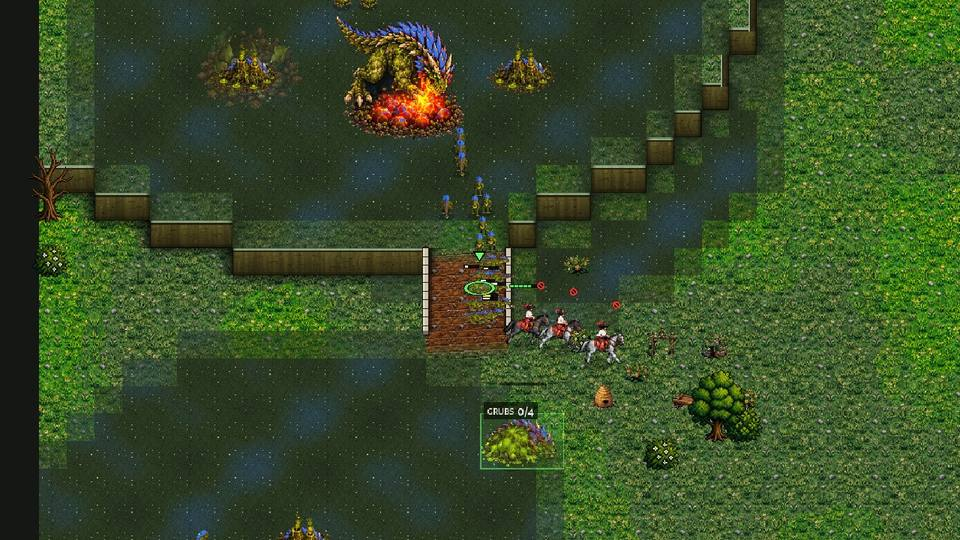
   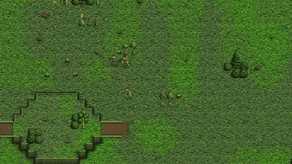

2. **After the failed rush, buildings instead of soldiers (5:20-7:00).** The hand-over to the Economy plan ("labourers
   to two halls and a walled natural") builds a second hall, a Foundry, Barracks 2, Farms 3 and 4 and the natural's
   palisade; the Barracks and the Horse Breeder stand idle (coach lines 5:23-6:53: `barracks 0/1`, then `0/2`) while the
   computer itself says `army_due true` from 6:23 and reckons the Brood's army at 882-1,182 against its own 635. The
   army is 5 Horsemen and 1 Musketeer from 4:53 to 6:53 (Greenhold 1137), 5 Horsemen from 5:22 to 6:53 (Greenhold
   1100). In the study the Crown's median army is 575 at 5:00 and 575 at 6:00. Greenhold 1100 at 7:35: Barracks,
   Barracks 2 going up, Foundry, three Farms, no soldier in the main (picture). Fix proposal B.

   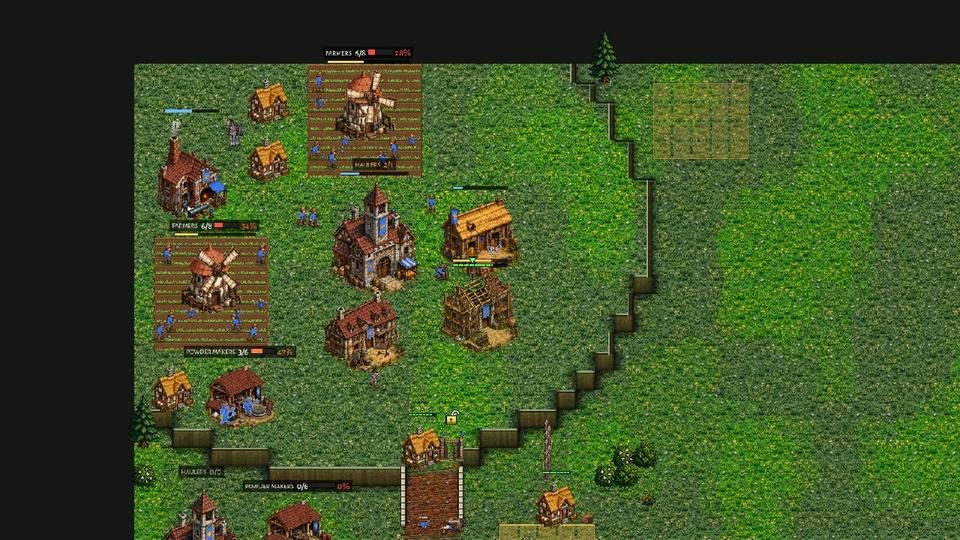

3. **A half-built natural with no one to hold it (6:30-8:00).** The army posts at the natural's gate ("room for 6
   Musketeers behind the palisade") but has Horsemen, so the palisade line is "a line of 1" (Greenhold 1100: line after
   line of 1 from 6:55 to 7:40), the palisade is open, the Powder Mill has no crew (0/6) and the Farms are short (2/8, 3/8;
   Greenhold 1137 at 6:58, picture: 4 Farms with 15 of 32 hands). The Brood's Timing wave (25-31 Raptors) walks in at
   6:50-7:00, the labourers die (Greenhold 1137: 26 -> 19 -> 2 by 8:53) and both halls fall by 9:20. Fix proposal C.

   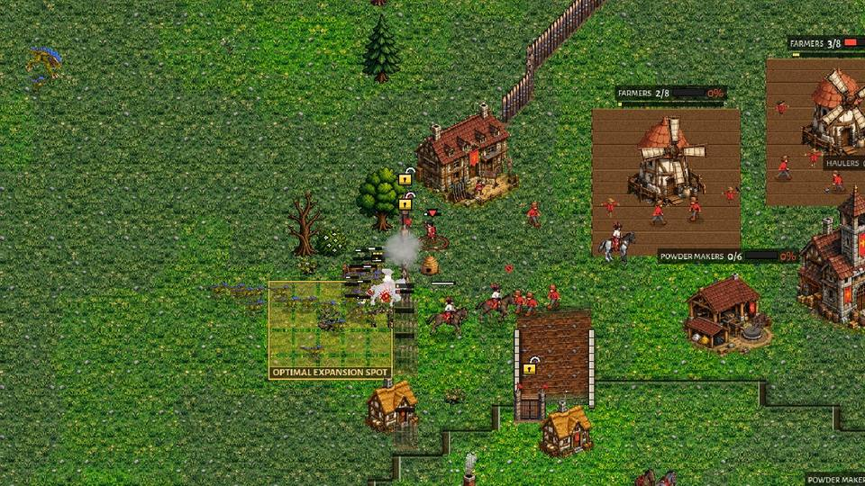

**When the Crown does well it does not finish (Ashford Crossing 1164).** The same rush failed (5:33) but the Brood took
the Spitter build and came late; the Crown's natural held with a line of 23 Muskets behind the palisade, the Brood's
waves died on it (10:00-11:24: the Brood lost 3,100 for 880, its army fell to 455; picture), and at 11:24 the Crown had
2,590 of army against 455 and more income (11,400 against 9,913). It never attacked: "holds its wave back: the enemy
army it knows is bigger" (11:18, 12:18, 12:33) and "holds the gate ... against the force outside (1377) its army (2345)
goes out only at 2755" (12:50); it built a Church and two more expansions. The Brood rebuilt to 50 Raptors by 12:24 and
66 by 14:25, broke the natural at 14:30 (empty Farms, 0/8, picture) and led at 15:00. Over the study "holds its wave
back" was written 34 times in 17 games. Fix proposal D.

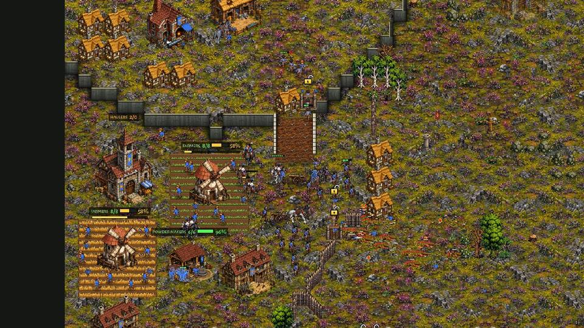
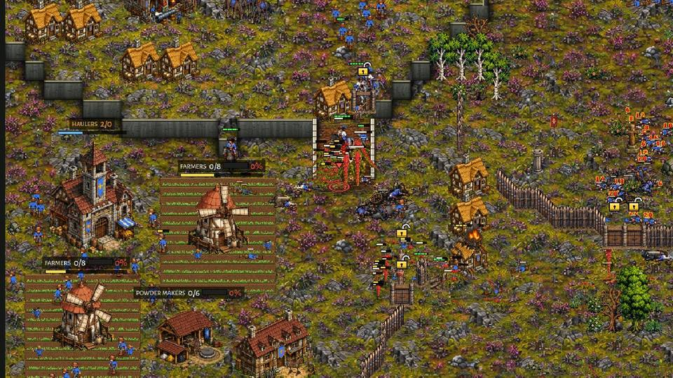

**The Brood's three biggest mistakes** (it won anyway)

1. **Waves into a finished musket line** (Ashford 1164, 10:00-11:24): Spitters and Raptors walk at the palisade and the
   23 Muskets behind it, 3,100 lost for 880 (picture). The Brood's first attacks were "thrown away" 7 times in 38 games
   and its first arrivals were held 8 times; against a Crown that had its line up, the Brood would do better to starve it
   (take the map, kill the outer Farms) than attack the gate.
2. **A full army guards against 1-3 riders for 2 minutes** (Greenhold 1137, 4:21-6:27: "guards its grubs ... with 18
   warriors against 2 riders, no chase", later 32 against 1): safe, but the Raptors could have killed the riders or
   gone for the Crown's natural, which had nothing in it at 5:00-6:00. Small cost here; against a human rider harass
   it hands over map control.
3. **A bank that sleeps late** (Mirewood 1155, 12:40: 3,589 unspent for 125 s at the supply cap): the Brood at 200 supply
   with nothing to spend on. Harmless against this Crown.

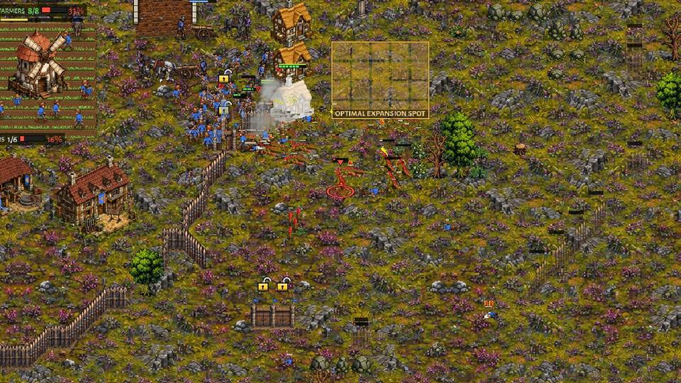

### Crown v Clockwork: why the Clockwork wins (or leads)

The Clockwork has two halls from about 3:20 and the Crown one until 7:30-8:00; the Crown's income stays at 0.65-0.75 of
the Clockwork's all game. The Crown's line wins the fights it is given (Ashfall 1116: 7,955 killed for 2,970 lost by
14:26; Red Coast 1125: 8,720 for 5,215), but the Clockwork rebuilds faster than it loses and the Crown cannot replace a
lost wave.

**The Crown's three biggest mistakes**

1. **One hall until 7:30-8:00** (Ashfall 1116: the second hall planned at 7:23, the Clockwork's at 3:19; study: halls at
   8:00 1.7 against 2.6). Its Timing plan's first attack goes at 7:26 from one base; the income gap is set by then and
   never closes (Ashfall: 4,560 against 5,766 at 7:20, 12,920 against 17,388 at 14:26). Fix proposal E.
2. **The army stands while the base is built** (Red Coast 1125, rush plan against the Clockwork: the riders "worked" at
   4:15 and "regroup"; the army is 465 (3 Horsemen, 2 Musketeers) from 4:24 to 6:24 while a Foundry, Cottages and the
   natural go up (picture at 6:05) and the Clockwork goes from 420 to 1,275; then wave 2 of 13 supply at 7:07 into 2,020,
   "rush failed" at 7:24). The same idle-Barracks hand-over as against the Brood. Fix proposal B.
3. **The wave walks into the Clockwork's base unformed and spends the army** (Ashfall 1116: the line forms well at 7:30
   and wins the field at 8:09 (gif), but at 8:32 "meets the enemy before its line is formed" and falls back losing 355
   for 210; 10:57 and 12:09: 4-5 Muskets, guns limbered, at the Clocktower of the Clockwork's natural (picture); the army
   1,840 at 8:20, 685 at 12:25). Study-wide: "meets the enemy before its line is formed" 58 times, and the Crown's median
   army falls from 1,310 at 8:00 to 822 at 10:00 while the Clockwork's rises to 1,890. This is crown-rider-screen's
   "still wrong" 1; fix proposal F.

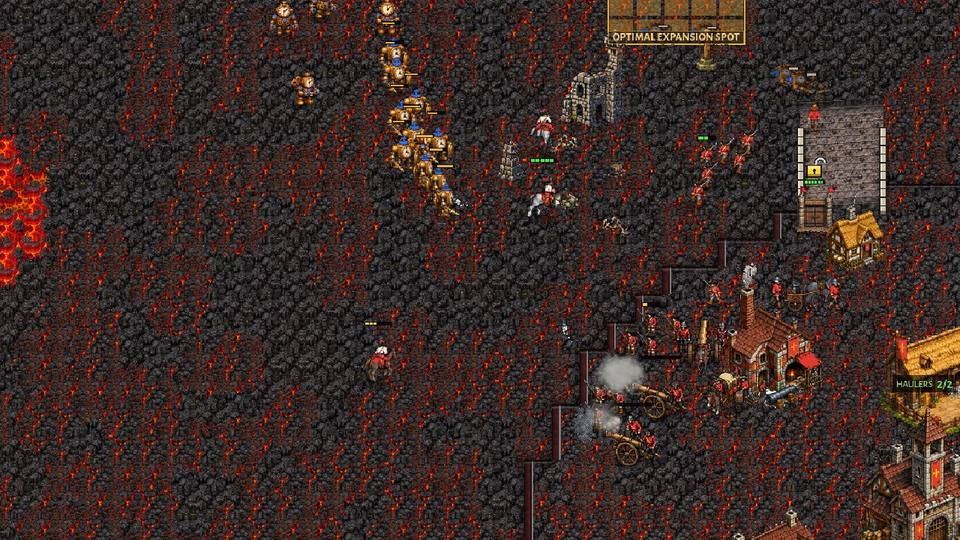
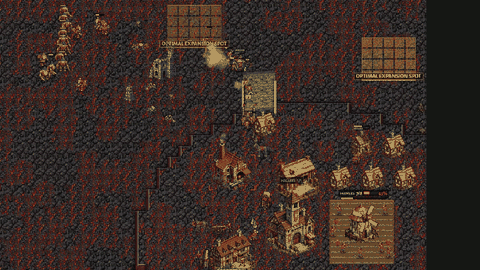
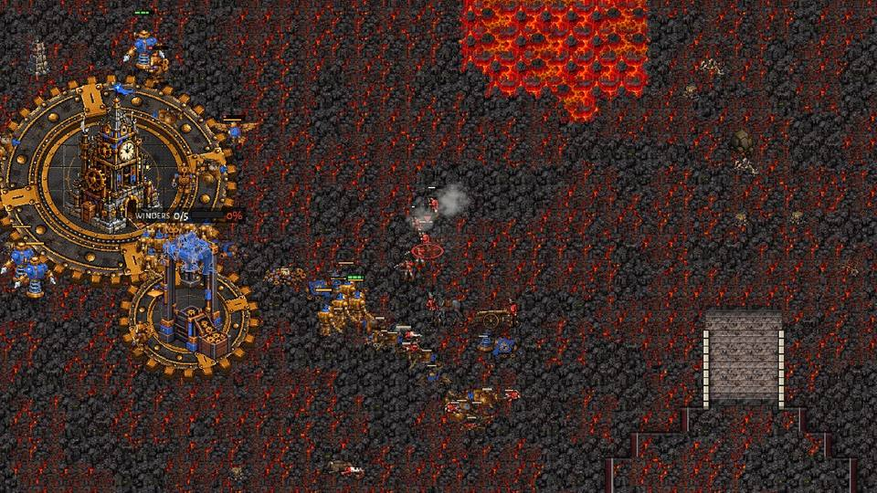
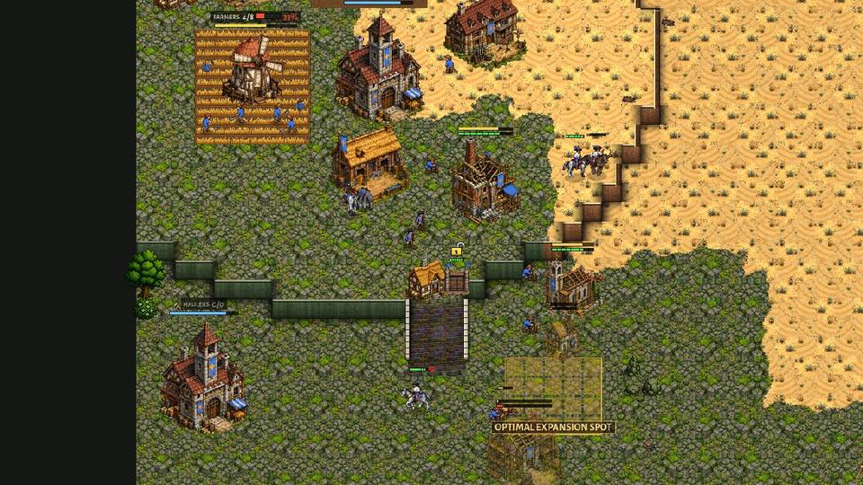

**The Clockwork's three biggest mistakes**

1. **Pushes into the musket line** (Ashfall 1116, 7:39: Clock Soldiers in a column at the foot of the Crown's ramp under
   its line and two guns, picture; from 6:20 to 8:20 the Clockwork lost 1,075 value for 50). Its first attacks were thrown away in 14
   of 38 games (lost more than twice what they killed), its first arrivals held 13 times.
2. **It does not finish** (Red Coast 1125: the Crown's last hall was gone by 10:25; from then to 15:00 the Clockwork
   pushed into the Crown's main again and again, losing about 6,900 value to the last Musketeers and guns,
   while 16 Crown labourers stood idle with 30 gold; picture at 13:27). Study-wide 30 of 38 draws, the Clockwork ahead in
   23, and 5 draws with a hall-less Crown at 15:00. The hunt (docs/rules_fixes.md) starts only when the enemy has no
   fighting unit; a few Musketeers keep it off.
3. **Springer timing picks** (OPTIMAL's Clockwork chose it in 10 games and won or led 4; Economy 16 of 16, Heavy Works 5
   of 6). Every game the Crown won or led was against a Springer Clockwork. Ashfall 1116 was one: its Springers did
   little against the line and guns.

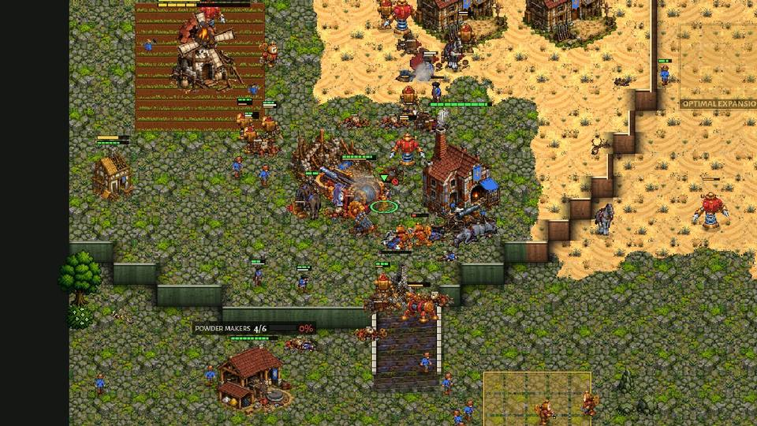
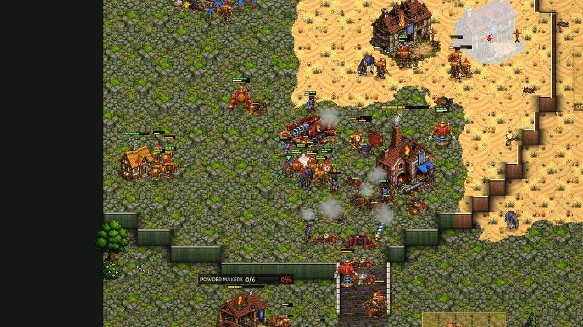

## Proposals for the owner (none applied)

AI play, each small and gateable by matchup like the coaching jobs' fixes:

- **A. No blind Horseman rush against the Hard Brood.** Today OPTIMAL reads nearly every Brood as GREEDY (its Mound
  Turtle on new ground at 0:00 counts as "a second base"; crown_v_brood_coach.md already named this read) and rushes;
  33 of 38 rushes failed. Proposal: against the Brood, a Mound Turtle alone is not GREEDY (count Rootmaws and grubs, as
  "little army" means few warriors at the Mother); and a rush that rides out turns back to harass outlying Rootmaws when
  the screen sees 8+ Raptors between it and the Mother, instead of riding in and being written off 90 s later. The owner
  said the Horseman rush is "extremely effective v the Brood Economy": it should stay for a read that is true.
- **B. A soldier floor in every hand-over.** When a rush or raid ends, the plan that takes over keeps the Barracks
  training until the Crown's army is at least 0.7 of the enemy army it reckons (the computer already has `army_due` and
  the reckoning); Farm 3-4, the Foundry and Barracks 2 wait for it. Measured target: the Crown's army from 5:00 to 7:00
  should rise like the Brood's (now 575 -> 690 against 487 -> 812).
- **C. Build what it can crew, and hold with Muskets.** No new Farm while the existing ones are under 6 of 8 hands, the
  Powder Mill crewed before the natural's wall is finished, and the natural's gate post manned by Muskets (Horsemen are
  not a palisade line: "a line of 1").
- **D. Forget a beaten army.** The Crown's reckoning of the enemy army should fall when it kills it (Ashford 1164: it
  killed 3,100 in a minute and still "knows" the enemy army is bigger) or age after 60-90 s unseen; and the gate post's
  "goes out only at 2x the force outside" is too strict once the Crown has won the fight at the gate (2,345 against
  1,377 stayed in). A wave when ahead by 3x is the Crown's one chance against the Brood's late game.
- **E. The second hall by 5:00 against the Clockwork.** The Crown's Timing plan against the Clockwork goes one-base to
  7:30; the crown-spots-v2 natural at the ramp foot, walled, is safe enough against the Clockwork's first pushes now
  that the line holds them (13 held). The crown-v-clockwork coaching measured a two-hall Timing and turned it off (0 of 6
  won or led, army at 8:00 437): that was before the line (0.33.24); worth measuring again.
- **F. The wave keeps its line inside the enemy's base** (crown-rider-screen "still wrong" 1, crown-line-fight "still
  wrong" 2): after a won field it re-forms and steps on in line, the guns unlimbered behind it at each halt, instead of
  the shared attack-move.
- **G. The Clockwork: pick the Springer timing less against the Crown** (4 of 10 won or led; every Crown success was
  against it), **finish a hall-less enemy** (the hunt when the enemy has no hall and under, say, 400 of army, not
  only none), and **no push into a musket line on the high ground** without Ballistas/Pendulums (or wait for the
  Crown's wave to come out).

Rules / balance (the owner's to decide; the study only shows the numbers):

- **The Crown's income** is the root of both matchups: 0.65-0.68 of the Clockwork's and 0.79 of the Brood's at 8:00, and
  in 76 games the Crown out-earned its opponent at 8:00 three times (all three against the Brood). The coaching jobs'
  balance proposals still wait: crown_v_brood_coach.md (the Cottage 10 supply, or the hall training 2 labourers at
  once) and crown-v-clockwork-coach.md (the Crown's yield per labourer, 34 against the Clockwork's 57 a minute at 10:00).
- **A hall-less side with labourers and no gold** is not "helpless" (it has workers): Red Coast 1125 kept 16 idle
  labourers and 6 Musketeers for 4.5 minutes. A rule that also counts "no hall, no production building, and not the
  price of a hall in the bank" as helpless would end such games (5 Crown v Clockwork draws had a hall-less Crown).
- **The script error** `Unit._pick_pistol` on a freed instance (scripts/unit.gd:966), seen twice in one game: worth a
  `is_instance_valid` guard (not changed here: a study only).

## Files

- `docs/winrate_2026_11_12/winrate-a/data/<tag>/`: the 76 games (result.json, story.txt, errors.txt).
- `docs/winrate_2026_11_12/winrate-a/games.csv`: one line per game. `compare.md`: now v 0.33.7 per pairing and map.
  `qa_report_tables.md`: the old study's report on these games.
- `docs/winrate_2026_11_12/winrate-a/films/<film>/`: the six films' coach.txt, story.txt, stats.txt, result.txt.
- `docs/shots/winrate-a/`: the pictures (jpg, 960x540) and two gifs.
- Tools: `tools/study/qa_matches.py --only pairs:crbr,crcw` (the games),
  `tools/study/winrate_games.py` (games / compare), `tools/study/winrate_film.sh` (a film).
- To play a game again: `godot --headless --fixed-fps 30 --script res://tools/qa_match.gd -- map:<map> seed:<seed>
  slots:<faction/optimal/0,faction/optimal/1> out:<dir>` (map, seed and slots in each result.json); the games do not
  repeat exactly.
