# winrate-b: Clockwork v Brood and the Crown mirror, win rates and a coach's look (2026-11-12, on 0.33.25)

Short sentences, to be read aloud.

The owner (2026-11-12 20:47): "Now do a gameplay coaching test to see the win rates in all match-ups." Three jobs split
the nine matchups. This one is **Clockwork v Brood** and **Crown v Crown**. It is a study only: no game or AI code was
changed. New tools only: `tools/study/winrate_b.py` (the runner), `tools/study/winrate_b_report.py` (the tables) and
`tools/study/winrate_b_film.py` (a film's numbers as a table).

## How it was measured

- **The same design as docs/qa_2026_11_08_matches.md** (0.33.7): `tools/qa_match.gd`, Hard OPTIMAL against Hard OPTIMAL,
  all 19 two-player maps, two seeds a map with the sides swapped between them, up to 15:00. **The same tags and seeds**
  (`tools/study/qa_matches.py`'s `base()` queue, only these two pairings): 38 games a pairing, 76 in all.
- Version 0.33.25 (main at f035ef22). About 3 minutes of real time a game, two at once. All 76 games ran to a result.
  **No script error** in any game (no errors.txt), no stalled run.
- **Draws**: no winner at 15:00. The draw's LEADER is the side whose income earned + 2 x army value is 10% ahead (the old
  study's rule). "Won or led" = won, or led a draw.
- **Views**: in Clockwork v Brood every number is the **Clockwork's** (the old study wrote it from the Brood's side; its
  numbers are turned round here). In the mirror the view is the **P1 start spot** (slot 0).
- Data: `docs/winrate_2026_11_12/winrate-b/data/<game>/` (result.json, story.txt), one line a game in
  `docs/winrate_2026_11_12/winrate-b/games.csv` (winner, end, leader, income and army of both sides at 5:00, 8:00, 10:00,
  15:00, halls lost, plans, start slot), every table in `docs/winrate_2026_11_12/winrate-b/tables.md`
  (`python3 tools/study/winrate_b_report.py`).
- **Noise.** One game says little: a seed played twice agrees with itself about 2 times in 3 (the brood-nerf study), and
  the films below show it again (3 of 5 films ended differently from the same seed in the batch). Read the 38-game
  totals. With 38 games, a won-or-led share between about 34% and 66% cannot be told from a coin (two-sided p > 0.05).

## The answer in short

| matchup | run | W-D-L | won or led | decided | mean length (decided) |
|---|---|---|---|---|---|
| Clockwork v Brood (Clockwork's view) | 0.33.7 | 2-22-14 | 12 of 38 (Brood 23, even 3) | 16 | 13:00 |
| Clockwork v Brood (Clockwork's view) | **now** | **11-15-12** | **20 of 38 (Brood 17, even 1)** | **23** | 12:28 |
| Crown v Crown (P1's view) | 0.33.7 | 2-36-0 | 17 of 38 (P2 17, even 4) | 2 | 13:58 |
| Crown v Crown (P1's view) | **now** | **3-35-0** | **16 of 38 (P2 18, even 4)** | **3** | 13:32 |

1. **Clockwork v Brood is now even.** The Clockwork won 11 and lost 12 (it won 2 and lost 14 on 0.33.7). Won or led 20 to
   the Brood's 17. That is a coin flip (p 0.74), which is what a fair matchup looks like. The change from 0.33.7 is real
   for the wins (2 -> 11 of 38, Fisher p 0.01) and likely for the won-or-led share (12 -> 20, p 0.10). Played seed by
   seed, the Clockwork did better in 19 games, worse in 9, the same in 10 (sign test p 0.09). The coaching of
   clockwork-v-brood-coach (0.33.20) shows: the Clockwork's push now gets home and finishes, and more games end (23
   decided, was 16; 7 before 12:00, was 2).
2. **The Crown mirror still does not end.** 35 of 38 draws, as on 0.33.7 (36). The coaching since (crown-v-crown-coach,
   crown-line-fight, crown-rider-screen) changed how the fights look, not how the games end. In 14 of the 35 draws one
   side had an army twice the other's (and 1,500 or more) for three sampled minutes or more and still did not finish (22
   of 36 on 0.33.7: fewer, but still many). The mirror is fair: P1 won or led 16, P2 18 (p 0.86).
3. **A start-spot edge is left in Clockwork v Brood, on the classic maps only.** On the 9 classic maps the P1 spot won or
   led 15 of 18 (won 12, lost 1; p 0.008). The Clockwork on P1 won or led all 9; the Brood on P1 6 of 9. On the 10 named
   maps it is even (P1 10, P2 9). The old study had the same lean on the classic maps in this matchup (14 of 18). The
   start-spots-fix study measured the mirrors only, where the classic edge is gone (the Crown mirror here: P1 8, P2 7 on
   the classic maps). So something on the classic maps favours spot A for the Clockwork and the Brood against each other.
   It is the strongest signal in this study. See proposal 5.
4. **The Clockwork earns more but the Brood catches up.** The Clockwork's income is 1.61 times the Brood's at 5:00, 1.44 at
   8:00, 1.22 at 10:00, 1.05 at 15:00. Its army is bigger at every minute (1.33 times at 8:00). The Brood earns a little
   less than on 0.33.7 (5,052 at 8:00, was 5,574): the Clockwork's pushes now reach it more often (37 first arrivals in
   the Brood's base, was 26) and its ground was lost 1.2 times a game (0.4 on 0.33.7).
5. **In the mirror, Dragoon raids is the weak pick.** OPTIMAL picks blind (the opening read is UNKNOWN or GREEDY in the
   mirror). Sides on Dragoon raids at 5:00 won or led 6 of 20 and trailed 12. Economy won or led 11 of 23, Balanced 8 of
   17, Timing 6 of 11. Both mirror films show why (below).

## 1. Win rates in detail

### Results

| pairing | run | games | W-D-L | won or led | draws led (subject / even / other) | decided | decided before 12:00 | p (won or led v trailed, 50%) |
|---|---|---|---|---|---|---|---|---|
| Clockwork v Brood | 0.33.7 | 38 | 2-22-14 | 12 | 10/3/9 | 16 | 2 | 0.09 |
| Clockwork v Brood | now | 38 | 11-15-12 | 20 | 9/1/5 | 23 | 7 | 0.74 |
| Crown v Crown (P1) | 0.33.7 | 38 | 2-36-0 | 17 | 15/4/17 | 2 | 0 | 1.00 |
| Crown v Crown (P1) | now | 38 | 3-35-0 | 16 | 13/4/18 | 3 | 0 | 0.86 |

The same game then and now (same tag, map and seed; better = a better letter for the subject in W > w > d > l > L):

- Clockwork v Brood: the Clockwork did better in 19, worse in 9, the same in 10 (sign test p 0.09).
- Crown mirror: P1 did better in 9, worse in 11, the same in 18 (p 0.82): nothing moved, as a mirror should.

**What is noise here.** The Clockwork's 11 wins against 2 on 0.33.7 is not noise (Fisher p 0.01). Its won-or-led 20 against
12 is probably real (p 0.10). The mirror's 3 decided against 2 is nothing (p 1.0). Within the batch, 20 v 17 (Clockwork v
Brood) and 16 v 18 (mirror) are both even.

### Draws

- Clockwork v Brood: 15 draws, most of them clear: the leader's score was 1.27 to 2.36 times the other's in 13 of 15. In
  12 of the 15 one army was twice the other's and 1,500 or more for three sampled minutes or more (16 of 22 on 0.33.7).
  Two draws were games being finished at the bell (Frostmere r0: the Clockwork had 0 workers, 0 army, 0 halls at 15:00, its
  last hall falling in the last minute; Glimmerdeep r0: 1 worker left).
- Crown mirror: 35 draws. Half are close (the leader under 1.25 times in 17 of 35), 14 are lopsided (1.5 to 2.8 times) and
  not finished. One was a beaten side at the bell (Mirewood r1: P2 at 0 workers, 0 army, 1 hall, 23 gold at 15:00; it went
  from 28 labourers at 12:00 to 9 at 14:00).

### The start spots (P1 = slot 0)

| pairing | run | maps | P1 wins - P2 wins | P1 won or led - P2 | p (won or led) |
|---|---|---|---|---|---|
| Clockwork v Brood | 0.33.7 | all 19 | 10 - 6 | 21 - 14 | 0.31 |
| Clockwork v Brood | now | all 19 | 18 - 5 | 25 - 12 | 0.05 |
| Clockwork v Brood | now | 9 classic | **12 - 1** | **15 - 3** | **0.008** |
| Clockwork v Brood | now | 10 named | 6 - 4 | 10 - 9 | 1.00 |
| Clockwork v Brood | 0.33.7 | 9 classic | 6 - 1 | 14 - 3 | 0.013 |
| Crown v Crown | now | all 19 | 3 - 0 | 16 - 18 | 0.86 |
| Crown v Crown | now | 9 classic | 0 - 0 | 8 - 7 | 1.00 |
| Crown v Crown | 0.33.7 | 9 classic | 2 - 0 | 12 - 4 | 0.08 |

On the classic maps, Clockwork v Brood by who held P1: the Clockwork on P1 won or led **9 of 9** (WWWWWWWww); the Brood on
P1 6 of 9 (WWWlwWWlL). On 0.33.7 it was the other way round (the Brood on P1 9 of 9, the Clockwork 5 of 9). So it is the
spot, not the faction. The mirror's classic edge is gone (8-7), as start-spots-fix found; the cross matchup still has one.
Each map plays each spot once per faction, so the two games of a map are not independent; still, 15 of 18 over 9 maps is
the clearest number in this study.

### Income and army

The subject's mean over the other's, games still running at that minute (n):

| pairing | run | income 5:00 | 8:00 | 10:00 | 15:00 | army 5:00 | 8:00 | 10:00 | 15:00 |
|---|---|---|---|---|---|---|---|---|---|
| Clockwork v Brood | 0.33.7 | 1.52 (38) | 1.27 (38) | 1.01 (37) | 0.90 (22) | 1.25 (38) | 1.25 (38) | 1.50 (37) | 1.64 (22) |
| Clockwork v Brood | now | 1.61 (38) | 1.44 (38) | 1.22 (36) | 1.05 (15) | 1.39 (38) | 1.33 (38) | 1.64 (36) | 1.27 (15) |
| Crown v Crown (P1/P2) | 0.33.7 | 0.99 (38) | 0.99 (38) | 0.99 (38) | 0.95 (36) | 0.51 (38) | 0.82 (38) | 1.04 (38) | 0.82 (36) |
| Crown v Crown (P1/P2) | now | 0.99 (38) | 0.96 (38) | 0.98 (38) | 0.93 (35) | 0.69 (38) | 0.78 (38) | 0.99 (38) | 0.92 (35) |

Each side's own means (income earned / army value) and what it lost:

| side | run | income 5:00 | 8:00 | 10:00 | 15:00 | army 5:00 | 8:00 | 10:00 | 15:00 | halls lost a game (built + sites) |
|---|---|---|---|---|---|---|---|---|---|---|
| Clockwork (v Brood) | 0.33.7 | 3527 | 7091 | 9357 | 16436 | 588 | 1132 | 1805 | 3129 | 1.2 + 0.2 |
| Clockwork (v Brood) | now | 3531 | 7291 | 9888 | 16614 | 656 | 1165 | 1748 | 2635 | 1.1 + 0.0 |
| Brood (v Clockwork) | 0.33.7 | 2316 | 5574 | 9247 | 18317 | 470 | 903 | 1205 | 1913 | ground lost 0.4 |
| Brood (v Clockwork) | now | 2194 | 5052 | 8113 | 15840 | 472 | 876 | 1068 | 2072 | ground lost 1.2 |
| Crown P1 (mirror) | 0.33.7 | 2350 | 5340 | 8260 | 14212 | 67 | 719 | 1385 | 1525 | 0.6 + 0.3 |
| Crown P1 (mirror) | now | 2520 | 5400 | 8440 | 15244 | 84 | 772 | 1414 | 1917 | 0.6 + 0.3 |
| Crown P2 (mirror) | 0.33.7 | 2370 | 5410 | 8310 | 14906 | 130 | 879 | 1329 | 1850 | 0.7 + 0.2 |
| Crown P2 (mirror) | now | 2550 | 5640 | 8640 | 16365 | 121 | 989 | 1428 | 2082 | 0.6 + 0.1 |

- The Crown earns 2-10% more in the mirror than on 0.33.7 (7% at 5:00, 3% at 8:00, 9% at 15:00) (the farms-before-Mills fix of
  crown-v-crown-coach), and the 0.33.7 army gap at 5:00 between the spots (67 v 130) is gone (84 v 121 is noise).
- The Clockwork's labourers stop at about 25-28 (25.3 at 8:00, 27.9 at 10:00; the Brood 30.7 and 41.6), and its third
  Clocktower comes late: a median of 10:00 (8:00 at the earliest, never in 4 games). The Clockwork sides that trailed had
  the same halls at 8:00 as those that won or led (2.1); by 12:00 the winners held 4, the trailers 2.9.
- The Brood's biomass still piles up: 1,000 or more in the bank at 10:00 in 9 of 36 Brood sides (11 of 37 on 0.33.7), up
  to 4,797 at 15:00 (Glimmerdeep r0). The Clockwork and the Crown spend nearly everything (a mean bank of 60-130).

### Game length

| pairing | run | decided | before 10:00 | 10:00-12:00 | 12:00-15:00 | draws | shortest |
|---|---|---|---|---|---|---|---|
| Clockwork v Brood | 0.33.7 | 16 | 1 | 1 | 14 | 22 | 9:58 |
| Clockwork v Brood | now | 23 | 2 | 5 | 16 | 15 | 9:50 |
| Crown v Crown | 0.33.7 | 2 | 0 | 0 | 2 | 36 | 13:22 |
| Crown v Crown | now | 3 | 0 | 0 | 3 | 35 | 12:07 |

Clockwork v Brood: decided games end at 12:28 on average (13:00 on 0.33.7); the Clockwork's wins at 9:52-14:23, the
Brood's at 9:50-14:34. The Crown mirror's three decided games: Redrock Canyon r1 12:07 (P1 Timing v Economy), Kestrel Rise
r0 13:37 (P1 Balanced v Dragoon raids), Amberfall Vale r1 14:53 (Economy v Economy), all won by P1.

### What OPTIMAL played

The plan each side was playing at 5:00 and how those sides did:

| side | plan at 5:00 | sides | won | won or led | lost or trailed | at the end (most common) |
|---|---|---|---|---|---|---|
| Clockwork | Balanced | 33 | 10 | 18 | 15 | Balanced 27, Economy 6 |
| Clockwork | Clock Soldier rush | 5 | 1 | 2 | 2 | Clock Soldier rush 4, Economy 1 |
| Brood | Balanced | 28 | 8 | 13 | 15 | Balanced 16, Brute siege 12 |
| Brood | Timing | 7 | 4 | 4 | 3 | Brute siege 4, Timing 3 |
| Brood | Spitter timing | 3 | 0 | 0 | 2 | Spitter timing 3 |
| Crown (mirror) | Economy | 23 | 1 | 11 | 9 | Economy 21, Siege push 2 |
| Crown (mirror) | **Dragoon raids** | 20 | 0 | **6** | **12** | Dragoon raids 11, Economy 5, Timing 3 |
| Crown (mirror) | Balanced | 17 | 1 | 8 | 7 | Balanced 12, Siege push 2, Timing 2 |
| Crown (mirror) | Timing | 11 | 1 | 6 | 4 | Timing 10, Siege push 1 |
| Crown (mirror) | Siege push | 5 | 0 | 3 | 2 | Siege push 4, Balanced 1 |

In Clockwork v Brood both computers open the same way in nearly every game (seen in all three films): the Brood reads the
Clockwork GREEDY at 1:41 and picks Rush; the Clockwork reads the Brood's 0:00 turtle as GREEDY at 1:44-2:00 and picks the
Clock Soldier rush; the Raptors come at 2:49; the Clockwork reads AGGRESSIVE at 3:12-3:19 and turns to Balanced. So the
plan at 5:00 is Balanced for both in most games, as clockwork-v-brood-coach described.

## 2. Per map

Letters: round 0 then round 1, the subject's result (W won, L lost, w/l a draw it led/trailed, d even). The Clockwork's slot per round in brackets. Income ratio at 8:00 (the subject's over the other's), the two games' mean.

| map | CW v BR 0.33.7 | CW v BR now | CW income 8:00 now | Cr v Cr (P1) 0.33.7 | Cr v Cr now | P1 income 8:00 now | ends now (CW v BR ; Cr v Cr) |
|---|---|---|---|---|---|---|---|
| greenhold | Ll | lW (P2P1) | 1.75 | dd | wl | 1.04 | -/14:04 ; -/- |
| highmoor | wL | WL (P1P2) | 1.63 | wW | dw | 0.98 | 10:18/12:34 ; -/- |
| dune_sea | lL | LW (P2P1) | 1.57 | ll | wl | 0.81 | 12:01/10:43 ; -/- |
| frostfang | Wl | Ww (P1P2) | 1.42 | ww | dl | 0.88 | 12:56/- ; -/- |
| twin_fords | Ld | Ww (P2P1) | 1.90 | wl | wl | 0.89 | 11:30/- ; -/- |
| ashfall | wl | WL (P1P2) | 1.43 | ww | ww | 0.96 | 11:24/13:04 ; -/- |
| mirewood | Lw | LW (P2P1) | 1.64 | ww | lw | 1.13 | 13:55/13:45 ; -/- |
| border_march | ll | WL (P1P2) | 1.60 | lw | lw | 0.97 | 9:52/14:34 ; -/- |
| red_coast | Lw | ww (P2P1) | 1.32 | Ww | ld | 0.95 | -/- ; -/- |
| ashford_crossing | Ld | Lw (P1P2) | 1.36 | lw | wl | 0.91 | 14:23/- ; -/- |
| kestrel_rise | wL | lw (P2P1) | 1.80 | lw | Wl | 1.22 | -/- ; 13:37/- |
| thornwood_maze | Lw | LL (P1P2) | 1.27 | ll | ll | 0.79 | 9:50/14:10 ; -/- |
| redrock_canyon | ll | LL (P2P1) | 1.04 | lw | lW | 1.13 | 10:04/13:50 ; -/12:07 |
| saltmarsh_isles | wL | ww (P1P2) | 1.58 | wl | wd | 1.02 | -/- ; -/- |
| glimmerdeep | wl | ll (P2P1) | 1.51 | lw | ww | 1.01 | -/- ; -/- |
| frostmere | LL | lL (P1P2) | 1.54 | ll | ll | 1.06 | -/13:31 ; -/- |
| cinder_steps | wW | LW (P2P1) | 1.71 | dl | ll | 0.81 | 13:01/12:41 ; -/- |
| hollowfen | wd | WW (P1P2) | 2.03 | ll | ll | 0.80 | 12:30/12:25 ; -/- |
| amberfall_vale | LL | wd (P2P1) | 0.95 | ld | wW | 1.08 | -/- ; -/14:53 |

Read per map with care: two games a map, and a seed agrees with itself about 2 times in 3.

- Clockwork v Brood, the Clockwork's best maps now: Hollowfen (won both, 2.03 times the Brood's income at 8:00), Twin Fords,
  Frostfang, Saltmarsh Isles and Red Coast (won or led both). Its worst: Thornwood Maze, Redrock Canyon (lost both; on
  Redrock its income lead is only 1.04, the smallest), Glimmerdeep (trailed both). Against 0.33.7 the Clockwork turned
  Twin Fords, Red Coast and Saltmarsh into wins or leads (and Hollowfen from a lead and an even draw into two wins) and kept losing Thornwood, Redrock and Frostmere. On
  six classic maps (Highmoor, Dune Sea, Ashfall, Mirewood, Border March and, with draws, Greenhold) each side won once:
  whoever held P1.
- Crown mirror: no map is decided twice; P1's income at 8:00 runs from 0.79 (Thornwood) to 1.22 (Kestrel) of P2's,
  which is how far one blind OPTIMAL pick can fall behind another.

## 3. Compared with 0.33.7 (docs/qa_2026_11_08_matches.md)

| | 0.33.7 | now (0.33.25) | noise? |
|---|---|---|---|
| Clockwork v Brood: Clockwork W-D-L | 2-22-14 | 11-15-12 | the wins: p 0.01, real |
| ... Clockwork won or led | 12 (Brood 23) | 20 (Brood 17) | p 0.10, probably real |
| ... decided | 16 | 23 | p 0.17 |
| ... Clockwork income / Brood's at 8:00 / 10:00 | 1.27 / 1.01 | 1.44 / 1.22 | sd per game ~0.20 / 0.27: the shift is about one sd of a game, real over 38 |
| ... Brood ground lost a game | 0.4 | 1.2 | |
| ... P1 won or led on the classic maps | 14 of 18 | 15 of 18 | the same lean both times |
| Crown mirror: P1 W-D-L | 2-36-0 | 3-35-0 | no change |
| ... decided | 2 | 3 | no change |
| ... lopsided draws not finished (2x army, 1,500+, 3+ minutes) | 22 of 36 | 14 of 35 | p 0.10: maybe fewer |
| ... income at 8:00 (mean of both sides) | 5,375 | 5,520 | small |

What changed between the two runs: the start spots (0.33.23), the rules fixes (0.33.12: beaten sides lose, winners
hunt), the Crown mirror coaching (0.33.17), clockwork-v-brood-coach (0.33.20), the mirror coachings of the others, the
Crown's line (0.33.24) and rider screen (0.33.25). The Clockwork v Brood change is the coaching's; the Crown mirror is
what it was.

## 4. The coach's look: five filmed games

Filmed with `tools/shot_ai_match.gd` (xvfb, opengl3, 1280x720, `every:30`: each side's main and army every 30 s, a stats
line every 15 s, the fights as they happen, the match log), Hard OPTIMAL against Hard OPTIMAL, the batch's own maps and
seeds:

```
xvfb-run -a godot --rendering-driver opengl3 --resolution 1280x720 --fixed-fps 30 --path . --script res://tools/shot_ai_match.gd -- \
    a:<P1 faction> b:<P2 faction> pa:optimal pb:optimal map:<map> seed:<seed> swap:0 out:<dir> end:900 every:30
```

A film is a new game: the same seed does not replay the batch's game (3 of these 5 ended differently). Each film's numbers
(a table a minute: `python3 tools/study/winrate_b_film.py <dir> --every 60`), its AI STORY and its match log (gzipped) are
in `docs/winrate_2026_11_12/winrate-b/films/<film>/`; the pictures in `docs/shots/winrate-b/` (jpg 640 wide, two gifs).

| film | P1 v P2 | the batch's game (same seed) | the film | kind |
|---|---|---|---|---|
| cb_greenhold_1102 | Brood v Clockwork | draw, the Brood led | **the Brood won 12:51** | the stronger economy won |
| cb_ashfall_1117 | Clockwork v Brood | the Clockwork won 11:24 | draw, **the Brood led** (22,700 v 19,850) | an upset |
| cb_highmoor_1105 (extra) | Clockwork v Brood | the Clockwork won 10:18 | draw, the Clockwork led (24,700 v 20,400) | a won field not finished |
| cc_kestrel_1133 | Crown v Crown | P1 won 13:37 | draw, P1 far ahead (25,400 v 12,100; P2 down to 5 labourers) | the stronger side won the field |
| cc_frostmere_1148 | Crown v Crown | draw, P2 led | draw, P2 led (24,340 v 12,210) | a won field not finished |

### Clockwork v Brood

**How the Brood won Greenhold 1102.** The Clockwork led early (income 1.4 times the Brood's at 5:00, army 2,565 v 1,600 at
9:05). Its push went out at 8:37 (27 units in a block) and at 9:23 walked onto the Brood's swamp by a Mound Turtle
expansion, where the whole pack met it: 2,565 fell to 1,300 while the Brood went from 1,600 to 2,525 (93 Raptors) in the
same minute. The Brood had 51 grubs to the Clockwork's 28 by 9:00, and it turned them into a capped army: 199 of 200
supply at 11:06, 121 Raptors and 4 Tyrants. Its 123-supply wave (10:48) reached the Clocktowers at 11:05; the Clockwork's
labourers went from 26 to 2 by 12:06 and it was out at 12:51.

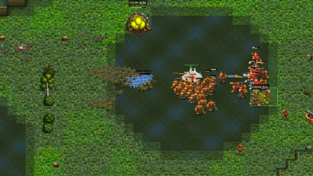
*Greenhold 1102, 9:23: the Clockwork's push (left of centre, in a block) on the Brood's swamp; the pack comes in from the left.*

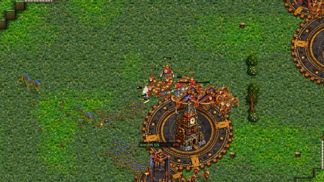
*11:05: the Brood's 123-supply wave at the Clockwork's Clocktower.*

**How the Brood came back at Ashfall 1117 (the upset).** The Clockwork was ahead all game until 12:00 (income 7,371 v
4,485 at 8:00; army 3,490 v 2,220 at 12:05). At 12:26 the Brood sent 69 supply (52 Raptors, 16 Spitters) into the
Clockwork's works. At 12:38 the Clockwork's push said "clearly ahead (worth 4,480, the enemy army seen lately 1,254): it
presses on to the enemy's halls", and four seconds later "no longer clearly ahead (4,270 against 2,076)": the wave was at
its door. The fight (12:44-13:02) was on its own gears, the army bunched on a press: it lost 2,795 and killed 1,845, then
pulled back. The Brood rebuilt with Spitters (35 by 14:51) and ended with 2,850 army to 1,125.

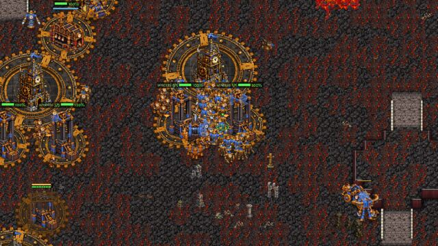
*Ashfall 1117, 12:32: the Clockwork's army packed on its own works just before the Spitter wave.*

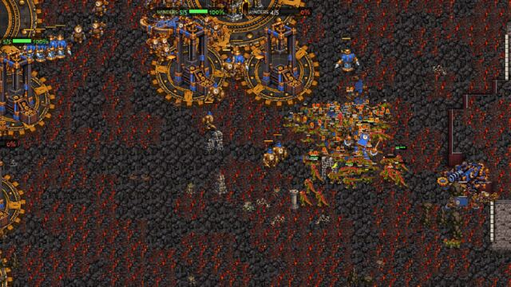
*13:15: the Brood's wave in the Clockwork's works.*

**The Clockwork's three biggest mistakes**

1. **It waits for a bigger push while the Brood has nothing** (Highmoor 1105, 12:01-14:56; Ashfall 1117, 13:20-13:53).
   Highmoor: the push pulled back at 12:01 (it had killed 2,400 and lost 2,320). At 13:06 the Clockwork had 2,480 army,
   the Brood 285. The log, 13:31: "holds at its gathering point: its last push (3765) had to pull back; the next goes worth
   4706 (it has 3175)"; 14:17 the same with 4,165. It went at 14:56, after the Brood's own Brute siege (14:21) had come and
   gone. Ashfall, 13:47: "the next goes worth 5706 (it has 1895)" while the Brood had 52 seen lately. The rule asks for
   1.25 times the LAST push, whatever the enemy has now. Two and a half minutes of a won field thrown away, and a draw
   instead of a win.
   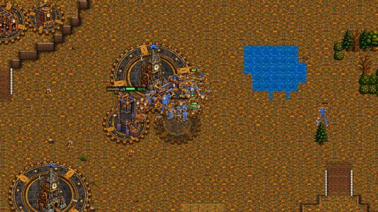
   *Highmoor 1105, 13:32: 3,175 of Clockwork at its gathering point; the Brood's army is 285.*
   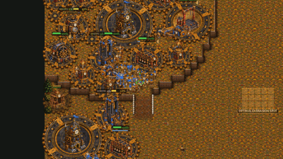
   *The Clockwork's army 10:02-14:32: out, at the Brood's expansions, back home, waiting.*
2. **It pushes into the Brood's swamp and the whole pack** (Greenhold 1102, 9:23, picture above). It went out at 1.6 times
   the army it had seen, but the Mother lays a pack in a minute on her swamp (clockwork-v-brood-coach, "still wrong" 1, seen
   again). At Highmoor (12:17) the push fought by the Brood's expansions for two minutes and came home with 1,445 of 3,765.
   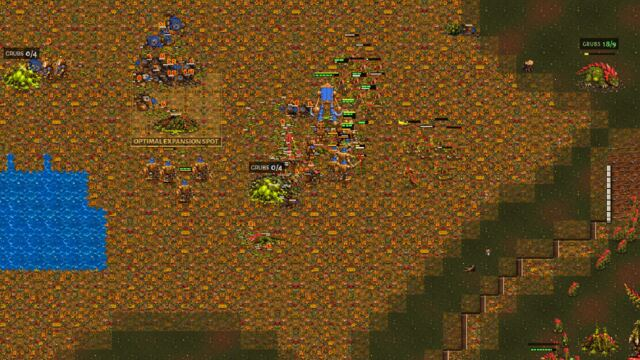
   *Highmoor 1105, 12:17: the push among the Brood's expansion turtles; the Mother on her swamp at the top right.*
3. **It fights a Spitter wave packed on its own gears, and calls itself "clearly ahead" with the wave at its door**
   (Ashfall 12:26-13:02, pictures above). The "clearly ahead" check counts the enemy army seen lately (1,254), not the
   69-supply wave already in its base. Also, in all three films its labourers stop at 26-32 (the Brood 50-53) and the
   third Clocktower comes at about 10:00 (the batch's median too): the income lead melts from 1.6 times at 5:00 to 1.05 at
   15:00.

**The Brood's three biggest mistakes**

1. **The opening rush is thrown away** (all three films: 10 supply of Raptors at 2:49-2:52, back at 3:30-3:50 with 50-100 of
   250; 6-8 Raptors lost for 0-3 Clockwork units). It does make the Clockwork drop its Clock Soldier rush for Balanced
   (3:12-3:19), which may be worth it; the old study counted these early raids too (a median 2:55).
2. **Waves sent into the Clockwork's army at home**: Highmoor 6:37 (back with 175 of 800), Ashfall 10:20 (750 of 1,400)
   and 12:26 (520 of 2,095, into 3,490 at home). It goes when its own army is big, not when the Clockwork's is away.
3. **Biomass in the bank under the cap**: Highmoor 10:06-11:06, 1,438-1,940 banked at 89-104 of 112-148 supply while the
   Clockwork's 38-unit push came (10:33). In the batch, 9 of 36 Brood sides had 1,000+ banked at 10:00 (up to 4,797 at
   15:00, Glimmerdeep r0). At Greenhold it banked 4,279 at the cap, which is the cap, not a mistake.

### Crown v Crown

**Why the winner won, both films.** Both computers play the same until 1:50-2:25, when OPTIMAL reads UNKNOWN (the ramp is
walled at 0:22 and the scout sees nothing) and picks blind. In both films one side picked **Dragoon raids**, and its
labourers stopped: Kestrel P2 had 13-14 labourers from 3:00 to 6:00 (P1, Balanced, went from 14 to 24), Frostmere P1 had
15-16 from 4:00 to 6:00 (P2, Balanced then Economy, went from 15 to 23). The Dragoon build puts up a Church, a Foundry, a Barracks, a Horse Breeder and
its natural's palisade first; the raids themselves were a rider or two from about 6:00 and a few Dragoons by 9:00, and
they were answered.
By 10:00 the other side had 48 labourers to 30 (Kestrel) and 48 to 37 (Frostmere), and the game was decided by
economy. In the batch Dragoon raids won or led 6 of 20 and trailed 12.

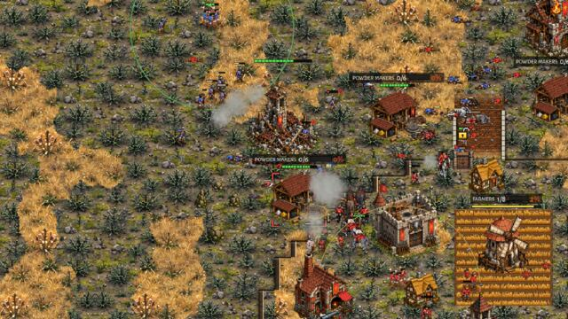
*Kestrel Rise 1133, 14:30: P1 (blue) in P2's base among its Powder Mills; P2 has 5 labourers left.*

**The losing side's three biggest mistakes**

1. **The Dragoon raids opening starves the labourers** (Kestrel P2 3:00-6:00, Frostmere P1 4:00-6:00; above).
2. **Waves that break at once**: Kestrel P2, 8:29: "sends out its first attack" and "pulls back from the enemy's
   palisade: the fire there is too strong" in the same second. Frostmere P1, 9:01 breaks through a palisade, 9:49 pulls
   back; its wave 2 (11:40) reached P2's line as a handful ("losing the fight (290 lost for 0)", 11:46), then 865 for 480
   (12:04). In the batch 39 of 99 waves pulled back from a palisade.
   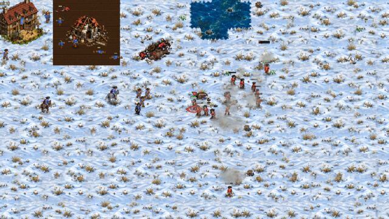
   *Frostmere 1148, 11:44: P1's wave 2 (blue, left) arrives a few men at a time against P2's line (red).*
3. **It guards the ramp while its natural dies**: Kestrel P2, 13:07-14:37, "holds the top of its ramp: against the force
   below (786-1,231) its army (876-1,022) goes down only at 1.3 times", and its musket line "moves to the cliff edge above
   its Town Hall" again and again, while its labourers went from 43 to 5 and its natural's halls fell (14:27, 14:44).

**The winning side's three biggest mistakes**

1. **The first wave walks in strung out and is lost under the enemy's ramp** (Kestrel P1, 8:37-10:06). The wave won a
   small fight at 9:20 and brought its gun up to shell the Town Hall (9:24); reinforcements walked across the middle one by
   one; at 9:46 P2 held the top of its ramp with 1,040; P1's army went from 1,540 (9:06) to 465 (10:06).
   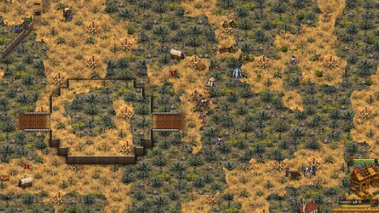
   *Kestrel Rise 1133, 9:32: P1's men cross the middle in ones and twos.*
   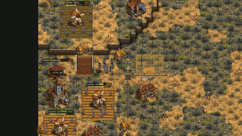
   *P1's army, 8:32-14:32.*
2. **It does not finish a won field.** Frostmere P2 at 12:50 and 13:34: "halts out of reach of the enemy's base and forms
   its musket line" (22 and 25 muskets); 2,715 to 520 at 14:06, and a draw. The mirror's hunt over a token army needs the
   enemy under 450 and under 15% of ours (crown-v-crown-coach's choice 5): 520 is 19%. Kestrel P1, 2,720 to 930 at 14:06,
   also a draw. In the batch 14 of 35 draws had one army twice the other's and 1,500+ for three sampled minutes or more.
3. **Most fights still begin unformed.** "Meets the enemy before its line is formed: N muskets deploy into a line under
   fire": Kestrel P1 12:12, 12:48, Frostmere P2 10:18 (23 muskets). In the batch's AI STORY: 120 unformed meetings to 113
   "forms its musket line before the enemy army ahead" and 24 halts before a base (crown-rider-screen measured 42% formed
   in the mirror; here 49%).

## 5. Proposals for the owner (none applied)

**Clockwork v Brood**

1. **The next push after a pull-back goes on what the enemy has now.** Today: 1.25 times the last push's value. Proposal:
   the smaller of that and 1.5 times the enemy army reckoned (at least 900), so Highmoor's 3,175 against 285 goes at once.
   Where: the Clockwork's gathering rule ("holds at its gathering point: its last push had to pull back; the next goes
   worth ..."). Small, gated to the Brood like the other clockwork-v-brood fixes. Expected: more of the 12 lopsided
   Clockwork-led draws finished.
2. **"Clearly ahead" counts the wave at the door.** Before pressing on to the halls, count enemy armies within 900 px of
   its own buildings (C4's measure) as well as the army seen lately (Ashfall 12:38).
3. **The Brood attacks the Clockwork's army only when it is away, or when the wave is 1.3 times what is at home**
   (Ashfall 12:26, Highmoor 6:37). Its Raptors' strength is catching the push in the open (Greenhold 9:23).
4. **The Brood spends a bank over 1,000 under the cap** (another expansion turtle, Rootmaw or research when the eggs are
   the limit). Look first at why: eggs, Sires, or the plan holding the biomass.
5. **The classic maps' spot A in Clockwork v Brood** (P1 won or led 15 of 18, both runs). Before any change: replay the 9
   classic maps in this matchup with 4 more seeds a spot, and run start-spots-fix's first-minutes probe on Clockwork v
   Brood (it measured the mirrors only). If it holds, look at what differs for each faction at spot A: the Brood's
   expansion turtles and swamp, the Clockwork's press spots by the Clocktower, the first rush's walk.
6. Worth a look, not a fix yet: the Clockwork's labourers stop at 26-32 and its third Clocktower comes at ~10:00 in nearly
   every game, winners and losers alike.

**Crown v Crown**

7. **Dragoon raids in the mirror keeps the labourers coming** (the hall keeps training to about 20 by 5:00 before the
   Church, Horse Breeder and palisade), or OPTIMAL leaves Dragoon raids out of the blind (UNKNOWN) table in the mirror. It
   won or led 6 of 20 here, the weakest pick.
8. **A wave is not sent if the siege check would pull it back at once** (Kestrel P2 8:29: out and back in the same
   second; 39 of 99 waves pulled back from a palisade).
9. **The hunt over a token army a little wider in the mirror**: under 25% of ours and under 700 (today 15% and 450), so
   Frostmere's 2,715 against 520 goes for the halls with its guns. 14 of 35 mirror draws were lopsided and unfinished.
10. **The ramp hold looks at the labourers too**: a side whose natural's labourers are dying goes down to them even at
    1.0 times the force below (Kestrel P2 13:07-14:37: 43 labourers to 5 while the army held the ramp at 1.3 times).

**Both**: 15:00 is still short for these computers. With 35 of 38 mirror games and 15 of 38 Clockwork v Brood games at the
bell, a win rate at 15:00 is mostly "who led". A batch to 20:00 on the same seeds would show which leads turn into wins.

## Files

- `tools/study/winrate_b.py` (runner: qa_matches' base queue, these two pairings), `tools/study/winrate_b_report.py`
  (tables; `--csv` for one line a game), `tools/study/winrate_b_film.py` (a film's stats as a table).
- `docs/winrate_2026_11_12/winrate-b/data/` (76 games), `games.csv`, `tables.md` (every table, every game),
  `films/` (five films' stats, story, log).
- `docs/shots/winrate-b/` (9 jpg, 2 gif).
