# Win rates, the two mirrors (job winrate-c, 2026-11-12/13, on 0.33.25)

Short sentences, to be read aloud. A study only: no game or AI code changed (tools and data only, no version bump).

The owner (2026-11-12 20:47): "Now do a gameplay coaching test to see the win rates in all match-ups." Three jobs split
the nine matchups; this one is the two mirrors: **Clockwork v Clockwork** and **Brood v Brood**. The other jobs:
winrate-a (Crown v Brood, Crown v Clockwork), winrate-b (Clockwork v Brood, Crown mirror); they combine into
docs/winrate_2026_11_12.md.

## How it was measured

- The same base design as the qa-matches study (docs/qa_2026_11_08_matches.md, 0.33.7), so the numbers compare:
  `tools/qa_match.gd`, Hard OPTIMAL against Hard OPTIMAL, the 19 two-player maps x 2 seeds (round 0, round 1), up to
  15:00, the SAME tags and seeds (qa_matches.py `base()`; e.g. Greenhold Clockwork mirror seeds 1105 and 1142).
  76 games, 38 a mirror. No game failed, no script error, no stall.
- Runner `tools/study/winrate_c.py` (two games at once on a 2-core machine, about 4-5 minutes a game), tables
  `tools/study/winrate_c_report.py` (with `--csv`: one line a game). Data: `docs/winrate_2026_11_12/winrate-c/data/<tag>/`
  (result.json, story.txt), `games.csv` (winner, end, the draw's leader, income and army of each side at 5, 8, 10 and
  15:00, halls lost, the builds), `start_spots.txt` (which start each player had: `tools/study/winrate_c_spots.gd`).
- Rules as in the old study: a draw = no winner at 15:00. Its **leader** = the side whose income earned + 2 x army value
  is 10% ahead. **Won or led** = won, or led a draw. In a mirror the sides are **P1** (player index 0) and **P2**.
  In every one of these 76 games P1 stood on **spot A** (the map's top / top-left start, the start-spots study's name):
  so "P1" here is the same as "spot A". (In a mirror "the sides swapped" between the rounds changes nothing: the second
  round is a second seed, same starts.)
- **Noise.** 38 games a mirror. A game is not the same game twice even with the same seed. The two rounds of a map
  differ from about 2:00 on (only 1 of 38 map pairs had the same incomes at 5:00). With 38 games: a P1 v P2 split of
  13-7 is p 0.26 (noise), 11-2 is p 0.02 (real enough to look at); a change in the draw rate from 22 to 13 decided is
  p 0.07 (a hint). Each p below is an exact two-sided test; 19 maps x 2 games means a single map's result is noise.

## The answer in short

| mirror | 0.33.7 (qa-matches) | now (0.33.25) |
|---|---|---|
| **Clockwork v Clockwork**: P1 W-D-L | 0-38-0 | **13-18-7** |
| ... decided games (mean length, shortest) | 0 | **20** (13:07, 11:43) |
| ... won or led P1 / even / P2 | 19 / 6 / 13 | 19 / 6 / 13 |
| ... a side clearly ahead (army 2x and 1,500+) that won | 0 of 34 | **20 of 32** (4.8 min after it was clearly ahead) |
| ... draws with one side beaten in all but name (army under 300, the other 2,000+) | 26 | **9** (all broken at 12:00-15:00) |
| ... income per side at 8:00 / 10:00 | 9,346 / 12,791 | 9,130 / 12,444 |
| **Brood v Brood**: P1 W-D-L | 14-16-8 | **11-25-2** |
| ... decided games (mean length, shortest) | 22 (12:29, 10:17) | **13** (12:26, 9:33) |
| ... won or led P1 / even / P2 | 21 / 3 / 14 | **23 / 6 / 9** |
| ... a side clearly ahead that won | 22 of 38 | **13 of 35** |
| ... draws with one side beaten in all but name | 3 | **0** |
| ... income per side at 8:00 / 10:00 | 5,420 / 8,607 | **9,250 / 13,294** |
| ... richer side's income over the poorer's at 8:00 | 1.29 (sd 0.38) | **1.09** (sd 0.09) |

1. **The Clockwork mirror ends games now.** 0 of 38 decided at 0.33.7, 20 of 38 now (p < 0.001): the coaching
   (clockwork-v-clockwork-coach: the hunt goes with the push, the menders first, hunting parties) is what changed it.
   It is even: P1 13-7 is noise (p 0.26), won or led 19-13 (p 0.38). Economies are the same as before (8:00 within 2%).
2. **Most Clockwork draws left are games the clock cut.** 9 of the 18 draws had a side whose army broke at 12:00-14:00
   (under 300 against 4,700-6,700), 4 of them with no hall left at 15:00. The hunt takes about 5 minutes from "clearly
   ahead" to the win; a push won at 12:00 runs out of time. The other 9 draws were two live armies (6 even, 3 led).
3. **The Brood mirror is richer and evener, but ends less often.** Income at 8:00 is up 71% (p < 0.001) and the two
   sides are within 9% of each other (was 29%): the brood-v-brood-coach fixes (no false GREEDY read, the Raptor no
   longer read as a rider) hold on all 19 maps. No dead draws. But only 13 decided (was 22, p 0.07, a hint) and a side
   clearly ahead won only 13 of 35 (was 22 of 38): the Brood can get ahead, but its waves do not kill a defended Mother
   (coach's notes below).
4. **The Brood mirror leans to spot A: 11-2 in decided games (p 0.02), won or led 23-9 (p 0.02)**, all of it on the
   named maps (spot A won or led 15-3, p 0.01; classic maps 8-6, noise). The start-spots-fix study found the same
   (named maps 14-5-1 for spot A, p 0.06, run 3): two studies, the same lean, on different seeds. The Clockwork mirror
   shows none (named 10-8, classic 9-5).
5. **No crash, no script error, no stall** in 76 games (0.33.7 had 2 errors, in other matchups).

## Win rates (P1 = player index 0 = spot A)

| mirror | version | games | P1 W-D-L | won or led P1 / even / P2 | draws led P1 / even / P2 | decided | before 12:00 | mean length (decided) | shortest | round 0 | round 1 | same result both rounds |
|---|---|---|---|---|---|---|---|---|---|---|---|---|
| Clockwork v Clockwork | 0.33.7 | 38 | 0-38-0 | 19 / 6 / 13 | 19 / 6 / 13 | 0 | 0 | - | - | 0-19-0 | 0-19-0 | 19 of 19 maps |
| Clockwork v Clockwork | 0.33.25 | 38 | 13-18-7 | 19 / 6 / 13 | 6 / 6 / 6 | 20 | 2 | 13:07 | 11:43 | 6-8-5 | 7-10-2 | 7 of 19 maps |
| Brood v Brood | 0.33.7 | 38 | 14-16-8 | 21 / 3 / 14 | 7 / 3 / 6 | 22 | 11 | 12:29 | 10:17 | 6-9-4 | 8-7-4 | 11 of 19 maps |
| Brood v Brood | 0.33.25 | 38 | 11-25-2 | 23 / 6 / 9 | 12 / 6 / 7 | 13 | 6 | 12:26 | 9:33 | 6-12-1 | 5-13-1 | 8 of 19 maps |

The P1 v P2 split, by map kind (spot A's view):

| mirror | maps | spot A W-L (decided) | won or led - trailed |
|---|---|---|---|
| Clockwork | all 19 | 13-7 (p 0.26) | 19-13 (p 0.38) |
| Clockwork | 9 classic | 5-3 | 9-5 |
| Clockwork | 10 named | 8-4 | 10-8 |
| Brood | all 19 | **11-2 (p 0.02)** | **23-9 (p 0.02)** |
| Brood | 9 classic | 3-1 | 8-6 (p 0.79) |
| Brood | 10 named | **8-1 (p 0.04)** | **15-3 (p 0.01)** |

Per map, Brood spot A won or led both rounds on 6 maps (Cinder Steps, Glimmerdeep, Redrock Canyon, Dune Sea, Thornwood
Maze, Saltmarsh Isles), spot B on none. In the Clockwork mirror A did so on 4 maps, B on 3.

## Economy and armies (mean per side, games still running at that minute; brackets: games)

| mirror | version | income 5:00 | 8:00 | 10:00 | 15:00 | army 5:00 | 8:00 | 10:00 | 15:00 | richer / poorer income 8:00 (mean, sd) | 10:00 | bigger / smaller army 10:00 (median) |
|---|---|---|---|---|---|---|---|---|---|---|---|---|
| Clockwork | 0.33.7 | 4231 (38) | 9346 (38) | 12791 (38) | 18421 (38) | 658 | 1613 | 2325 | 3534 | 1.06, 0.05 | 1.07 | 2.36 |
| Clockwork | now | 4234 (38) | 9130 (38) | 12444 (38) | 19708 (18) | 674 | 1523 | 2345 | 3066 | 1.07, 0.07 | 1.09 | 1.65 |
| Brood | 0.33.7 | 2300 (38) | 5420 (38) | 8607 (38) | 15728 (16) | 424 | 791 | 1087 | 1435 | 1.29, 0.38 | 1.34 | 2.25 |
| Brood | now | 3586 (38) | 9250 (38) | 13294 (37) | 22849 (25) | 376 | 1671 | 2468 | 2818 | 1.09, 0.09 | 1.10 | 1.42 |

- Clockwork: income at 8:00 -215 a side (-2%, p 0.02) and at 10:00 -347 (-3%, p 0.03); armies the same (p 0.33, 0.93).
  A 2-3% drop with two tests close to the line is most likely noise or the price of the earlier fighting (first own
  attack now at a median 5:20; at 0.33.7 the push never marked itself attacking).
- Brood: income +3,830 at 8:00 (+71%) and +4,687 at 10:00, armies at 8:00 twice as big (all p < 0.001). Real.
- Brood supply: in 67 of 228 readings at 4:00, 5:00 and 6:00 a Brood side stood within 2 of its supply cap (the
  Clockwork 2 of 228). Both Brood films show it at the moment the first fights start (see the notes).

## Per map

Each cell: P1's (spot A's) results on that map, round 0 then round 1. W won, L lost; lower case a draw P1 led (w),
trailed (l) or even (d). Last column: the end times of the decided games now (Clockwork / Brood).

| map | Cw v Cw 0.33.7 | Cw v Cw now | Br v Br 0.33.7 | Br v Br now | now: ends (Cw / Br) |
|---|---|---|---|---|---|
| amberfall_vale | lw | Wl | lL | Wd | 11:44 - / 13:12 - |
| ashfall | wl | wW | lw | Ld | - 13:56 / 11:14 - |
| ashford_crossing | dw | wd | WL | Wl | - - / 11:18 - |
| border_march | wl | dw | LL | lW | - - / - 14:45 |
| cinder_steps | lw | WW | WW | WW | 12:24 13:17 / 9:33 10:02 |
| dune_sea | ww | dw | Wl | ww | - - / - - |
| frostfang | ww | wL | dW | Wl | - 12:47 / 14:33 - |
| frostmere | ll | Lw | WW | wL | 12:59 - / - 13:26 |
| glimmerdeep | ww | WW | WW | wW | 12:56 13:01 / - 10:45 |
| greenhold | wd | LW | dl | wl | 13:19 13:32 / - - |
| highmoor | ll | dW | ww | ld | - 14:52 / - - |
| hollowfen | dw | Wl | Ll | Wl | 13:44 - / 12:57 - |
| kestrel_rise | ll | LW | wW | wd | 11:43 14:04 / - - |
| mirewood | wd | ld | LW | wd | - - / - - |
| red_coast | ww | Ll | wW | wd | 12:37 - / - - |
| redrock_canyon | dw | Wd | WW | wW | 12:38 - / - 14:44 |
| saltmarsh_isles | ld | Ll | wd | Ww | 13:34 - / 14:55 - |
| thornwood_maze | lw | lL | LL | ww | - 13:30 / - - |
| twin_fords | wl | WW | wl | lW | 12:21 13:23 / - 10:14 |

- Cinder Steps is spot A's in both mirrors, then and now (8 games: A won 6, led 1 draw, trailed 1). Two maps, 4 games each: a hint.
  The Brood's other A maps are named maps (Glimmerdeep, Redrock Canyon, Saltmarsh Isles, Thornwood Maze).
- Every game, minute by minute, is in the appendix (the report's own output) and in games.csv.

## Halls lost, builds, first attacks

| | Clockwork 0.33.7 | Clockwork now | Brood 0.33.7 | Brood now |
|---|---|---|---|---|
| built halls lost (Clockwork) / Brood ground shrank | 77 | 119 | 91 | 26 |
| sides losing 3 or more | 15 | 27 | 12 | 2 |
| Brood Mothers killed | - | - | 22 | 13 |
| OPTIMAL's build at 5:00, sides (won or led) | balanced 76 (32) | balanced 73 (32), springer 2 (0), economy 1 (0) | balanced 60 (25), timing 11 (6), rush 5 (4) | balanced 34 (17), timing 30 (9), economy 12 (6) |
| own first attack (median, earliest) | none marked | 5:20, 4:45 | 2:55, 2:45 | 6:45, 5:40 |
| first enemy arrival of 300+ in a base | 6:20, 5:20 | 6:00, 5:10 | 8:10, 4:10 | 7:10, 6:10 |

- The Clockwork loses more halls now because games are finished: the hunt takes them.
- The Brood loses far less ground (26 against 91) and only 13 Mothers die (22 before): the Raptor rush is out of the
  mirror's dice (no Rush at 5:00 now) and the waves come at 6:45 with an army, not at 2:55.
- The Brood's Timing pick won or led only 9 of 30 sides (Balanced 17 of 34, Economy 6 of 12). Small samples; worth a
  look if the owner wants OPTIMAL's mirror dice tuned.

## Coached look: four filmed games

Filmed with `tools/shot_ai_match.gd` (`a:/b:` the faction, `pa:optimal pb:optimal every:30 coach:1`; pictures every 30
s, the fights, the bases every 2 minutes, a status line a side every 15 s). Logs in
`docs/winrate_2026_11_12/winrate-c/films/<film>/` (coach.txt, story.txt, result.txt, stats.txt.gz); pictures in
`docs/shots/winrate-c/`. A film is a new run of the batch game's map and seed, so it is not the same game minute by
minute; all four ended the same way as their batch game.

### Clockwork 1: Amberfall Vale, seed 1159 (the stronger side won). P1 won at 11:57.

What happened: at 1:32 P2 read P1's opening as NORMAL and picked **Economy** ("an economic race"); P1 kept Balanced.
At 5:13 P1's push went out with 12 Clock Soldiers; P2 had 5-7. It met them at P2's natural at 5:48, killed 1,030 for 400
by 6:23, and never left: from 6:38 to 10:00 its army stood 11-22 tiles from P2's buildings while P2 fed in what it made
(its army stayed under 450). P2's income went from +1,000 to +800 a minute; P1's to +1,600. "Clearly ahead" at 8:01;
P2's last hall fell at 10:08; the game ended 11:57.

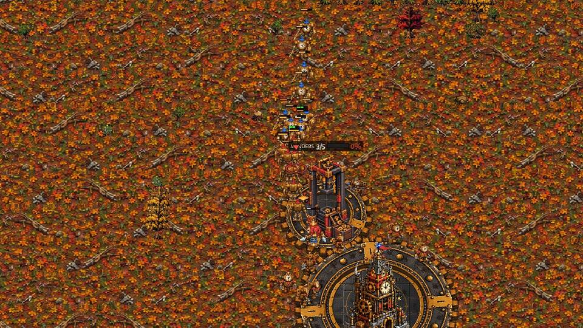
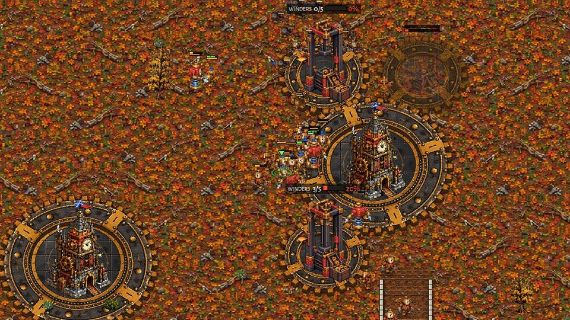
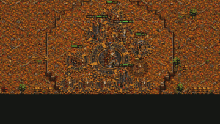

Why the winner won: it went out at the right time against an Economy build, 12 against 5, and kept the enemy in its
base. The loser's Economy pick in the mirror lost the 5:00 fight.

P1 (winner), three mistakes:
1. 5:48, the push arrives single file down the road (first picture): the front soldiers fight while the tail is 300 px
   back. It won anyway because it was twice the size.
2. 8:01 to 11:57: four minutes from "clearly ahead (1,250 against 70)" to the win. At 9:04 the army walks down P2's
   ramp as one long column (picture below); the halls fell at 10:08, the last workers and buildings at 11:57.
3. "does not chase 1 fast rider(s)" 10 times from 6:42 to 10:24: a lone enemy Clock Soldier read as a fast rider (the
   cwcw coach's "still wrong" item 4). Harmless here, noise in the story.

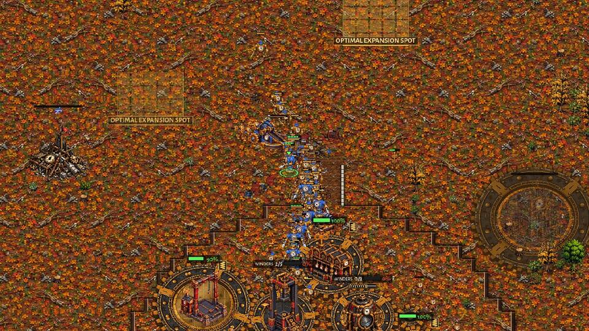

P2 (loser), three mistakes:
1. 1:32, **Economy on a NORMAL read in the mirror**: 5-7 soldiers at 5:00 against the enemy's 11-12. The other Clockwork
   is the same computer and pushes at 5:00-5:20 in nearly every game (first own attack, median 5:20).
2. 5:53, it lays a THIRD Clocktower while the enemy push is at its natural (6:14 picture, the ghost top right): money
   for a hall that the army then lacked.
3. 6:23 to 11:00, it never rebuilt an army: each new soldier walked into P1's 1,000-5,000 one at a time ("whole army
   defends its base" with 70-400). Holding back to its main's gears and the ramp was the only chance.

### Clockwork 2: Mirewood, seed 1123 (a draw, P2 ahead at 15:00).

What happened: an even game for 13 minutes (incomes within 1-4% at every minute, armies trading). At 1:31/1:41 both
read the other GREEDY. Pushes went out at 4:52-6:08 on both sides and traded evenly. At 10:53 P1 had 3,630 against P2's
1,965 and pushed into P2's natural; by 12:08 it had lost about 3,500 for 1,400 (picture). At 13:26 P2 pushed with 43
(3,685 against 2,990), broke P1's army at P1's natural 14:08-14:38 (picture) and was hunting at 15:00: P1 had 170 army
left. A game the clock cut.

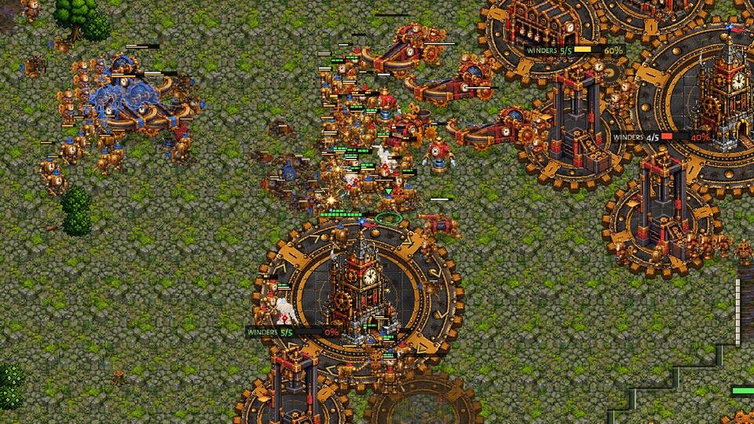
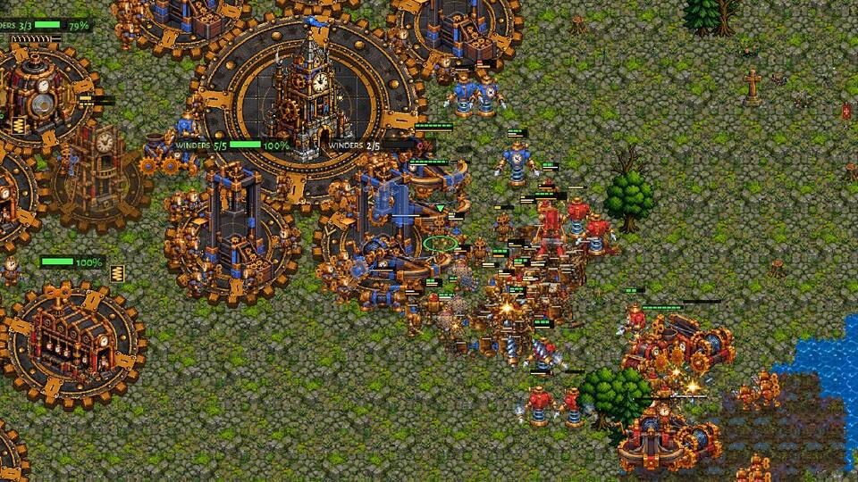
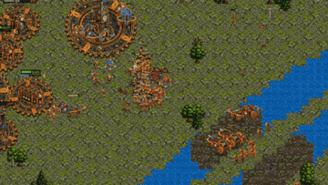

Why P2 came out ahead: it defended on its own gears (mended, its Ballistas behind the Clocktower) and took the trade
2.5 to 1, then went out when the enemy army was the smaller one.

P1, three mistakes:
1. 10:53-11:24, a push at 1.85 times the enemy's army into its natural lost 2.5 to 1: its front arrived spread out
   (some on the left round its Great Winder, the rest in the middle; picture) into Ballistas and menders on the gears.
2. 5:05-5:27, it laid its Heavy Works four times (log: "lays a Heavy Works on the spot it kept" at 5:05, 5:13, 5:20,
   5:27); it finished 19 s after P2's.
3. 13:50, "whole army defends its base" with 2,990 against 3,685 at its natural, but the army was spread between the
   natural and the main; it lost 2,550 in 30 s.

P2, three mistakes:
1. 1:31, read the enemy GREEDY ("no army and no production at its base") from the Clockwork's own economic opening
   (it kept Balanced, so no harm; but the read is wrong in every Clockwork mirror the films saw).
2. 9:10, "push is clearly ahead (2,570 against 1,076)" while the enemy had 2,610: the reckoning of the enemy's army
   was off by 1,500 (the cwcw coach's proposal 1, still open). It turned back at 9:16.
3. 12:08 to 13:26, after winning the defence (2,205 against 1,710) it waited 78 s at home before going out; with that
   time back the 14:38 break would have been a win before 15:00.

### Brood 1: Cinder Steps, seed 1152 (the stronger side won). P1 won at 11:51 (batch game 9:33).

What happened: both rooted a Mound Turtle at 0:00, both picked the Timing attack. P1 earned more from the start (3,333
against 2,881 at 4:51): P2 stood at its supply cap at 4:51 (49 of 52) and 5:51 (64 of 64). P1's timing left at 5:54
with 23 supply of Raptors and hit P2's natural turtle (picture): 770 killed for 75 by 6:51, P2's natural gone by 7:51.
From there P1 was ahead (9,206 against 6,425 at 7:51). P2's 50-supply wave at 9:13 lost 900 of 1,560. P1's 146-supply
wave at 10:50 went for the Mother at 11:39 and killed her.

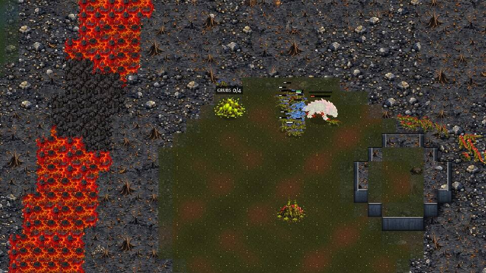
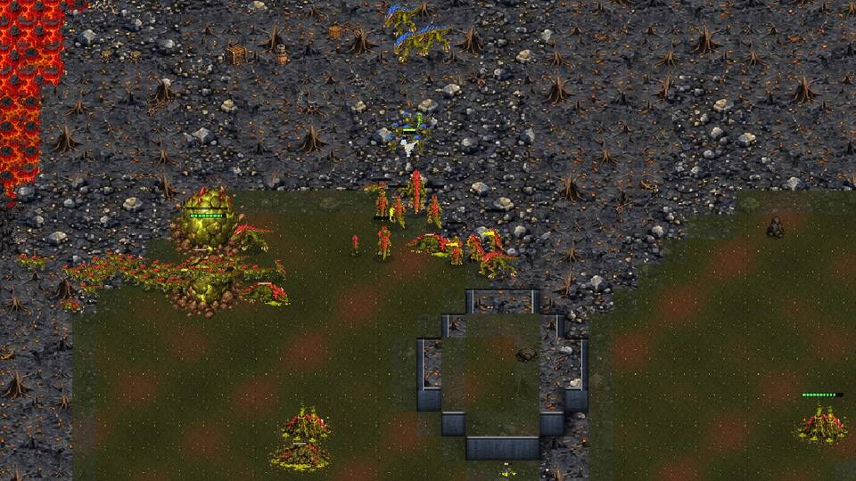

Why the winner won: more income from the first minutes and an army in time for 5:54, while P2 was supply blocked.

P1 (winner), three mistakes:
1. 9:21, its own wave "pulls back: only 500 of 1,800 is left": a wave lost 1,300 at the same time as P2's attack, both
   waves out at once (the brood coach's "base trades", fix 3, still happens on this map).
2. 9:21 to 10:50, a 3,300-4,800 army at home at the cap (178-199 of 200 supply) while P2 had 535: 90 s of waiting
   against a broken enemy.
3. 7:51 to 11:22, about 1,000 food in the bank at every check (1,006, 1,007, 984, 1,125) with room under the cap at
   7:51: the Mother's laying, not food, was the limit.

P2 (loser), three mistakes:
1. 4:51 and 5:51, at the supply cap (49/52, 64/64) right before the enemy's timing.
2. 5:59-6:16, the alarm sounded, but it defended in pieces ("6 against 125", "2 against 25", "8 against 200") and pulled
   back to the Mother at 6:15, leaving the natural's turtle.
3. 9:13, a 50-supply wave into an enemy army twice its size: lost 900 of 1,560 for little.

### Brood 2: Greenhold, seed 1104 (a draw, P1 far ahead at 15:00).

What happened: P1 Balanced, P2 **Economy** (1:41, on a NORMAL read). P1's first wave (6:30, 25 supply) went for P2's
Mother at 7:09 and 7:45 with 11-12 creatures and pulled back at 8:15 with 650 of 2,750. P1's 81-supply wave at 9:36
broke P2's army (P2 350 at 11:06). From 11:00 P1 stood at the cap, 200 of 200, 123 Raptors and nothing else, 3,000-3,900
food in the bank. Two more waves went for the Mother (12:27 with 5, 13:32 with 56) and pulled back with 875 of 3,875 and
1,750 of 7,150 left. P2's 32 Spitters, Rootmaws and the Mother held. 15:00: P1 25,402 earned, army 3,875; P2 15,772,
army 2,950.

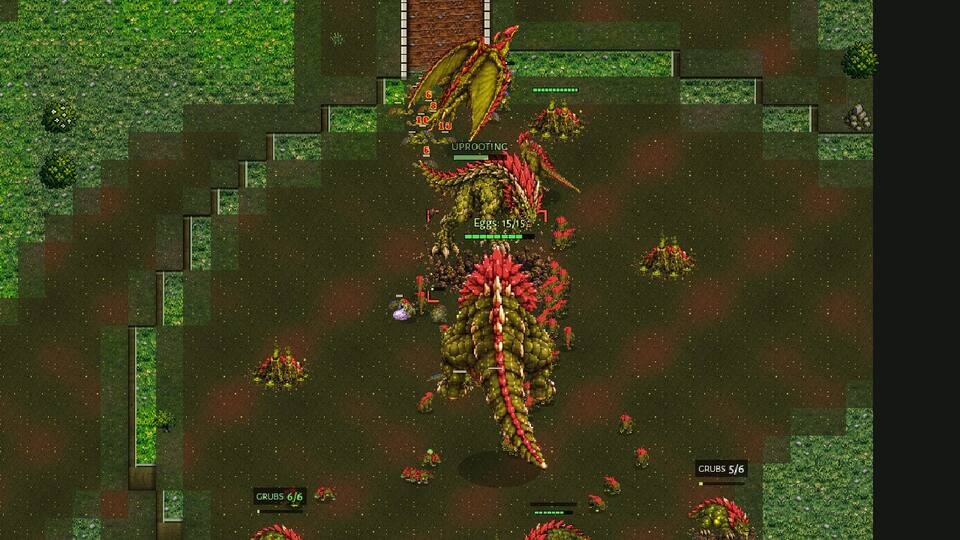
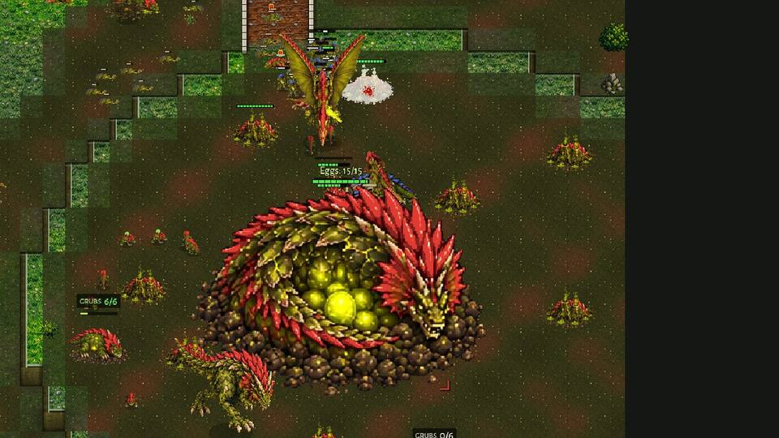
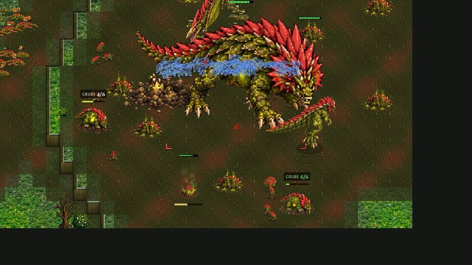

Why P1 led and did not win: it won the economy and the army fights, but a wave of Raptors alone does not kill a Mother
guarded by Spitters and Rootmaws.

P1 (ahead), three mistakes:
1. 11:00-14:06, **Raptors only** (123 of 123 at 13:07) into rooted Rootmaws, Spitters and the Mother: two waves lost
   three quarters of themselves. At the cap with 3,000+ food it had nothing to change the mix with (Brutes need their
   Sire; it had 1 Brute).
2. 12:27 and 14:02, "goes for the enemy Mother with 5 creatures" / "with 4": the Queen hunt started by a handful.
3. 7:09-8:15, its first 25-supply wave went for the Mother twice with 11-12 creatures and lost 2,100 of 2,750.

P2 (behind), three mistakes:
1. 1:41, **Economy on a NORMAL read** (the same pick as Clockwork 1); supply capped at 4:51 (47/52).
2. 7:06 to 11:06, food piling up: 1,311, 1,641, 3,809, 5,124 in the bank with Eggs 15 of 15 (pictures) and an army of
   350-650. The batch's game on this seed did not do it (bank under 600 all game) and only 1 Brood side of 74 had 1,500+
   at 10:00 in the batch: a film-only case, but a real one.
3. 12:06-15:00, with 32 Spitters it held at home and never went out, though P1's Raptor waves kept losing.

## Proposals for the owner (NOT applied)

Clockwork mirror:
1. **OPTIMAL's mirror dice without Economy before the first fight** (as the Brood mirror's fix 8 took the Rush out):
   the other Clockwork pushes at a median 5:20 with 10-12 soldiers. In the batch only 1 side picked Economy and it lost
   (Amberfall Vale r0); the film showed why. Or Economy only after a scouted second Clocktower with no army.
2. **The mirror's GREEDY read**: the Clockwork's own economic opening reads GREEDY at 1:30 ("no army and no production
   at its base"). The Brood mirror's fix 1 did the same job for the Brood: a third hall, not "no army", as greed.
3. **The reckoning by trades** (clockwork-v-clockwork-coach proposal 1, still open): "clearly ahead (2,570 against
   1,076)" against 2,610 (Mirewood 9:10).
4. **Close up before the enemy's gears**: pushes arrive in a column (Amberfall 5:48, Mirewood 11:24). The Brood has
   it (its fix 6, "closes up before it meets"); the Clockwork push could stop and gather once 20-25 tiles out.
5. **For the studies, not the game**: 9 of 18 Clockwork draws are wins the 15:00 limit cut (the army broke at
   12:00-14:00). A mirror study at 20:00, or counting "army under 300 and no hall for 60 s" as a loss in the tables,
   would read the mirror better. Whether the game itself should end such sides sooner is the owner's rule
   (docs/rules_fixes.md beats a side with no workers, army or means; these sides still had 8-33 workers).

Brood mirror:
1. **Spot A on the named maps** (won or led 15-3, p 0.01; start-spots-fix run 3 found 14-5-1): two studies agree.
   docs/start_spots_fix.md section 3 has the proposals (the paths drift from the first seconds); a check of the named
   maps' turtle spots and rally points for spot B is the next step. Not a Clockwork or Crown problem.
2. **Finishing a won game**: a side clearly ahead won 13 of 35. Ideas, to be measured: (a) at the cap with food banked,
   mix the next wave (Spitters, Brutes through their Sire) instead of more Raptors; (b) the Queen hunt only with most
   of the wave near her, never with 4-5 creatures; (c) a wave that just broke the enemy army goes on to the Mother at
   once instead of waiting at home at the cap (Cinder Steps 9:21-10:50).
3. **Supply before the first fight**: a Brood side was within 2 of its cap in 29% of the 4:00-6:00 readings (the
   Clockwork 1%); both films' losers were blocked at 4:51-5:51. The supply source could be grown a minute earlier.
4. **OPTIMAL's mirror dice**: Timing won or led 9 of 30 sides, Balanced 17 of 34, Economy 6 of 12. Small numbers; if
   it holds up in a bigger batch, Timing's weight in the mirror could come down.

## Tools and data

- `tools/study/winrate_c.py` (runner), `tools/study/winrate_c_report.py` (tables, `--csv`),
  `tools/study/winrate_c_spots.gd` (who stood on which start).
- `docs/winrate_2026_11_12/winrate-c/data/` (76 games), `games.csv`, `start_spots.txt`, `films/` (4 films' logs).
- `docs/shots/winrate-c/` (10 pictures, 2 gifs).
- To replay a game: `godot --headless --fixed-fps 30 --script res://tools/qa_match.gd -- map:<map> seed:<seed>
  slots:clockwork/optimal/0,clockwork/optimal/1 out:<dir>` (not the same game twice: see Noise).

## Appendix: every game (tools/study/winrate_c_report.py)

### Clockwork v Clockwork

| map | seed | rd | result | end | leader | income P1/P2 5:00 | 8:00 | 10:00 | 15:00 | army P1/P2 5:00 | 8:00 | 10:00 | 15:00 | halls lost P1/P2 | plans at 5:00 |
|---|---|---|---|---|---|---|---|---|---|---|---|---|---|---|---|
| amberfall_vale | 1159 | 0 | P1 won | 11:44 | P1 | 4354 / 4168 | 9752 / 7163 | 13155 / 8463 | - | 700 / 490 | 2035 / 495 | 4575 / 345 | - | 0 / 3 | balanced / economy |
| amberfall_vale | 1196 | 1 | draw | 15:00 | P2 | 4321 / 4418 | 8308 / 8933 | 12027 / 12670 | 20126 / 21873 | 700 / 700 | 1050 / 1780 | 1785 / 1935 | 905 / 5235 | 2 / 0 | balanced / balanced |
| ashfall | 1120 | 0 | draw | 15:00 | P1 | 4301 / 3918 | 9640 / 8742 | 13416 / 11635 | 21225 / 18000 | 700 / 700 | 2355 / 320 | 3225 / 1450 | 3320 / 1980 | 0 / 2 | balanced / balanced |
| ashfall | 1157 | 1 | P1 won | 13:56 | P1 | 4376 / 3974 | 8978 / 7953 | 12739 / 11575 | - | 700 / 700 | 1470 / 1090 | 3155 / 315 | - | 0 / 4 | balanced / balanced |
| ashford_crossing | 1132 | 0 | draw | 15:00 | P1 | 4291 / 4251 | 9795 / 9635 | 13605 / 13406 | 21238 / 18572 | 560 / 700 | 1300 / 1530 | 2330 / 2990 | 4700 / 0 | 0 / 3 | balanced / balanced |
| ashford_crossing | 1169 | 1 | draw | 15:00 | even | 3483 / 3613 | 6226 / 6126 | 9129 / 8918 | 17031 / 16138 | 685 / 300 | 665 / 1290 | 1735 / 2000 | 3780 / 3325 | 0 / 0 | springer / springer |
| border_march | 1126 | 0 | draw | 15:00 | even | 4379 / 4018 | 9732 / 9188 | 13390 / 13129 | 22086 / 22382 | 700 / 700 | 1735 / 1360 | 2430 / 1730 | 4890 / 3515 | 0 / 0 | balanced / balanced |
| border_march | 1163 | 1 | draw | 15:00 | P1 | 4371 / 4010 | 9689 / 9072 | 13301 / 13051 | 21223 / 15680 | 700 / 700 | 1480 / 1595 | 3070 / 2285 | 6735 / 0 | 0 / 4 | balanced / balanced |
| cinder_steps | 1153 | 0 | P1 won | 12:24 | P1 | 4448 / 4457 | 9657 / 8713 | 13188 / 10908 | - | 700 / 700 | 2010 / 710 | 4690 / 270 | - | 0 / 3 | balanced / balanced |
| cinder_steps | 1190 | 1 | P1 won | 13:17 | P1 | 4422 / 4444 | 9785 / 9595 | 13318 / 11814 | - | 700 / 700 | 1860 / 660 | 4290 / 270 | - | 0 / 4 | balanced / balanced |
| dune_sea | 1111 | 0 | draw | 15:00 | even | 4372 / 4281 | 9316 / 9412 | 12942 / 13289 | 22290 / 20830 | 700 / 630 | 1775 / 1370 | 1690 / 2260 | 3725 / 3865 | 0 / 0 | balanced / balanced |
| dune_sea | 1148 | 1 | draw | 15:00 | P1 | 4427 / 3953 | 9703 / 9175 | 13442 / 13044 | 21586 / 15980 | 700 / 700 | 2130 / 1650 | 3540 / 3030 | 5825 / 0 | 0 / 4 | balanced / balanced |
| frostfang | 1114 | 0 | draw | 15:00 | P1 | 4362 / 3941 | 9695 / 9009 | 13268 / 12927 | 21928 / 18070 | 700 / 700 | 1780 / 1555 | 2120 / 1960 | 5365 / 0 | 0 / 2 | balanced / balanced |
| frostfang | 1151 | 1 | P2 won | 12:47 | P2 | 4254 / 4020 | 8287 / 8415 | 10153 / 12222 | - | 630 / 630 | 490 / 1330 | 0 / 3305 | - | 3 / 0 | balanced / balanced |
| frostmere | 1150 | 0 | P2 won | 12:59 | P2 | 4369 / 4465 | 9509 / 9611 | 12562 / 12772 | - | 630 / 630 | 1455 / 1990 | 70 / 4090 | - | 4 / 0 | balanced / balanced |
| frostmere | 1187 | 1 | draw | 15:00 | P1 | 4320 / 4340 | 9446 / 9506 | 12801 / 12526 | 20893 / 14324 | 630 / 630 | 1675 / 1920 | 2120 / 2150 | 5955 / 0 | 0 / 4 | balanced / balanced |
| glimmerdeep | 1147 | 0 | P1 won | 12:56 | P1 | 4391 / 3856 | 9845 / 8242 | 13422 / 11382 | - | 700 / 700 | 2035 / 790 | 4655 / 320 | - | 0 / 3 | balanced / balanced |
| glimmerdeep | 1184 | 1 | P1 won | 13:01 | P1 | 4415 / 3937 | 9848 / 9164 | 13392 / 12181 | - | 700 / 630 | 2000 / 920 | 4540 / 70 | - | 0 / 4 | balanced / balanced |
| greenhold | 1105 | 0 | P2 won | 13:19 | P2 | 4316 / 4229 | 9633 / 9541 | 12611 / 12879 | - | 700 / 630 | 1120 / 2130 | 140 / 4155 | - | 4 / 0 | balanced / balanced |
| greenhold | 1142 | 1 | P1 won | 13:32 | P1 | 4364 / 3961 | 9753 / 9122 | 13477 / 12838 | - | 700 / 700 | 2100 / 1065 | 4175 / 290 | - | 0 / 5 | balanced / balanced |
| highmoor | 1108 | 0 | draw | 15:00 | even | 4416 / 3925 | 8816 / 8623 | 11853 / 12675 | 18399 / 19738 | 700 / 700 | 1665 / 1190 | 1885 / 2315 | 3335 / 2970 | 0 / 0 | balanced / balanced |
| highmoor | 1145 | 1 | P1 won | 14:52 | P1 | 4369 / 3930 | 9715 / 9064 | 13146 / 12822 | - | 700 / 700 | 2170 / 1905 | 3110 / 485 | - | 0 / 5 | balanced / balanced |
| hollowfen | 1156 | 0 | P1 won | 13:44 | P1 | 4375 / 4314 | 9662 / 9488 | 13203 / 11445 | - | 700 / 700 | 2140 / 880 | 3920 / 70 | - | 0 / 6 | balanced / balanced |
| hollowfen | 1193 | 1 | draw | 15:00 | P2 | 4348 / 4272 | 9061 / 9417 | 12729 / 13131 | 21502 / 22494 | 700 / 700 | 2055 / 2620 | 3150 / 1910 | 2600 / 4015 | 1 / 1 | balanced / balanced |
| kestrel_rise | 1135 | 0 | P2 won | 11:43 | P2 | 4337 / 4481 | 8140 / 9089 | 9650 / 12210 | - | 700 / 700 | 510 / 1795 | 0 / 3535 | - | 2 / 0 | balanced / balanced |
| kestrel_rise | 1172 | 1 | P1 won | 14:04 | P1 | 4396 / 4470 | 8393 / 9085 | 11607 / 11640 | - | 700 / 700 | 1890 / 440 | 2185 / 555 | - | 0 / 4 | balanced / balanced |
| mirewood | 1123 | 0 | draw | 15:00 | P2 | 4437 / 3992 | 9767 / 9264 | 13191 / 13126 | 18227 / 21523 | 700 / 700 | 1370 / 1165 | 3425 / 3015 | 0 / 5915 | 4 / 0 | balanced / balanced |
| mirewood | 1160 | 1 | draw | 15:00 | even | 4357 / 4327 | 9797 / 9880 | 13256 / 14112 | 20354 / 20464 | 700 / 700 | 1780 / 680 | 3175 / 2440 | 3435 / 3565 | 0 / 1 | balanced / balanced |
| red_coast | 1129 | 0 | P2 won | 12:37 | P2 | 4301 / 4281 | 9507 / 9602 | 11377 / 12819 | - | 630 / 630 | 710 / 2520 | 0 / 4610 | - | 3 / 0 | balanced / balanced |
| red_coast | 1166 | 1 | draw | 15:00 | P2 | 4172 / 4016 | 9574 / 9270 | 13235 / 13160 | 18444 / 20714 | 630 / 700 | 1660 / 1070 | 2875 / 2160 | 175 / 4905 | 3 / 0 | balanced / balanced |
| redrock_canyon | 1141 | 0 | P1 won | 12:38 | P1 | 3956 / 4439 | 9187 / 7954 | 12871 / 9561 | - | 700 / 630 | 2100 / 345 | 3910 / 445 | - | 0 / 4 | balanced / balanced |
| redrock_canyon | 1178 | 1 | draw | 15:00 | even | 3945 / 4497 | 9055 / 8798 | 13172 / 12487 | 20941 / 20510 | 700 / 630 | 1960 / 1650 | 2580 / 3045 | 1920 / 2055 | 1 / 0 | balanced / balanced |
| saltmarsh_isles | 1144 | 0 | P2 won | 13:34 | P2 | 4494 / 4162 | 9585 / 9148 | 12819 / 12560 | - | 700 / 630 | 1905 / 1610 | 2885 / 4130 | - | 4 / 0 | balanced / balanced |
| saltmarsh_isles | 1181 | 1 | draw | 15:00 | P2 | 4357 / 4257 | 8800 / 9462 | 12374 / 12876 | 14978 / 20040 | 700 / 630 | 1650 / 1945 | 3030 / 4400 | 0 / 6180 | 4 / 0 | balanced / balanced |
| thornwood_maze | 1138 | 0 | draw | 15:00 | P2 | 4326 / 4263 | 8926 / 9554 | 12840 / 13179 | 18092 / 21622 | 700 / 700 | 1805 / 1905 | 2925 / 3295 | 170 / 6020 | 5 / 0 | balanced / balanced |
| thornwood_maze | 1175 | 1 | P2 won | 13:30 | P2 | 4364 / 3984 | 9107 / 9202 | 12320 / 12479 | - | 700 / 700 | 2175 / 2420 | 210 / 4570 | - | 5 / 0 | balanced / balanced |
| twin_fords | 1117 | 0 | P1 won | 12:21 | P1 | 4297 / 3964 | 9687 / 8833 | 13137 / 10299 | - | 700 / 700 | 2260 / 630 | 4160 / 100 | - | 0 / 4 | balanced / balanced |
| twin_fords | 1154 | 1 | P1 won | 13:23 | P1 | 4403 / 3970 | 9882 / 8645 | 13125 / 12314 | - | 700 / 630 | 2080 / 1030 | 3805 / 360 | - | 0 / 4 | balanced / balanced |

### Brood v Brood

| map | seed | rd | result | end | leader | income P1/P2 5:00 | 8:00 | 10:00 | 15:00 | army P1/P2 5:00 | 8:00 | 10:00 | 15:00 | halls lost P1/P2 | plans at 5:00 |
|---|---|---|---|---|---|---|---|---|---|---|---|---|---|---|---|
| amberfall_vale | 1158 | 0 | P1 won | 13:12 | P1 | 4053 / 3818 | 10234 / 9623 | 15134 / 14244 | - | 550 / 550 | 2110 / 1165 | 1130 / 550 | - | 0 / 1 | balanced / balanced |
| amberfall_vale | 1195 | 1 | draw | 15:00 | even | 4023 / 3911 | 9354 / 9219 | 13296 / 12753 | 20936 / 21329 | 425 / 450 | 1095 / 1315 | 1295 / 2330 | 3865 / 3885 | 0 / 0 | economy / timing |
| ashfall | 1119 | 0 | P2 won | 11:14 | P2 | 3627 / 3515 | 9576 / 9899 | 13749 / 13720 | - | 375 / 100 | 2015 / 1235 | 2880 / 3410 | - | 0 / 0 | balanced / balanced |
| ashfall | 1156 | 1 | draw | 15:00 | even | 3382 / 3290 | 9263 / 8775 | 12798 / 12462 | 21407 / 20339 | 475 / 600 | 1500 / 1755 | 3435 / 2900 | 4500 / 3685 | 0 / 0 | timing / timing |
| ashford_crossing | 1131 | 0 | P1 won | 11:18 | P1 | 3093 / 2557 | 8977 / 7417 | 14031 / 11184 | - | 300 / 200 | 1895 / 1870 | 2260 / 800 | - | 0 / 0 | balanced / timing |
| ashford_crossing | 1168 | 1 | draw | 15:00 | P2 | 2916 / 3041 | 8129 / 7984 | 12483 / 11467 | 21514 / 20534 | 425 / 175 | 1990 / 1420 | 2100 / 1250 | 2065 / 5045 | 0 / 1 | timing / balanced |
| border_march | 1125 | 0 | draw | 15:00 | P2 | 3597 / 3501 | 9018 / 9587 | 12919 / 13980 | 19611 / 25422 | 375 / 175 | 1590 / 1690 | 3075 / 3325 | 550 / 2145 | 0 / 0 | balanced / timing |
| border_march | 1162 | 1 | P1 won | 14:45 | P1 | 3597 / 3501 | 8847 / 9603 | 12631 / 13609 | - | 375 / 175 | 2115 / 2045 | 2800 / 1085 | - | 0 / 1 | balanced / timing |
| cinder_steps | 1152 | 0 | P1 won | 9:33 | P1 | 3600 / 3121 | 9473 / 7215 | - | - | 175 / 575 | 2050 / 1430 | - | - | 0 / 2 | timing / timing |
| cinder_steps | 1189 | 1 | P1 won | 10:02 | P1 | 3600 / 3120 | 9321 / 6786 | 13618 / 9418 | - | 175 / 350 | 950 / 640 | 1750 / 700 | - | 0 / 2 | timing / balanced |
| dune_sea | 1110 | 0 | draw | 15:00 | P1 | 3373 / 3309 | 9197 / 9052 | 13409 / 13182 | 24755 / 22308 | 275 / 575 | 2120 / 1650 | 3015 / 3510 | 3510 / 2125 | 0 / 0 | timing / timing |
| dune_sea | 1147 | 1 | draw | 15:00 | P1 | 3373 / 3664 | 9363 / 9766 | 13330 / 14075 | 22784 / 21493 | 275 / 350 | 2155 / 1895 | 3730 / 2860 | 4250 / 1340 | 0 / 4 | timing / balanced |
| frostfang | 1113 | 0 | P1 won | 14:33 | P1 | 3609 / 3092 | 9543 / 8769 | 13869 / 12563 | - | 375 / 375 | 1705 / 1410 | 2170 / 3455 | - | 0 / 1 | balanced / timing |
| frostfang | 1150 | 1 | draw | 15:00 | P2 | 3382 / 3749 | 9051 / 9506 | 12497 / 13620 | 20801 / 24552 | 475 / 600 | 1775 / 2090 | 2395 / 3965 | 2850 / 4870 | 1 / 0 | timing / balanced |
| frostmere | 1149 | 0 | draw | 15:00 | P1 | 3967 / 3739 | 10156 / 10011 | 14363 / 14043 | 24411 / 18977 | 450 / 550 | 1260 / 2230 | 1315 / 1750 | 1750 / 225 | 0 / 2 | balanced / economy |
| frostmere | 1186 | 1 | P2 won | 13:26 | P2 | 3932 / 3866 | 9133 / 9632 | 13268 / 13965 | - | 275 / 500 | 1500 / 1565 | 2845 / 2515 | - | 0 / 0 | timing / balanced |
| glimmerdeep | 1146 | 0 | draw | 15:00 | P1 | 3818 / 3236 | 9583 / 7887 | 13822 / 11062 | 23221 / 19337 | 275 / 350 | 1725 / 1990 | 1450 / 2135 | 3825 / 1475 | 0 / 1 | timing / timing |
| glimmerdeep | 1183 | 1 | P1 won | 10:45 | P1 | 3818 / 3154 | 9596 / 7207 | 13861 / 9483 | - | 275 / 475 | 1600 / 1270 | 3850 / 845 | - | 0 / 3 | timing / balanced |
| greenhold | 1104 | 0 | draw | 15:00 | P1 | 3588 / 3446 | 9991 / 8559 | 15002 / 12474 | 27567 / 18561 | 275 / 300 | 675 / 1400 | 2460 / 3460 | 3005 / 525 | 0 / 1 | balanced / economy |
| greenhold | 1141 | 1 | draw | 15:00 | P2 | 3560 / 3309 | 10563 / 9109 | 14044 / 13433 | 23740 / 22660 | 300 / 550 | 225 / 1880 | 2500 / 3215 | 770 / 3125 | 0 / 0 | economy / timing |
| highmoor | 1107 | 0 | draw | 15:00 | P2 | 3393 / 3442 | 9348 / 9352 | 13251 / 14637 | 21559 / 25987 | 275 / 175 | 1525 / 2120 | 3680 / 1750 | 1050 / 3705 | 0 / 0 | timing / economy |
| highmoor | 1144 | 1 | draw | 15:00 | even | 3627 / 3749 | 9838 / 10375 | 14105 / 14532 | 24178 / 25187 | 375 / 650 | 2060 / 850 | 3480 / 3830 | 3185 / 3500 | 0 / 1 | balanced / balanced |
| hollowfen | 1155 | 0 | P1 won | 12:57 | P1 | 3681 / 3360 | 8885 / 7717 | 13011 / 11494 | - | 550 / 375 | 1625 / 1150 | 2820 / 940 | - | 0 / 0 | balanced / timing |
| hollowfen | 1192 | 1 | draw | 15:00 | P2 | 3768 / 3324 | 8259 / 7141 | 12213 / 9101 | 20890 / 19418 | 400 / 575 | 1395 / 200 | 2060 / 1425 | 1025 / 3025 | 0 / 0 | timing / balanced |
| kestrel_rise | 1134 | 0 | draw | 15:00 | P1 | 3864 / 3763 | 10306 / 9684 | 14370 / 13975 | 24394 / 24563 | 100 / 800 | 2100 / 1150 | 3430 / 4255 | 6265 / 2680 | 0 / 0 | economy / balanced |
| kestrel_rise | 1171 | 1 | draw | 15:00 | even | 3922 / 3791 | 9105 / 9253 | 12406 / 12322 | 22874 / 21516 | 675 / 275 | 2230 / 1825 | 1095 / 1325 | 2425 / 2675 | 0 / 0 | balanced / timing |
| mirewood | 1122 | 0 | draw | 15:00 | P1 | 3597 / 3501 | 8912 / 9550 | 12952 / 13910 | 24417 / 21948 | 375 / 175 | 1190 / 1725 | 1925 / 2725 | 2960 / 1700 | 0 / 0 | balanced / timing |
| mirewood | 1159 | 1 | draw | 15:00 | even | 3597 / 3687 | 10040 / 9611 | 14667 / 13737 | 26041 / 26374 | 375 / 475 | 1425 / 2290 | 3350 / 3220 | 4265 / 3855 | 0 / 0 | balanced / balanced |
| red_coast | 1128 | 0 | draw | 15:00 | P1 | 3627 / 3515 | 9873 / 9709 | 14428 / 14069 | 26442 / 23225 | 375 / 100 | 1720 / 1540 | 1325 / 3240 | 2375 / 1425 | 0 / 1 | balanced / balanced |
| red_coast | 1165 | 1 | draw | 15:00 | even | 3585 / 3484 | 9975 / 9848 | 14351 / 14270 | 24974 / 24344 | 225 / 100 | 1875 / 995 | 3440 / 3880 | 3875 / 3760 | 0 / 1 | economy / balanced |
| redrock_canyon | 1140 | 0 | draw | 15:00 | P1 | 3776 / 3766 | 10476 / 9427 | 15298 / 13113 | 26601 / 21443 | 325 / 350 | 690 / 1630 | 1240 / 1950 | 2480 / 1865 | 0 / 0 | economy / timing |
| redrock_canyon | 1177 | 1 | P1 won | 14:44 | P1 | 3776 / 3771 | 11029 / 10687 | 16132 / 15360 | - | 325 / 400 | 2745 / 2560 | 3115 / 2295 | - | 0 / 0 | economy / economy |
| saltmarsh_isles | 1143 | 0 | P1 won | 14:55 | P1 | 3581 / 3277 | 8828 / 8637 | 12078 / 12803 | - | 425 / 400 | 2925 / 2080 | 3535 / 1790 | - | 0 / 2 | economy / balanced |
| saltmarsh_isles | 1180 | 1 | draw | 15:00 | P1 | 3856 / 3664 | 8465 / 7821 | 11793 / 11738 | 20475 / 18714 | 400 / 225 | 1600 / 2125 | 3695 / 3265 | 3080 / 1310 | 0 / 0 | timing / timing |
| thornwood_maze | 1137 | 0 | draw | 15:00 | P1 | 4273 / 4011 | 9652 / 8567 | 13936 / 12293 | 24692 / 20509 | 525 / 375 | 1300 / 2490 | 2200 / 2090 | 3900 / 3725 | 0 / 0 | balanced / timing |
| thornwood_maze | 1174 | 1 | draw | 15:00 | P1 | 4110 / 3994 | 9672 / 9330 | 13966 / 12698 | 25107 / 20243 | 325 / 375 | 2520 / 1250 | 2880 / 2025 | 3740 / 4375 | 0 / 0 | economy / timing |
| twin_fords | 1116 | 0 | draw | 15:00 | P2 | 3597 / 3703 | 9582 / 10010 | 13307 / 14246 | 22723 / 27399 | 375 / 475 | 2425 / 1040 | 2990 / 3710 | 1630 / 1675 | 1 / 0 | balanced / balanced |
| twin_fords | 1153 | 1 | P1 won | 10:14 | P1 | 3597 / 3676 | 9859 / 10238 | 14490 / 13904 | - | 375 / 650 | 2270 / 2415 | 2025 / 150 | - | 0 / 0 | balanced / balanced |

